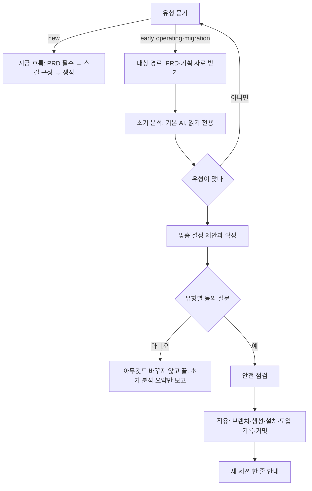

# 프로젝트 유형별 도입, 두뇌 확장과 Task 게이트 설계·실행 계획

2026-10-22 설계, 같은 날 1차 수정. 사용자 결정 세 가지(3절 D5~D7)와 독립 계획 리뷰 지적(High 6, Medium 8), 외부 두뇌 실측(3절 D10)을 반영했다. 구현은 6절의 Task 순서로 하고, Task마다 세부 계획 → 구현 → 검수 → 테스트 → 보완을 거쳐 통과 조건을 모두 채운 뒤 다음 Task로 넘어간다.

## 1. 배경과 목표

지금 `prokit-init`은 PRD를 받아 새 Better-T-Stack 프로젝트를 만드는 흐름 하나뿐이다. 실제로는 이미 진행하던 프로젝트에 프로킷을 들이려는 경우가 많다.

- PRD, 화면 정의서, 디자인 시스템, 프로토타입까지만 있고 개발 환경은 아직 없는 초기 프로젝트
- 개발하고 운영 중인 Next.js 프로젝트
- 다른 언어나 프레임워크로 만든 서비스를 Next.js로 옮기려는 프로젝트

이런 프로젝트는 새 프로젝트처럼 바로 만들 수 없다. 지금 상태를 먼저 분석하고, 그 프로젝트에 맞는 설정을 제안하고, 단계를 나눠 안전하게 적용해야 한다. 두뇌 쪽 요구도 있다. OpenSpec, Spec Kit, Compound Engineering을 쓰는 사용자가 있고, 두뇌를 둘 이상 함께 쓰거나 진행 중에 바꾸고 싶어 한다.

목표:

1. `prokit-init`이 먼저 프로젝트 유형(새 프로젝트, 초기, 운영 중, 전환)을 받는다.
2. 기존 프로젝트(초기, 운영 중, 전환)는 기본 AI가 먼저 읽기 전용으로 초기 분석을 하고, 그 결과로 맞춤 설정(템플릿, 두뇌, 과설계 방지, 추가 스킬, 응답 방식, 화면 디자인 보조, 적용 방식)을 제안한다.
3. 설정이 확정되면 유형별 동의 질문을 하고, 동의하면 적용한다. 적용 뒤 프로젝트 세션에서 `prokit-analyzer`가 정밀 분석을 하고, 두뇌가 단계별 진행 계획을 세운다.
4. 진행 계획은 Task 단위로 나눈다. Task마다 세부 계획, 구현, 검수, 테스트, 보완을 dev-cycle 라운드로 하고, 그 라운드가 완전히 통과해야 다음 Task를 열 수 있다(Task 게이트).
5. 두뇌에 OpenSpec, Spec Kit, Compound Engineering을 더한다. 하나를 추천하되 여러 개를 고를 수 있다.
6. 진행 중에도 두뇌, 과설계 방지 스킬, 추가 스킬, 선택 묶음을 추가·변경·제거하는 `prokit-skills-manage` 스킬을 둔다.
7. `prokit-ui`는 기존 프로젝트에서 리디자인 여부를 먼저 묻는다. 리디자인을 원할 때만 스타일 후보를 내고, 아니면 기존 디자인을 분석해 DESIGN.md 명세에 맞는 `DESIGN.md`를 만든다.
8. 구현이 끝나면 소개, 문서, 가이드를 모두 고친다.

## 2. 용어

| 용어 | 뜻 |
|---|---|
| 프로젝트 유형 | `new`(새 프로젝트), `early`(초기 프로젝트: 기획 자료와 프로토타입만 있음), `operating`(운영 중인 Next.js 프로젝트), `migration`(다른 언어·프레임워크에서 Next.js로 전환). 설치기 인자 `--project-type`과 `.dev-cycle.json`의 `projectType` 값 |
| 초기 분석 | `prokit-init` 세션의 기본 AI가 대상 폴더를 읽기만 하며 하는 분석. 맞춤 설정 제안의 근거다 |
| 정밀 분석 | 적용 뒤 프로젝트 세션에서 `prokit-analyzer` 에이전트가 하는 분석. 진행 계획의 근거다. 결과는 `docs/prokit/analysis.md` |
| 도입 기록 | `docs/prokit/intake.md`. 유형, 초기 분석 요약, 확정한 설정, 동의 질문과 답, 디자인 방향을 적는다. `docs/first-request.md`는 다음 세션에 줄 요청 한 덩어리만 둔다 |
| 진행 계획 | 두뇌가 정밀 분석으로 세운 단계별 계획. 문서는 `docs/plans/`, Task 표는 `tasks/plan.md` |
| Task | 진행 계획의 한 단계. 라운드 하나로 끝낸다. 크면 계획에서 나눈다 |
| Task 게이트 | 앞 Task가 모두 `완료`나 `제외`여야 다음 Task 라운드를 열 수 있게 하는 dev-cycle 규칙 |
| 주 두뇌 | 두뇌를 여럿 고르면 목록의 첫 두뇌. 맡는 단계를 먼저 이끈다 |
| 하네스 먼저 적용(adopt) | Better-T-Stack 구조가 아닌 Next.js 프로젝트에 구조는 그대로 두고 하네스만 설치하는 설치기 방식(`--adopt`) |

## 3. 결정

- **D1 유형 네 가지.** 새 프로젝트는 지금 흐름 그대로다. Next.js가 아닌 운영 프로젝트는 전환(`migration`)으로 본다.
- **D2 PRD.** `new`는 PRD 필수(지금 규칙)다. 나머지 유형은 PRD가 있으면 분석에 쓰고, 없으면 초기 분석이 추천 근거다. 기존 프로젝트의 화면 정의서, 디자인 시스템, 프로토타입, 코드도 PRD 자료로 읽는다.
- **D3 초기 분석은 읽기 전용.** init 세션은 대상 폴더에 파일을 쓰지 않고 분석한다. 동의를 받기 전에는 어떤 파일도 바꾸지 않는다. 동의 뒤 적용 전에 안전 점검을 한다: 작업 트리가 깨끗한지(아니면 멈추고 알린다), 기본 브랜치인지, `prokit/setup` 브랜치가 이미 있는지(있으면 묻는다), 추적 중인 `.env*` 비밀 파일이 있는지.
- **D4 정밀 분석과 계획은 프로젝트 세션에서.** 두뇌와 에이전트는 그 프로젝트에서 연 세션에서만 불러오므로(루트 `AGENTS.md`의 "초기 구성이 끝나면" 규칙), init 세션은 적용과 커밋까지 하고 `docs/first-request.md`에 다음 요청을 적어 새 세션으로 넘긴다. 사용자는 동의를 한 번만 하고, 새 세션은 그 요청대로 정밀 분석부터 이어 간다.
- **D5 운영 중인 Next.js(사용자 결정: 하네스 먼저).** Better-T-Stack 구조면 지금 설치기를 쓴다. 아니면 `install.sh --adopt`로 기존 스택과 폴더를 그대로 두고 하네스만 새 브랜치에 설치한다. 구조 맞추기는 정밀 분석 뒤 Task로 제안한다. 하네스 커밋은 앱 코드를 바꾸지 않으므로 검토 뒤 기본 브랜치에 병합하길 권한다. 사용자가 도입 브랜치에서 계속하겠다고 하면 `--default-branch prokit/setup`으로 기준 브랜치를 기록해 설치 커밋이 라운드 diff에 섞이지 않게 한다(병합한 뒤 첫 H Task에서 되돌린다). adopt의 첫 경로 규칙은 흔한 Next.js 배치로 추정하고(E: prisma·drizzle·migrations, D: `app/api`·`pages/api`·server·trpc, B: app·pages·components·styles), 규칙 밖 코드는 `case F` 규칙으로 무거운 F다(`classify`가 F 규칙을 받게 고쳤다).
- **D6 전환(사용자 결정: 새 폴더).** 새 Next.js 프로젝트를 새 폴더(기본 `../<이름>`)에 만들고 기존 코드와 배포·CI는 건드리지 않는다. 새 프로젝트의 `.dev-cycle.json`에 `legacy.path`로 기존 코드 경로를 적는다. 이 값은 안내용이다: `pnpm dev-cycle status`가 보여 주고 `prokit-analyzer`가 읽는다. 스크립트가 그 폴더를 쓰지 않는다.
- **D7 초기 프로젝트(사용자 결정: 같은 폴더).** 2026-10-22 실측으로 확정한 순서다.
  1. 같은 폴더가 git 저장소가 아니면 `git init`과 첫 커밋부터 한다. 새 브랜치 `prokit/setup`을 만든다.
  2. 루트에는 `.git`만 남기고 모두 옮긴다: 기획 자료(PRD, 화면 정의서, 디자인 시스템 문서)는 `docs/`로, 프로토타입 코드와 그 설정(`package.json`, `.gitignore`, README 등)은 `prototype/`으로 `git mv`하고 커밋한다. Better-T-Stack이 루트의 같은 이름 파일을 덮어쓰기 때문이다.
  3. 상위 폴더에서 `pnpm create better-t-stack@latest <폴더 이름> … --no-git --install --directory-conflict merge`로 그 폴더에 만든다(템플릿 README의 다른 옵션은 그대로).
  4. Better-T-Stack은 만든 뒤 폴더 전체를 포맷해 옮겨 둔 파일의 모양(빈 줄, 세미콜론, 들여쓰기)을 바꾼다. 바로 `git checkout -- docs prototype`으로 원본을 되돌린다.
  5. `install.sh … --project-type early`. 설치기가 `biome.json`에 `!prototype`을 더해 프로토타입을 검사에서 뺀다. turbo·타입 검사는 작업 공간(`apps/*`, `packages/*`)만 보므로 따로 뺄 것이 없다.
  6. 새 프로젝트 절차 3\~9를 마치고 커밋한 뒤 `prokit/setup`을 기본 브랜치에 fast-forward로 병합한다(운영 전이라 브랜치를 오래 두지 않는다. push는 요청할 때만).
  실측: `pnpm check`, `pnpm exec biome check .` 통과, `docs/`·`prototype/` 원본 그대로.
- **D8 Task 게이트.**
  - Task 하나는 라운드 하나다. 상태는 `대기`, `진행`, `완료`, `제외`다.
  - `pnpm dev-cycle table <케이스> --write --title "…" --task T3`는 앞 Task가 모두 문제 없는 `완료`나 `제외`이고 T3이 `대기`나 `진행`일 때만 열린다. 마커에 `task=T3`을 적고 T3을 `진행`으로 바꾼다.
  - `close`가 partial이 아니면 T3을 `완료`로 바꾸고 기록 칸에 보관 파일 경로를 더한다. `close --partial`은 보관 마커에 `partial=true`를 적고 T3을 `진행`으로 둔다. 같은 T3을 다시 `table --task T3`으로 열어 남은 일을 끝낸다.
  - `완료`의 증거는 기록 칸의 마지막 경로다. 그 파일이 `archiveDir` 아래에 있고 보관 마커가 `task=T3`이며 `partial=true`가 아니어야 한다. 손으로 `완료`라고 고친 행은 이 검사에 걸린다.
  - `제외`는 사용자가 그 Task를 하지 않기로 정한 것이다. 기록 칸에 `제외: <사유> (사용자, <날짜>)`를 적는다.
  - 진행 계획이 있으면 `audit`·`close`·`status`가 같은 계획 검사를 돌린다. 계획에 문제가 있으면 audit이 실패한다. `--task` 없이 연 라운드(진행 중 생긴 버그 수정 등)는 허용하되 Task를 끝낸 것으로 세지 않는다.
- **D9 두뇌 복수 선택.**
  - `.dev-cycle.json`의 `brain`은 하나면 문자열, 여럿이면 배열이다. `--brain openspec,superpowers`처럼 쉼표로 준다. 첫 값이 주 두뇌다.
  - 단계 결정: 단계마다 목록 순서에서 그 단계를 맡는 첫 두뇌를 쓴다. 두뇌별 맡는 단계는 `brains/README.md`의 단계 표가 정본이다.
  - 흐름을 강제하는 두뇌(세션 시작 훅이나 전역 지시: superpowers, oh-my, gstack)를 둘 이상 고르면 설치기가 경고한다.
  - 기록 코드: `recordChoices`의 정규식을 문자열과 배열 모두 받게 고친다. 읽는 곳(`skills-setup.mjs`, `install.mjs`의 출력, `install.test.mjs`, `doc-values.mjs`, 스킬 문서)을 함께 고친다. 옛 `skills-setup.mjs`는 배열을 모르므로, 설치기의 옛 판 경고(`OLD_SETUP`)가 배열 기록에도 걸리게 한다.
  - 추천은 하나다.
- **D10 새 두뇌 세 개(2026-10-22 실측).**

  | 두뇌 | Claude Code | Codex·Antigravity·Grok Build | 설치 | 제거 | 남기는 문서 |
  |---|---|---|---|---|---|
  | `openspec` | 스킬 6개(`.claude/skills/openspec-*`)와 명령 `/opsx:*`(`.claude/commands/opsx/`) | 스킬 6개(`.agents/skills/openspec-*`), Antigravity 명령(`.agents/workflows/opsx-*.md`) | 전역 CLI(`npm install -g @fission-ai/openspec@latest`. 스킬이 실행 중에 `openspec` 명령을 부른다. gstack·OMX처럼 그 두뇌를 고를 때만) + 프로젝트 `OPENSPEC_TELEMETRY=0 openspec init --tools claude,codex,antigravity --force --profile core --no-animation` | 생성한 스킬·명령·`.agents/skills/.openspec-target` 삭제 | `openspec/` |
  | `spec-kit` | 스킬 10개(`.claude/skills/speckit-*`) | 스킬 10개(`.agents/skills/speckit-*`) | `uvx --from specify-cli specify init --here --force --non-interactive --integration claude --integration-options="--events false" --script sh --ignore-agent-tools` 뒤 `integration install codex`(같은 옵션). 설치할 때만 uv가 필요하고, 실행 중에는 `.specify/scripts`만 쓴다. 훅을 쓰지 않는다 | 스킬과 `.specify/`의 도구 파일(scripts, templates, workflows, integrations, 설정 json) 삭제 | `specs/`, `.specify/memory/` |
  | `compound-engineering` | 플러그인 `compound-engineering@compound-engineering-plugin`(project scope. 훅·MCP 없음) | skills CLI로 핵심 스킬을 `.agents/skills`에(`agents: codex`. superpowers와 같은 방식). 전역 플러그인은 쓰지 않는다 | 플러그인 설치, skills CLI | 플러그인 제거, skills CLI remove | `docs/plans/`, `docs/solutions/`, `.compound-engineering/` |

  - 새 설치 종류 `init`(openspec, spec-kit): 매니페스트에 `run`(sh 명령), `env`, `marker`(설치 여부를 판정하는 파일 목록), `remove`(sh 명령), `keep`(남기는 경로)을 둔다. `marker`가 있으면 설치본으로 보고, 고르지 않았으면 정리 대상이다.
  - Compound Engineering의 commit·push·PR·worktree·`lfg`·`ce-setup` 스킬은 Codex용으로 설치하지 않는다. Claude 플러그인에는 들어 있으므로 라우팅 규칙 3(코드를 고치거나 커밋·배포하는 두뇌 스킬은 사용자가 요청할 때만)으로 막는다.
  - Spec Kit의 `speckit-taskstoissues`(이슈 트래커 게시)는 쓰지 않는다(mattpocock `to-tickets`를 뺀 이유와 같다).
  - OpenSpec CLI는 기본으로 사용 통계를 보낸다. 끄는 법(`OPENSPEC_TELEMETRY=0`)을 두뇌 파일과 보고에 적는다. 전역 설정은 바꾸지 않는다.
- **D11 스킬 관리.** 새 템플릿 스킬 `prokit-skills-manage`가 고른 구성을 바꾸는 요청을 받는다. `prokit-skills-update`는 이미 고른 스킬을 최신으로 올리는 일만 맡는다(두 스킬 설명에 경계를 적는다). 두뇌와 과설계 방지는 `--brain`·`--simplicity`에 원하는 최종 목록을 주면 나머지를 지운다(지금 동작). 추가 스킬과 선택 묶음은 지금처럼 `--matt`·`--optional`로 더하고, 새 `--drop <이름>[,<이름>]`으로 지운다. 이름은 추가 스킬 목록과 선택 묶음에서 찾는다. 필수 3개와 다른 출처의 같은 이름 스킬은 지우지 않는다(`skills-lock.json` 출처로 확인).
- **D12 기존 프로젝트의 디자인.**
  - 조건: `.dev-cycle.json`의 `projectType`이 `early`, `operating`, `migration`이고 `docs/prokit/intake.md`에 "디자인 방향" 답이 없으면, `prokit-ui`는 첫 새 작업에서 한 번 묻는다: 기존 디자인 유지(추천) 또는 리디자인. `projectType`이 없거나 `new`면 지금 흐름이다.
  - 답은 `docs/prokit/intake.md`의 "디자인 방향"에 날짜와 함께 적는다. 파일이 없으면 그 절만 있는 파일을 만든다.
  - 유지: 스타일 후보를 내지 않는다. `DESIGN.md`가 있으면 그대로 쓴다. 없으면 기존 디자인(운영 화면 코드와 토큰, 디자인 시스템 문서, 프로토타입)을 분석해 DESIGN.md 명세 형식으로 만들고 `@google/design.md lint`로 확인한다(지금 impeccable-map "DESIGN.md 검사"의 lint. 실행이 실패하면 적고 막지 않는다).
  - 리디자인: 지금의 리디자인 흐름(지금 화면 critique, 카탈로그 후보, 스타일 선택)이다.
  - `prokit-ui` SKILL.md의 "이미 만든 화면이 있으면 … 묻지 않는다" 문장과 단계 표 "시각 방향" 행을 이 조건에 맞게 고친다.
- **D13 문서는 구현 뒤.** 구현과 검증이 끝나면 문서 계획(6절 T10)대로 소개, handbook, 튜토리얼, 루트 README, 템플릿 README를 고친다. 다만 매니페스트에서 세는 값(`doc-values`)은 그 값을 바꾼 Task에서 채우고 검사한다.

## 4. 흐름

### 4.1 init 세션(pro-kit 폴더, 작업 폴더, 또는 기존 프로젝트 옆)



- 기존 프로젝트 안에서 세션을 열었으면 pro-kit은 그 옆(`../pro-kit`)에 받는다. 프로젝트 안에 받지 않는다.
- 유형별 동의 질문:
  - early: "지금 프로젝트에 Next.js를 적용하고, 프로토타입을 프로킷 개발 환경으로 옮겨 구현을 이어 갈까요?"
  - operating: "프로킷을 안전하게 적용하려면 정밀 분석부터 해야 해요. 새 브랜치에 하네스를 설치하고 정밀 분석을 시작할까요?"
  - migration: "Next.js 전환을 시작할까요? 안정적으로 전환하려면 지금 프로젝트를 먼저 정밀 분석해요."
- 적용:

  | 유형 | 브랜치·위치 | 만들기 | 설치 |
  |---|---|---|---|
  | early | 같은 폴더, `prokit/setup` | 자료 `git mv` 커밋 → Better-T-Stack(같은 폴더. 방법은 T2 실측) | `install.sh … --project-type early`, 새 프로젝트 절차 3~9 |
  | operating(Better-T-Stack) | 같은 폴더, `prokit/setup` | 없음 | `install.sh … --project-type operating` |
  | operating(그 밖의 Next.js) | 같은 폴더, `prokit/setup` | 없음 | `install.sh … --adopt --project-type operating` |
  | migration | 새 폴더 `../<이름>` | Better-T-Stack | `install.sh … --project-type migration --legacy <기존 경로>`, 새 프로젝트 절차 3~9 |

- 도입 기록 `docs/prokit/intake.md`와 다음 요청 `docs/first-request.md`("prokit-analyzer로 정밀 분석을 하고, 두뇌로 진행 계획을 세운 뒤 Task별로 진행해줘")를 커밋에 넣는다. 설치기가 `유지(템플릿과 다름)`로 남긴 파일은 보고에 적고, 정밀 분석 뒤 첫 H Task에서 옮긴다.

### 4.2 프로젝트 세션

1. `prokit-analyzer`(읽기 전용)가 유형별 점검표로 정밀 분석을 하고 `docs/prokit/analysis.md` 초안을 돌려준다. 메인이 파일로 쓴다.
2. 주 두뇌(없으면 기본 AI)가 분석으로 진행 계획을 쓴다: 문서 `docs/plans/<날짜>-<유형>-plan.md`, Task 표 `tasks/plan.md`. `prokit-reviewer(plan)`이 검토하고 사용자가 확인한다. 분석과 계획은 케이스 A 라운드 하나로 한다(문서만 바뀐다).
3. Task마다 `pnpm dev-cycle table <케이스> --write --title "T1 …" --task T1`로 라운드를 연다. 첫 행에서 그 Task의 세부 계획(파일, 단계, 검사, 완료 조건)을 다시 세우고 `prokit-reviewer(plan)`을 받은 뒤 구현, 리뷰, 테스트, 검증, 보완, 사용자 확인을 한다.
4. `close`가 Task를 `완료`로 표시한다. 다음 Task로 간다.

## 5. 설계 상세

### 5.1 설치기(`install.mjs`, 두 템플릿 공통)
- `--project-type <new|early|operating|migration>`: `.dev-cycle.json`에 `projectType`을 기록한다. 없으면 기록하지 않는다(`new`로 읽는다).
- `--legacy <경로>`: migration일 때만 받는다. `.dev-cycle.json`의 `legacy.path`로 기록한다. 경로가 없으면 오류다.
- `--adopt`: 단계별 수행 여부는 아래와 같다. 세부는 T2에서 `classify`의 기본 케이스를 읽고 정한다.

  | 설치 단계 | 일반 | adopt |
  |---|---|---|
  | preflight | Better-T-Stack 구조 | git 저장소, 루트 `package.json`, 어느 `package.json`엔가 `next`, Node, pnpm |
  | 파일 복사 | `files/` 전부 | 하네스 목록만(아래). 이미 있는 파일은 지금처럼 덮어쓰지 않는다 |
  | `AGENTS.md`·`CLAUDE.md` 블록 | `files/`의 블록 | `adopt/`의 블록(두 템플릿 같음) |
  | 스킬 링크 | `prokit-*` | 같음 |
  | `.dev-cycle.json` 채우기 | commands, 기본 브랜치 | 같음. `rules`는 H만 |
  | package.json scripts | 더함 | 하네스 명령만 더함(있는 이름은 건드리지 않음). resource 래퍼 없음 |
  | `.gitignore` | 더함 | 같음 |
  | biome.json, turbo.json | 고침 | 하지 않음 |
  | SessionStart 키 훅 | 더함 | 같음 |
  | Biome 포맷 | 복사한 파일 | 하지 않음 |
  | 에이전트 생성 | 함 | 같음 |
  | 스킬 설치 | 매니페스트 전부 | `stack` 표시 항목(Better Auth, Neon, Supabase, turborepo) 제외 |

  하네스 목록: `prokit-dev-cycle`, `prokit-verify`, `prokit-web`, `prokit-ui`, `prokit-skills-update`, `prokit-skills-manage`, `.claude/agents/*`, `scripts/`의 dev-cycle·delegation·resource-guard·skills-setup·sync-agents·load-keys, `docs/dev-workflow.md`, `tasks/`, `.dev-cycle.json`, `skills.manifest.json`, `GLOSSARY.md`, `docs/domain/project.md`, `licenses/`.

### 5.2 스킬 설치기(`skills-setup.mjs`, `skills.manifest.json`)
- 칸(`SLOTS`)마다 고른 이름 목록(`names`)과 항목 목록(`items`)을 다룬다. 두뇌만 여럿을 받는다. `leftovers`, `personalOff`, 설치 목록, 전역 도구, 플러그인, Codex 플러그인, OMX, 상태 줄을 목록 기준으로 바꾼다.
- `--check`의 두뇌 줄: `두뇌: openspec(주, 설치됨), superpowers(설치됨)`.
- `init` 종류: 설치는 `marker`가 모두 있으면 건너뛴다. 정리는 `remove`를 실행한 뒤 marker가 남았으면 실패로 알리고, `keep` 경로가 있으면 "남김"으로 알린다. `--check`는 고른 두뇌의 marker가 없으면 누락이다.
- `--drop`: 5.2의 D11.

### 5.3 dev-cycle(`dev-cycle.mjs`)
- `tasks/plan.md`(설정 `planPath`, 기본 `tasks/plan.md`) 블록:
  ```markdown
  <!-- dev-cycle:plan doc=docs/plans/2026-10-23-migration-plan.md -->
  ## 진행 계획: 레거시 PHP 예약 서비스 전환
  | Task | 제목 | 상태 | 기록 |
  |---|---|---|---|
  | T1 | 하네스 경로 규칙 맞추기 | 완료 | tasks/archive/2026-10-23-t1-하네스-경로-규칙-맞추기.md |
  | T2 | 회원 데이터 모델 옮기기 | 진행 | |
  | T3 | 예약 조회 화면 옮기기 | 대기 | |
  <!-- dev-cycle:plan-end -->
  ```
- `pnpm dev-cycle plan [--json]`: 표, 다음에 열 Task, 문제를 보여 준다. 문제가 있으면 exit 1.
- `table … --task Tn`, `close`, `audit`, `status`: D8.

### 5.4 에이전트 `prokit-analyzer`
- `.claude/agents/prokit-analyzer.md`(도구: Read, Grep, Glob, Bash. Write·Edit 없음). `pnpm agents:sync`가 Codex·Antigravity판을 만든다.
- 점검표 정본: `prokit-dev-cycle/references/analysis.md`. 공통(스택·구조·규모, 문서·기획 자료, 테스트·검사, 빌드·배포·CI, 데이터·인증, 보안 위험, 디자인 자산) + 유형별(early: 자료 대응표와 프로토타입 화면 목록, operating: 프로킷 규칙과의 차이·위험 순위·dev-cycle 경로 규칙 후보, migration: 기능·라우트·데이터 대응표, 전환 순서 후보, 병행 운영 방식).
- 응답: 보고서 마크다운과 진행 계획 후보(Task 목록 초안, 위험, 먼저 확인할 질문). 파일은 쓰지 않는다.

### 5.5 스킬 문서
- `prokit-dev-cycle`: 0절에 진행 계획 확인, 새 절 "진행 계획과 Task"(4.2), `references/analysis.md`, `references/project-plan.md`.
- `brains/README.md`: 두뇌 표에 세 두뇌, 단계 표(두뇌별 맡는 단계), 복수 선택과 주 두뇌, 추천 기준 줄, "바꾸는 법"을 `prokit-skills-manage`로. 새 파일 `brains/openspec.md`, `brains/spec-kit.md`, `brains/compound-engineering.md`.
- `process-routing.md`: 두뇌 여럿일 때 단계 결정 규칙.
- 템플릿 `AGENTS.md`·`CLAUDE.md`: "각 항목은 하나만 쓴다"를 고친다.
- `prokit-ui`: D12, `impeccable-map.md`에 "기존 디자인으로 DESIGN.md 만들기".
- `prokit-init`(pro-kit 저장소): 설명(지금은 "이미 만든 프로젝트에는 쓰지 않는다")부터 다시 쓴다. 유형 선택, 초기 분석, 맞춤 제안, 동의, 안전 점검, 유형별 적용, 보고. evals에 유형별 시나리오를 더한다.
- 루트 `AGENTS.md`: "기존 프로젝트에 도입하기" 절(유형별 절차), 템플릿 수정 규칙의 설치 구성 문장.

## 6. Task

공통 통과 조건: 두 템플릿 테스트(`node --test 'templates/<템플릿>/tests/*.test.mjs'`) 통과, 공유 파일 바이트 일치, `files/` 아래 `.mjs`·`.json`은 Biome 형식, pro-kit 문서 검사(`node --test scripts/handbook.test.mjs scripts/doc-values.test.mjs`, `node scripts/doc-values.mjs --check`), 이 문서의 상태 갱신. 독립 리뷰(서브에이전트)는 T1, T2, T3, T8과 마지막 통합 검증에서 한다.

| Task | 내용 | 주요 파일 | 통과 조건(공통 외) | 상태 |
|---|---|---|---|---|
| T1 | 두뇌 복수 선택과 새 두뇌 세 개 설치 | 매니페스트, `skills-setup.mjs`, `install.mjs`(출력·옛 판 경고), 테스트, `doc-values` | 복수 기록(문자열·배열)·정리·검사 테스트, `init` 설치·정리 테스트, 흐름 강제 두뇌 경고 테스트. scratchpad의 Better-T-Stack 프로젝트에 세 두뇌를 실제로 설치·정리 | 완료(2026-10-22): 두 템플릿 319개 통과. 실측: 세 두뇌 동시 설치 → `compound-engineering`만 남기기 → `none`, 문서(`openspec/`, `specs/`, `.specify/memory/`) 보존, `skills:check`·Biome 통과. 두뇌 문서(원래 T5 일부)를 함께 했다 |
| T2 | 설치기 유형·adopt, early 같은 폴더 실측 | `install.mjs`, `adopt/`, 매니페스트 `stack`, 테스트 | early 같은 폴더 생성 실측과 `pnpm check` 통과 방법 기록, adopt preflight·복사 목록·기존 scripts 보존·분류 테스트, scratchpad의 일반 Next.js 앱에 adopt 설치 뒤 `pnpm dev-cycle status`·`skills:check`·`agents:check` 통과 | 완료(2026-10-22): 두 템플릿 326개 통과. 실측: `create-next-app` 앱에 adopt(기존 `AGENTS.md`·스크립트·코드 보존, 스킬 27개, 세 검사 exit 0, `app/about.tsx`→B, `lib/price.ts`→F), early 같은 폴더 생성(D7). `--default-branch` 추가, `load-keys.mjs`를 H 규칙에 넣음 |
| T3 | 진행 계획과 Task 게이트 | `dev-cycle.mjs`, `.dev-cycle.json`(`planPath`), 새 테스트 | 게이트, close·partial, 다시 열기, 제외, 손으로 고친 완료 탐지, audit 연동 테스트 | 완료(2026-10-22): 새 시험 7개, 두 템플릿 335개 통과. 독립 리뷰 High 0, Medium 지적(계획 블록 밖 행, 보관 뒤 계획 갱신 실패, 대기 뒤 진행) 반영 |
| T4 | 스킬 제거와 `prokit-skills-manage` | `skills-setup.mjs`(`--drop`), 새 스킬, `prokit-skills-update` 설명 | 제거 테스트(필수 3개·다른 출처 보호), 스킬 문서 | 완료(2026-10-22): `--drop` 시험, 스킬 문서와 `prokit-skills-update` 경계, 템플릿 `AGENTS.md` 연결. 두 템플릿 337개 통과 |
| T5 | 두뇌 문서와 라우팅 | `brains/*.md`, `process-routing.md`, 템플릿 `AGENTS.md`·`CLAUDE.md`, `prokit-dev-cycle` 0절 | template-docs·skills 테스트, 단계 표와 두뇌 파일 일치 | 완료(2026-10-22): T1에서 카탈로그·단계 표·두뇌 파일 3개·라우팅·템플릿 `AGENTS.md`를, 여기서 `prokit-dev-cycle` 0절을 고쳤다 |
| T6 | `prokit-analyzer`와 진행 계획 절차 | 에이전트, `references/analysis.md`, `references/project-plan.md`, `prokit-dev-cycle`, `docs/dev-workflow.md` | `agents:check`, sync-agents 테스트, 문서 링크 | 완료(2026-10-22): `prokit-analyzer`(읽기 전용), `references/analysis.md`·`project-plan.md`, dev-cycle 6절, adopt의 라운드 끝(배포 PASS: adopt), Task 라운드 앞 두 행(세부 계획·계획 리뷰)을 코드로 강제. 두 템플릿 338개, 문서 검사 67개 통과. 문서 값(스킬 열 개, 에이전트 네 개) 자동 갱신 → 이름을 나열한 문장은 T10에서 맞춘다 |
| T7 | `prokit-ui` 기존 프로젝트 디자인 | `prokit-ui/SKILL.md`, `impeccable-map.md` | 스킬 테스트, D12 조건과 문장 일치 | 완료(2026-10-22): 디자인 방향 질문(한 번, intake.md에 기록), "기존 디자인으로 DESIGN.md 만들기"(명세 절 순서, 지어내지 않기, lint, 사용자 확인), init 초안 답. 회귀 시험 추가. 두 템플릿 339개 통과 |
| T8 | `prokit-init`과 루트 절차 | `prokit-init` 스킬과 evals, 루트 `AGENTS.md`·`CLAUDE.md` | skill-creator 방식 eval(새 판과 옛 판 비교): new PRD 있음, new PRD 없음, early 동의, early 거절, operating Better-T-Stack, operating 일반 Next.js, migration, 유형이 맞지 않음(operating이라 했는데 Next.js 아님) | 완료(2026-10-22): eval 21개(새 8개). 1차 11개 시나리오 22회 실행, 새 판 60/60(100%), 옛 판 51%. 회귀(1·4·10) 같음. 채점 지적(비git 운영 대상, 질문 4개 제한, adopt 템플릿 질문, 두뇌 쏠림) 반영 뒤 2차 16·17 통과. 검토 화면은 scratchpad `prokit-init-workspace/iteration-1/review.html` |
| T9 | 통합 검증 | 전체 | 실제 설치(new, early, operating Better-T-Stack, operating adopt, migration) 한 번씩, 진행 계획 게이트 실사용, `VERIFICATION.md` | 완료(2026-10-22, 한계 있음): scratchpad 실측. new는 T1의 새 Better-T-Stack 설치(`--project-type new` 기록은 시험으로 확인), early 같은 폴더, operating Better-T-Stack(`--default-branch`, Task 게이트 CLI 실사용), operating adopt(`create-next-app`), migration(`legacy.path`, `status`). 두 템플릿 `VERIFICATION.md`에 기록. 통합 리뷰 High 0, Medium 3(계획 표 상태, `prokit/setup`이 기준 브랜치로 적히는 경우 → `--default-branch`를 늘 넘기게 절차 수정, adopt에 없는 스킬·파일 안내) 반영. 한계: 새 프로젝트 세션에서 `prokit-analyzer` 정밀 분석과 진행 계획을 끝까지 돌려 보지 않았다 |
| T10 | 문서 | handbook, tutorials, 루트 README·CONTRIBUTING, 템플릿 README, `docs/common-values.md` | handbook·doc-values 테스트, 문체 검수(`prokit-writing`) | 완료(2026-10-22): 새 쪽 `start/adopt.md`, `concepts/project-plan.md`와 handbook 스무 쪽 남짓, 루트 README·CONTRIBUTING·THIRD_PARTY_NOTICES, 템플릿 README 묶음, `tutorials/start/README.md`. 문서 리뷰 Medium 4·Low 7 반영. 문서 검사 67개, `doc-values --check` 통과. pro-kit-web 반영(sync, 소개·워크플로 쪽)은 요청할 때 한다 |
| T11 | 검수와 테스트 보완 | 전체 | 독립 리뷰(테스트 빈틈, 스킬 문서, 수정분), 템플릿 스킬 실행 평가, 회귀 테스트 | 완료(2026-10-22): 코드 결함 9건(모르는 인자로 설치, adopt 기록 누락, 블록 없는 `tasks/plan.md`가 audit을 막음 등)과 문서 지적을 고쳤다. 두 템플릿 350개 통과. 실행 평가 7개 시나리오에서 이번 판 41/43, HEAD 판 19/43. 평가 세트에 `prokit-skills-manage`와 진행 계획·디자인 방향 시나리오를 더했다. 상세는 템플릿 `VERIFICATION.md` |
| T12 | 실제 프로젝트 시험 | 전체 | [시험 계획](2026-10-22-prokit-init-analyzer-e2e.md)의 유형별 시나리오를 실제 프로젝트와 실제 세션으로 실행, 독립 채점, 찾은 결함 수정과 다시 시험 | 완료(2026-10-22): `prokit-init` 64/64, 프로젝트 세션 49/53(실패는 고친 뒤 다시 시험해 통과). `--plan` 진행 계획 라운드, adopt ESLint, operating 설치 정리, 제외 순서, Supabase `DATABASE_URL`, `pnpm create` 위치, 진행 계획 문서 규칙을 고쳤다. 두 템플릿 352개 통과 |

홈페이지(pro-kit-web) 반영은 이 계획 밖이다. T10이 끝나면 할 일을 보고하고, 사용자가 요청하면 sync·커밋·배포한다.

## 6-1. T10 문서 계획
쪽마다 `prokit-docs`의 공통 절차(순서 표, 이웃 쪽 틀, 원본 대조, 링크, 값 표시)와 `prokit-writing`(handbook·tutorials 해요체, 루트 README·CONTRIBUTING `~습니다`)을 따른다.

| 쪽 | 바꿀 것 |
|---|---|
| `handbook/start/README.md`, `handbook/README.md` | 시작하기 표에 "기존 프로젝트에 도입하기" 행, 한눈에의 PRD 문장을 유형별로 |
| 새 `handbook/start/adopt.md` | 유형 네 가지, 초기 분석과 맞춤 제안, 동의, 유형별 적용(early 같은 폴더, operating 하네스 먼저·Better-T-Stack, migration 새 폴더), 도입 기록, 새 세션에서 정밀 분석과 진행 계획, 프롬프트 예 |
| `handbook/start/what-is-prokit.md`, `prd.md`, `quickstart-service.md`, `after-create.md` | PRD 필수는 새 프로젝트만. 기존 프로젝트는 PRD가 있으면 쓰고 없으면 초기 분석. 기존 프로젝트 링크 |
| `handbook/skills/brains.md` | 두뇌 열 개(새 셋), 하나 권장·여럿 가능·주 두뇌·단계 표 요약, 강제 두뇌 경고, 바꾸기는 `prokit-skills-manage`, `--drop`, 두뇌 문서 남김, 전역 설치(OpenSpec CLI) |
| `handbook/skills/prokit-skills.md`, `install-and-update.md`, `README.md` | `prokit-skills-manage` 행, `--drop`, 스킬 열 개 |
| `handbook/concepts/agent-roles.md` | `prokit-analyzer` |
| 새 `handbook/concepts/project-plan.md`(또는 `dev-cycle.md` 절) | 진행 계획과 Task 게이트(`tasks/plan.md`, `--task`, 상태 네 가지, 세부 계획·계획 리뷰 행, partial, 제외) |
| `handbook/design/ui-flow.md`, `design-md.md` | 기존 프로젝트 디자인 방향 질문, 기존 디자인으로 `DESIGN.md` 만들기 |
| `handbook/templates/installer.md`, `update-existing.md`, `what-it-adds.md` | `--project-type`, `--legacy`, `--adopt`, `--default-branch`, adopt가 복사하는 것과 하지 않는 것. 갱신 반영과 도입의 차이 |
| `handbook/reference/commands.md`, `project-structure.md`, `faq.md`, `tech-stack.md` | `dev-cycle plan`, `table --task`, `skills:setup --brain a,b`·`--drop`, `docs/prokit/`·`tasks/plan.md`·`adopt/`, FAQ(기존 프로젝트, 두뇌 여럿, 두뇌 바꾸기) |
| 루트 `README.md`, `CONTRIBUTING.md` | 기능 줄과 빠른 시작에 기존 프로젝트 도입, 두뇌 선택. CONTRIBUTING의 공유 파일(`adopt/`) |
| 템플릿 `README.md` 두 개 | 설치 옵션 표(새 인자), 두뇌 표(새 셋, 여럿), `--drop` |
| 템플릿 `VERIFICATION.md` 두 개 | 2026-10-22 실측 기록(새 두뇌 판, adopt, early, operating, migration, Task 게이트) |
| `tutorials/` | 시작 과정의 준비물·첫 요청에 기존 프로젝트 안내 링크(다시 쓰지 않고 handbook 링크) |

## 7. 만들지 않는 것
- 운영 중인 프로젝트를 Better-T-Stack 구조로 자동 이전하는 기능. 정밀 분석이 제안하면 Task로 한다.
- 다른 언어 코드를 자동 변환하는 도구. 에이전트가 Task마다 옮긴다.
- Codex·Antigravity·Grok Build용 Compound Engineering 전역 플러그인. 프로젝트 `.agents/skills` 스킬로 대신한다.
- 두뇌를 바꿀 때 그 두뇌가 만든 문서(`openspec/`, `specs/`, `.specify/memory/`, `docs/solutions/`) 삭제. 인계 자료로 남긴다.
- init 세션에서 정밀 분석과 구현 진행(D4).
- Task 하나를 여러 Task 상태로 나누는 기능. 크면 계획에서 Task를 나눈다.

## 8. 위험
- 외부 두뇌의 설치 명령과 생성 파일은 판마다 바뀐다. 매니페스트에 판을 고정하지 않고(템플릿 규칙) 실측한 판(OpenSpec 1.14.3, Spec Kit 1.2.2, Compound Engineering 3.31.0)을 `VERIFICATION.md`에 적는다.
- Spec Kit은 설치할 때 uv가 필요하다. 없으면 설치기가 멈추고 설치 명령을 알린다.
- OpenSpec과 Spec Kit은 `.claude/skills`와 `.agents/skills`에 실제 폴더를 만든다. `prokit-*` 링크 규칙과는 이름이 겹치지 않는다(`openspec-*`, `speckit-*`).
- adopt 프로젝트에는 Better-T-Stack 전용 계층 스킬이 없다. 계층 규칙과 스킬 연결은 정밀 분석 뒤 H Task에서 맞춘다.
- 같은 폴더 생성(early)은 실측 전이다. T2에서 먼저 확인하고, 안 되면 임시 폴더에 만든 뒤 옮기는 방법으로 바꾼다.
