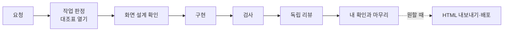

<p align="center"><a href="https://prokit-web.vercel.app/"></a></p>

<h1 align="center">pro-kit-ui</h1>

<p align="center"><strong>프로킷 UI 스킬셋. DB 없이 화면을 만드는 AI 개발 환경</strong></p>

<p align="center">
  <em>코드를 몰라도 괜찮습니다. 평소 말로 요청하면 모든 페이지의 링크와 버튼이 동작하는 화면을 만들고, 검사까지 마친 뒤 넘겨줍니다.</em>
</p>

<p align="center">
  <a href="https://prokit-web.vercel.app/"><strong>프로킷 사이트 보기 →</strong></a><br>
  <sub>같은 흐름으로 만든 화면 프리셋 <!-- v:presets.screen.count -->14<!-- /v -->개를 모든 페이지까지 열어 볼 수 있습니다.</sub>
</p>

<p align="center">
  <a href="https://github.com/roadkwon-ai/pro-kit-ui/tags"></a>
  <a href="LICENSE"></a>
  <a href="https://www.better-t-stack.dev/"></a>
  
  
  
  
</p>

> **사용 전에**: 이 저장소의 프로킷 코드·스킬·문서는 [MIT License](LICENSE)를 따릅니다. 설치할 때 원본 출처에서 받는 외부 스킬에는 각자의 [원래 조건](THIRD_PARTY_NOTICES.md)이 적용됩니다.

<p align="center">
  <strong>PRD로 스킬 추천 &middot; 화면만 프로젝트 &middot; 프로젝트 스킬 6개 &middot; dev-cycle 라운드와 독립 리뷰 &middot; 디자인 스타일 추천·DESIGN.md &middot; 화면 프리셋 팩 &middot; HTML 내보내기 &middot; GitHub Pages·Vercel 정적 배포</strong>
</p>

<p align="center">
  <a href="#ui-스킬셋이란">UI 스킬셋이란</a> &middot;
  <a href="#이렇게-일합니다">일하는 방식</a> &middot;
  <a href="#빠른-시작">빠른 시작</a> &middot;
  <a href="#만들어-본-예시">만들어 본 예시</a> &middot;
  <a href="#얼마나-걸리고-얼마-드나요">시간과 비용</a> &middot;
  <a href="#지원하는-에이전트">지원하는 에이전트</a> &middot;
  <a href="#새-판으로-올리기">새 판</a> &middot;
  <a href="#ui-스킬셋과-pro-스킬셋">Pro 스킬셋</a> &middot;
  <a href="#문서-지도">문서</a> &middot;
  <a href="#라이선스">라이선스</a>
</p>

---

## UI 스킬셋이란
AI 코딩 에이전트가 화면을 만들 개발 환경을 프로젝트에 설치하는 생성기입니다. 만들 서비스를 적은 PRD(누가 쓰고 무엇을 하는지 몇 줄)를 주면, 그 PRD에 맞는 스킬 구성을 추천하고 화면만 만드는 Next.js 프로젝트를 만듭니다. 그 뒤로는 에이전트가 스타일 추천, 화면 설계, 모든 페이지 구현, 검사, 독립 리뷰의 순서를 지키며 일합니다. 사용자는 "첫 화면을 더 따뜻한 느낌으로 바꿔줘"처럼 평소 말로 요청하고 확인 질문에 답하면 됩니다.

DB와 로그인은 쓰지 않습니다. 모든 화면을 예시 데이터로 채우고, 체크나 추가 같은 동작은 화면 안에서 흉내 내 버튼이 실제로 반응하게 만듭니다. 다 만든 화면은 HTML 파일로 내보내거나 GitHub Pages·Vercel에 올립니다.

더 알아보기: [프로킷이란](handbook/start/what-is-prokit.md) · [UI 스킬셋](handbook/design/ui-skillset.md) · [처음 한 시간](handbook/start/first-hour.md) · [처음 보는 용어](tutorials/reference/glossary.md)

## 이렇게 일합니다
이 저장소는 생성기입니다. [Better-T-Stack](https://www.better-t-stack.dev/)이 만든 Next.js 앱 뼈대에 아래 하네스(에이전트가 정해진 순서로 일하게 하는 규칙, 스킬, 자동 검사의 묶음)를 설치하고, 화면 작업은 그렇게 만든 새 프로젝트 폴더에서 합니다. 화면 하나를 만들거나 고치는 작업 한 번(라운드)은 이렇게 흘러갑니다.



처음부터 끝까지는 프롬프트 → 분석과 추천(PRD로 두뇌와 스킬 추천) → 프로젝트 준비 → 기획과 디자인 → 모든 페이지 → 검사와 리뷰 → 내보내기·배포 순서입니다.

| 하네스를 이루는 것 | 하는 일 |
|---|---|
| 규칙 문서 | 에이전트가 시작할 때 `AGENTS.md`, 용어집, 프로젝트 소개를 읽어 새 세션도 같은 원칙으로 화면을 만듭니다 |
| 스킬 | 프로젝트 스킬 6개가 진행 순서, 화면 기획과 디자인, 검사, 프리셋 팩 활용, 스킬 구성 변경, 외부 스킬 갱신을 맡습니다. 전문 작업은 공식·외부 스킬에 맡기고 결과를 검수합니다. 첫 설정은 이 저장소의 `prokit-init`이 합니다. [프로킷 스킬](handbook/skills/prokit-skills.md) · [공식 스킬과 연결](handbook/skills/official-skills.md) |
| 역할 나누기 | 만든 에이전트가 아닌 리뷰 에이전트가 결과를 따로 검토합니다. [위임 에이전트와 리뷰 에이전트](handbook/concepts/agent-roles.md) |
| 대조표와 audit | 작업을 케이스로 나눠 대조표를 열고, 모든 칸에 실행한 증거가 있어야 라운드를 닫습니다. 화면 리뷰 점수는 리뷰 기록 파일과 맞춰 봅니다. [dev-cycle 라운드](handbook/concepts/dev-cycle.md) · [케이스와 대조표](handbook/concepts/cases.md) |
| 자동 검사 | 타입, 린트, 빌드, 화면 디자인, 커밋 전 비밀값을 명령으로 확인합니다. 마감 전에는 개발 화면과 내보낸 HTML에서 모든 링크와 버튼을 눌러 봅니다. [화면만 프로젝트와 HTML 내보내기](handbook/design/screen-only.md) |

화면은 스타일 추천부터 `DESIGN.md`, 모든 페이지까지 [UI/UX 흐름](handbook/design/ui-flow.md)을 따릅니다. 두뇌(진행을 주도하는 스킬 묶음)는 하나를 권하되 여럿을 함께 쓸 수 있고, 과설계 방지 스킬(ponytail 추천)은 하나를 고르거나 고르지 않습니다. 고르는 법은 [두뇌와 선택 스킬](handbook/skills/brains.md)에 있습니다.

그냥 AI에게 맡길 때와 이렇게 다릅니다.

- 사용자 확인이 대조표의 마지막 칸이라, 내가 화면을 보고 확인해야 작업이 끝납니다.
- 검사를 실제로 실행한 증거가 없으면 완료라고 하지 않습니다.
- 사이트맵의 모든 페이지를 만들고, 링크와 버튼을 모두 눌러 404나 "준비 중" 페이지가 남지 않게 합니다.
- 배포 토큰 같은 비밀값은 커밋과 내보낸 HTML에서 걸러 냅니다.

## 빠른 시작
> **PRD부터 정합니다.** UI 스킬셋은 PRD(만들 서비스를 적은 기획 문서)로 프로젝트에 맞는 스킬 구성을 추천하고 개발 환경을 만듭니다. PRD가 없으면 프로젝트를 만들지 않습니다. 몇 줄이면 되고, 적을 것과 주는 법은 [PRD 먼저 정하기](handbook/start/prd.md)에 있습니다.

준비물은 Node <!-- v:node.min -->22.20<!-- /v --> 이상(<!-- v:node.recommended -->24<!-- /v --> 권장), pnpm, git입니다. DB를 띄우지 않으므로 컨테이너 엔진은 필요 없습니다. Windows는 WSL2의 Ubuntu에서 엽니다([준비물](handbook/start/requirements.md)). 에이전트마다 여는 명령은 [지원하는 에이전트](handbook/start/supported-agents.md)에 있습니다.

### 화면만 만들기
작업 폴더(예: `~/projects`)에서 에이전트를 열고 프롬프트 하나를 보내면, 이 저장소를 받는 일부터 화면 만들기와 HTML 내보내기까지 이어집니다.

> https://github.com/roadkwon-ai/pro-kit-ui 를 이 폴더에 받고, 그 안의 AGENTS.md대로 화면만 만들 프로젝트를 그 옆에 living 폴더로 만들어줘. 없는 준비물은 설치해줘. 같이 사는 사람들이 함께 쓴 생활비를 적고, 월말에 누가 누구에게 얼마를 보내면 되는지 알려 주는 서비스를 만들고 싶어. 필요한 화면을 모두 예시 데이터로 만들어줘. 디자인 스타일은 서비스에 어울리는 걸로 추천해주고, 다 만들면 HTML 파일로 내보내줘.

프롬프트에서 서비스를 설명한 문장이 PRD입니다. 끝에 "GitHub Pages에 배포해줘"나 "Vercel에 배포해줘"를 붙이면 인터넷에 올립니다. 이미 받은 `pro-kit-ui` 폴더에서 에이전트를 열었다면 "이 PRD로 화면만 만드는 프로젝트 만들어줘. PRD는 [~/Documents/living-prd.md]에 있어."처럼 요청하고, Claude Code에서는 `/prokit-init <PRD 파일 경로나 내용>`으로 바로 불러도 됩니다. 자세히: [빠른 시작: 화면만 만들기](handbook/start/quickstart-screens.md), 단계별 안내는 [튜토리얼](tutorials/README.md).

### 프리셋 팩으로 시작하기
프리셋 팩은 완성된 화면 프리셋의 화면 구성, 디자인, 예시 데이터, 그림을 묶은 자료입니다. 에이전트가 스타일을 새로 고르거나 원본 사이트를 다시 조사하지 않고, 검증된 결과를 바탕으로 내 서비스를 만듭니다. 프리셋마다 [컨셉으로 화면 만들기](tutorials/samples/README.md) 쪽에 바로 붙여 넣을 프롬프트가 있습니다. 자세히: [프리셋 팩으로 시작하기](handbook/start/quickstart-pack.md).

### 만든 뒤: 새 프로젝트에서 이어 가기
화면 작업은 **새 프로젝트 폴더에서 연 새 세션**에서 합니다. 프로킷 스킬과 에이전트는 그 세션에서만 불러옵니다. 작업 폴더에서 시작했다면 에이전트가 보고 끝에 이어 갈 한 줄을 줍니다.

```bash
cd ../living
.agents/skills/impeccable/scripts/impeccable hooks on   # 화면 디자인 검사 켜기. 작업 폴더에서 시작했다면 이미 켜져 있습니다
claude
```

"요금제 페이지 추가해줘", "모바일에서 메뉴가 겹쳐 보여. 고쳐줘", "HTML로 내보내줘"처럼 평소 말로 요청합니다. 예시 프롬프트는 [만든 뒤 개발하기](handbook/start/after-create.md), 요청 크기 고르기와 멈췄을 때·이어 갈 때 보낼 말은 [요청하고 이어 가는 법](handbook/start/ask-well.md), 작업 한 번의 실제 흐름은 [라운드 한 번 따라가 보기](handbook/concepts/round-example.md)에 있습니다. 인터넷에 올리는 순서는 [GitHub Pages](handbook/deploy/github-pages.md)와 [배포하기 가이드](tutorials/reference/deploy.md)에서 봅니다.

## 만들어 본 예시
같은 화면만 흐름으로 만든 프리셋 중 대표 예시 3개입니다. 사이트맵의 모든 페이지를 갖춰 링크와 버튼이 모두 동작하고, 404나 "준비 중" 페이지가 없습니다.

<table>
<tr>
<td width="50%" valign="top"><a href="https://prokit-web.vercel.app/pro-kit/goru/"></a><br><strong><!-- v:preset.goru.title -->고루<!-- /v --></strong> · <!-- v:preset.goru.kindLabel -->앱 화면<!-- /v --> · <!-- v:preset.goru.field -->공동 생활비 정산<!-- /v --> · 페이지 <!-- v:preset.goru.pages -->7<!-- /v -->개 · <a href="https://prokit-web.vercel.app/pro-kit/goru/">HTML</a> · <a href="tutorials/samples/goru.md">만들어 보기</a><br><sub>위 "화면만 만들기" 프롬프트와 같은 생활비 정산 컨셉으로 실제로 만든 앱</sub></td>
<td width="50%" valign="top"><a href="https://prokit-web.vercel.app/pro-kit/olgot/"></a><br><strong><!-- v:preset.olgot.title -->올곧<!-- /v --></strong> · <!-- v:preset.olgot.kindLabel -->앱 화면<!-- /v --> · <!-- v:preset.olgot.field -->입시학원 수강 신청·상담<!-- /v --> · 페이지 <!-- v:preset.olgot.pages -->203<!-- /v -->개(<!-- v:preset.olgot.pageTypes -->48<!-- /v -->종) · <a href="https://prokit-web.vercel.app/pro-kit/olgot/">HTML</a> · <a href="tutorials/samples/olgot.md">만들어 보기</a><br><sub>이만큼 큰 사이트도 모든 페이지를 같은 흐름으로 만들고 검사합니다</sub></td>
</tr>
<tr>
<td width="50%" valign="top"><a href="https://prokit-web.vercel.app/pro-kit/pacecrew/"></a><br><strong><!-- v:preset.pacecrew.title -->PACECREW<!-- /v --></strong> · <!-- v:preset.pacecrew.kindLabel -->랜딩페이지<!-- /v --> · <!-- v:preset.pacecrew.field -->동네 러닝 크루 매칭<!-- /v --> · 페이지 <!-- v:preset.pacecrew.pages -->22<!-- /v -->개 · <a href="https://prokit-web.vercel.app/pro-kit/pacecrew/">HTML</a> · <a href="tutorials/samples/pacecrew.md">만들어 보기</a></td>
<td width="50%" valign="top"><strong>화면 프리셋 <!-- v:presets.screen.count -->14<!-- /v -->개 전체</strong><br><a href="https://prokit-web.vercel.app/">프로킷 사이트</a>에서 모든 페이지까지 열어 보고, <a href="tutorials/samples/README.md">컨셉으로 화면 만들기</a>에서 같은 컨셉으로 만들어 봅니다.</td>
</tr>
</table>

## 얼마나 걸리고 얼마 드나요
<!-- v:limit.pro5h.plans -->Claude Pro · ChatGPT Plus(Codex)<!-- /v --> 같은 구독 요금제로 만들 수 있습니다. 사용량이 <!-- v:limit.window -->5시간<!-- /v --> 한도에 걸리면 안내된 시간이 지난 뒤 "하던 작업 이어서 해줘"로 이어 갑니다. 위 예시를 프리셋 팩으로 만들 때 걸리는 시간은 이렇습니다.

- <!-- v:preset.goru.title -->고루<!-- /v -->(페이지 <!-- v:preset.goru.pages -->7<!-- /v -->개): <!-- v:preset.goru.pack.time.text -->한 번에 완성하면 약 1시간\~2시간(여러 번 고쳐 달라고 하면 약 3시간까지)<!-- /v -->
- <!-- v:preset.pacecrew.title -->PACECREW<!-- /v -->(페이지 <!-- v:preset.pacecrew.pages -->22<!-- /v -->개): <!-- v:preset.pacecrew.pack.time.text -->한 번에 완성하면 약 2시간 5분\~4시간 10분(여러 번 고쳐 달라고 하면 약 6시간 15분까지)<!-- /v -->
- <!-- v:preset.olgot.title -->올곧<!-- /v -->(페이지 <!-- v:preset.olgot.pages -->203<!-- /v -->개): <!-- v:preset.olgot.pack.time.text -->한 번에 완성하면 약 3시간 55분\~7시간 50분(여러 번 고쳐 달라고 하면 약 11시간 45분까지)<!-- /v -->

여러 번 고치면 왜 늘어나는지, 토큰과 API 요금 환산, 이미지 키는 [비용과 키](tutorials/reference/costs-and-keys.md)에, 단계마다 실제로 얼마나 걸렸는지는 [만드는 과정과 걸리는 시간](tutorials/reference/process-and-time.md)에 있습니다.

## 지원하는 에이전트
<!-- v:agents.list -->Claude Code, Codex, Antigravity, Grok Build<!-- /v --> <!-- v:agents.count -->4<!-- /v -->개를 지원합니다. 어느 것으로 열어도 같은 규칙과 스킬로 일하고, 도구마다 읽는 파일 위치, 서브에이전트, 이미지 그리기 도구, 여는 명령만 다릅니다. 표와 확인한 범위는 [지원하는 에이전트](handbook/start/supported-agents.md)에 있습니다.

## 새 판으로 올리기
이 저장소의 새 판은 [태그](https://github.com/roadkwon-ai/pro-kit-ui/tags)로 나옵니다. 받은 폴더를 최신으로 맞춘 뒤(`git pull`), 그 폴더에서 연 에이전트에게 "템플릿 변경을 [living]에 반영해줘"라고 요청합니다. 에이전트가 차이와 옮길 항목을 정리해 주면, 실제 반영은 그 프로젝트에서 연 세션이 작업 한 번(라운드)으로 합니다. 그 프로젝트가 스스로 고친 내용은 덮어쓰지 않습니다. 자세히: [갱신 반영](handbook/templates/update-existing.md).

## UI 스킬셋과 Pro 스킬셋
UI 스킬셋은 [Pro 스킬셋(pro-kit)](<!-- v:link.repo -->https://github.com/roadkwon-ai/pro-kit<!-- /v -->)에서 화면 작업에 필요한 것만 담았습니다. 화면을 만들고 검사하는 규칙과 스킬은 두 스킬셋이 같습니다.

| 항목 | UI 스킬셋 (이 저장소) | Pro 스킬셋 (`pro-kit`) |
|---|---|---|
| 만드는 것 | 예시 데이터로 채운 화면, HTML 파일 | 화면과 함께 로그인·저장이 되는 실제 서비스 |
| 템플릿 | `prokit-next-neon`(화면만) | Neon, Supabase 템플릿 두 개 |
| 프로킷 스킬 | 첫 설정(`prokit-init`), 진행(`prokit-dev-cycle`), 화면(`prokit-ui`), 검사(`prokit-verify`), 팩 활용(`prokit-pack-use`), 스킬 구성 변경(`prokit-skills-manage`), 스킬 갱신(`prokit-skills-update`) | UI 스킬셋의 스킬과 화면 동작·API·DB·배포 스킬 |
| 화면 프리셋 팩 | 쓸 수 있습니다 | 쓸 수 있습니다 |
| 올리는 곳 | GitHub Pages, Vercel(정적 HTML) | 화면은 같고, 서비스는 Vercel의 개발·운영 환경에 버전 릴리스와 함께 올립니다 |
| 클론 코딩 튜토리얼, 기존 프로젝트 도입 | 없습니다 | 있습니다 |

### Pro 스킬셋으로 올리기
화면만 만든 프로젝트를 로그인·저장이 되는 실제 서비스로 바꾸려면 Pro 스킬셋이 필요합니다. `pro-kit`을 받은 폴더에서 에이전트를 열고 "템플릿 변경을 [프로젝트 경로]에 반영해줘"라고 요청하면, 빠진 서버 스킬과 바뀐 파일을 알려 주고 그 프로젝트의 세션에서 옮기게 안내합니다. 그 뒤 그 프로젝트 세션에 "실제 서비스로 바꿀 거야"라고 요청합니다.

## 문서 지도
| 어디 | 무엇이 있나요 |
|---|---|
| [문서(handbook)](handbook/README.md) | [시작하기](handbook/start/README.md), [핵심 개념](handbook/concepts/README.md), [템플릿](handbook/templates/README.md), [스킬과 에이전트](handbook/skills/README.md), [디자인](handbook/design/README.md), [배포](handbook/deploy/README.md), [레퍼런스](handbook/reference/README.md). 화면만 만드는 데 필요한 쪽을 담았습니다 |
| [튜토리얼](tutorials/README.md) | 코드를 몰라도 프롬프트를 붙여 넣으며 화면을 만드는 단계별 안내. [시작하기](tutorials/start/README.md), [컨셉으로 화면 만들기](tutorials/samples/README.md), 비용과 키·배포·용어·문제 해결·Windows 가이드 |
| [AGENTS.md](AGENTS.md) | 에이전트가 화면만 프로젝트를 만들 때 따르는 절차와 이 저장소의 규칙 |
| [프로킷 사이트](https://prokit-web.vercel.app/) | 화면 프리셋을 모든 페이지까지 열어 보는 곳. 사이트의 문서에는 Pro 스킬셋 내용도 함께 있습니다 |

## 이 저장소에 대해
이 저장소는 [pro-kit](<!-- v:link.repo -->https://github.com/roadkwon-ai/pro-kit<!-- /v -->)에서 생성한 읽기 전용 사본입니다. pro-kit을 릴리스할 때 같은 버전 태그로 다시 만들어지고, 올라간 내용이 원본으로 만든 판과 같은지 확인한 뒤에 릴리스가 끝납니다. 파일을 직접 고치지 말고, 이슈와 기여는 pro-kit에 남겨 주세요.

## 라이선스
프로킷의 독자 코드·스킬·문서는 [MIT License](LICENSE)로 제공합니다. 외부 스킬은 설치 목록을 통해 원본 출처에서 따로 받으며, [제3자 안내](THIRD_PARTY_NOTICES.md)에 적은 원래 조건이 적용됩니다. 만든 앱 전체나 사용자가 직접 쓴 코드의 저작권은 프로킷을 쓴다고 바뀌지 않습니다. 별도 프리셋 팩은 그 팩에 적힌 조건을 확인합니다.
