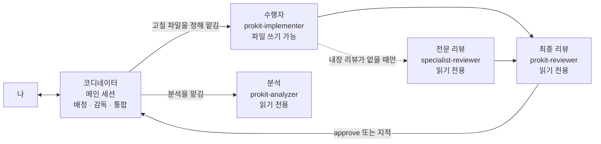
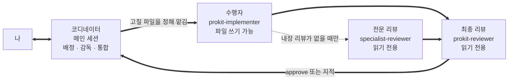

# 위임 에이전트와 리뷰 에이전트

> 한눈에: 프로킷은 공식 전문 스킬과 수행자에게 전문 작업을 맡기고, 코디네이터가 배정·감독·통합·최종 검수를 맡게 해요. 구현 수행자는 승인한 파일만 고치고, 분석·리뷰 에이전트는 파일을 읽기만 해요. **자기가 만든 변경을 자기가 승인하지 않게 하려는 거예요.**

## 왜 나눠 두나

같은 에이전트가 만들고 스스로 "잘 됐다"고 승인하면 실수를 못 잡아요. 사람 팀에서 작성자와 리뷰어를 나누는 것과 같은 이유예요. 프로킷은 일을 맡는 에이전트를 역할별로 나누고, 파일을 고칠 수 있는 쪽과 읽기만 하는 쪽을 구분해요. 용어는 [처음 보는 용어](../../tutorials/reference/glossary.md#도구)에서 찾아요.

## 만든 쪽과 검토하는 쪽이 다르다

<!-- edition:pro -->

<!-- /edition -->
<!-- edition:ui

-->

| 역할 | 파일을 고치나요 | 내가 알아 둘 점 |
|---|---|---|
| 코디네이터(메인 세션) | 직접 쓰기도 해요(루트 설정 등) | 내가 대화하는 에이전트예요. 완료를 선언하기 전에 audit을 통과해야 해요 |
| 수행자 `prokit-implementer` | 승인한 파일만 | 커밋, push, 배포, DB 적용은 하지 않아요 |
| 전문 리뷰 `specialist-reviewer` | 읽기만 | 전문 공급자에 자체 리뷰가 없을 때만 불러요 |
| 최종 리뷰 `prokit-reviewer` | 읽기만 | 매 라운드 새로 받아요. 대신 승인해 주는 다른 리뷰는 없어요 |
| 분석 `prokit-analyzer` | 읽기만 | 기존 프로젝트를 도입할 때 정밀 분석을 해요 | <!-- edition:pro -->

**내가 하는 일**: 없어요. 보고에 `prokit-reviewer(code): approve …`가 보이는지만 확인하면 돼요.

아래 표는 각 에이전트의 도구와 금지 사항을 정확히 적은 자세한 설명이에요. 위 표로 충분하면 접어 둔 채로 넘어가도 돼요.

## 코디네이터와 <!-- edition:pro --><!-- v:prokit.agents.count.ko -->네<!-- /v --><!-- /edition --><!-- edition:ui 세 --> 에이전트

<details>
<summary>에이전트별 도구와 금지 사항 표 보기</summary>

| 에이전트 | 맡는 일 | 쓸 수 있는 도구 | 하지 않는 일 |
|---|---|---|---|
| 코디네이터(메인 세션) | 전문 스킬·수행자에 작업과 검사 소유권을 배정하고, 대조표·재지시·최종 통합을 관리해요 | 프로젝트가 허용한 도구 | 구현 수행자나 리뷰어 대신 전문 작업을 하지 않고, 완료를 선언하지도 않아요 |
| `prokit-implementer` | 검증한 전문 공급자를 연결하는 호환 구현 어댑터예요. 코디네이터가 정한 파일만 만들거나 고치고, 지정한 검사를 실행해요 | 읽기, 쓰기, 고치기, 셸, 검색, 스킬 | 승인 없는 경로·루트 설정 변경. `git stash`·`git reset`·`git checkout -- <파일>`처럼 작업 트리를 되돌리는 명령(다른 작업자의 변경이 함께 사라져요). 커밋, push, 배포, <!-- edition:pro -->DB 마이그레이션 적용, <!-- /edition -->외부 서비스 호출, 비밀값 출력 |
| `specialist-reviewer` | 공급자에 내장 리뷰가 없을 때만 그 전문 산출물, 실제 계약, 증거 패킷을 읽기 전용으로 검토해요 | 읽기, 검색, 읽기용 셸(`git diff`, `git show` 등) | 일반 코드 리뷰 반복. 파일 만들기와 고치기. 테스트, 빌드, 설치, DB 명령, 서브에이전트 실행 |
| `prokit-analyzer` | 프로킷을 들인 기존 프로젝트를 읽기 전용으로 정밀 분석하고, 보고서와 진행 계획 후보를 돌려줘요. 보고서는 메인이 `docs/prokit/analysis.md`에 써요. 보고서를 쓰는 규칙은 아래 "코디네이터가 하는 일"에 있어요 | 읽기, 검색, 읽기용 셸 | 파일 만들기와 고치기. 설치, 빌드, 테스트, DB 명령, 네트워크 요청. 비밀값 출력 | <!-- edition:pro -->
| `prokit-reviewer` | 계획과 전체 통합을 읽기 전용으로 검토하고 실제 계약, 증거 해시, 통합 수용 여부를 JSON 하나로 돌려줘요 | 읽기, 검색, 읽기용 셸(`git diff`, `git log` 등), 스킬 | 파일 만들기와 고치기. 테스트, 빌드, 설치, DB 명령 실행 |

</details>

> [!IMPORTANT]
> 대조표의 통합 리뷰 행(`prokit-reviewer(...)`)은 반드시 `prokit-reviewer`에게 맡겨요.

`prokit-implementer`는 기존 위임 이름을 유지하는 호환 어댑터예요. 전문 공급자에 자체 리뷰가 있으면 그 범위를 증거 패킷에 적고, `specialist-reviewer`를 다시 부르지 않아요. 전문 스킬의 리뷰 증거는 같은 출처·계약·환경일 때만 재사용하고, `prokit-reviewer`의 새 최종 게이트는 매 라운드 다시 받아요.

`prokit-analyzer`는 기존 프로젝트를 도입할 때와 큰 일의 진행 계획을 세우기 전에 불러요. 리뷰어가 아니라 계획의 입력을 만드는 에이전트예요([정밀 분석과 진행 계획](project-plan.md), [기존 프로젝트에 도입하기](../start/adopt.md)). <!-- edition:pro -->

## 자세히

### 리뷰가 보는 것

코디네이터가 focus, 대조표 마커의 기준 커밋(base SHA), 검토할 파일 목록, 대조표 경로, 증거 패킷 해시를 줘요. `prokit-reviewer`는 focus에 맞는 스킬을 먼저 읽고 diff와 주변 코드를 봐요.

| focus | 먼저 읽는 것 | 확인하는 것 |
|---|---|---|
| `plan` | `prokit-dev-cycle`의 재사용·설정 참조, 고른 과설계 방지 스킬의 계획 기준(없으면 내장 재사용 순서), 해당 계층 스킬. <!-- edition:pro -->진행 계획과 Task 세부 계획이면 `project-plan.md`와 테스트 러너 규칙 <!-- /edition -->| 바꿀 파일과 대조표 케이스(가벼우면 수정안은 `--upgrade`), 사용자 결정을 바꾸는 지적 표시, 실제 기존 경로와 소비자, 공통 모듈의 책임, 환경 변수·설정 정본, 불필요한 추상화, 회귀 검사 |
| `code` | <!-- edition:pro -->`prokit-web`, `prokit-api`<!-- /edition --><!-- edition:ui `prokit-ui` -->, `GLOSSARY.md`, `docs/domain/project.md`, React가 바뀌었으면 `vercel-react-best-practices` | 정확성, 오류와 경계 처리, Server·Client Component 경계, 데이터 화면의 네 가지 상태, 불필요한 복잡도, 테스트가 동작을 실제로 검증하는지, 용어집과 어긋나는 새 이름, `docs/domain/project.md` 표에 빠진 항목 |
| `security` | `prokit-api`, `better-auth-security-best-practices` | 세션 없는 접근, 입력으로 받은 소유자 id, where 조건의 소유자 누락, 출력에 섞인 내부 필드, 비밀값의 클라이언트 노출, 인증 설정 | <!-- edition:pro -->
| `db` | `prokit-db`, `supabase-postgres-best-practices` | 생성 SQL의 데이터 손실, 파괴적 변경의 단계 분리, FK·인덱스·nullable·기본값, `db:push` 흔적, 적용된 마이그레이션 파일의 사후 수정 | <!-- edition:pro -->

계획 리뷰에는 스펙·계획·화면 설계와 결정 위치, 재사용 후보 파일도 줘요. 리뷰어는 문서의 주장을 실제 파일과 대조해요. F의 계획 리뷰는 두뇌의 계획 리뷰가 없어도 수행하고 N/A로 넘기지 않아요. 구현 전에 지적을 반영하거나 근거를 적어 기각해요.

supabase 템플릿은 db focus에서 `supabase` 스킬도 읽고, RLS를 끈 `public` 테이블과 `supabase db push` 흔적, Data API 노출을 함께 봐요. security focus에서는 `service_role` 같은 비밀 키가 `NEXT_PUBLIC_`으로 새는지, 합의 없이 들어온 supabase-js나 Supabase Auth가 있는지도 봐요. <!-- edition:pro -->

지적마다 파일과 줄, 근거, 최소 수정안을 적어요. 확인하지 못한 추측은 지적으로 올리지 않고 한계(`limitations`)에 적어요.

<details>
<summary>리뷰어가 돌려주는 JSON 꼴</summary>

```json
{"verdict":"approve|changes-required|blocked","focus":"plan|code|security|db","skills_read":["실제로 읽은 스킬 이름"],"max_severity":"none|low|medium|high|critical","findings":[{"severity":"high","file":"경로","line":42,"evidence":"근거","fix":"수정안"}],"limitations":["확인하지 못한 것"]}
```

</details>

- high 이상 지적이 있으면 approve를 내지 않아요.
- diff나 파일을 읽을 수 없으면 `blocked`예요.

### 코디네이터가 하는 일

- 리뷰 결과를 증거 칸에 요약해요. 예: `prokit-reviewer(code): approve, max=low, 지적 2 (반영 1, 기각 1: 재현 안 됨)`.
- `skills_read`에 focus 스킬이 빠졌으면 읽고 다시 리뷰하게 해요.
- 지적은 직접 확인한 뒤에만 고쳐요. high 이상 지적을 고쳤으면 같은 focus로 다시 리뷰받아요. 응답이 없거나 JSON이 깨졌으면 `blocked`로 적어요.
- 코드 리뷰 행에서는 고른 과설계 방지 스킬의 검토 결과도 함께 적어요(예: `ponytail-review: 반영 2(Must fix 1), 기각 1, 백로그 1`). 검토 스킬이 없으면 `prokit-reviewer`가 간결성까지 봐요. 정확성·보안 지적은 회귀 테스트를 더한 뒤 반영하고, 간결성 규칙으로 기각하지 않아요. 스킬별 동작(Codex의 네이티브 스킬 포함)은 [공식 스킬과 연결](../skills/official-skills.md)과 [두뇌와 선택 스킬](../skills/brains.md)에 있어요.
- 구현을 맡길 때는 아래를 줘요. 정확한 파일 목록, 읽을 `prokit-*` 스킬, 재사용·설정 결정 위치, 선택한 공급자의 실제 출처·해시·범위, 완료 조건과 담당 검사예요. 여러 개를 나란히 맡길 때는 파일·생성 산출물·소비자가 겹치지 않게 나누고, 작은 관련 작업은 같은 수행자에게 묶어요. `AGENTS.md`, `.dev-cycle.json`, `package.json`, 루트 설정은 직접 고치되 파일을 명시해 배정하면 수행자가 그 파일만 고칠 수 있어요.
- 공급자의 내장 리뷰가 없을 때만 `specialist-reviewer`에 전문 계약 검토를 맡겨요. 이 결과는 통합 리뷰를 대신하지 않아요. `prokit-reviewer`는 매번 전체 계약과 증거 해시를 다시 확인해요. 패킷과 `--context`는 검토 자료라서 메인 세션이 승인했다는 증명이 아니며, 최종 게이트는 메인 세션의 런타임이 현재 작업 식별자에 묶어요. 응답·근거가 모자라면 필요한 내용을 최대 두 번 재지시하고, 해소하지 못하면 `unknown` 또는 `blocked`로 남겨요.
- `prokit-analyzer`의 보고서를 쓸 때는 판, 개수, 파일 이름을 이번에 연 파일에서만 옮겨요(`package.json`이 `catalog:`면 `pnpm-workspace.yaml`을 열어요). 경로는 상대 경로로 적고, 열지 못한 것은 "확인하지 못한 것"에 남겨요. <!-- edition:pro -->
- impeccable `critique`처럼 서브에이전트를 스스로 띄우는 스킬은 메인 세션에서 실행해요.

### 에이전트 도구마다 읽는 파일

에이전트의 정본은 `.claude/agents/`에 있어요. Claude Code와 Grok Build는 이 파일을 그대로 읽고, Codex용 `.codex/agents/`와 Antigravity용 `.agents/agents/`는 이 정본에서 자동으로 만들어요.

```bash
pnpm agents:sync    # .claude/agents에서 .codex/agents와 .agents/agents를 다시 만든다
pnpm agents:check   # 정본과 생성물이 맞는지 검사한다
```

`.claude/agents` 정의 파일에는 쓸 모델도 적혀 있어요. 구현과 전문 리뷰는 `sonnet`, 분석과 최종 리뷰는 `opus`예요. Codex·Antigravity용 파일에는 모델을 적지 않아요. Codex는 사용자 설정(`config.toml`)에 `[agents] default_subagent_model`이 있으면 하위 에이전트를 그 모델로 띄우니, 세션과 같은 모델을 쓰려면 그 값을 확인해요. 읽기 전용 리뷰 에이전트는 파일을 읽고 찾고 명령을 실행하는 도구만 받아요.

Codex에서는 분석과 리뷰 에이전트를 메인 대화 없이(`spawn_agent`의 `fork_turns: "none"`) 띄워요. 기본값은 메인 대화를 모두 넘겨서, 구현 과정을 본 채로 리뷰하게 되기 때문이에요.

## 관련 문서

- [하네스 엔지니어링](harness.md)
- [위임과 자원 관리](delegation-and-resources.md)
- [dev-cycle 라운드](dev-cycle.md)
- [정밀 분석과 진행 계획](project-plan.md)
- [케이스 <!-- v:devCycle.cases.range -->A\~F·H<!-- /v -->와 대조표](cases.md)
- [prokit 스킬 <!-- edition:pro --><!-- v:prokit.skills.count -->10<!-- /v --><!-- /edition --><!-- edition:ui 6 -->개](../skills/prokit-skills.md)
