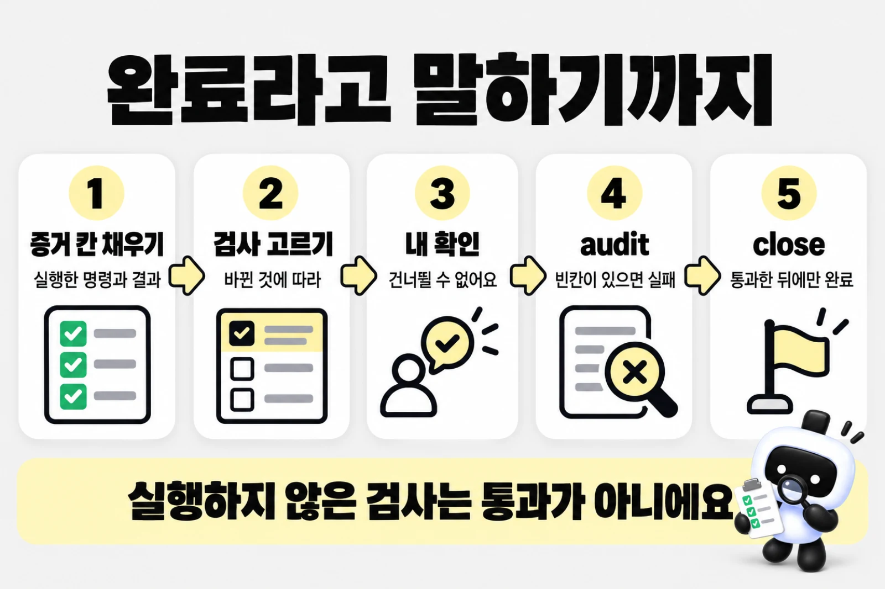
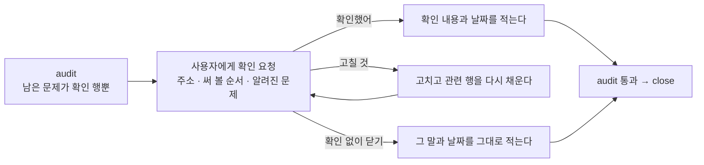

# 증거와 audit, 사용자 확인

> 한눈에: 대조표의 칸은 실제로 실행한 명령과 결과로만 채워요. 칸을 다 채웠는지는 `audit` 명령이 검사하고, 통과해야 완료라고 말해요. 마지막 칸은 사용자가 결과를 직접 보고 확인하는 칸이라 건너뛸 수 없어요.

## 증거 적는 법

> [!IMPORTANT]
> 원칙은 하나예요. 실행하지 않은 검사는 통과가 아니에요.

증거 형식은 `prokit-verify` 스킬이 정해요.

| 무엇 | 이렇게 적어요 |
|---|---|
| 명령 | `pnpm check-types → exit 0`. 실패하면 첫 오류 한 줄 |
| 테스트 | `vitest todo.isolation → 3 passed` |
| 리뷰 | `prokit-reviewer(code): approve, max=low, 지적 2 (반영 1, 기각 1: 재현 안 됨)` |
| 스킬 사용 | `사용: 내장(계획) → docs/plans/…`. 두뇌를 골랐으면 `사용: superpowers:writing-plans → docs/superpowers/plans/…`처럼 실제 스킬과 산출물을 적어요 |
| 같은 명령을 여러 행이 요구할 때 | 한 번 실행하고 뒤 행에는 `6행과 같음: pnpm check-types → exit 0`. 그사이 해당 검사의 입력이 바뀌었거나 변경 영향을 확인하지 못했으면 다시 실행 |
| 해당 없는 행 | `N/A: 사유` |

- F의 `prokit-reviewer(plan)` 행에는 리뷰어의 `approve`와 `max=none|low|medium`을 적어요. N/A나 일반 검사 결과로 넘기지 않아요. 두뇌의 계획 리뷰가 없어도 프로젝트 리뷰어로 수행해요. 도구 실패는 `blocked: 사유`로 남기고 부분 완료로 보고해요.
- `✓`, `ok`, `done`, `완료`만 적거나 공백을 뺀 4자 미만으로 적으면 증거가 아니에요.
- 결과를 얻지 못했으면 `blocked: 사유`나 `미실행: 사유`로 적어요. `blocked`는 이번 세션에서 해소할 수 없는 원인(외부 서비스, 권한, 사용자 허락 없이 설치할 수 없는 도구 등)에 쓰고, `미실행`은 사용자가 범위에서 뺀 단계나 앞 단계가 blocked여서 할 수 없는 뒤 단계에 써요.
- 테스트 러너(vitest 도입 행)나 로컬 테스트 DB처럼 라운드 안에서 준비하기로 된 것이 없다는 이유로는 `blocked`를 쓰지 않고 그 준비부터 해요.
- 다른 검사가 통과했다고 해서 실행하지 못한 검사를 통과로 합치지 않아요.
- 이전 결과를 쓸 때는 실제 실행 증거와 조건이 같은지 확인하고 `재사용`으로 적어요. 재시도 뒤 성공한 검사는 `flaky`로 남겨요. 해결되지 않은 검사 불안정을 통과로 바꾸지 않아요. 범위와 조건은 [검사 재사용 기준](delegation-and-resources.md#독립-작업을-나눠서-확인하기)을 따라요.
- 전문 공급자의 내장 리뷰는 같은 검토 범위만 재사용해요. 빈 전문 관점만 보완하고, 대조표의 `prokit-reviewer` 최종 리뷰는 현재 변경과 증거 해시로 새로 받아요.
- 비밀값, 토큰, 연결 문자열, 실사용자 데이터는 증거에 옮겨 적지 않아요.

설계 증거는 `기존: 경로·소비자; 결정: 재사용·분리; 설정: 환경 변수·설정 영향; 검증: 회귀 검사`로 적어요. 환경 변수·설정이 바뀌지 않으면 그 항목에 변경 없음을 적어요.

두뇌를 골랐다면 단계 행(행 문구에 `요구 명확화 단계`·`계획 단계`·`구현 단계`·`디버깅 단계`·`고른 두뇌의 계획 방법`이 든 행)의 증거는 다음 중 하나여야 해요.

| 꼴 | 뜻 |
|---|---|
| `사용: <이름>` | 이름이 고른 두뇌 파일에 백틱으로 적혀 있어요(예: `사용: agent-skills:planning-and-task-breakdown`). `prokit-implementer` 같은 하네스 이름은 두뇌 방법으로 치지 않아요 |
| `사용: <스킬>(추가 스킬)` | 이 프로젝트에 설치한 mattpocock 추가 스킬(`skills-lock.json`)이에요 |
| `사용: 내장(<단계>): <사유>` | 두뇌의 스킬을 쓰지 않은 사유가 있어요. 단계와 사유를 비울 수 없어요 |

`N/A:`, `blocked:`, `미실행:`은 평소 규칙대로예요. 두뇌가 `none`이면 이 검사는 하지 않아요. 단, audit은 **이름만 확인해요.** 에이전트가 그 스킬을 실제로 불렀는지는 대화 기록을 보지 않으니 알 수 없고, 그 부분은 리뷰와 사용자 확인이 받쳐 줘요.

audit은 행 누락, 설계 필수 항목, 리뷰 승인 형식도 확인해요. 화면 리뷰 행은 실행 기록도 봐요. critique는 스스로 남긴 `.impeccable/critique/` 기록 파일을, audit은 `tasks/evidence/`에 저장한 보고서를 증거에 적어야 해요. 그 파일이 이번 라운드에 쓴 것이고 점수가 증거와 같아야 통과해요. 재사용·설정 판단이 옳은지, 스킬을 실제로 적용했는지는 독립 리뷰와 동작 평가로 확인해요.

## 검사 고르기

바뀐 것에 따라 최소 검사가 정해져 있어요. 여러 줄에 해당하면 모두 해요.

| 바뀐 것 | 최소 검사 |
|---|---|
| 모든 코드 | 타입 검사(`commands.typecheck`), 린트(`commands.lint`) |
| 화면과 라우트 | 모든 코드 검사 + 빌드, 런타임 확인, desktop(1440px)과 mobile(390px) 스크린샷 |
| 프로시저와 인증 | 모든 코드 검사 + 테스트, 2계정 격리 테스트 | <!-- edition:pro -->
| 스키마 | 모든 코드 검사 + 로컬 개발 DB에 마이그레이션 적용(병합 전에는 원격 개발 DB에도). 사용자 소유 테이블이면 2계정 격리 테스트도. supabase는 `supabase db advisors` 보안 결과도(병합 전에는 스테이징에도) | <!-- edition:pro -->
| 스킬, 에이전트, dev-cycle | `pnpm agents:check`, `pnpm skills:check`, `pnpm dev-cycle case`, `pnpm dev-cycle status`. 스킬 본문을 바꿨으면 skill-creator eval |
| 빌드·배포·작업공간 설정 | `pnpm build`와 타입·린트 검사. 스크립트, CI, 배포 설정, `.dev-cycle.json` 규칙을 바꿨으면 `prokit-reviewer(code)`도 |

명령은 `.dev-cycle.json`의 `commands`에 있어요. 린트 증거는 파일을 고치지 않는 `pnpm exec biome check .`로 남겨요. `pnpm check`는 파일을 고치므로 증거로 쓰지 않아요.

**오류 예산은 0이에요.** 확인한 화면마다 아래를 세요.

- 브라우저 콘솔의 오류와 경고
- 개발 오버레이의 Issues
- Next.js 진단(`get_errors`)
- 개발 서버 로그의 오류

브라우저 확장 탓으로 보이는 항목도 빼지 않고, 깨끗한 브라우저에서 재현해 원인을 가려요. `prokit-verify`의 브라우저 샘플 스크립트는 콘솔 오류·경고, 잡히지 않은 오류, 모바일 가로 넘침을 `결함:` 줄로 출력해요. 브라우저가 직접 남기는 `Failed to load resource` 줄은 여기에 잡히지 않아서 `get_errors`로 함께 봐요.

> [!WARNING]
> `pnpm dev`를 띄우기 전에 `lsof`로 포트 3001을 확인하고, 다른 프로세스가 쓰고 있으면 끄거나 포트를 바꾸지 않고 사용자에게 알려요.

## audit

`pnpm dev-cycle audit`은 대조표를 검사해요.

- 빈칸이 있으면 실패해요.
- 작업이 다른 계층을 건드렸으면 케이스를 올리라고 알려 줘요.
- 화면 리뷰 행(critique, audit)은 증거에 적은 기록 파일이 있고, 이번 라운드를 연 뒤에 쓰였고, 점수가 증거와 같은지 봐요. `blocked:`, `미실행:`, `N/A:`에 사유를 적은 칸은 이 검사를 건너뛰어요.
- 진행 계획 라운드(`--plan`)의 `[confirm]` 칸에는 지금 Task 구성의 지문(`sig=`)이 있어야 해요. 확인한 뒤 Task가 바뀌었으면 다시 확인을 요구해요. <!-- edition:pro -->
- 진행 계획에 문제가 있으면 `진행 계획:` 줄로 알려요. 앞 Task가 끝나지 않았는데 다음 Task가 진행이거나, 손으로 고친 완료, 지문이 바뀐 계획 같은 경우예요. Task 라운드는 그 Task가 진행 상태인지도 봐요([정밀 분석과 진행 계획](project-plan.md)). <!-- edition:pro -->
- `[confirm]` 칸을 N/A, PASS, blocked, 미실행, 대기 같은 건너뛰기 표시로 채우면 거부해요.
- `blocked:`나 `미실행:`으로 채운 칸은 채운 것으로 봐요. 그래서 그런 칸이 있으면 "부분 완료(blocked N건, 미실행 M건)"로 보고하고, 사용자가 그대로 닫자고 할 때만 `pnpm dev-cycle close --partial`로 닫아요. 아직 하지 않은 작업을 이렇게 적어 audit을 넘기지 않아요.

audit이 통과한 뒤에만 완료라고 말해요.

## 사용자 확인

대조표 끝의 `[confirm]` 행은 사용자가 결과를 직접 보거나 써 본 뒤에 채워요.

- 에이전트는 먼저 audit으로 남은 문제가 이 행뿐인지 봐요. 사용자가 확인할 것은 마지막 결과예요.
- 진행 계획 라운드에서는 리뷰까지 끝난 최종 계획 요약과 지문(`sig=`)을 보여 주고 확인을 받아요. 계획을 보기 전에 한 "진행해"는 확인으로 치지 않아요. `pnpm dev-cycle evidence`로 이 행을 채울 때도 지문이 없거나 정밀 분석·계획 문서·계획 리뷰 행이 아직 끝나지 않았으면 거부해요. <!-- edition:pro -->
- 화면이 있으면 개발 서버를 띄워 주소가 응답하는지 확인한 뒤 확인을 요청하고, 사용자가 답할 때까지 끄지 않아요.
- 화면이면 주소와 스크린샷, 기능이면 써 볼 순서를 줘요. 새 기능(F)은 스펙의 테스트 시나리오가 순서예요. 알려진 문제(남은 오류, 미룬 지적)도 함께 알려 줘요.
- 사용자가 확인하면 그 내용과 날짜를 적어요. 고칠 것이 나오면 고치고, 그 행을 다시 채운 뒤 확인을 또 받아요.
- 에이전트가 이 행을 스스로 넘기지 않아요. 사용자가 결과를 보지 않고 닫자고 하면 그 말과 날짜를 그대로 적어요(예: `사용자: 확인 없이 닫는다(2026-10-01)`).

## 확인해 달라고 하면

작업이 끝나면 에이전트가 "직접 보고 확인해 주세요"라고 물어요. 이 확인이 있어야 라운드가 닫혀서, 내가 무엇을 하면 되는지 알아 두면 좋아요. 이 확인이 필요한 이유는 검사와 리뷰가 모두 통과해도 "내가 원한 게 이게 맞나"는 나만 판단할 수 있기 때문이에요.

예시 메시지(실제 문구는 작업마다 달라요):

> 할 일 마감일 기능을 다 만들었고 검사와 리뷰를 마쳤어요. http://localhost:3001 에서 써 보세요. 써 볼 순서는 이래요. 1) 마감일 없이 추가 2) 어제 날짜로 추가하고 빨간색인지 보기. 알려진 문제는 시간대가 한국 시간 고정이라는 점이에요. 확인하시면 알려 주세요.

답은 세 가지 중 하나예요.

| 내 답 | 예시 | 에이전트가 하는 일 |
|---|---|---|
| 확인 | `확인했어` | 확인한 내용과 날짜를 `[confirm]` 칸에 적고 audit과 close로 가요 |
| 고칠 것 알려 주기 | `2번에서 빨간색이 너무 진해. 연하게 해줘` | 고치고 관련 행을 다시 채운 뒤 다시 확인을 받아요 |
| 확인 없이 닫기 | `확인 없이 그냥 닫아` | 그 말과 날짜를 그대로 적어요(예: `사용자: 확인 없이 닫는다(2026-10-01)`). 에이전트가 스스로 이 선택을 하지는 않아요 |

> [!IMPORTANT]
> `[confirm]` 칸은 `N/A`, `PASS`, `blocked`, `미실행`, `대기` 같은 건너뛰기 표시로 채울 수 없어요. audit이 거부하고 `close --partial`로도 닫히지 않아요.

다른 칸이 `blocked`나 `미실행`으로 남은 부분 완료는 내가 "그대로 닫자"고 할 때만 `close --partial`로 닫혀요. 화면이 있으면 내가 답할 때까지 개발 서버를 끄지 않아요.

화면 작업에서는 두 가지 숫자를 보고받을 수 있어요.

- **화면 리뷰 점수**: impeccable audit이 매긴 20점 만점 점수가 <!-- v:devCycle.ui.auditMin -->16<!-- /v -->점 이상이고 접근성이 4점 만점에 <!-- v:devCycle.ui.a11yMin -->3<!-- /v -->점 이상이어야 완료로 봐요. 쉽게 말해 "눈에 띄게 불편한 화면이나 키보드·화면 읽기 프로그램으로 못 쓰는 화면이 아니다"라는 최소선이에요. 못 미치면 에이전트가 더 다듬을지 물어요. 그대로 두자고 하면 그 사실과 날짜가 남아요.
- **오류 예산 0**: 확인한 화면마다 브라우저 콘솔 오류와 경고, 개발 서버 오류가 0건이어야 해요. 사용자에게는 "화면에서 빨간 오류가 하나도 안 나온다"는 뜻이에요. 에이전트가 오류 몇 건을 알려 오면 원인과 해결 여부를 함께 물어보세요.

전체 흐름은 [라운드 한 번 따라가 보기](round-example.md)에서 볼 수 있어요.

## 자세히

### 비밀값 검사

커밋 전에 `pnpm dev-cycle secrets`가 커밋할 변경에서 비밀값을 찾아요.

| 종료 코드 | 뜻 | 다음 할 일 |
|---|---|---|
| 0 | 비밀값을 찾지 못했어요 | 커밋해요 |
| 1 | 비밀값을 찾았어요 | 커밋·push하지 않아요. 값을 지우거나 그 파일을 스테이징에서 빼고 다시 실행해요. 걸린 파일과 변수 이름만 보고해요 |
| 2 | 검사를 실행하지 못했어요 | 커밋하지 말고 출력을 보고해요 |

### 화면 점수 기준

화면 작업(케이스 B, B 행을 포함하는 F)의 impeccable audit 점수는 20점 만점에 <!-- v:devCycle.ui.auditMin -->16<!-- /v -->점(`ui.auditMin`), 접근성 점수는 4점 만점에 <!-- v:devCycle.ui.a11yMin -->3<!-- /v -->점(`ui.a11yMin`) 이상이어야 해요. 다시 확인해도 못 미치면 완료로 보고하지 않고 더 다듬을지 물어요. 사용자가 그대로 두자고 하면 그 사실과 날짜를 적어요.

## 관련 문서

- [dev-cycle 라운드](dev-cycle.md)
- [케이스 <!-- v:devCycle.cases.range -->A\~F·H<!-- /v -->와 대조표](cases.md)
- [비밀값 지키기](../deploy/secrets.md)
- [검증 결과](../reference/verification.md)
