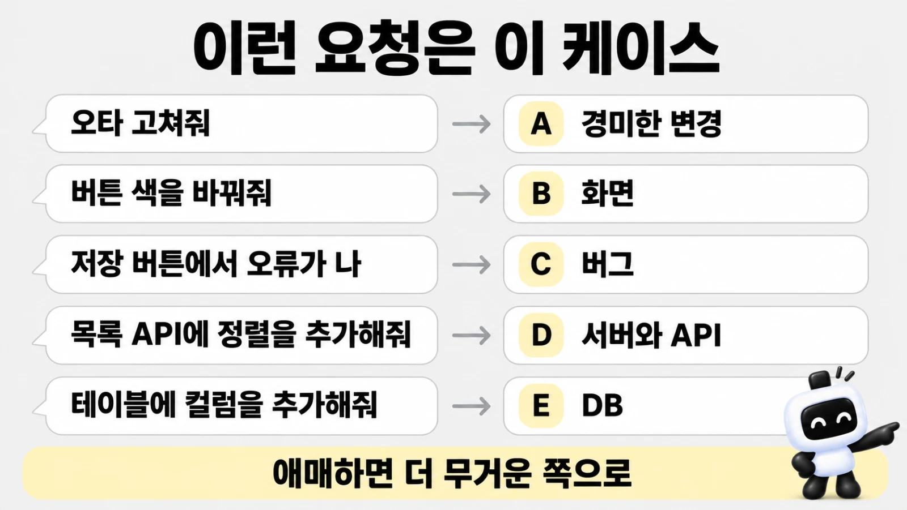
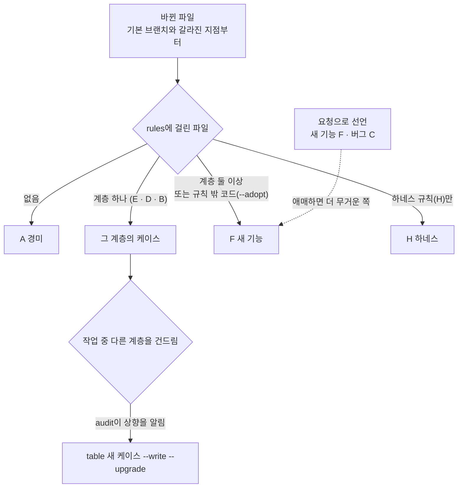

# 케이스 <!-- v:devCycle.cases.range -->A\~F·H<!-- /v -->와 대조표

> 한눈에: 작업을 시작할 때 그 종류(케이스)를 정해요. 화면만 바꾸는지, 서버나 데이터 저장 방식까지 바꾸는지에 따라 챙길 검사가 달라서 종류마다 확인 목록이 미리 정해져 있어요. 작업 중 범위가 넓어지면 **더 무거운 케이스로 올려요**.

## 케이스 <!-- v:devCycle.cases.count.ko -->일곱<!-- /v --> 가지

| 케이스 | 언제 | 판정 경로 | 대조표의 대표 행 |
|---|---|---|---|
| A | 문서나 설정처럼 규칙에 걸리지 않는 경미한 변경 | 아래 경로 밖 | 타입·린트 검사 |
| B | 화면, 컴포넌트, 스타일 | `apps/web/src/app`, `apps/web/src/components`, `packages/ui` | impeccable 화면 설계, 스크린샷과 오류 예산 0, critique·audit, 코드 리뷰(+간결성 검토) |
| C | 버그 수정 | 경로와 상관없이 선언 | 재현 테스트 먼저 작성, 수정 뒤 통과 |
| D | 서버와 API | `packages/api`, `apps/web/src/app/api` | zod 계약, 2계정 격리 테스트, 코드 리뷰 |
| E | DB 스키마와 마이그레이션 | `packages/db` | 생성 SQL 검토, 로컬 적용, 병합 전 원격 적용, DB 리뷰 |
| F | 화면·API·DB 중 둘 이상에 걸친 새 기능 | 두 계층 이상, 또는 새 기능으로 선언 | 스펙(테스트 시나리오 포함)과 계획, 계획 리뷰, E·D·B 행 전체, 전체를 실제로 실행해 확인, 공통화·리팩토링, 최종 리뷰, 시나리오 QA와 발견 수정 |
| H | 스킬, 에이전트, dev-cycle 자체와 빌드·배포·작업공간 설정 | `.agents/skills/`, `.agents/agents/`, `.claude/agents/`, `skills.manifest.json`, `scripts/dev-cycle.mjs`, `docs/dev-workflow.md`, `next.config.*`, 루트 `package.json` 등 | `agents:check`, `skills:check`, 빌드·검사, 스킬 eval |

> [!IMPORTANT]
> 모든 대조표 끝에는 공통 행 두 개가 붙어요. 문서 영향 확인(`GLOSSARY.md`, `docs/adr/`, `docs/domain/project.md`, 미룬 지적은 백로그로)과 사용자 확인(`[confirm]`)이에요.

## 이런 요청은 이 케이스

케이스는 에이전트가 정하니 외울 필요는 없어요. 요청을 이렇게 말하면 이 케이스가 되는구나 하고 감만 잡으세요. 예시는 모두 가상의 요청이에요.

| 케이스 | 이런 요청이면 | 에이전트가 더 챙기는 것 |
|---|---|---|
| A | "README 오타 고쳐줘", "문서 문장 다듬어줘" | 타입·린트 검사 정도예요 |
| B | "버튼 색을 바꿔줘", "카드 간격을 넓혀줘" | 화면 스크린샷, 오류 예산 0, 디자인 점검 |
| C | "저장 버튼을 누르면 오류가 나", "목록이 비어 보여" | 버그를 먼저 재현하는 테스트, 고친 뒤 통과 확인 |
| D | "목록 조회 API에 정렬을 추가해줘" | 입출력 규칙, 다른 사용자 데이터가 안 보이는지 보는 2계정 테스트 |
| E | "할 일 테이블에 마감일 컬럼을 추가해줘" | 생성된 SQL 검토, DB 적용, 데이터가 사라지는 변경인지 판단 |
| F | "할 일에 마감일 붙이고 지난 건 표시해줘" | 스펙과 계획, 계획 리뷰, 화면·API·DB 행 전부, 최종 리뷰, 사용자 흐름 QA |
| H | "스킬 구성을 바꿔줘", "빌드 설정을 고쳐줘" | 에이전트·스킬 상태 검사, 빌드와 검사 |

애매하면 더 무거운 쪽으로 가요. 어떤 케이스로 열었는지 궁금하면 `이 요청을 왜 그 케이스로 판정했는지 알려줘`라고 물어보세요.

## 판정과 상향

판정은 바뀐 파일을 `.dev-cycle.json`의 `rules` 위에서부터 맞춰 보는 방식이에요. 계층 규칙(E·D·B)에 걸린 계층이 하나면 그 케이스, 둘 이상이면 F예요. 하네스 규칙(H)에만 걸리면 H이고, 어느 규칙에도 걸리지 않으면 A예요.

- **판정**: `pnpm dev-cycle case`는 지금 바뀐 파일을 `.dev-cycle.json`의 경로 규칙(`rules`)에 맞춰 판정해요. 아직 파일을 바꾸기 전이면 판정이 A로 나오므로 요청을 보고 케이스를 골라 `table`에 적어요.
- **하네스만 설치한 기존 프로젝트(`--adopt`)의 처음 경로 규칙**: 설치기가 흔한 Next.js 배치로 추정한 규칙을 `.dev-cycle.json`에 적어요. `prisma/`·`drizzle/`·`migrations/`는 E, `app/api/`·`pages/api/`·`server/`·`trpc/`는 D, `app/`·`pages/`·`components/`·`styles/`는 B로 보고, 규칙 밖의 `.ts`·`.tsx`·`.js`·`.jsx`·`.mjs`·`.cjs` 파일은 무거운 F로 봐요. 이 규칙은 추정이라서 정밀 분석 뒤 첫 H Task에서 그 프로젝트의 구조에 맞게 고쳐요([기존 프로젝트에 도입하기](../start/adopt.md), [정밀 분석과 진행 계획](project-plan.md)). 앱의 루트 `package.json` 같은 작업공간 설정은 H 규칙에서 빠져요.
- **선언**: 새 기능 요청은 F, 버그 제보는 C로 선언해요. 애매하면 더 무거운 케이스를 골라요.

### 상향과 자동으로 붙는 행

- **상향**: 작업 중 다른 계층을 건드리면 `pnpm dev-cycle audit`이 케이스를 올리라고 알려 줘요. `pnpm dev-cycle table <새 케이스> --write --upgrade`를 실행하면 이미 채운 증거, 직접 추가한 행, 메모를 그대로 두고 새 케이스의 행을 더해요.
- **보안 리뷰 자동 추가**: 로그인과 관련된 경로(`packages/auth`, `apps/web/src/app/api/auth/` 등, `.dev-cycle.json`의 `authPaths`)를 건드리면 `[review] prokit-reviewer(security)` 행이 자동으로 붙어요. 아직 파일을 바꾸기 전이라도 로그인, 세션, 권한 문제라면 대조표를 연 직후 이 행을 직접 더해요.
- **자동으로 붙는 행**: 조건에 따라 대조표 맨 앞에 행이 붙어요([정밀 분석과 진행 계획](project-plan.md)).
  - D·E·F 표에서 그 계층 패키지에 `test` 스크립트가 없으면 `vitest 도입` 행이 붙어요.
  - `--task`로 열면 Task 세부 계획 행과 Task 세부 계획 리뷰 행이 붙어요(F는 세부 계획 행만).
  - `--plan`으로 열면 정밀 분석(기존 프로젝트만), 계획 문서와 Task 표, 진행 계획 리뷰 행이 붙어요.
- **테스트 러너 먼저**: D·E 행이 있는 대조표(F 포함)나 서버·DB 코드를 고치는 C에서 테스트 러너가 없으면 첫 행 앞에 `vitest 도입(최초 1회)` 행이 들어가요. D·E·F 표는 그 계층 패키지에 `test` 스크립트가 없을 때 `table`이 넣고, C는 에이전트가 더해요. 격리 테스트 행을 채울 방법이 이것뿐이라서 요청 범위를 넓히는 일로 보지 않아요.

## 자세히

### 대조표 행의 정본

케이스별 행은 설치된 프로젝트의 `docs/dev-workflow.md`에 있어요. `scripts/dev-cycle.mjs`가 이 문서를 읽어 대조표를 만들어요. 행 형식은 `- [태그] 단계 → 증거 형식`이에요.

| 표시 | 뜻 |
|---|---|
| `[verify]` | 검사 행. 실행한 명령과 결과가 증거예요 |
| `[review]` | 리뷰 행. `prokit-reviewer`나 impeccable critique 같은 리뷰 결과가 증거예요 |
| `[confirm]` | 사용자 확인 행. N/A나 blocked로 넘길 수 없어요 |
| `@include E D B` | 다른 케이스의 행을 그 자리에 펼쳐요(F가 E·D·B를 포함하는 방식) |
| `@inherit verify review` | 경로로 판정된 케이스에서 검사·리뷰 행만 가져와요(C가 쓰는 방식) |

### 케이스별 행

케이스별 행 전체 보기

- **A. 경미**: 타입·린트 검사.
- **B. UI**: impeccable context와 `PRODUCT.md`·`DESIGN.md` 확인(`PRODUCT.md`가 없으면 impeccable init, `DESIGN.md`가 없고 Better-T-Stack 기본 화면뿐이면 스타일 1\~3위와 직접 정하기 중 사용자 선택) → impeccable shape로 화면 설계 확정 → `[design]` 재사용·설정 설계 점검 → 구현 → 타입·린트·빌드 → 런타임 확인과 desktop·mobile 스크린샷(오류 예산) → impeccable critique → impeccable audit과 web-design-guidelines 검사 → 수정과 polish → 재확인 → `prokit-reviewer(code)` → `DESIGN.md` 갱신 여부.
  - 기존 프로젝트(`early`·`operating`·`migration`)는 첫 화면 작업에서 스타일을 고르기 전에 디자인 방향을 먼저 물어요(`기존 디자인 유지 (추천)` 또는 `리디자인`).
  - critique 행의 증거에는 impeccable이 남긴 `.impeccable/critique/<시각>__<대상>.md` 경로와 그 파일 머리의 점수를 적어요. audit 행(web-design-guidelines 검사 포함)은 보고서를 `tasks/evidence/ui-audit-<시각>.md`로 저장하고 그 경로와 총점(N/20)을 적어요. 두 파일 모두 이번 라운드에 쓴 것이어야 해요([증거와 audit, 사용자 확인](audit-and-confirm.md)).
- **C. 버그**: 재현 테스트 작성과 실패 확인 → 수정 → 재현 테스트 통과 → 판정된 케이스의 검사·리뷰 행. 화면 문구·모양 버그는 테스트 파일 대신 고치기 전과 뒤의 화면 스크린샷으로 재현과 통과를 보여요.
- **D. 서버·API**: `[design]` 재사용·설정 설계 점검 → zod 입출력 계약 → 구현(격리 테스트부터) → 2계정 격리 테스트 → 타입·린트·테스트 → `prokit-reviewer(code)`.
- **E. DB**: `[design]` 재사용·설정 설계 점검 → 스키마 수정과 생성 SQL 검토 → 타입·린트 → 로컬 개발 DB에 적용 → 병합 전 원격 DB에 적용(neon은 Neon 개발 브랜치) → 파괴적 변경 판단(없음 또는 2단계 계획) → `prokit-reviewer(db)`. supabase는 새 테이블의 RLS 확인, 로컬 `supabase db advisors` 보안 검사, 병합 전 Supabase 스테이징 적용과 advisors 검사가 더 붙어요.
- **F. 새 기능**: 스펙(만들지 않는 것, 인수 조건, 테스트 시나리오) → 구현 계획 → `[design]` 재사용·설정 설계 점검 → 계획 리뷰 → 구현 방식 → E·D·B 행 → 통합 런타임 확인 → 공통화·리팩토링·최적화 점검 → 전체 diff 최종 리뷰 → 사용자 흐름 QA → QA 발견 수정과 재QA.
- **H. 하네스**: `[design]` 재사용·설정 설계 점검 → `pnpm agents:check` → `pnpm skills:check` → `pnpm dev-cycle case`·`status` 실행 확인 → 빌드·배포 설정이나 작업공간 설정을 바꿨으면 `pnpm build`와 타입·린트 검사 → 스크립트·CI·배포·작업공간 설정을 바꿨으면 `prokit-reviewer(code)` → 스킬을 바꿨으면 skill-creator eval 재실행. 스킬, 에이전트, dev-cycle 파일과 함께 빌드·배포 설정(`next.config.*`, `vercel.json`, `turbo.json`, `.github/workflows/`)과 작업공간 설정(루트 `package.json`, `biome.json`, `tsconfig.json`, `packages/config/`)을 바꿔도 H로 판정돼요. [기존 프로젝트에 하네스만 설치한](../start/adopt.md) `adopt`는 앱의 루트 `package.json`, `biome.json`, `tsconfig.json`이 그 프로젝트의 것이라 H가 아니라 A로 봐요. 기능 의존성이 들어가는 `apps/web`·`packages/*`의 `package.json`, `pnpm-workspace.yaml`의 `catalog:`, `pnpm-lock.yaml`은 H로 보지 않아요.

행의 전체 문구(괄호 안의 스킬과 증거 형식)는 템플릿의 [`docs/dev-workflow.md`](../../templates/prokit-next-neon/files/docs/dev-workflow.md)에서 볼 수 있어요. 프로젝트에 맞게 행을 고쳐도 되고, 고치는 일 자체가 케이스 H예요.

### 첫 라운드가 무거워지는 경우

> [!WARNING]
> 프로젝트를 만든 뒤 설치 결과와 첫 마이그레이션을 기본 브랜치에 커밋하지 않으면 그 파일이 첫 라운드의 diff에 섞여 실제 작업보다 무거운 케이스로 판정돼요. 라운드는 기본 브랜치와 갈라진 지점(merge-base)부터 바뀐 것을 보므로 기능 브랜치에 커밋해도 해결되지 않아요([빠른 시작: 서비스 만들기](../start/quickstart-service.md)).

## 관련 문서

- [dev-cycle 라운드](dev-cycle.md)
- [증거와 audit, 사용자 확인](audit-and-confirm.md)
- [위임 에이전트와 리뷰 에이전트](agent-roles.md)
- [UI/UX 흐름](../design/ui-flow.md)
