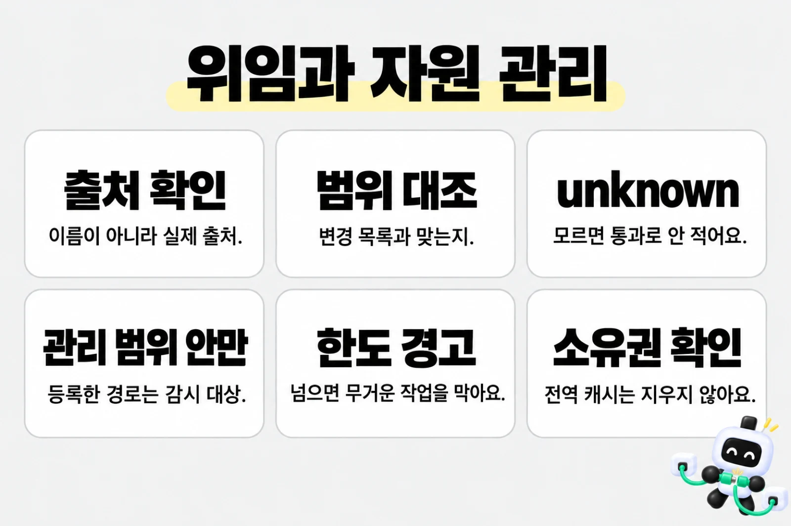
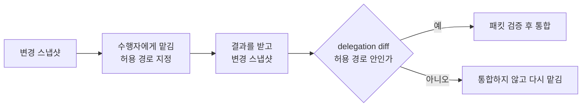

# 위임과 자원 관리

> 한눈에: 전문 스킬이나 수행자를 쓸 때는 이름만 보고 고르지 않아요. 실제 출처와 내용, 가능한 부작용을 확인하고 승인한 범위 안에서만 맡겨요. **로컬 자원도 현재 작업에 연결한 프로젝트·워크트리·관리 임시 폴더에서만 크기를 재고, 확인한 소유권 없이 지우지 않아요.**

## 쉽게 말하면

에이전트는 일을 혼자 하지 않고 전문 스킬과 수행자에게 나눠 맡기고, 작업하면서 내 컴퓨터의 디스크와 캐시(다시 내려받지 않으려고 모아 둔 임시 파일)를 써요. 이때 두 가지가 문제가 될 수 있어요. 이름만 그럴듯한 엉뚱한 스킬에 일을 맡기거나, 용량이 커졌다고 지우면 안 되는 파일을 지우는 일이에요. 프로킷은 이 둘을 미리 막아요.

| 프로킷이 해 주는 일 | 왜 필요한가 |
|---|---|
| 맡길 전문 스킬을 이름이 아니라 실제 출처와 내용으로 골라요 | 같은 이름의 가짜나 낡은 스킬에 맡기지 않으려고요 |
| 맡긴 결과가 정말 맡긴 범위에서 나왔는지 변경 목록과 대조해요 | 에이전트의 "했어요"라는 말만 믿지 않으려고요 |
| 확인하지 못한 것은 통과로 적지 않고 `unknown`이나 `blocked`로 남겨요 | 검사하지 않은 일이 끝난 일로 둔갑하지 않게요 |
| 캐시와 설치 환경의 크기, 남은 디스크 여유를 재서 경고하고 새 무거운 작업을 막아요 | 디스크가 꽉 차서 작업이 중간에 깨지지 않게요 |
| 내가 쓰는 환경과 전역 캐시는 지우지 않아요 | 다른 프로젝트까지 망가지지 않게요 |

**내가 하는 일**: 평소에는 없어요. 에이전트가 디스크가 부족하다거나 어떤 검사가 막혔다고 알려 올 때만 보면 돼요.

> [!TIP]
> 막혔을 때 보낼 말:
> - 용량 문제: `현재 자원 사용량과 막힌 이유를 확인하고, 안전하게 정리할 수 있는 후보를 알려줘`
> - 스킬 문제: `선택한 스킬과 사용할 수 없는 이유를 확인하고, 검증된 대안이 있는지 알려줘`

아래는 에이전트가 따르는 규칙을 정확히 적은 자세한 설명이에요. 에이전트의 역할 구분은 [위임 에이전트와 리뷰 에이전트](agent-roles.md)에서 먼저 보세요.

## 자세히

### 말 풀이

처음 보는 말은 [처음 보는 용어](../../tutorials/reference/glossary.md#도구)에도 있어요.

말 풀이 표 보기

| 말 | 쉬운 풀이 |
|---|---|
| 공급자(provider) | 전문 작업을 실제로 해 주는 스킬이나 플러그인 |
| canonical location | 그 스킬의 진짜 원본이 있는 위치 |
| 내용 해시(hash) | 파일 내용을 짧은 값으로 줄인 지문. 내용이 한 글자라도 바뀌면 달라져요 |
| capability, side effect | 그 스킬이 할 수 있는 일과, 실행하면 바깥에 생기는 변화(파일 쓰기, 네트워크 호출 등) |
| 스냅샷 | 작업을 맡기기 전과 후에 찍어 두는 변경 목록 |
| 패킷(packet) | 맡긴 작업의 결과를 한 묶음으로 적은 보고서. 작업 식별자, 변경, 증거, 남은 문제가 들어 있어요 |
| capture artifact | 실행 전후의 실제 상태를 담아 `tasks/evidence/`에 남긴 기록 파일 |
| guard | 무거운 명령을 감싸서 실행 전에 디스크를 재고 실행 뒤 기록을 남기는 보호 장치 |
| inode | 파일 시스템이 폴더나 파일을 구별하는 내부 번호. 폴더 이름이 같아도 번호가 다르면 다른 폴더예요 |
| lease | 잠금이 살아 있음을 알리려고 일정한 간격으로 잠금 파일을 건드려 두는 방식 |

### 위임할 때 남기는 근거

`skills.manifest.json`은 설치할 항목의 정본이에요. 실제 수행자를 고르는 허용 목록은 아니에요. 아래 순서대로 확인해요.

**사용자가 명시한 출처** → **프로젝트 정본** → **실제로 접근 가능한 외부 출처** → **검증한 기본 대안**

#### 선택하기 전에 확인하는 것

선택하기 전에는 다음을 확인해요. 같은 이름의 스킬이 여러 곳에 있거나 매니페스트에 적혀 있어도 이 확인을 건너뛰지 않아요.

- 실제 내용의 출처와 canonical location, 내용 해시
- 범위와 의존성
- capability와 side effect

사용자가 현재 쓸 수 있는 로컬 사용자 지정 스킬, 플러그인, 공급자 참조를 명시했으면 선택 사실을 기록하고 다시 허락을 묻지 않아요. 실행 권한은 늘어나지 않아요.

이 절차는 전문 공급자를 선택한 작업에서만 열어요. 공급자 메타데이터와 선택 기록은 사실을 다시 확인하기 위한 캐시일 뿐, 그 자체가 근거는 아니에요. 네이티브가 이름 있는 역할 파일 등록을 지원하는지 먼저 확인하고, 지원하면 정확한 역할을 써요. 지원하지 않으면 검증한 논리 역할과 읽기 전용 텍스트 생산자만 써서 결과를 받고, 메인 세션이 승인한 범위를 바이트 단위로 통합해요.

| 역할 | 하는 일 |
|---|---|
| 코디네이터 | 작업 단위, 허용 경로, 선택한 공급자, 완료 조건과 최종 통합을 정해요 |
| `prokit-implementer` | 검증한 전문 공급자를 연결해 승인한 파일만 고쳐요 |
| `specialist-reviewer` | 공급자에 내장 리뷰가 없을 때만 전문 산출물을 읽기 전용으로 확인해요 |
| `prokit-reviewer` | 전체 계약, 증거 해시, 통합 수용 여부를 매번 읽기 전용으로 확인해요 |

#### 맡기기 전후의 대조

- 작업을 넘기기 전과 받은 뒤에 변경 스냅샷을 잡아요.
- 받은 뒤에는 `dev-cycle delegation diff`로 배정한 경로 밖 변경이나 커밋이 없는지 대조해요. 있으면 그 결과를 통합하지 않고 다시 맡겨요.
- 패킷에는 작업 식별자, 상태, 공급자, 허용 경로, 제약, 환경 참조와 지문, 실제 변경, 증거, 리뷰 범위, 미해결 항목, 부작용, 다음 행동을 넣어요.

> [!IMPORTANT]
> 실제 산출물 해시와 명령 종료 코드가 없는 보고 문구는 증거가 아니에요.

capture artifact는 `tasks/evidence/` 아래에 실행 전과 후를 각각 한 번만 남겨요. 환경·자원 helper(보조 스크립트) 출력은 작업 산출물과 분리해 기록하고, 해시에는 경로·바이트 수·표준 출력 요약을 함께 남겨요. private guard token이나 owner receipt(소유 확인 기록)는 직접 읽거나 출력하지 않아요.

#### 위임 명령과 검증 경계

- `dev-cycle delegation resolve <스킬 참조 또는 상대 경로>`는 실제 스킬 원본의 위치와 내용 해시를 관찰해요. 신뢰한 원본 확인 결과와 에이전트 도구 연결부(host adapter)가 계약을 현재 실행에 묶지 못하면 "확인만 함(inspection-only)"으로 보고하고 exit 1로 막아요.
- `dev-cycle delegation validate`와 `audit --packet --context`는 패킷의 구조와 증거 데이터를 검사하고, 찾은 문제를 모두 보여 줘요. CLI에서는 메인 세션의 런타임 검증기를 넘길 수 없어서 이 검사는 진단용이고 늘 exit 1이에요. `close`는 패킷을 받지 않아요.
- `--context` JSON은 자료이지 메인 세션이 승인했다는 증명이 아니에요.
- inspection-only여도 이미 승인한 읽기 전용 텍스트 위임은 할 수 있어요. 실제 원문에서 의존성·도구·부작용을 확인하고 같은 작업·실행·루트에 연결된 네이티브 수행자가 수락했으면 후보 텍스트를 받아요. 확인하지 못한 권한이나 범위 밖 부작용은 계속 차단해요.

최종 게이트는 메인 세션 런타임의 검증된 콜백이나 실제 host adapter가 현재 task·run·제품·증거·공급자·환경·리뷰어 식별자에 묶어서만 허용해요. 그 연결을 증명할 수 없으면 `unknown`이나 `blocked`로 남겨요. 이 경계를 우회하려고 별도 인증 서버나 등록 서비스를 더하지 않아요.

로컬 Codex의 delegation accept 연결

로컬 Codex에는 `dev-cycle delegation accept` 실행 연결이 있어요. 코디네이터가 기준 커밋·변경 범위·검사 argv(명령과 인자 목록)·선택한 프로젝트 원본·산출물을 명시하면, 같은 실행이 자원 보호 아래 검사와 새 읽기 전용 Codex 리뷰를 실행해요. 실제 결과와 현재 해시를 메모리에서 검증하므로 JSON 승인값으로 완료를 만들 수 없어요. 라운드 중에는 대조표 `tasks/todo.md`도 바뀌어 있으니 `--scope tasks/todo.md`를 함께 줘요. 기술 인수가 `complete`여도 사용자 확인은 `pending`일 수 있어요.

이 기술 완료는 사용자 확인이나 라운드 close를 대신하지 않아요. 저장한 결과 파일도 다음 실행의 권한 증명으로 사용할 수 없어요. 다른 호스트나 보호된 작업의 권한까지 검증했다고 보고하지 않아요.

#### 공급자의 내장 리뷰 재사용

- 전문 공급자가 자체 리뷰를 제공하면 그 리뷰 범위만 재사용해요.
- 스킬의 출처·내용, 계약, 리뷰어, 환경 지문이 모두 같은 경우에만 이전 전문 리뷰를 재사용해요. 환경이 달라지거나 확인되지 않으면 새 환경의 검사로 인정하지 않아요.
- 보안, DB, 계약처럼 빠진 관점만 보완하고, 최종 `prokit-reviewer` 게이트는 재사용하지 않아요.
- 출처, 범위, 의존성, 부작용을 맞추지 못하면 검증한 대안을 찾고, 없으면 `blocked`로 남겨요. 미검사 작업을 PASS로 바꾸지 않아요.
- 수정은 원 수행자에게 모아 재지시하고 영향받은 검사만 다시 해요. 외부 워크플로우의 반복 한도를 지키며 추가 재지시는 최대 두 차례예요.

### 독립 작업을 나눠서 확인하기

작업 기록 분석, 템플릿 보완, 기존 프로젝트 이행은 범위가 달라요. 성능 개선을 검토한다고 완성된 프로젝트를 갱신하거나 H 라운드를 추가하지 않아요. 기존 프로젝트에 새 하네스를 반영하는 작업은 사용자가 그 이행을 요청했을 때 진행해요.

#### 나눠 맡기는 기준

코디네이터는 기존 계획과 대조표에 작업의 선행 조건, 담당 파일, 검사 대상, 결과 위치, 완료 조건을 적어요.

- 파일과 상태가 겹치지 않는 구현은 나눠 맡겨요.
- 같은 파일이나 빌드 출력을 바꾸는 작업은 순서대로 진행해요.
- 병렬 구현 중에는 담당 범위의 회귀 검사만 하고, 통합한 코드의 타입·린트·빌드는 한 담당자가 실행해요.
- 계획한 작업 수와 실제로 끝난 작업 수, 빠진 범위도 구분해 기록해요.

#### 묶어 맡기고 범위를 읽는 법

같은 책임과 파일 범위에 속한 작은 작업은 한 수행자에게 묶어요. 리뷰어는 바뀐 계층의 계약과 실제 소비자, 공유 설정을 읽고 필요한 문맥을 더 확인해요. 하네스만 바뀌었는데 화면과 API 문서를 모두 읽도록 요구하지는 않아요. 영향 범위가 불분명하면 확인 범위를 넓히고, 필수 보안·권한 검토를 생략하지 않아요.

공통 규칙과 위임·증거 계약은 문맥을 줄일 때도 읽어요. 필수 증거나 실제 권한을 검증할 수 없으면 리뷰 판정과 통합 수용을 모두 `blocked`로 남겨요. 읽기 호출이 줄었다는 이유로 필수 문맥을 빠뜨린 결과를 성능 개선으로 인정하지 않아요.

전문 리뷰와 QA는 같은 산출물이 고정된 뒤 독립 범위를 동시에 확인할 수 있어요. 코디네이터는 에이전트 수뿐 아니라 각 검사 도구 안에서 실행하는 브라우저 수도 함께 계산해요. 구체적인 배정 기준은 설치된 스킬의 [실행 효율과 검사 재사용](../../templates/prokit-next-neon/files/.agents/skills/prokit-dev-cycle/references/execution-efficiency.md)에 있어요.

#### 검사를 다시 쓰는 기준

다시 확인할 대상은 실패한 검사, 변경된 기능, 그 기능이 쓰는 공통 코드의 소비자예요. 이전 산출물·검사 조건·도구·환경·기준선과 현재 작업에 묶인 실제 실행 근거를 확인하고, 변경 영향이 없을 때만 통과 증거를 재사용해요. 영향 범위나 환경이 확인되지 않으면 관련 검사 묶음을 다시 실행해요. 새 사이트와 공통 배치·라우팅·디자인 토큰 변경의 최종 확인에서는 해당 전체 범위를 검사해요.

#### 불안정한 검사

재시도해서 성공한 검사는 `flaky`(가끔 실패하는 불안정한 검사)로 기록해요. 원인을 해결하지 못한 불안정한 검사, 빠진 검사, 실패한 검사는 완료 근거가 아니에요. 독립 작업의 결과는 보존하고, 수정이 필요한 결과만 원 수행자에게 모아 전달해요.

### 관리 범위 안 자원만 다루기

자원 정책의 실행 정본은 `.dev-cycle.json`의 `resources`예요. 등록할 때는 `path`, `kind`, `lifetime`을 적어요.

- kind: `workspace`, `buildCache`, `nextOutput`, `nodeModules`, `pythonVenv`, `managedTemp` 중 하나
- lifetime: 기본 `project`와 `temporary`

> [!IMPORTANT]
> `roots`에 등록한 경로는 감시 대상일 뿐 자동 삭제 권한이 아니에요.

#### 측정과 한도

측정기는 캐시, Next 출력, Node 의존성, Python 가상 환경, 관리한 임시 폴더를 나눠 봐요. 하드링크(한 파일의 이름이 여러 개인 경우)는 한 번만 합산하고, 심볼릭 링크는 따라가지 않아요. COW(복사하지 않고 공유하는 저장 방식) 공유 여부를 알 수 없으면 그 한계를 따로 적어요. `node_modules`와 Python 가상 환경은 정상일 때 다시 쓰며, 활성 개발 서버의 Next 출력과 영구 환경은 지우지 않아요.

| 상황 | 정책 |
|---|---|
| 영구 활성 환경 하나 | <!-- v:policy.resource.environmentWarn -->10GiB<!-- /v -->가 넘으면 정보 경고만 남겨요 |
| 캐시 | <!-- v:policy.resource.cacheWarn -->20GiB<!-- /v -->부터 경고하고 <!-- v:policy.resource.cacheBlock -->40GiB<!-- /v -->부터 실행을 막아요 |
| 관리 대상 합계 | <!-- v:policy.resource.totalWarn -->40GiB<!-- /v -->부터 경고하고, 새 무거운 작업은 <!-- v:policy.resource.totalBlock -->80GiB<!-- /v -->부터 막아요 |
| 파일 시스템 여유 공간 | <!-- v:policy.resource.freeWarn -->20GiB<!-- /v --> 이하면 경고하고 <!-- v:policy.resource.freeBlock -->10GiB<!-- /v --> 이하면 막아요 |
| 빠른 점검 | <!-- v:policy.resource.fastTimeout -->30초<!-- /v -->마다 확인하고, 시간을 제한한 별도 측정 작업의 예산은 <!-- v:policy.resource.fastWorkerTimeout -->10초<!-- /v -->예요 |
| 전체 목록 점검 | <!-- v:policy.resource.fullTimeout -->5분<!-- /v -->마다 확인하고, 시간을 제한한 별도 측정 작업의 예산은 <!-- v:policy.resource.fullWorkerTimeout -->30초<!-- /v -->예요 |

> [!NOTE]
> 이 보호는 관리 명령과 등록한 경로에 적용돼요. 직접 실행한 명령이나 다른 프로세스까지 디스크 사용량을 제한하지는 않아요.

#### 환경 재사용과 확보 공간

환경 재사용은 같은 프로젝트 위치에서 파일 지문과 실제 환경 상태를 확인한 뒤 결정해요. 지문이 같다는 이유만으로 정상이라고 판단하지 않고, Python 가상 환경을 다른 위치로 복사하지 않아요. 재설치 전후 증가도 기록해 필요 없는 중복 설치를 찾아요.

측정한 크기는 삭제 후 확보될 공간이 아니에요. 실행과 임시 출력이 놓이는 파일 시스템의 실제 여유 공간을 별도로 확인해요. HTML 내보내기는 인식한 가상 환경·Python bytecode·등록한 환경과 캐시 경로를 임시 사본에서 제외해요.

#### 정리는 이 조건에서만

정리는 먼저 대상과 이유만 보여 줘요. 작업 범위 밖 경로, 전역 캐시, 영구 환경은 정리하지 않아요. 실제로 만든 임시 폴더는 아래를 모두 증명한 경우에만 지울 수 있어요.

- 생성 핸들(만든 쪽이 받은 확인 기록)
- 루트 inode
- 실행 수명 종료
- 자식 프로세스 종료
- 결과 전달

Turbopack compiler cache는 guard가 새로 만든 경우에만 소유 기록을 남겨요. guard가 만들지 않은 캐시는 지우지 않아요. 필요하면 Next를 끈 뒤 직접 지워요. 실행이 끝난 뒤 `resource clean --apply`는 아래를 확인하고 나서야 지워요.

- 소유 기록과 같은 디렉터리인지
- 실행과 자식 프로세스가 끝났는지
- 실행 중인 guard나 Next dev·build(Next의 `.next/lock`·`.next/dev/lock`)가 없는지

#### 창을 닫거나 강제로 끊겼을 때

- 창을 닫으면(SIGHUP, `nohup`으로 띄워도 마찬가지) guard가 감싼 명령도 멈춰요.
- guard는 자식 프로세스 그룹을 lock과 소유 기록에 적은 뒤에만 명령을 시작해요. 그래서 강제로 끊긴 guard가 남긴 lock과 소유 기록은 그 프로세스와 자식 그룹이 모두 없으면 다음 실행과 `resource clean`이 회수해요.
- turbo는 작업마다 프로세스 그룹을 따로 만들어서, 그룹이 끝났어도 Next가 남아 있으면(`.next/dev/lock`·`.next/lock`) 회수하지 않고 그 Next를 끄라고 알려 줘요.

#### 컨테이너나 다른 OS에서 돈 guard

lease로 lock을 지키는 방식

컨테이너나 다른 OS에서 돈 guard는 pid(프로세스 번호)로 생사를 확인할 수 없어요. 그래서 guard는 lock을 잡는 동안 따로 띄운 작은 셸로 lock을 짧은 간격마다 건드려요(lease). guard, 자식 프로세스 그룹, guard가 띄운 Next dev 가운데 하나라도 살아 있는 동안은 lease를 계속 갱신해요. 그래서 guard만 멈추거나 강제 종료돼도 남은 자식이 lock을 지켜요.

- 다른 환경의 lock을 만나면 그 간격의 세 배 동안 지켜보고, 바뀌지 않으면 끝난 것으로 보고 회수해요. 시계를 비교하지 않아서 두 환경의 시계가 달라도 돼요.
- 다만 공유 폴더가 파일 변경 시각을 몇 초 안에 보여 줘야 맞아요. <!-- edition:pro -->Podman 머신의 공유 폴더(virtiofs)에서 확인했고, <!-- /edition -->속성을 오래 캐시하는 네트워크 폴더(sshfs·NFS)는 지원하지 않아요. 바뀌면 그쪽이 실행 중이라고 알려 줘요.
- 다른 환경에서 만든 캐시의 소유 기록은 마운트 경로가 달라 같은 디렉터리인지 확인할 수 없어서, 그 환경의 `resource clean`이 정리해요.
- 재부팅 판단은 시계를 바꿔도 그대로인 부팅 표시(Linux·WSL의 `boot_id`, macOS의 `kern.bootsessionuuid`)로 해요.

### 확인과 기록

자원 확인은 측정을 끝까지 하지 못했거나 제한 시간 안에 끝내지 못하면 `unknown`으로 남겨요. 그래도 여유 공간은 파일 시스템에서 바로 읽어서, 차단 한계 이하이면 막아요.

- 실행 전 검사가 `unknown`이면 명령을 시작하지 않아요(exit 75).
- 실행 뒤 전체 측정이 끝나지 않으면 두 가지를 해요. 실행 전 측정값에 이번 실행이 만든 캐시 크기를 더하고, 여유 공간을 다시 읽어요. 그다음 같은 기준으로 판정해요. 그래서 측정만 늦은 경우에는 명령의 종료 코드를 그대로 돌려줘요. 이것마저 재지 못하면 exit 75예요.

측정기는 디렉터리 여러 개를 동시에 읽어요. 하지만 컨테이너에 마운트한 프로젝트처럼 느린 파일 시스템에서 전체 측정이 <!-- v:policy.resource.fullWorkerTimeout -->30초<!-- /v -->를 넘으면 `.dev-cycle.json`의 `resources.full.workerTimeoutMs`(밀리초)로 늘려요.

컨테이너 엔진(Podman·Docker, Supabase 로컬 스택)의 이미지·컨테이너·볼륨은 `resource check`가 엔진이 보고한 크기와 회수할 수 있는 크기를 함께 보여 줘요. 엔진이 관리하므로 예산에 넣지 않고 지우지도 않아요. 디스크 부족은 같은 파일 시스템의 여유 공간 검사로 막아요. <!-- edition:pro -->

무거운 명령은 실행 전후 상태와 종료 코드를 기록해요. 실패한 측정이나 막힌 실행은 통과로 바꾸지 않고 원인과 다음 행동을 남겨요.

위임은 공급자 내용과 패킷을 검증한 뒤에만 시작해요. 완료 패킷은 허용 경로 밖 실제 변경, 남은 미해결 항목, 허용하지 않은 부작용, 다른 환경 지문, 없는 명령 종료 코드, 다른 산출물 해시를 거부해요. 상세 명령과 종료 코드는 [명령 모음](../reference/commands.md)에서 확인해요.

## 관련 문서

- [위임 에이전트와 리뷰 에이전트](agent-roles.md)
- [하네스 엔지니어링](harness.md)
- [증거와 audit, 사용자 확인](audit-and-confirm.md)
- [설치된 프로젝트의 폴더 구조](../reference/project-structure.md)
