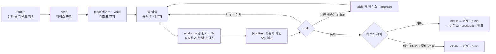

# dev-cycle 라운드

> 한눈에: 코드를 바꾸는 작업 하나가 라운드 하나예요. 라운드를 시작하면 할 일과 확인 결과를 적는 표(대조표)를 열고, **모든 칸을 실제로 한 일의 증거로 채워야 끝나요**. 마지막 칸은 사용자가 결과를 직접 보고 확인하는 칸이에요.

## 왜 라운드로 일하나

에이전트에게 "만들어줘"만 시키면 어디까지 확인했는지 알 수 없어요. 라운드는 이 문제를 체크리스트로 풀어요. 시작할 때 표를 열고, 칸마다 실제로 한 일의 증거를 적고, 마지막에 내가 확인해야 닫혀요. 요청부터 커밋까지 실제 대화로 보고 싶으면 [라운드 한 번 따라가 보기](round-example.md)부터 읽어 보세요. 처음 보는 말은 [용어](../../tutorials/reference/glossary.md#만들기)에서 찾아요.

> [!IMPORTANT]
> 말로 하는 "다 됐어요"가 아니라 표가 완료의 기준이에요.

## 라운드의 흐름

라운드는 `tasks/todo.md`에 붙는 대조표 하나예요. 모든 행의 증거 칸을 채우고 `pnpm dev-cycle audit`을 통과해야 닫혀요.

**요청** → **케이스 판정** → **대조표 열기** → **행마다 증거** → **내 확인** → **audit** → **close**

| 단계 | 하는 일 |
|---|---|
| 시작 | `pnpm dev-cycle status`로 진행 중인 라운드가 있는지 봐요. 있으면 이어서 하고, 없으면 외부 스킬의 새 버전도 확인해요(원격은 하루 한 번). `AGENTS.md`, `GLOSSARY.md`, `docs/domain/project.md`를 읽고, 요청을 한 문장으로 다시 써 보고, 결과가 달라질 만큼 모호한 데가 있으면 먼저 물어요 |
| 케이스 판정 | 요청이 어떤 종류인지 정해요. 새 기능은 F, 버그는 C이고, 애매하면 더 무거운 쪽을 골라요([케이스 <!-- v:devCycle.cases.range -->A\~F·H<!-- /v -->와 대조표](cases.md)) |
| 대조표 열기 | `pnpm dev-cycle table <케이스> --write --title "<요청 요약>"`. `--write` 없이 실행하면 미리 보기만 해요. 진행 계획의 Task면 `--task T<n>`, 진행 계획 라운드면 `--plan`, 계획 전에 하라고 한 급한 일이면 `--no-task`를 붙여요([정밀 분석과 진행 계획](project-plan.md)) |
| 행 실행 | 위에서부터 순서대로 하고, 끝낸 행마다 증거 칸을 채워요. 행에 적힌 스킬은 실제로 불러 쓰고 증거에 이름을 적어요 |
| 사용자 확인 | 결과를 보여 주고, 사용자가 직접 보거나 써 본 뒤 확인을 받아요([증거와 audit, 사용자 확인](audit-and-confirm.md)) |
| 마무리 | audit 통과 → close → 커밋·push → 사용자가 고르면 릴리스와 production 배포 |

### 단계마다 내가 하는 일

| 언제 | 내가 하는 일 |
|---|---|
| 시작 | 하고 싶은 것을 평소 말로 보내요. 에이전트가 되물으면 답해요 |
| 케이스 판정 | 보통 없어요. 새 기능인지 버그인지 분명하게 말해 주면 판정이 빨라요 |
| 대조표 열기 | 없어요. `tasks/todo.md`에 표가 생겼는지 궁금하면 열어 봐요 |
| 행 실행 | 스펙의 "만들지 않는 것"과 인수 조건이 맞는지 봐요. 진행이 궁금하면 `pnpm dev-cycle status` 결과를 보여 달라고 해요 |
| 사용자 확인 | 에이전트가 준 주소나 순서대로 직접 써 보고 `확인했어` 또는 고칠 것을 말해요([확인해 달라고 하면](audit-and-confirm.md#확인해-달라고-하면)) |
| 마무리 | 릴리스와 production 배포를 할지 물으면 고르고, 운영 DB에 적용할 마이그레이션이 있으면 동의해요 |

### 막히면

에이전트가 표 없이 바로 코딩하면 `prokit-dev-cycle 스킬로 케이스부터 판정하고 대조표를 열어줘`라고 보내요. 이전 세션이 남긴 라운드가 있는지는 `pnpm dev-cycle status` 결과를 보여 달라고 해서 확인해요.

## 요청 하나가 흘러가는 모습

"할 일에 마감일 붙이고 지난 건 표시해줘"라는 요청은 화면, API, DB에 모두 걸치는 새 기능이라 케이스 F로 진행돼요.

```mermaid
flowchart LR
  R["할 일에 마감일 붙이고<br/>지난 건 표시해줘"] --> DC["prokit-dev-cycle<br/>케이스 F · 대조표"]
  DC --> SP["스펙 · 테스트 시나리오<br/>용어 기록 GLOSSARY.md"]
  SP --> PLAN["구현 계획 · 재사용과 설정 점검<br/>prokit-reviewer(plan)"]
  PLAN --> DB["prokit-db<br/>due_at 마이그레이션<br/>로컬 적용"]
  DB --> API["prokit-api<br/>프로시저 · 격리 테스트"]
  API --> UI["prokit-ui · prokit-web<br/>화면 설계 → 구현<br/>스크린샷 · 점수"]
  UI --> RF["공통화 · 리팩토링<br/>간결성 검토"]
  RF --> REV["prokit-reviewer<br/>독립 리뷰"]
  REV --> QA["시나리오 QA<br/>오류 예산 0 · 발견 수정"]
  QA --> CF["사용자 확인<br/>[confirm]"]
  CF --> V["prokit-verify<br/>audit 통과 → close"]
  V --> END["커밋 · push<br/>고르면 릴리스 · production 배포"]
```

## 자세히

### 명령

`status`, `case`, `table`, `plan`, `evidence`, `audit`, `archive`, `close`, `secrets` 명령과 옵션(`--upgrade`, `--partial`, `--json` 등)은 [명령 모음의 dev-cycle](../reference/commands.md#dev-cycle)에 있어요.

### 작업 기록 보관

- `pnpm dev-cycle archive [--title "제목"]`은 라운드를 닫지 않아도 쓸 수 있어요. 활성 대조표와 미완료 항목은 건드리지 않고, 대조표 밖에서 끝낸 일반 할 일·백로그만 KST 날짜의 제목 파일로 옮겨요. 끝난 하위 항목은 부모 문맥과 함께 남기며, 코드 예시는 옮기지 않아요.
- `close`는 audit과 사용자 확인을 모두 통과한 뒤 대조표와 완료한 일반 할 일·백로그를 같은 방식으로 보관해요. 파일 이름이 같으면 `-2`, `-3`을 붙여 기존 파일을 보존하고, 기존 월별 기록도 그대로 둬요.
- 기록은 `tasks/archive/README.md`에서 찾아보고, `tasks/todo.md`에는 남은 항목과 그 색인 링크 하나만 남겨요.

### Task 라운드

큰 일을 진행 계획의 Task로 나눴다면 `pnpm dev-cycle table <케이스> --write --title "T1 …" --task T1`로 Task 하나를 라운드로 열어요. 대조표 맨 앞에 행 두 개가 붙어요. 하나는 그 Task의 세부 계획(바꿀 파일, 단계, 단계별 검사, 완료 조건)이고, 다른 하나는 그 계획의 리뷰예요. 계획 리뷰 행이 이미 있는 케이스 F는 세부 계획 행만 붙어요. 앞 Task가 완료나 제외가 아니면 다음 Task 라운드는 열리지 않아요. 자세한 내용은 [정밀 분석과 진행 계획](project-plan.md)에 있어요.

### 라운드를 여는 때

- 고치거나 만들어 달라는 요청이면, 이번에는 원인 분석이나 스펙·계획까지만 하라고 해도 라운드를 열어요. 분석 결과는 대조표 블록 안 메모나 `tasks/evidence/`에 남기고, 행의 증거 칸은 그 행을 실제로 끝냈을 때만 채워요.
- 코드를 바꾸지 않는 질문이나 설명 요청에는 라운드를 열지 않아요.
- 배포 요청도 코드를 바꾸지 않으므로 라운드 없이 `prokit-deploy`가 맡아요.
- 기존 프로젝트는 진행 계획을 확정하기 전(`sig=`가 없을 때)에는 `--task` 없는 라운드도 열리지 않아요. 사용자가 계획 전에 하라고 한 급한 버그 수정, 템플릿 갱신 반영, 스킬 구성 변경만 `--no-task`로 열고, 대조표에 `notask=true`로 남아요.

### 행을 채우는 법

- 첫 증거를 적기 전에 `prokit-verify`를 불러 그 스킬이 정한 검사 고르기와 증거 형식을 따라요.
- 문서는 그 계층을 구현하는 행에서 함께 고쳐요. 새 용어는 `GLOSSARY.md`에, 새 화면·프로시저·테이블은 `docs/domain/project.md`에 넣어요. 그래야 뒤의 리뷰 행이 문서까지 봐요.
- B·D·E·F·H는 구현 전에 `[design]` 행에서 기존 경로·소비자, 공통화·분리 결정과 환경 변수·설정 영향을 확인해요. F는 계층별 점검을 합쳐 한 번만 적고 독립 계획 리뷰를 받아요. A·C는 관련 변경에 같은 판단 기준을 쓰되 새 설계 단계를 강제하지 않아요.
- 서버나 DB 테스트가 필요한데 테스트 러너가 없으면 첫 행 앞에 `vitest 도입(최초 1회)` 행이 들어가고 그것부터 해요. D·E·F 표는 `table`이 넣고(`packages/api`, E는 `packages/db`에 `test` 스크립트가 없을 때), C나 그 폴더가 없는 구조는 에이전트가 더해요.
- 작업 중 다른 계층을 건드리면 audit이 케이스를 올리라고 알려 줘요. `pnpm dev-cycle table <새 케이스> --write --upgrade`로 올려도 이미 채운 증거와 메모는 남아요.

### 마무리

1. audit으로 남은 문제가 표 끝의 `[confirm]` 행뿐인지 봐요. 다른 행이 남았으면 먼저 끝내요.
2. 사용자 확인을 받아요.
3. audit이 통과해야 해요. `blocked`나 `미실행` 칸이 있으면 "부분 완료"로 보고하고, 사용자가 그대로 닫자고 할 때만 `close --partial`로 닫아요.
4. 배포할 수 있는지 봐요. `pnpm vercel:deploy production --check`는 항상 실행해요. 기본 브랜치, GitHub `origin`, `gh auth status`, 배포 검사(커밋하지 않은 변경과 릴리스 항목은 제외)가 모두 통과하면 한 번 물어요. 선택지는 "릴리스하고 production 배포 (기본)"와 "커밋·push만 (배포 PASS)"예요. 하나라도 빠지면 묻지 않고 커밋·push까지만 해요. 화면만 프로젝트는 모두 통과해도 묻지 않고 커밋·push까지만 해요. 화면 배포는 요청할 때 따로 해요([화면만 프로젝트의 배포](../design/screen-only.md#배포)).
5. 이 라운드에서 미룬 지적을 `tasks/todo.md`의 백로그로 옮겨요. 재발 원인이 확인됐으면 `tasks/lessons.md`, 해당 규칙·평가 입력이나 백로그에 반영했는지도 확인하고 `pnpm dev-cycle close`로 닫아요. 이때 대조표와 완료한 일반 할 일·백로그도 함께 보관해요.
6. 커밋 전에 `pnpm dev-cycle secrets`를 실행하고, 이 라운드에서 바꾼 파일과 `tasks/`만 커밋해요. 제목은 Conventional Commits 접두어(`feat:`, `fix:`, `docs:` …)로 써요. 릴리스 노트의 절이 여기서 정해지고, `!`는 깨지는 변경으로 버전을 올려요. 이어서 push해요. 설치기가 건 git pre-commit 훅(`pnpm dev-cycle guard --staged`)이 이 커밋에 닫은 라운드 기록이 있는지 봐요. 라운드 없이 코드나 하네스를 커밋하려 하면 막고, 훅을 건너뛰는 `git commit --no-verify`는 사용자가 허락할 때만 써요.
7. 릴리스와 production 배포를 골랐다면 `prokit-deploy`의 배포 순서를 따라요([Vercel 배포와 되돌리기](../deploy/vercel.md)).

> [!WARNING]
> Vercel 프로젝트의 Git 연결이 push마다 배포를 만드는 경우(`Git 자동 배포`)에는 push가 곧 운영 배포라서 커밋만 하고 push하지 않아요. 연결을 끊거나 이 기기에서 확인할 수 있게 한 뒤 push하라고 안내해요.

기존 프로젝트에 도입한 프로젝트의 마무리

[기존 프로젝트에 도입한](../start/adopt.md) 프로젝트(하네스만 설치한 `adopt`)는 배포 스크립트가 없어서 배포 확인과 릴리스를 하지 않아요. 묻지 않고 커밋까지 하고, 대조표에 `배포 PASS: adopt(기존 배포 절차)`를 적어요. 배포는 그 프로젝트의 기존 절차를 따르고, push는 요청할 때만 해요. 운영 중인 Better-T-Stack 프로젝트(`operating`)도 기본 브랜치 push가 기존 CI·배포를 부를 수 있어서, 배포 방법을 `prokit-deploy`에 맞췄다고 `docs/adr/`에 기록하기 전까지는 같게 해요(`배포 PASS: 운영 중(기존 배포 절차)`).

라운드를 마무리하는 단계가 아니면 커밋, push, 릴리스, 배포는 사용자가 요청할 때만 해요.

## 관련 문서

- [라운드 한 번 따라가 보기](round-example.md)
- [케이스 <!-- v:devCycle.cases.range -->A\~F·H<!-- /v -->와 대조표](cases.md)
- [정밀 분석과 진행 계획](project-plan.md)
- [증거와 audit, 사용자 확인](audit-and-confirm.md)
- [위임 에이전트와 리뷰 에이전트](agent-roles.md)
- [위임과 자원 관리](delegation-and-resources.md)
- [하네스 엔지니어링](harness.md)
- [명령 모음](../reference/commands.md)
