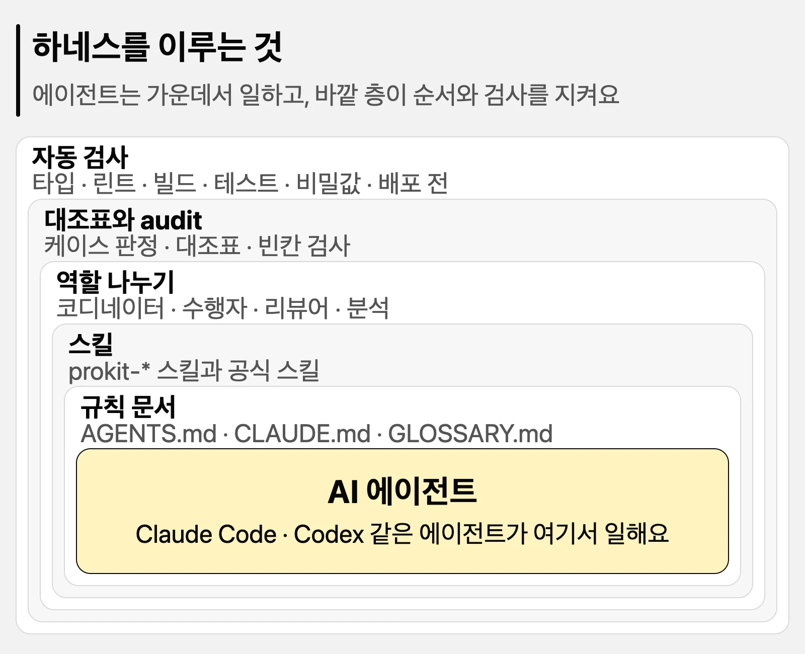
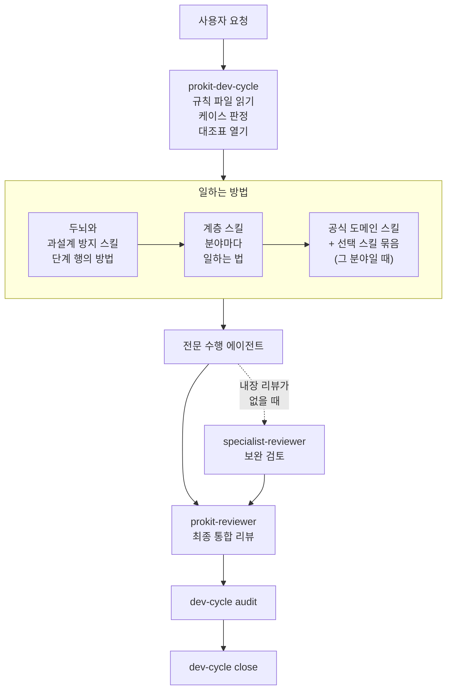

# 하네스 엔지니어링

> 한눈에: 하네스는 에이전트가 정해진 순서와 검사를 지키며 일하게 만드는 규칙, 스킬, 자동 검사의 묶음이에요. 에이전트에게 “잘해 줘”라고 부탁하는 대신 해야 할 일과 확인할 일을 파일과 명령으로 정해 둬요. **그래서 누가 요청하든 에이전트가 같은 순서로 일해요.**

## 왜 필요한가

AI 에이전트는 똑똑하지만 부탁한 대로만 움직여서, 바쁘면 검사를 건너뛰거나 “다 됐어요”라고 먼저 말하기도 해요. 순서와 검사를 파일과 명령으로 정해 둔 이 묶음을 하네스라고 불러요([용어](../../tutorials/reference/glossary.md#도구)).

> [!IMPORTANT]
> 프로킷은 에이전트의 기억력이나 성의에 기대지 않고, 순서와 검사를 파일과 명령으로 못 박아 둬요.

비유하면 건설 현장의 안전 장비와 점검표 같아요. 숙련된 작업자도 안전대를 매고 점검표에 체크하고, 감리가 따로 확인한 뒤에야 준공 검사를 받아요. 하네스는 에이전트에게 채우는 안전대와 점검표이고, 감리가 리뷰 에이전트, 준공 검사가 사용자 확인이에요.

## 하네스가 나에게 보장하는 것

1. 코드를 바꾸는 작업은 언제나 같은 순서(케이스 판정, 대조표, 검사, 리뷰)로 진행돼요.
2. 실제로 실행하지 않은 검사는 통과로 적히지 않아요. 빈칸이 있으면 audit이 막아요.
3. 만든 에이전트와 검토하는 에이전트가 달라서, 자기 작업을 자기가 승인하지 않아요.
4. **마지막 결과 확인은 에이전트가 대신 채우거나 건너뛸 수 없어요.** 내가 직접 보고 확인하거나, 보지 않고 닫겠다고 말하면 그 말이 날짜와 함께 기록돼요.
5. 새 세션이나 다른 에이전트로 바꿔도 파일에 남은 규칙과 대조표로 이어서 일해요.

## 하네스를 이루는 것

템플릿을 설치하면 프로젝트에 다섯 가지가 생겨요. 에이전트는 가운데서 일하고, 바깥 층이 순서와 검사를 지켜요.

| 부분 | 파일과 명령 | 하는 일 |
|---|---|---|
| 자동 검사 | `.dev-cycle.json`의 `commands`, `pnpm skills:check`, `pnpm agents:check`, `pnpm dev-cycle secrets`, `pnpm vercel:deploy … --check`, 에이전트 도구의 훅 | 타입, 린트, 빌드, 테스트, 스킬과 에이전트 상태, 비밀값, 배포 준비를 명령으로 확인해요. 실행한 결과가 곧 증거예요. 훅은 라운드 없는 편집 같은 길을 일하는 도중에 막아요 |
| 대조표와 audit | `scripts/dev-cycle.mjs`, `.dev-cycle.json`, `docs/dev-workflow.md`, `tasks/` | 작업을 케이스로 나누고 케이스별 대조표를 연 뒤 빈칸이 없는지 검사해요. <!-- edition:pro -->큰 일은 `tasks/plan.md`의 진행 계획으로 Task를 나누고, 앞 Task가 끝나야 다음 Task 라운드가 열려요([정밀 분석과 진행 계획](project-plan.md)) <!-- /edition -->|
| 역할 나누기 | `.claude/agents/`의 전문 수행<!-- edition:pro -->, 분석<!-- /edition -->, 리뷰 에이전트([이름과 하는 일](agent-roles.md)) | 코디네이터는 직접 구현하지 않고 계층별 수행자와 읽기 전용 분석·리뷰에 나눠 맡겨요. `prokit-reviewer(...)` 통합 리뷰 행은 최종 리뷰어만 채울 수 있어요 |
| 스킬 | `.agents/skills/prokit-*` <!-- edition:pro --><!-- v:prokit.skills.count -->11<!-- /v --><!-- /edition --><!-- edition:ui 7 -->개와 공식 스킬 | 분야마다 일하는 법을 알려 줘요. `prokit-*`는 일을 나누고 맡기고 검수하고, 공식 스킬은 그 일을 맡은 전문 에이전트가 읽고 따라요. 대조표의 행마다 그 단계에서 읽을 공식 스킬과 맡는 에이전트가 정해져 있어요 |
| 규칙 문서 | `AGENTS.md`, `CLAUDE.md`, `GLOSSARY.md`, `docs/domain/project.md` | 에이전트가 시작할 때 읽는 개발 원칙과 공통 규칙, 용어집, 프로젝트 소개. `CLAUDE.md`는 `@AGENTS.md`로 같은 지침을 읽어요 |

## 요청이 흘러가는 길

코드를 바꾸는 작업은 `prokit-dev-cycle`에서 시작해요. 요청이 어떤 케이스인지 정하고 대조표를 연 다음, 행마다 분야별 스킬과 프로세스 스킬을 불러 써요.

- **전문 공급자 연결**: 코디네이터는 실제 출처와 범위를 확인한 전문 공급자와 공식 스킬을 그 계층의 전문 수행 에이전트에 연결해요.
- **보완 검토**: 공급자 자체의 내장 리뷰가 없을 때만 `specialist-reviewer`에 맡겨요.
- **최종 통합 리뷰**: `prokit-reviewer`가 매번 해요.
- **두뇌 연결**: 두뇌를 골랐다면 단계 행(요구 명확화·계획·구현·디버깅)에서 그 두뇌의 스킬을 쓰고, 증거 칸에 쓴 스킬 이름을 적어요. 구현을 맡길 때는 그 스킬 이름을 위임 지시에 넣어요. 라운드가 열려 있을 때의 `pnpm dev-cycle status`와 `table --write`가 `두뇌:` 줄로 고른 두뇌를 알려 줘요. 두뇌가 주는 에이전트는 읽기 전용 보완 검토로만 쓰고 최종 통합 리뷰는 그대로 `prokit-reviewer`가 해요([두뇌와 선택 스킬](../skills/brains.md)).
- **배포 요청**: 코드를 바꾸지 않으므로 라운드를 열지 않고 `prokit-deploy`가 맡아요. 배포와 운영 DB 적용은 중간에 사용자 동의가 필요해서 서브에이전트(보조 에이전트)에 맡기지 않고 메인 세션에서 해요. <!-- edition:pro -->
- **선택 묶음**: 해당하는 분야인데 스킬이 없으면 에이전트가 설치를 제안해요.

<!-- edition:pro -->

도식에서 이어지는 관계는 이래요.

- 두뇌와 과설계 방지 스킬이 단계의 방법을 먼저 정하고, 계층 스킬이 그 단계에서 읽을 공식 도메인 스킬을 정해요. 화살표는 이 순서예요.
- 두뇌의 단계 스킬은 위임 지시에 넣어 전문 수행 에이전트에 넘기고, 공식 도메인 스킬은 그 에이전트가 읽고 따라요.
- 배포 요청은 이 흐름 밖이에요. 라운드 없이 `prokit-deploy`가 메인 세션에서 배포해요.

- **규칙 파일**: `AGENTS.md`, `GLOSSARY.md`, `docs/domain/project.md`. 시작할 때 읽어요
- **계층 스킬**: `prokit-web`, `prokit-ui`, `prokit-api`, `prokit-db`, `prokit-verify`
- **두뇌와 과설계 방지 스킬**: 고른 것만 써요. 고르지 않았으면 내장 절차와 간결성 규칙으로 해요([두뇌와 과설계 방지 흐름](../skills/brain-flow.md))
- **공식 도메인 스킬**: Next.js, React, Better Auth, shadcn, UI 스킬(impeccable, hallmark. 고르지 않았으면 기본 AI), Neon 또는 Supabase, Vercel
- **전문 수행 에이전트**: 계층별 builder, `prokit-runtime-checker`, `prokit-implementer`
- **선택 스킬 묶음**: ops, motion, mobile, i-have-adhd, 화면 디자인 보조. 설치되어 있지 않으면 설치를 제안하고, 배포의 비용·성능 점검에도 써요
- **`prokit-reviewer`**: plan, code, ui, security, db 리뷰를 맡아요. audit은 모든 행의 증거를 채운 뒤 돌려요
- **`prokit-deploy`**: `--check`, DB 적용, 배포, 확인 순서로 해요
<!-- /edition -->

## 자세히

- **프로세스 스킬 고르기**: 설계, 계획, 구현, 디버깅, 리뷰, QA, 검증에 쓸 프로세스 스킬은 설치된 프로젝트의 `.agents/skills/prokit-dev-cycle/references/process-routing.md`에 표로 정리돼 있어요. 단계마다 1순위 스킬, Claude와 Codex의 대안, 스킬이 없을 때의 절차가 적혀 있어요. 필요한 전문 스킬이 없으면 검증한 대안을 찾고, 대안도 없으면 막힌 이유를 남겨요.
- **과설계 막기**: 스펙에 “만들지 않는 것” 절을 두고, 계획은 `prokit-reviewer(plan)`이 재사용·설정 결정까지 검토해요. 고른 과설계 방지 스킬이 있으면 그 스킬이, 없으면 내장 간결성 규칙과 `prokit-reviewer`가 이 일을 맡아요. 어떤 스킬의 규칙보다 `prokit-dev-cycle`, `AGENTS.md`, 대조표가 우선해요(스킬별 설명은 [두뇌와 선택 스킬](../skills/brains.md)).
- **하네스를 고치는 일**: 스킬, 에이전트, dev-cycle 자체와 빌드·배포·작업공간 설정을 바꾸는 작업도 라운드로 해요. 케이스 H예요([케이스 <!-- v:devCycle.cases.range -->A\~F·H<!-- /v -->와 대조표](cases.md)). 대조표 행의 정본인 `docs/dev-workflow.md`는 프로젝트에 맞게 고쳐도 되고, 고치는 일 자체가 케이스 H 변경이에요.
- **일하는 도중에 막는 훅**: 설치기가 Claude Code 설정(`.claude/settings.json`)에 훅을 넣고, Codex(`.codex/hooks.json`)와 Antigravity(`.agents/hooks.json`)에도 비슷한 훅을 넣어요(도구마다 조금 달라요. 아래 괄호와 [지원하는 에이전트](../start/supported-agents.md)). 훅은 audit이 끝에서 잡는 일을 중간에 막거나 기록해요.
  - 편집 막기(`edit-guard`): 열린 라운드 없이 코드나 하네스 파일을 편집 도구로 고치려 하면 막아요. 라운드가 열려 있어도 코디네이터가 계층 코드를, 계층 에이전트가 다른 계층 파일을 고치려 하면 막아요.
  - 스킬 기록(`skill-log`): 스킬 호출, `SKILL.md` 읽기, 증거 폴더의 스크린샷을 연 일을 `.prokit/skills-used.jsonl`(커밋하지 않는 파일)에 에이전트 이름과 함께 남겨요. audit이 증거에 적은 스킬과 대조해요.
  - 프로세스 끄기 막기(`shell-guard`, Claude Code와 Codex): `pkill`, `killall`, `pgrep`·`lsof` 결과를 넘긴 `kill`처럼 이름이나 포트로 골라 끄는 명령을 막아요. 같은 기기의 다른 프로젝트 서버까지 꺼지기 때문이에요. 계층 파일(화면<!-- edition:pro -->·서버·DB<!-- /edition --> 코드)을 리다이렉션, `sed -i`, `cp`·`mv`, 파일을 쓰는 `python`·`node` 스크립트로 고치는 명령도 막아요. 셸로 고치면 편집 훅이 계층을 확인하지도 기록하지도 못하기 때문이에요. 실제로 쓰는 대상만 봐요. 스크립트가 쓰는 글이나 읽기·불러오기 인자에 계층 경로가 들어 있어도 막지 않아요. 생성 명령과 포맷 명령은 막지 않아요.
  - 커밋 막기(git pre-commit 훅): 라운드 기록 없이 코드나 하네스를 커밋하려 하면 막아요([dev-cycle 라운드](dev-cycle.md#마무리)).
  - Codex는 `/hooks`에서 신뢰하고, Antigravity는 폴더를 신뢰한 뒤에 돌아요. 도구별 확인 범위는 [지원하는 에이전트](../start/supported-agents.md)에 있어요.
- **새 세션도 같은 규칙으로**: 규칙 문서와 대조표가 파일로 남아 있어서 새 세션은 `pnpm dev-cycle status`로 진행 중인 라운드를 이어받아요. 닫은 라운드와 완료한 일반 할 일은 `tasks/archive/README.md`에서 찾고, `tasks/todo.md`에는 남은 항목만 남아요.
- **공급자와 자원 경계**: 매니페스트는 설치할 항목의 정본이에요. 실제 공급자 선택은 출처·내용 해시·범위·의존성·부작용을 확인하고 정해요. 현재 작업에 연결된 프로젝트·워크트리·관리 임시 폴더만 보수적으로 크기를 재고, 전역 정리나 영구 환경 삭제는 하지 않아요. [위임과 자원 관리](delegation-and-resources.md)에서 이유와 증거를 확인해요.

## 관련 문서

- [스킬 구조 한눈에](../skills/skill-map.md)
- [dev-cycle 라운드](dev-cycle.md)
- [라운드 한 번 따라가 보기](round-example.md)
- [위임 에이전트와 리뷰 에이전트](agent-roles.md)
- [위임과 자원 관리](delegation-and-resources.md)
- [prokit 스킬](../skills/prokit-skills.md)
- [공식 스킬과 연결](../skills/official-skills.md)
- [템플릿이 더하는 것](../templates/what-it-adds.md)
