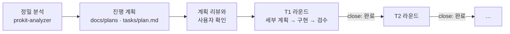

# 정밀 분석과 진행 계획

> 한눈에: 라운드 하나로 끝나지 않는 큰 일(기존 프로젝트 도입, 다른 언어에서 전환, 큰 기능 묶음)은 진행 계획을 세워 Task로 나눠요. **Task 하나가 라운드 하나이고, 앞 Task가 완전히 끝나야 다음 Task를 열 수 있어요.** 기존 프로젝트는 계획 전에 분석 에이전트가 프로젝트를 정밀 분석해요.

## 흐름



1. **정밀 분석**: 읽기만 하는 분석 에이전트 `prokit-analyzer`가 스택, 구조, 기능·화면·데이터, 테스트와 배포, 보안, 디자인 자산, 위험을 살펴요. 유형에 따라 더 보는 것이 있어요. 초기 프로젝트는 기획 자료와 프로토타입의 대응, 운영 중인 프로젝트는 프로킷 규칙과의 차이, 전환은 기능·데이터 대응표와 옮길 순서예요. 결과는 `docs/prokit/analysis.md`에 남아요. 분석 에이전트는 이번에 연 파일에서만 판, 개수, 파일 이름을 옮겨요. `package.json`의 판이 `catalog:`면 `pnpm-workspace.yaml`을 열고, 열지 못한 것은 "확인하지 못한 것"에 둬요. 경로는 프로젝트 기준 상대 경로로 적어요.
2. **진행 계획**: 먼저 결과를 바꾸는 질문부터 물어요. 기존 프로젝트는 분석의 "먼저 확인할 질문" 가운데 Task 구성을 바꾸는 것, 새 프로젝트는 PRD의 모호함이에요. 디자인 방향은 여기서 묻지 않고, 그 화면 Task에서 `prokit-ui`가 물어요(기존 디자인을 이어 갈지, 리디자인할지). 답을 받은 뒤 고른 두뇌(없으면 지금 에이전트)가 분석을 바탕으로 계획 문서(`docs/plans/`)와 Task 표(`tasks/plan.md`)를 써요. 계획 문서에는 목표, 사용자 결정, 범위, 만들지 않는 것, Task 목록, 순서의 이유, 되돌리기 방법을 적고, Task마다 목표, 범위, 완료 조건, 예상 케이스, 위험을 적어요. 예상 케이스는 바꿀 파일을 `.dev-cycle.json`의 `rules`에 대어 정해요. 맞출 것(프로킷 규칙과의 차이)이 있을 때만 첫 Task를 H로 두고, 바꿀 파일이 없거나 완료 조건이 이미 참인 빈 Task는 만들지 않아요. 테스트 러너(vitest) 도입은 H Task로 따로 두지 않고, 처음 D·E를 고치는 Task 라운드의 `vitest 도입` 행으로 해요(E만 고치면 `packages/db`에만 두어요). 계획은 리뷰 에이전트(`prokit-reviewer`)가 검토하고 사용자가 확인해요. 정밀 분석과 진행 계획은 라운드 하나(`pnpm dev-cycle table A --write --title "정밀 분석과 진행 계획" --plan`)로 해요. 이 명령이 분석, 계획, 계획 리뷰 칸을 대조표 맨 앞에 붙여요. 사용자는 리뷰까지 끝난 최종 계획 요약을 보고 확인해요. 확인 칸에는 그때 본 Task 구성의 지문(`sig=`)을 함께 적어요. 계획을 보기 전에 한 "진행해"는 확인으로 치지 않고, 확인한 뒤 Task 구성이 바뀌면 다시 확인받아요.
3. **Task 라운드**: `pnpm dev-cycle table <케이스> --write --title "T1 …" --task T1`로 열어요. 대조표 맨 앞에 두 칸이 붙어요. 그 Task를 지금 코드에 맞춰 다시 설계한 세부 계획(바꿀 파일, 단계, 단계별 검사, 완료 조건)과 그 계획의 리뷰예요. 케이스 F처럼 계획 리뷰 행이 이미 있는 케이스는 세부 계획 칸 하나만 붙고, 원래 리뷰 행이 세부 계획을 검토해요. 세부 계획을 쓰기 전에 그 케이스에서 물을 것(B·F의 디자인 방향과 범위)을 먼저 물어요. 세부 계획의 바꿀 파일이 연 케이스보다 무거운 경로 규칙에 걸리면 `--upgrade`로 케이스를 올려요. 케이스를 낮추려고 파일을 옮기거나 `rules`를 고치지 않아요. 이어서 구현, 검수, 테스트, 보완, 사용자 확인을 평소 라운드처럼 해요.
4. **다음 Task**: `pnpm dev-cycle close`가 Task를 완료로 기록하면 다음 Task를 열 수 있어요.

## Task 표

`tasks/plan.md`에 이런 표가 있어요.

```markdown
<!-- dev-cycle:plan doc=docs/plans/2026-10-23-migration-plan.md sig=9c1e4b7a20d3 -->
## 진행 계획: 레거시 예약 서비스 전환
| Task | 제목 | 상태 | 기록 |
|---|---|---|---|
| T1 | 하네스 경로 규칙 맞추기 | 완료 | tasks/archive/2026-10-23-T1-하네스-경로-규칙-맞추기.md |
| T2 | 회원 데이터 모델 옮기기 | 진행 | |
| T3 | 예약 조회 화면 옮기기 | 대기 | |
<!-- dev-cycle:plan-end -->
```

| 상태 | 뜻 |
|---|---|
| 대기 | 아직 시작하지 않았어요 |
| 진행 | 라운드를 열었거나, 막힌 칸을 남기고 부분 완료로 닫았어요 |
| 완료 | 라운드가 audit과 사용자 확인을 통과해 닫혔어요. 기록 칸에 보관 파일이 있어요 |
| 제외 | 사용자가 하지 않기로 정했어요. 기록 칸에 사유와 날짜를 적어요 |

`dev-cycle:plan` 블록이 없는 `tasks/plan.md`는 진행 계획으로 보지 않아요. 다른 도구(예: agent-skills 두뇌의 `/plan`)가 같은 이름의 계획 문서를 쓰면 그 계획은 `docs/plans/`로 옮기고, `tasks/plan.md`에는 Task 표만 둬요.

## 게이트가 막는 것

- 앞 Task가 완료나 제외가 아니면 다음 Task 라운드가 열리지 않아요.
- 손으로 "완료"라고 고쳐도 소용없어요. 기록 칸의 마지막 보관 파일이 그 Task의 라운드이고 부분 완료가 아니어야 완료로 인정해요. 아니면 `pnpm dev-cycle plan`과 audit이 문제로 알려요.
- 진행 계획 라운드를 닫으면 Task 구성(번호, 제목, 순서)의 지문이 계획 블록 머리(`sig=`)에 적혀요. 지문이 없는 계획, 즉 진행 계획 라운드를 거치지 않은 계획에서는 Task 라운드가 열리지 않아요. 그 뒤 라운드 밖에서 Task를 더하거나 순서를 바꾸거나 지문을 지우면 `pnpm dev-cycle plan`과 audit이 문제로 알리고 다음 Task 라운드가 열리지 않아요. 계획은 진행 계획 라운드(`--plan`)에서 고쳐요. 상태와 기록 칸은 지문에 들지 않아서 제외는 그대로 기록할 수 있어요.
- 앞 라운드(진행 계획이나 앞 Task)를 닫은 뒤 커밋하지 않으면 다음 Task 라운드가 열리지 않아요. 계획 변경이 다음 Task의 diff와 커밋에 섞이지 않게 해요.
- 막힌 칸이 남아 부분 완료(`close --partial`)로 닫으면 Task는 진행으로 남아요. 같은 Task를 다시 열어 끝내요.
- 진행 중에 생긴 버그 수정처럼 Task가 아닌 일은 `--task` 없이 라운드를 열어도 돼요. Task를 끝낸 것으로 세지는 않아요. 이때 끝나지 않은 Task가 있으면 경고가 나와요. 그 Task의 일이었다면 `--task`로 다시 열어요.
- 기존 프로젝트는 진행 계획을 확정하기 전(지문 없음)에는 `--task` 없는 라운드도 열리지 않아요. 분석과 계획을 건너뛰고 바로 일을 시작하지 않게 해요. 사용자가 계획 전에 하라고 한 급한 버그 수정, 템플릿 갱신 반영, 스킬 구성 변경만 `--no-task`를 붙여 열어요. 경로 규칙·하네스 맞추기와 기능 일은 진행 계획의 Task로 해요. `--no-task`로 연 라운드는 대조표 머리와 `status`에 표시돼요.
- 그 Task의 라운드가 이미 열려 있으면 `status`와 `plan`이 새로 열지 말고 열린 라운드에서 이어 가라고 알려요.
- 사용자가 앞 Task를 미루거나 건너뛰자고 해도 바로 고치지 않아요. 게이트를 설명하고 고르게 해요. 그 Task를 마저 하기(추천), 제외(사유를 받아 기록), 순서 바꾸기(`--plan` 라운드에서 계획 리뷰와 확인을 다시 받아요) 중에서 고른 뒤에 바꿔요.

## 명령

| 명령 | 하는 일 |
|---|---|
| `pnpm dev-cycle plan` | Task 표, 다음에 열 Task, 문제를 보여 줘요. 진행 계획 라운드 중에는 Task 구성의 지문(`sig=`)도 보여 줘요. 문제가 있으면 exit 1 |
| `pnpm dev-cycle table A --write --title "…" --plan` | 진행 계획 라운드를 열어요. 분석, 계획 문서와 Task 표, 계획 리뷰 칸이 맨 앞에 붙어요 |
| `pnpm dev-cycle table <케이스> --write --title "T1 …" --task T1` | 게이트를 통과하면 그 Task의 라운드를 열어요 |
| `pnpm dev-cycle table <케이스> --write --title "…" --no-task` | 계획 전에 하라고 한 급한 일만 Task 없이 열어요. 대조표에 `notask=true`가 남아요 |
| `pnpm dev-cycle status` | 진행 중인 라운드와 함께 진행 계획의 다음 Task를 보여 줘요. 전환이면 기존 코드 경로도 보여 줘요 |
| `pnpm dev-cycle close` | 라운드를 닫고 Task를 완료로 기록해요 |

## 관련 문서

- [기존 프로젝트에 도입하기](../start/adopt.md)
- [dev-cycle 라운드](dev-cycle.md)
- [위임 에이전트와 리뷰 에이전트](agent-roles.md)
- [증거와 audit, 사용자 확인](audit-and-confirm.md)
