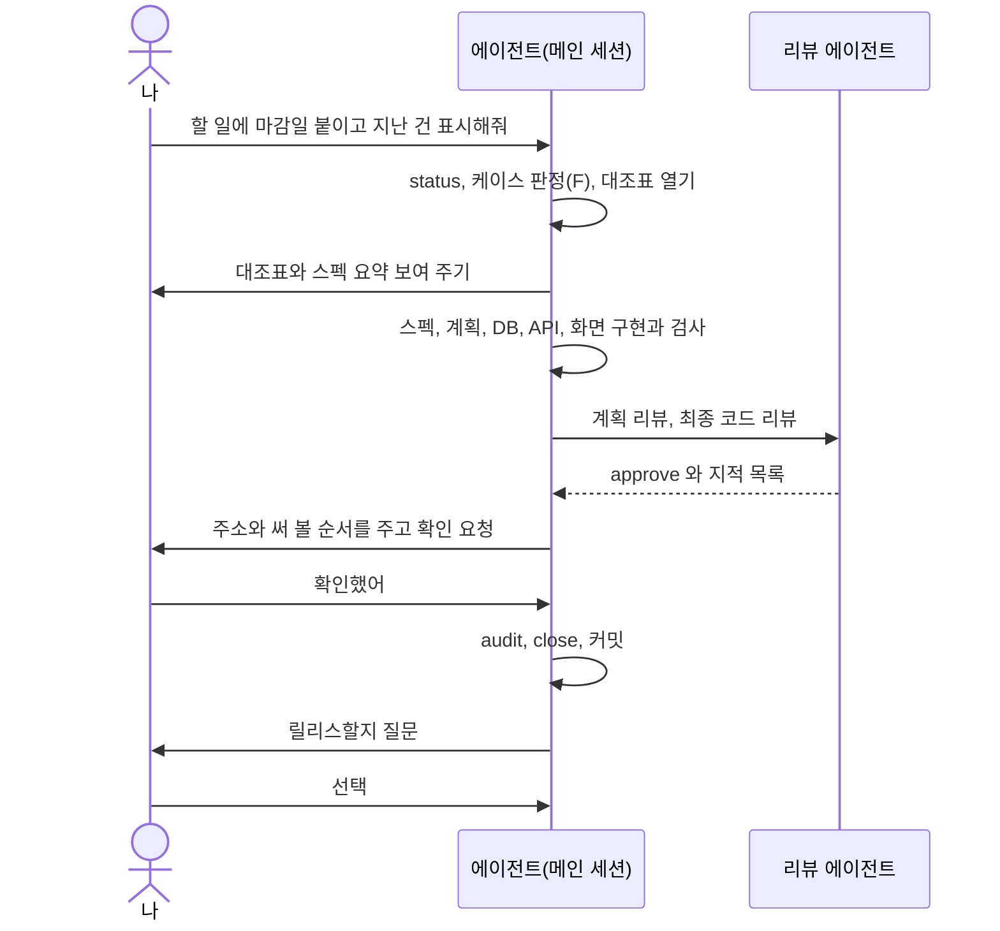

# 라운드 한 번 따라가 보기

> 한눈에: "할 일에 마감일 붙여줘"라는 한 줄 요청이 라운드 하나로 끝나기까지, 사용자가 무엇을 보고 무엇을 말하고 에이전트가 무엇을 하는지 대화와 화면 기록으로 따라가 봐요. 아래 대화와 표는 모두 **예시**예요. 명령 이름과 안내 문구는 템플릿의 `scripts/dev-cycle.mjs`와 `docs/dev-workflow.md`에서 가져왔고, 숫자와 파일 이름은 이해를 돕는 가짜 값이에요.

## 왜 이 쪽이 필요한가

[dev-cycle 라운드](dev-cycle.md)는 규칙만 읽으면 딱딱해요. 실제로는 이런 모습이에요. 사용자는 말로 부탁하고, 에이전트가 표를 열어 칸을 채우고, 마지막에 사용자에게 "써 보고 확인해 주세요"라고 물어요. 사용자가 직접 칠 명령은 거의 없어요. 처음 보는 말(에이전트, 커밋, push 등)은 [처음 보는 용어](../../tutorials/reference/glossary.md#도구)에서 찾아보세요.

## 한눈에 보는 순서



## 1. 요청하기

**내가 하는 일**: 하고 싶은 것을 평소 말로 보내요. 파일 이름이나 명령을 몰라도 돼요.

```text
할 일에 마감일 붙이고 지난 건 빨갛게 표시해줘
```

**에이전트가 하는 일**: `prokit-dev-cycle` 스킬을 불러 `pnpm dev-cycle status`로 진행 중인 라운드가 있는지 봐요. `AGENTS.md`, `GLOSSARY.md`, `docs/domain/project.md`를 읽고 요청을 한 문장으로 다시 써요. 결과가 달라질 만큼 모호하면 구현 전에 물어요.

> 예시 응답: 요청을 이렇게 이해했어요. 할 일마다 마감일을 저장하고, 목록에서 마감이 지난 항목을 빨간색으로 표시합니다. 마감일은 선택 입력인가요, 필수인가요?

## 2. 케이스 판정과 대조표 열기

**내가 하는 일**: 위 질문에 답해요(예: "선택 입력이야"). 케이스는 에이전트가 정해요.

**에이전트가 하는 일**: 화면, API, DB에 모두 걸치는 새 기능이라 케이스 F로 정하고 대조표를 열어요([케이스 <!-- v:devCycle.cases.range -->A\~F·H<!-- /v -->와 대조표](cases.md)).

```bash
pnpm dev-cycle table F --write --title "할 일 마감일"
```

> 화면 기록(예시): `tasks/todo.md에 케이스 F 대조표(N행)를 썼다`

열린 대조표는 `tasks/todo.md`에 이런 표로 들어가요. 행 문구는 `docs/dev-workflow.md`의 케이스 F에서 오고, 아래는 일부만 줄여 적은 **예시**예요.

```markdown
## 활성 라운드: F — 할 일 마감일
| # | 단계 | 증거 |
|---|---|---|
| 1 | 스펙 작성 (… 스펙에 '만들지 않는 것' 절과 인수 조건·테스트 시나리오 절 …) → 사용한 스킬, 스펙 경로, 추가·변경한 용어 |  |
| 2 | 구현 계획 (…) → 사용한 스킬과 계획 경로 |  |
| 3 | [design] 재사용·설정 설계 점검 (…) → 기존: 경로·소비자; 결정: 재사용·분리; 설정: 환경 변수·설정 영향; 검증: 회귀 검사 |  |
| 4 | [review] prokit-reviewer(plan) 계획 리뷰 (…) → prokit-reviewer(plan): approve, max=none|low|medium, 반영·기각 내역. N/A 불가 |  |
| 5 | 구현 방식 (…) → 사용한 스킬, provider 검증, … |  |
| … | (E 행: 스키마 수정과 마이그레이션, 로컬 DB 적용 / D 행: zod 계약, 2계정 격리 테스트 / B 행: 스크린샷, critique, audit) | |
| 17 | [review] prokit-reviewer(code) 전체 diff 최종 리뷰 → verdict, max_severity, 반영·기각 내역 |  |
| 18 | [verify] 사용자 흐름 QA (…) → 시나리오별 통과·실패, 오류 예산 수 |  |
| … | (QA 발견 수정과 재QA 등 공통 행) | |
| 19 | 문서 영향 확인 (…) → 갱신 내역 또는 N/A: 사유 |  |
| 20 | [confirm] 사용자 확인 (…N/A 불가) → 확인한 내용과 날짜 |  |
```

맨 오른쪽 증거 칸이 비어 있는 동안은 끝난 게 아니에요. 서버나 DB를 처음 고치는 프로젝트라면 맨 앞에 `vitest 도입(최초 1회)` 행이 하나 더 붙어요.

## 3. 스펙과 브리프 확인

**에이전트가 하는 일**: 1번 행에서 스펙을 써요. 스펙에는 "만들지 않는 것"(예: 알림, 반복 일정), 인수 조건, 정상·빈·오류·경계 상태의 테스트 시나리오가 들어가요. 새 용어(예: 마감일)는 `GLOSSARY.md`에 적어요. 화면이 있으면 impeccable 브리프도 만들어요. 2번 행의 계획은 `prokit-reviewer(plan)`이 읽기 전용으로 검토하고, 지적은 구현 전에 반영해요.

**내가 하는 일**: 스펙의 "만들지 않는 것"과 인수 조건을 훑어보고, 빠졌거나 과한 것을 말해요.

> 예시 응답: 스펙 초안이에요(경로는 대조표 1번 행 증거 칸에 적어요). 만들지 않는 것: 알림, 반복 마감. 인수 조건: 마감일 없이도 저장돼요. 마감이 지난 항목은 목록에서 빨간색이에요. 이대로 구현할까요?

```text
알림은 정말 빼고, 마감일 입력은 날짜 선택기로 해줘
```

## 4. 구현과 검사

**내가 하는 일**: 기다려요. 막히면 에이전트가 물어요. 상태가 궁금하면 "지금 어디까지 했어?"라고 물으세요.

**에이전트가 하는 일**: 대조표 위에서부터 순서대로 DB, API, 화면을 만들어요. 행 하나를 끝낼 때마다 실제로 실행한 명령과 결과를 증거 칸에 적어요(`pnpm check-types → exit 0`처럼. [증거 적는 법](audit-and-confirm.md#증거-적는-법)). 구현을 맡길 수행자(`prokit-implementer`)에게는 고칠 파일을 정확히 지정해 줘요([위임 에이전트와 리뷰 에이전트](agent-roles.md)). 진행 상황은 `status`로 볼 수 있어요.

> 화면 기록(예시, 숫자는 가짜): `라운드 F "할 일 마감일" — 11/20칸 — 다음: [verify] next-dev-loop 통합 런타임 확인`

화면 칸에서는 데스크톱과 모바일 스크린샷을 찍고, 브라우저 콘솔 오류가 0인지 세요([오류 예산](audit-and-confirm.md#검사-고르기)).

## 5. 독립 리뷰

**에이전트가 하는 일**: 구현이 끝나면 `prokit-reviewer`가 전체 diff를 읽기 전용으로 리뷰해요. 만든 쪽이 자기 변경을 승인하지 않게 하려는 거예요. 지적이 있으면 직접 확인한 뒤 고치고, 증거에는 이렇게 적어요.

> 증거 칸(예시): `prokit-reviewer(code): approve, max=low, 지적 2 (반영 1, 기각 1: 재현 안 됨)`

**내가 하는 일**: 없어요. 리뷰 결과를 요약해서 보고받으면 돼요.

## 6. 확인해 달라는 요청

**에이전트가 하는 일**: 먼저 `pnpm dev-cycle audit`으로 남은 문제가 마지막 `[confirm]` 행뿐인지 봐요. 개발 서버를 띄워 주소가 응답하는지 확인한 뒤 이렇게 물어요.

> 예시 메시지: 마감일 기능을 다 만들었고 검사와 리뷰를 마쳤어요. http://localhost:3001 에서 직접 써 보시고 확인해 주세요. 써 볼 순서는 이래요. 1) 할 일을 마감일 없이 추가한다 2) 어제 날짜를 마감일로 추가한다. 빨간색으로 보이는지 본다 3) 모바일 너비로 줄여 본다. 알려진 문제: 시간대가 한국 시간으로 고정이에요(미룬 지적, 백로그에 적어 뒀어요). 확인하시면 확인했다고 알려 주세요. 고칠 것이 있으면 알려 주세요.

**내가 하는 일**: 정말로 열어서 써 봐요. 이 칸은 에이전트가 대신 채울 수 없어요([확인해 달라고 하면](audit-and-confirm.md#확인해-달라고-하면)).

## 7. 내 답

```text
확인했어
```

고칠 것이 있으면 `2번에서 빨간색이 너무 진해. 연하게 해줘`처럼 말해요. 에이전트가 고치고 해당 행을 다시 채운 뒤 다시 확인을 받아요.

**에이전트가 하는 일**: 확인한 내용과 날짜를 증거 칸에 적어요.

> 증거 칸(예시): `사용자: 직접 확인 완료(2026-10-23)`

## 8. audit, close, 커밋

**에이전트가 하는 일**: 빠진 칸이 없는지 `audit`으로 검사하고, 통과하면 라운드를 닫아요.

> 화면 기록(예시): `audit 통과`, `라운드를 닫았다 → tasks/archive/2026-10-23-할-일-마감일.md`

미룬 지적은 `tasks/todo.md`의 백로그로 옮겨요. 커밋 전에 `pnpm dev-cycle secrets`로 비밀값이 섞이지 않았는지 보고, 이 라운드에서 바꾼 파일과 `tasks/`만 `feat:` 같은 접두어 제목으로 커밋해 push해요. `origin`(GitHub 원격 저장소)이 없으면 커밋까지만 해요.

**내가 하는 일**: 없어요. 보고에서 실행한 검사와 커밋 내용을 읽어 보세요.

## 9. 릴리스를 할지 묻는 질문

**에이전트가 하는 일**: `pnpm vercel:deploy production --check`로 배포 준비를 봐요. 기본 브랜치, GitHub `origin`, GitHub 로그인(`gh auth status`) 등이 모두 갖춰졌을 때만 한 번 물어요. 하나라도 모자라면 묻지 않고 커밋·push까지만 하고 이유를 알려 줘요.

> 예시 질문(선택지): 「릴리스하고 production 배포 (기본)」 또는 「커밋·push만 (배포 PASS)」

**내가 하는 일**: 하나를 골라요. 릴리스를 고르면 에이전트가 노트를 쓰고 버전과 노트를 보여 준 뒤 발행해도 되는지 다시 물어요. 운영 DB에 적용할 마이그레이션이 있으면 목록을 보여 주고 따로 동의를 받아요([Vercel 배포와 되돌리기](../deploy/vercel.md)). 지금은 배포하지 않기로 했다면 "커밋·push만"을 골라도 돼요. 릴리스하지 않은 변경은 다음 릴리스에 함께 담겨요.

## 막히면

- 에이전트가 표를 열지 않고 바로 코딩하면 `prokit-dev-cycle 스킬로 케이스부터 판정하고 대조표를 열어줘`라고 보내세요.
- 어디까지 했는지 모르겠으면 `pnpm dev-cycle status` 결과를 보여 달라고 하세요.
- 확인 요청이 오기 전에 에이전트가 "완료"라고 하면 `audit이 통과했는지와 사용자 확인 행이 채워졌는지 보여줘`라고 물어요.
- 이어서 읽기: [증거와 audit, 사용자 확인](audit-and-confirm.md)

## 관련 문서

- [dev-cycle 라운드](dev-cycle.md)
- [케이스 <!-- v:devCycle.cases.range -->A\~F·H<!-- /v -->와 대조표](cases.md)
- [증거와 audit, 사용자 확인](audit-and-confirm.md)
- [위임 에이전트와 리뷰 에이전트](agent-roles.md)
