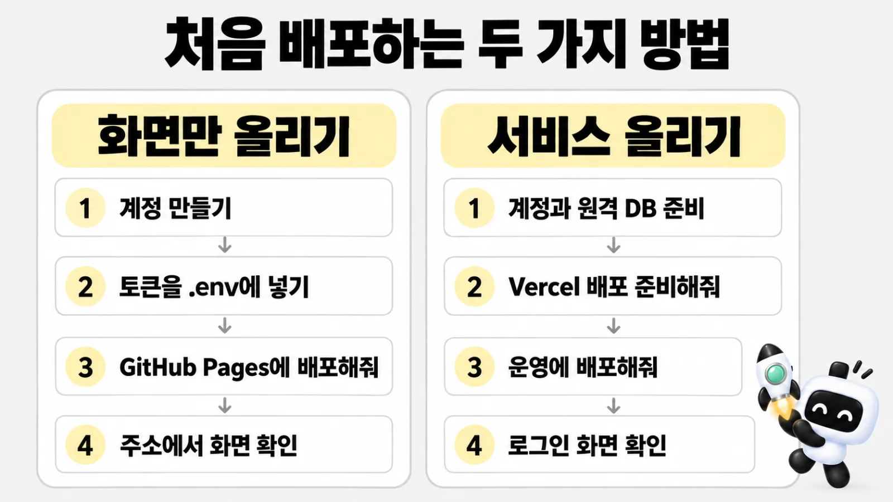

# 처음 배포하기

> 한눈에: 내 컴퓨터에서만 보이던 서비스를 인터넷에 처음 올리는 순서예요. 화면만 만든 프로젝트는 GitHub Pages나 Vercel에, DB가 있는 서비스는 Vercel에 올려요. 계정과 도구를 준비하고, 에이전트에게 "Vercel 배포 준비해줘" 같은 요청을 순서대로 보내면 돼요.

## 왜 따로 준비하나요

배포(deploy)는 내 컴퓨터의 파일을 다른 사람이 인터넷으로 볼 수 있는 곳(호스팅 서비스)에 올리는 일이에요. 올리려면 그 서비스의 계정이 필요하고, DB가 있는 서비스는 내 컴퓨터가 아닌 인터넷의 DB(원격 DB)도 필요해요. 에이전트는 사용자가 요청하기 전에는 올리지 않아요. 용어는 [처음 보는 용어](../../tutorials/reference/glossary.md#올리기)에 있어요.



## 내 상황 고르기

| 내 프로젝트 | 올릴 곳 | 읽을 곳 |
|---|---|---|
| 화면만 만들었어요(DB 없음) | GitHub Pages 또는 Vercel(정적 HTML) | 아래 "화면만 올리기", [GitHub Pages 배포](github-pages.md) |
| DB가 있는 서비스예요 | Vercel + 원격 DB(Neon 또는 Supabase) | 아래 "서비스 올리기", [Vercel 배포와 되돌리기](vercel.md) |

배포 비용은 계정과 요금제마다 달라요. 지금 요금은 각 서비스의 공식 페이지에서 확인하세요([비용과 키](../../tutorials/reference/costs-and-keys.md#배포-비용)).

## 화면만 올리기

1. 올릴 곳의 계정을 만들어요. GitHub Pages는 GitHub 계정, Vercel은 Vercel 계정이에요.
2. 토큰(내 계정으로 올려도 된다는 열쇠)을 만들어 작업 폴더나 프로젝트의 `.env`에 넣어요. GitHub Pages는 `GH_TOKEN`, Vercel은 `VERCEL_TOKEN`이에요. 만드는 법은 [배포하기](../../tutorials/reference/deploy.md)에 있어요.
3. 에이전트에게 이렇게 요청해요.

   ```text
   GitHub Pages에 배포해줘
   ```

   Vercel로 올릴 때는 "Vercel에 배포해줘"라고 해요. 에이전트가 화면을 HTML로 내보내 올리고 주소를 알려 줘요. GitHub Pages는 저장소가 없으면 저장소도 만들어요.
4. 열린 주소에서 화면을 확인해요.

**이렇게 되면 성공**

- 에이전트가 알려 준 주소가 열리고 만든 화면이 보여요.

고친 화면은 "고친 화면을 다시 배포해줘", 내릴 때는 "배포한 사이트를 내려줘"라고 해요. 자세한 순서와 토큰을 다루는 방법은 [GitHub Pages 배포](github-pages.md)에 있어요.

## 서비스 올리기

### 준비 체크리스트

| 준비 | 누가 하나요 | 확인 |
|---|---|---|
| GitHub 계정과 원격 저장소(`origin`) | 사용자가 만들어요. 요청하면 원격 저장소는 에이전트가 만들어요 | `git remote -v`에 `origin`이 보여요 |
| `gh auth login` | 사용자가 로그인해요 | `gh auth status`에 로그인한 계정이 보여요 |
| Vercel 계정과 Vercel CLI, `vercel login` | 사용자가 설치하고 로그인해요 | `vercel whoami`가 내 계정을 보여 줘요 |
| 원격 DB | 사용자가 계정과 프로젝트를 만들어요(neon 템플릿은 Neon, supabase 템플릿은 Supabase). 병합 전 확인용(develop)과 운영용이 따로 필요해요 | 템플릿 README의 "Vercel 배포"를 따라 준비해요([neon](../../templates/prokit-next-neon/README.md#vercel-배포) · [supabase](../../templates/prokit-next-supabase/README.md#vercel-배포)) |
| Node.js 버전 | Vercel 프로젝트 설정에서 <!-- v:vercel.node -->24.x<!-- /v -->로 둬요 | 20.x면 <!-- v:vercel.node20Stop -->2026-10-01<!-- /v -->부터 새 배포가 실패해요 |

> [!WARNING]
> 비밀번호나 연결 주소는 대화창에 붙여 넣지 않아요. 에이전트가 값이 출력되지 않는 방법으로 Vercel 환경변수에 넣어요([비밀값 지키기](secrets.md)).

### 순서

> [!IMPORTANT]
> production은 기본 브랜치에서 릴리스한 커밋만 올려요. 릴리스가 없으면 배포 스크립트가 production 배포를 멈춰요([버전과 릴리스](release.md)).


1. **준비**: 에이전트에게 요청해요.

   ```text
   Vercel 배포 준비해줘
   ```

   에이전트는 팀이 둘 이상이면 어느 팀에 만들지, 새 Vercel 프로젝트 이름은 무엇으로 할지 물어요. 그다음 프로젝트를 연결하고 환경변수(`DATABASE_URL`, `BETTER_AUTH_SECRET`, `BETTER_AUTH_URL`)를 넣은 뒤 `--check`로 준비 상태를 확인해요. **준비를 요청했다고 배포하지는 않아요.**
2. **첫 배포는 운영(production)이에요**: Vercel이 프로젝트의 첫 배포를 무조건 production으로 만들기 때문이에요. 그래서 스크립트는 production 배포가 없으면 develop 배포를 막아요. 첫 배포는 이렇게 요청해요.

   ```text
   운영에 배포해줘
   ```

   운영 배포에는 릴리스(버전 번호 붙이기)가 따라와요([버전과 릴리스](release.md)). 첫 버전은 `v0.1.0`이에요. 에이전트는 이렇게 보여 주고 물어요(문구는 다를 수 있어요).

   - "릴리스 `v0.1.0`과 노트예요. 이 노트로 발행할까요?"
   - "운영 DB에 적용할 마이그레이션은 이 N개예요. 적용할까요?"

   **동의하기 전에는 발행도 DB 적용도 하지 않아요.** DB를 먼저 적용하는 이유는 새 코드가 새 컬럼을 쓰기 때문이에요.
3. **확인**: 에이전트가 배포 주소에서 `/api/auth/get-session`이 200(정상 응답)인지 확인하고 보고해요. 사용자는 그 주소를 열어 로그인 화면이 뜨는지 눈으로 봐요. 운영에서는 가입이나 글쓰기처럼 데이터를 만드는 확인은 하지 않아요.
4. **그 뒤**: 새 기능을 만들면 병합 전에 확인용으로 "develop에 배포해줘", 실제 사용자에게 공개할 때 "운영에 배포해줘"라고 해요. 기능 라운드가 끝나면 에이전트가 "릴리스하고 production 배포할까요?"라고 물을 때도 있어요.

**이렇게 되면 성공**

- 에이전트가 알려 준 주소에서 로그인 화면이 떠요.
- 보고에 `/api/auth/get-session`이 200이라는 결과가 있어요.
- 보고에 배포 주소, 릴리스(운영만), DB 적용 결과, 되돌리기 명령이 들어 있어요.

### develop과 production은 무엇이 다른가요

| | develop | production |
|---|---|---|
| 쉬운 말 | 내가 먼저 써 보는 확인용 사본 | 실제 사용자가 쓰는 서비스 |
| DB | 확인용 원격 DB(neon의 `develop` 브랜치, supabase의 스테이징 프로젝트) | 운영 DB |
| 주소 | 고정 주소(`<프로젝트>-develop.vercel.app` 같은 이름). Vercel 로그인이 필요할 수 있어요 | 운영 주소 |
| 릴리스 | 하지 않아요 | 버전 태그와 노트가 있는 커밋만 올려요 |
| DB 적용 동의 | 바로 적용해요 | 목록을 보여 주고 동의를 받은 뒤 적용해요 |

## 결과 확인하고 되돌리기

- 확인 결과는 에이전트의 마지막 보고에 있어요. 배포 주소, 릴리스(운영만), DB 적용 결과, 확인 결과, 되돌리기 명령이 들어 있어요. 빠진 내용이 있으면 "배포 결과를 다시 보고해줘"라고 해요.
- 문제가 생기면 이렇게 말해요.

  ```text
  직전 배포로 되돌려줘
  ```

  운영은 `vercel rollback`, develop은 `vercel alias set`으로 이전 배포로 돌려요(되돌리기도 배포라서 요청할 때만 해요). 고친 뒤에는 새 patch 릴리스로 다시 배포해요.

> [!WARNING]
> 운영을 되돌려도 릴리스 기록은 지우지 않고, DB 마이그레이션은 되돌리지 않아요.

## 막히면

| 증상 | 해볼 것 |
|---|---|
| 에이전트가 "준비 안 됨"이라고 해요 | 알려 준 항목(예: CLI 없음, 환경변수 빠짐, 릴리스 없음)을 하나씩 해결해요. "무엇이 빠졌는지 정리해줘"라고 해요 |
| 로그인이나 토큰 오류예요 | 다시 로그인하기 전에, 키를 제대로 불러왔는지 에이전트에게 먼저 확인해 달라고 해요. 값을 대화창에 붙여 넣지 않아요 |
| 배포 주소에서 로그인이 안 돼요 | 배포마다 생기는 임시 주소에서는 로그인이 실패해요. 고정 주소로 열어요 |
| 그 밖에 | [막혔을 때](../../tutorials/reference/troubleshooting.md) |

## 자세히

- 배포 순서, 환경변수, 쓰지 않는 도구는 [Vercel 배포와 되돌리기](vercel.md)에 있어요.
- 버전 규칙과 릴리스가 멈추는 경우는 [버전과 릴리스](release.md)에 있어요.
- 기존 프로젝트를 들였다면 라운드를 마칠 때 배포를 묻지 않는 경우가 있어요([기존 프로젝트에 도입하기](../start/adopt.md)). 하네스만 설치해 배포 스크립트가 없는 `--adopt` 프로젝트, 그리고 배포 방법을 아직 프로킷에 맞추지 않은 운영 중 프로젝트예요.
- 이 쪽의 순서는 `prokit-deploy` 스킬과 `scripts/vercel-deploy.mjs`의 동작을 따랐어요.

## 관련 문서

- [Vercel 배포와 되돌리기](vercel.md)
- [GitHub Pages 배포](github-pages.md)
- [버전과 릴리스](release.md)
- [비밀값 지키기](secrets.md)
