# DESIGN.md

> 한눈에: `DESIGN.md`는 색, 글꼴, 간격 같은 디자인 값을 모아 둔 파일 하나예요. 에이전트는 화면을 만들 때마다 이 파일을 읽어서 새 세션에서도 같은 디자인을 이어 가요. 형식은 Google의 DESIGN.md 스펙을 따르고, 저장할 때마다 검사기로 확인해요.

## 왜 필요하고 언제 쓰나요

에이전트는 대화가 새로 시작되면 이전 대화를 기억하지 못해요. 그래서 "파란색 계열로, 둥근 모서리로"라고 말로만 정하면 화면마다 조금씩 달라져요. `DESIGN.md`에 정확한 값(토큰. 색이나 글자 크기에 이름을 붙인 값)을 적어 두면 새 세션에서도 같은 디자인을 이어 가요. 화면을 처음 만들 때 스타일을 고르면 에이전트가 만들어 주고([UI/UX 흐름](ui-flow.md)), 사용자는 평소에 이 파일을 직접 고치지 않아요.

## 바꾸고 싶을 때

> [!IMPORTANT]
> `DESIGN.md`는 직접 고치지 말고 에이전트에게 말로 시켜요.

토큰을 바꾸면 `globals.css`와 화면 코드도 함께 바뀌어야 해서, 에이전트가 라운드를 열고 확인까지 해 줘요([고쳐도 되는 파일](../reference/what-to-edit.md)).

| 하고 싶은 일 | 이렇게 요청해요 |
|---|---|
| 대표 색 바꾸기 | 대표 색을 #12805C 계열의 초록으로 바꿔줘. DESIGN.md도 같이 갱신하고 확인받아줘 |
| 글꼴 바꾸기 | 제목은 더 굵고 단단한 서체로, 본문은 읽기 편한 서체로 바꿔줘. 서체 라이선스도 확인하고 DESIGN.md도 같이 갱신해줘 |
| 간격과 모서리 바꾸기 | 전체적으로 간격을 조금 넓히고 모서리를 덜 둥글게 해줘. 토큰을 고치고 DESIGN.md도 갱신해줘 |
| 다크 모드 더하기 | 다크 모드를 더해줘. 라이트와 다크의 색 토큰을 DESIGN.md에 같이 적고 대비 검사도 해줘 |
| 스타일 통째로 바꾸기 | 다른 스타일로 리디자인하고 싶어. 후보를 추천해줘 |

에이전트는 덮어쓰기 전에 사용자에게 물어요. 바꾼 뒤에는 바뀐 화면을 직접 열어서 보고 "좋아", "여기는 다시"라고 알려 주면 돼요.

## 파일의 생김새

[Google DESIGN.md 스펙](https://github.com/google-labs-code/design.md) 형식이에요. 파일 맨 위의 YAML 머리말에 토큰(정확한 값)을, 본문 글에 그 값을 고른 이유를 적어요.

| 스펙의 원칙과 규칙 | 프로킷에서 |
|---|---|
| 머리말의 YAML 토큰은 정확한 값, 본문 글은 그 값의 이유 | 구현할 때 토큰을 `packages/ui`의 `globals.css` shadcn 변수로 옮겨요. 화면 코드에는 색 코드(hex)나 임의 Tailwind 값을 새로 쓰지 않아요 |
| 형용사 목록보다 구체적인 레퍼런스 | "토스 느낌"이라고 말로 전하지 않아요. 카탈로그에서 실제 서비스를 분석한 DESIGN.md 원문을 받아 써요 |
| 의도한 Do's and Don'ts | 원문의 금지 목록을 그대로 두고, 로고, 브랜드 이름, 전용 서체를 쓰지 않는 규칙을 더해요 |
| 정해진 8개 절과 순서 | impeccable `document`가 스펙대로 쓰고, lint가 빠진 절과 순서 오류를 알려 줘요. Refero 원문은 받은 뒤 토큰 머리말을 붙이고 절 순서를 맞춰요 |
| 검사기 `lint` | 저장하거나 고칠 때마다 설치 없이 바로 실행해요(`pnpm dlx @google/design.md lint DESIGN.md`). `missing-primary`가 나오면 대표 색을 더하고, `contrast-ratio`가 나오면 구현에서 WCAG AA 기준으로 맞추고 기록해요 |
| 검사기 `diff` | 카탈로그 파일에 `document` merge를 한 뒤 지워진 토큰(`removed`)이 없는지 봐요 |
| 세션이 바뀌어도 에이전트에게 남는 디자인 맥락 | 새 세션도 `DESIGN.md`를 읽고 같은 디자인 방향을 이어 가요. 덮어쓰기 전에는 사용자에게 물어요 |

파일은 이런 모양이에요. 본문 절은 [기존 디자인으로 만들기](#기존-디자인으로-만들기)의 순서를 따라요. 근거가 없는 절은 빼요.

```text
DESIGN.md
├── 머리말(YAML): 토큰, 정확한 값
└── 본문: 값을 고른 이유와 쓰는 규칙
    ├── Overview
    ├── Colors
    ├── Typography
    ├── Layout
    ├── Elevation & Depth
    ├── Shapes
    ├── Components
    └── Do's and Don'ts
```

## 선택한 디자인을 기록하고 확인하기

프로킷 제작 창에서 제목·본문 서체, 팔레트, 시작 모드·언어를 골라 화면을 만들 때는 `DESIGN.md`만으로 선택의 실제 구현을 확인하기 어려워요. `docs/preset-design.json`에는 선택값과 구현 확인값을, `DESIGN.md`에는 토큰과 선택 이유를 남겨요. 제작용 선택기는 프리셋과 프로킷 미리보기에서만 쓰고, 실전 서비스에는 선택기를 옮기지 않아요.

| 기록하거나 확인할 것 | 방법 |
|---|---|
| 서체 | 본문·제목의 실제 파일, 굵기, 라이선스와 한글 폴백을 기록해요. `document.fonts`와 계산된 서체로 실제 로딩을 확인해요 |
| 색과 모드 | 라이트·다크의 배경, 표면, 글자, 보조 글자, 대표 색, 대표 색 위 글자, 테두리 토큰을 기록해요. `getComputedStyle`로 실제 토큰을 대조해요 |
| 언어와 상태 | 한국어·영어 사전의 키가 같고, `html.lang`과 Intl 표시가 언어에 맞으며 전환 뒤 페이지·입력 상태가 남는지 봐요 |
| 접근성과 내보내기 | 본문·버튼 문구는 4.5:1 이상, 큰 글자·아이콘·조작부는 3:1 이상 대비를 확인해요. 개발 화면과 `pnpm export:html` 결과에서 같은 검사를 해요 |

> [!WARNING]
> `pnpm export:html`의 성공은 정적 빌드와 경로·비밀값 검사를 통과했다는 뜻이에요. 선택한 서체와 색이 실제 화면에 적용됐다는 증거는 브라우저 대조로 남겨야 해요.

이 기록과 검사는 [UI/UX 흐름](ui-flow.md#프리셋)의 프리셋 디자인 설정을 구체화한 것이며, 에이전트가 프롬프트를 자동으로 지킨다는 보증은 아니에요.

## 자세히

### 만드는 길

- **카탈로그에서 고르기**: 스타일 1\~3위 중 하나를 고르면 그 원문을 받아 `DESIGN.md`로 저장하고 lint로 확인해요. getdesign.kr과 awesome-design-md는 `curl`로, Refero는 `agent-browser`로 페이지의 다운로드 버튼을 눌러 받아요. Refero 원문은 Google 스펙 형식이 아니라서(표와 글뿐이고 맨 위의 YAML 토큰 머리말이 없어요) 본문 표의 값을 그대로 옮겨 토큰 머리말을 붙여요. 다른 브랜드 이름(`Similar Brands`)과 새 토큰을 만드는 예시(`Quick Start`)는 지우고, robots.txt가 막은 사이트 검색과 `/api/`는 쓰지 않아요.
- **기존 디자인으로 만들기**: 기존 프로젝트에서 디자인 유지를 골랐을 때 쓰는 길이에요. 아래에서 따로 설명해요.
- **직접 정하기**: "카탈로그 없이 impeccable로 정하기"를 고르면 시작 전에 `DESIGN.md`를 지어내지 않아요. 만든 화면을 바탕으로 마감 때 impeccable `document`로 기록해요.

### 기존 디자인으로 만들기

기존 프로젝트(초기, 운영 중, 전환)에서 [디자인 방향을 "기존 디자인 유지"로 정했는데](ui-flow.md#기존-프로젝트의-디자인-방향) `DESIGN.md`가 없으면, 카탈로그를 쓰지 않고 지금 있는 디자인으로 만들어요.

1. 운영 화면의 토큰과 컴포넌트, 디자인 시스템 문서, 프로토타입에서 값을 모아요. 토큰마다 어느 파일에서 왔는지 적어 둬요.
2. Google 스펙 형식으로 써요. 머리말에 토큰을 두고, 본문은 Overview, Colors, Typography, Layout, Elevation & Depth, Shapes, Components, Do's and Don'ts 순서예요. 근거가 없는 절은 빼요. 화면에서 실제로 쓰는 값만 옮기고 값을 지어내지 않아요.
3. 위의 lint를 실행하고, 색과 서체와 간격·반경, 주요 컴포넌트, 토큰별 출처를 보여 줘 사용자 확인을 받아요.
4. 초기 프로젝트와 전환은 첫 구현 행에서 토큰을 `globals.css`로 옮겨요. 운영 중인 프로젝트는 기존 토큰 파일이 원본이라 코드를 바꾸지 않고, `DESIGN.md`는 그 기록이에요.

### 고칠 때

- 토큰이나 컴포넌트가 바뀌면 impeccable `document`로 갱신해요. 덮어쓰기 전에 사용자에게 물어요.
- 카탈로그에서 들여온 `DESIGN.md`는 덮어쓰지 않고 merge로 바뀐 토큰만 더한 뒤 `diff`로 지워진 토큰이 없는지 봐요.

### 근거 자료

<details>
<summary>근거 자료 목록 보기</summary>

| 자료 | 내용 |
|---|---|
| [DESIGN.md 스펙](https://github.com/google-labs-code/design.md), [PHILOSOPHY](https://github.com/google-labs-code/design.md/blob/main/PHILOSOPHY.md) (Google Labs, 스펙 `alpha`) | 토큰은 정확한 값이고, 글은 그 값의 이유예요. "형용사는 영역을, 구체적인 레퍼런스는 한 점을 가리킨다" |
| [Stitch 발표](https://blog.google/innovation-and-ai/models-and-research/google-labs/stitch-ai-ui-design/) (Google, 2026-03-18) | 디자인 규칙을 다른 디자인·코딩 도구와 주고받는 에이전트용 마크다운 파일로 DESIGN.md를 소개해요 |
| [SpecifyUI](https://arxiv.org/abs/2509.07334) (arXiv 2509.07334, 2025) | 구조화한 스펙으로 만든 UI가 프롬프트만 쓴 경우보다 레퍼런스의 의도를 더 충실히 담았어요. 디자이너 16명 사용자 연구 |
| [Measuring the value of design systems](https://www.figma.com/blog/measuring-the-value-of-design-systems/) (Figma) | 디자인 시스템이 있을 때 사람 디자이너가 작업을 34% 빨리 끝냈어요. Figma는 이 값을 실제 환경의 최대치로 봐요 |
| [The Value of Design Systems Study](https://sparkbox.com/foundry/design_system_roi_impact_of_design_systems_business_value_carbon_design_system) (Sparkbox) | 개발자 8명이 IBM Carbon으로 폼 페이지를 47% 빨리 만들었고, 8명 중 5명의 시각 일관성이 나아졌어요 |
| [neon 검증 기록](../../templates/prokit-next-neon/VERIFICATION.md#google-designmd-명세-검토-2026-09-30-추가) | 스펙 검토, 카탈로그 lint 통계(getdesign.kr 22개, getdesign.md 76개), lint·diff를 넣은 이유 |

</details>

## 효과

> [!NOTE]
> 이 절은 `DESIGN.md`가 정말 도움이 되는지 궁금할 때 읽는 측정 기록이에요. 쓰는 데에는 필요 없어요.

`DESIGN.md`가 결과를 얼마나 바꾸는지 쟀어요. 앱 화면 서비스 중 <!-- v:eval.designMd.services -->4<!-- /v -->개(<!-- v:preset.goru.title -->고루<!-- /v -->, <!-- v:preset.fitslot.title -->핏슬롯<!-- /v -->, <!-- v:preset.uptrail.title -->Uptrail<!-- /v -->, <!-- v:preset.studyday.title -->하루공부<!-- /v -->)의 리디자인 전 첫 판을 같은 `PRODUCT.md`와 화면 설계로 두 번씩 만들었어요.

- A: 카탈로그에서 고른 `DESIGN.md`를 함께 줬어요.
- B: "토스 느낌으로, 대표 색은 #12805C"처럼 브랜드 이름과 대표 색만 말로 줬어요.

두 조건 모두 프로킷의 `prokit-ui` 규칙을 따랐고, 두 번째 화면은 새 세션에서 만들었어요(neon 템플릿, `claude -p`, Opus 5.5, 2026-09-30). 일치율은 두 조건 모두 A가 저장한 `DESIGN.md`의 토큰과 비교했어요.

```mermaid
%%{init: {"themeVariables": {"xyChart": {"plotColorPalette": "#2a78d6, #8c929b"}}}}%%
xychart-beta
  title "DESIGN.md 있음(파랑)과 브랜드 이름·대표 색만(회색) (%)"
  x-axis ["팔레트 일치", "글자 크기 일치", "반경 일치", "두 번째 화면 색 일관성", "블라인드 종합 승률"]
  y-axis "%" 0 --> 100
  bar [99, 100, 100, 95, 75]
  bar [71, 77, 88, 97, 25]
```

<!-- b:design-md-effect-chart -->

<!-- /b -->

| 지표 (서비스 <!-- v:eval.designMd.services -->4<!-- /v -->개, 8화면) | DESIGN.md 있음 | 브랜드 이름·대표 색만 |
|---|---|---|
| 목표 팔레트(색 조합) 일치율 (ΔE2000 3 이내. 눈으로 구별하기 어려운 정도의 색 차이) | <!-- v:eval.designMd.palette.with -->99<!-- /v -->% | <!-- v:eval.designMd.palette.without -->71<!-- /v -->% |
| 글자 크기 토큰 일치율 | <!-- v:eval.designMd.fontSize.with -->100<!-- /v -->% | <!-- v:eval.designMd.fontSize.without -->77<!-- /v -->% |
| 서체가 토큰과 같은 서비스 (서체 토큰이 있는 3개) | 3/3 | 1/3 |
| 블라인드 평가 8회 (어느 쪽이 A인지 숨기고 좌우를 번갈아 배치) | 종합 6승, 충실도 8승 | 종합 2승, 명료성 4승 (A 1승) |
| 두 번째 화면이 첫 화면 색을 따른 비율 | <!-- v:eval.designMd.secondScreen.with -->95<!-- /v -->% | <!-- v:eval.designMd.secondScreen.without -->97<!-- /v -->% |
| axe 접근성 위반 | 0 | 2 |
| 서비스당 에이전트 비용과 시간 | $10.34 · 24.1분 | $7.19 · 21.5분 |

같은 서비스(같이살림)의 첫 화면을 나란히 본 [비교 그림](../../docs/assets/design-samples/living-compare.webp)이 있어요. 왼쪽은 `DESIGN.md`가 있는 쪽, 오른쪽은 브랜드 이름과 대표 색만 준 쪽이에요.

- **품질**: `DESIGN.md`가 있으면 고른 디자인 시스템을 거의 그대로 재현해요. B도 깔끔했지만 화면에 쓴 색의 약 <!-- v:eval.designMd.palette.offTarget -->29<!-- /v -->%가 목표 밖 색이었고, 서체와 글자 크기도 에이전트가 새로 정했어요. 블라인드 평가에서는 A가 충실도 8전 8승, 종합 6승 2패였어요. B가 이긴 <!-- v:preset.uptrail.title -->Uptrail<!-- /v -->은 상태가 나빠진 서비스를 표 맨 위로 올리는 등 해야 할 일이 더 빨리 읽혔어요.
- **일관성**: 두 번째 화면의 일관성은 차이가 없었어요. B도 새 세션에서 첫 화면 코드를 읽고 따라갔어요. 색 코드를 직접 쓴 곳과 임의 색 클래스는 두 조건 모두 0이었어요(템플릿의 토큰 규칙).
- **효율**: 비용은 A가 44% 더 들었어요. 차이는 추천 단계($0.95, 1분)와 첫 화면의 원문 받기·lint·토큰 옮기기에서 났어요. 두 번째 화면은 비슷했어요($3.05, $2.74). B를 목표에 맞추려면 고치는 라운드가 더 필요하겠지만, 그 비용은 재지 않았어요.
- **한계**: 서비스 <!-- v:eval.designMd.services -->4<!-- /v -->개를 조건마다 한 번씩, 리뷰와 polish 없이 쟀어요. 평가자도 Claude예요. 측정 중 찾은 결함 2건(추천 글이 대표 색을 원문과 다르게 적음, `cn()`이 새 글자 크기 토큰을 지움)은 고쳤어요.

측정 방법, 서비스별 수치, 블라인드 평가 이유, 결함은 [DESIGN.md 효과 측정 보고서](../../docs/reports/2026-09-30-design-md-effect.html)([claude.ai 게시본](https://claude.ai/artifact/2tp355rbvt6QC2dBbfBHzb), 공유받은 계정만 열려요)와 [neon 검증 기록](../../templates/prokit-next-neon/VERIFICATION.md#designmd-효과-측정-2026-09-30-추가)에 있어요.

## 관련 문서

- [UI/UX 흐름](ui-flow.md)
- [검증 결과](../reference/verification.md)
- [처음 보는 용어](../../tutorials/reference/glossary.md)
