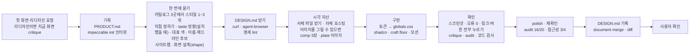

# UI/UX 흐름

> 한눈에: 화면은 `prokit-ui` 스킬이 맡아요. 코드를 쓰기 전에 서비스를 파악하고, 어울리는 디자인 스타일을 추천받아 고른 뒤 화면 설계를 확인받아요. 만든 뒤에는 모든 링크와 버튼을 눌러 보고 디자인 점수로 검사해요.

## 내가 답해야 하는 것

화면은 에이전트가 만들지만, 사용자가 정할 일이 세 번 있어요.

| 때 | 에이전트가 묻는 것(예시) | 사용자가 하는 일 |
|---|---|---|
| 스타일 선택 | "스타일 후보 1\~3위예요. 어느 쪽으로 할까요? 대표 색은 원본으로 할까요, 제품 색으로 바꿀까요?" | 미리 보기 주소를 열어 보고 하나를 골라요. 마음에 드는 서비스가 있으면 "토스처럼"처럼 말해도 돼요 |
| 화면 설계 확인 | "사이트맵과 화면 설계예요. 이대로 만들까요?" | 화면 목록, 링크와 버튼이 이어지는 곳, 문구를 읽고 빠진 것을 알려 줘요 |
| 화면 확인 | "화면을 만들고 점수를 확인했어요. 직접 보고 알려 주세요" | 개발 서버(`pnpm dev:web`)로 직접 눌러 보고, 고칠 곳을 말하거나 "좋아"라고 해요 |

> [!IMPORTANT]
> 답하기 전에는 에이전트가 코드를 쓰지 않아요.

기존 프로젝트를 들였다면 스타일을 고르기 전에 한 가지가 더 있어요. "지금 디자인을 그대로 이어 갈까요, 다른 스타일로 리디자인할까요?"예요. 아래 "기존 프로젝트의 디자인 방향"에서 설명해요. 용어가 낯설면 [처음 보는 용어](../../tutorials/reference/glossary.md#디자인)를 보세요.

## 흐름

[impeccable](https://github.com/pbakaus/impeccable)의 단계를 그대로 따라 기획(`PRODUCT.md`), 디자인 값 정하기(`DESIGN.md`), 화면 설계, 구현, 리뷰, 마감 순서로 진행해요.

<!-- b:ui-flow-diagram -->

<!-- /b -->

| 단계 | 에이전트가 하는 일 | 남는 것 | 사용자가 하는 일 |
|---|---|---|---|
| 기획 (프로젝트당 1회) | impeccable `init` 인터뷰로 서비스를 파악해요 | `PRODUCT.md` | 질문에 답하기 |
| 시각 방향 (첫 화면, 리디자인) | 리디자인이면 지금 화면을 찍어 critique하고 버릴 것을 적어요. 카탈로그 1\~3위와 "직접 정하기"를 추천하고(선택 묶음 `taste`가 있으면 taste-skill 방향도), 고른 스타일의 원문을 받아 스펙 검사기(lint)로 확인해요 | `DESIGN.md` | 스타일과 대표 색 고르기 |
| 설계 (화면마다) | 사이트맵에 링크와 버튼이 이어지는 곳을 모두 적고, impeccable `shape`로 화면마다 상호작용, 서체, 이미지, 아이콘, 모션 계획을 세워요. 이름이나 헤드라인을 새로 정하면 비슷한 서비스를 조사해 후보 3\~4개를 내요 | `docs/briefs/site-map.md`, `docs/briefs/<화면>.md` | 화면 설계 확인, 이름·문구 고르기 |
| 시각 자산 (화면마다) | 서체 파일을 받아 프로젝트에 직접 넣어요. 이미지를 그릴 수 있으면 방향 comp 3장을 그리고, 고른 comp에 맞춰 사진·일러스트(plate)를 만들어요 | `apps/web/src/fonts/`, `apps/web/public/images/`, `.impeccable/mocks/` | comp 고르기 |
| 개발 | 디자인 토큰을 `globals.css`의 shadcn 변수로 옮기고 컴포넌트를 조합해 화면을 만들어요 | 코드 | |
| 리뷰 | 스크린샷, 모든 링크·버튼 누르기(404, "준비 중", 반응 없는 버튼이 없어야 해요), `critique`, `audit`, `web-design-guidelines` | 점수, P0~P3, 위반 목록, critique 기록(`.impeccable/critique/…md`), audit 보고서(`tasks/evidence/ui-audit-<시각>.md`) | |
| 마감 | `polish`(마무리 손질), 재확인 1회 | 통과 점수 | 기준에 못 미치면 더 다듬을지 결정 |
| 기록 | `document` merge(기존 파일에 합치기), lint, diff | 갱신한 `DESIGN.md` | 덮어쓰기 전 확인 |

스타일 선택, 이름·문구 후보, 화면 설계 확인은 한 번에 물어요. 사용자 답을 받기 전에는 코드를 쓰지 않아요.

## 기존 프로젝트의 디자인 방향

[기존 프로젝트에 프로킷을 들인](../start/adopt.md) 경우(초기 프로젝트, 운영 중인 Next.js, 전환)에는 첫 새 UI 작업에서 스타일을 고르기 전에 `prokit-ui`가 한 번만 물어요. "지금 디자인을 그대로 이어 갈까요, 다른 스타일로 리디자인할까요?"예요. 선택지는 `기존 디자인 유지 (추천)`와 `리디자인`이고, 답과 날짜는 `docs/prokit/intake.md`의 "디자인 방향" 절에 남겨요.

| 답 | 이어지는 일 |
|---|---|
| 기존 디자인 유지 | 스타일 후보를 내지 않아요. `DESIGN.md`가 있으면 그것을 따르고, 없으면 기존 디자인(운영 화면의 토큰과 컴포넌트, 디자인 시스템 문서, 프로토타입)으로 만들어요([DESIGN.md](design-md.md#기존-디자인으로-만들기)). 초기 프로젝트와 전환은 첫 구현 행에서 토큰을 `packages/ui`의 `globals.css`로 옮기고, 운영 중인 프로젝트는 기존 토큰 파일을 그대로 원본으로 둬요 |
| 리디자인 | 아래 "스타일 추천 1\~3위"의 카탈로그 후보를 내는 기존 리디자인 흐름을 따라요 |

새 프로젝트는 이 질문을 하지 않고 위 흐름 그대로 진행해요.

## 스타일 추천 1\~3위

후보는 세 카탈로그에서만 뽑아요. 목록에 없는 브랜드는 지어내지 않아요.

| 카탈로그 | 범위 | 잘 맞는 화면 |
|---|---|---|
| [<!-- v:catalogs.kr.name -->getdesign.kr<!-- /v -->](https://www.getdesign.kr) | 한국 서비스 <!-- v:catalogs.kr.count -->23<!-- /v -->개(<!-- v:catalogs.kr.date -->2026-10-04<!-- /v -->) | 한국어 앱 화면 |
| [<!-- v:catalogs.awesome.name -->awesome-design-md<!-- /v -->](https://github.com/VoltAgent/awesome-design-md) | 해외 제품 <!-- v:catalogs.awesome.count -->74<!-- /v -->개(<!-- v:catalogs.awesome.date -->2026-09-30<!-- /v -->). AI, 개발자 도구, 핀테크, 커머스 등 | 해외 제품 톤, 개발자 도구 |
| [<!-- v:catalogs.refero.name -->Refero Styles<!-- /v -->](https://styles.refero.design) | 해외 제품 웹사이트 <!-- v:catalogs.refero.count -->1,342<!-- /v -->개(<!-- v:catalogs.refero.date -->2026-10-04<!-- /v -->) | 랜딩, 가격, 브랜드 페이지처럼 시각 연출이 큰 화면 |

- 화면 유형과 관계없이 세 카탈로그를 모두 봐요. `PRODUCT.md`의 분야, 화면 모드(앱 화면, 랜딩, 문서), 정보 밀도, 어조, UI 언어로 순위를 매겨요.
- "토스처럼", "넷플릭스처럼"처럼 브랜드를 지목하면 세 카탈로그 모두에서 그 브랜드를 찾고, 찾은 원문이 1위예요. Refero 분류 페이지에는 일부 스타일만 실리고 분류 이름이 실제 화면 성격과 다를 수 있어요(넷플릭스는 "에디토리얼" 분류에만 있어요). 그래서 분류에 없으면 웹 검색(`site:styles.refero.design <브랜드>`)으로 찾아요. 같은 브랜드의 스타일이 여럿이면 모두 후보로 두고, 세 곳 모두 없으면 "카탈로그에 없음"이라고 알린 뒤 같은 분야 후보를 내요.
- 후보마다 카탈로그 이름, 이유 한 줄, 미리 보기 주소를 붙여요. "카탈로그 없이 impeccable로 정하기"도 선택지에 넣어요. 선택 묶음 `taste`를 설치했으면 "taste-skill로 방향 뽑기"도 넣어요. 그 화면은 taste-skill이 뽑은 방향으로 화면 설계를 쓰고, critique 전에 실제 브라우저 검사를 더해요([화면 디자인 보조](../skills/brains.md#화면-디자인-보조)). 대표 색은 원본을 쓸지 제품 색으로 바꿀지도 물어요.
- 고른 원문의 값은 그대로 두고, 이름은 제품명으로 바꿔요. 같은 업종이면 원래 브랜드와 헷갈리지 않도록 제품 색을 권해요.

> [!WARNING]
> 로고와 원래 브랜드 이름은 화면에 쓰지 않고, 전용 서체는 공개 서체로 바꿔요.

## 자세히

### 새 작업과 좁은 개선

`prokit-ui`는 요청이 어느 쪽인지 먼저 정해요.

- **새 작업**: 새 화면, 새 흐름, 리디자인처럼 화면 전체의 모양을 바꾸는 요청이에요. 화면 설계를 확정하기 전에는 코드를 쓰지 않아요.
- **좁은 개선**: 기존 화면의 구성은 그대로 두고 간격, 문구, 상태 하나를 고치는 요청이에요. 화면 설계 없이 진행하고 대조표에 `N/A: 좁은 개선(버튼 간격)`처럼 적어요. 애매하면 새 작업으로 봐요.

### 지키는 규칙

- **모든 링크와 버튼이 동작해요**: 실제 페이지나 실제 동작(모달, 드로어, 상태 바꾸기, 복사, 폼 제출 뒤 완료 화면)으로 이어져요. 404, "준비 중", `#`만 걸린 링크는 두지 않아요.
- **토큰만 써요**: 색, 간격, 반경, 그림자는 토큰으로만 쓰고 색 코드(hex)나 임의 Tailwind 값(`bg-[#123456]`)을 새로 넣지 않아요.
- **통과 기준**: critique의 P0·P1은 해결하거나 사유를 적어요. audit 총점은 <!-- v:devCycle.ui.auditMin -->16<!-- /v -->/20 이상, 접근성 점수는 <!-- v:devCycle.ui.a11yMin -->3<!-- /v -->/4 이상이에요(`.dev-cycle.json`의 `ui.auditMin`, `ui.a11yMin`). 못 미치면 완료로 보고하지 않고 더 다듬을지 물어요. 점수만 적어서는 안 되고, 이번 라운드에 실행해 남긴 critique 기록 파일과 audit 보고서가 있어야 해요. 파일이 없거나 점수가 다르면 `dev-cycle audit`이 거절해요.
- **편집 중 자동 검사**: 프로젝트 루트에서 `.agents/skills/impeccable/scripts/impeccable hooks on`을 실행해 켜 두면(스킬 호출로 켜지 않아요) UI 파일을 고칠 때마다 detector가 결과를 알려 줘요.

### 이미지 그리기

사용자 요청이나 승인된 화면 설계에 생성 이미지가 있으면 실제로 생성해 화면에 연결하고 출처·검수 증거를 남겨요. 수행자에 도구가 없으면 코디네이터가 접근 가능한 이미지 도구로 위임해요. 이를 임의로 "SVG로 충분"이라는 사용자 승인으로 바꾸지 않아요.

그리는 길은 이 순서로 골라요.

1. 에이전트 자체 이미지 도구(Codex `image_gen`, Antigravity `generate_image`, Grok Build `image_gen`)
2. `OPENAI_API_KEY`가 있으면 impeccable `generate-image`. 비용은 사용자의 OpenAI API 계정에 청구돼요
3. Codex CLI가 ChatGPT로 로그인되어 있으면 `gpt-image` 스킬. ChatGPT 요금제 사용량을 써요
4. 모두 없으면 배치도로 구성을 골라요. 사진 자리를 도형이나 이모지로 흉내 내지 않아요

키는 프로젝트나 작업 폴더의 `.env`에 두면 Claude Code 세션을 열 때 훅이 불러와요. 준비 방법은 [비용과 키](../../tutorials/reference/costs-and-keys.md#이미지-그리기)에 있어요.

### 실제 추천 예 (<!-- v:preset.uptrail.title -->Uptrail<!-- /v --> 리디자인)

| 순위 | 스타일 | 추천 이유 |
|---|---|---|
| 1 | [<!-- v:preset.uptrail.design.rec1 -->Default<!-- /v -->](https://styles.refero.design/style/eeeb6ac9-fc07-4965-935a-e1989ed831f1) (<!-- v:preset.uptrail.design.src1 -->Refero Styles<!-- /v -->) | 무광 검정 판에 대표 색 Signal Blue 하나만 써요. 초록과 빨강은 상태 신호로만 써서, 하루 종일 띄워 두는 모니터에서 인시던트(장애) 빨강이 가장 눈에 띄어요 |
| 2 | [<!-- v:preset.uptrail.design.rec2 -->리멤버<!-- /v -->](https://www.getdesign.kr/services/remember) (<!-- v:preset.uptrail.design.src2 -->getdesign.kr<!-- /v -->) | 흰 바탕에 검정과 오렌지 한 점만 써요. "색이 보이면 곧 이상"이라는 규칙으로 이전 시안의 색 문제를 구조로 풀어요 |
| 3 | [<!-- v:preset.uptrail.design.rec3 -->ClickHouse<!-- /v -->](https://getdesign.md/clickhouse/design-md) (<!-- v:preset.uptrail.design.src3 -->awesome-design-md<!-- /v -->) | 검정 바탕, 전기 노랑, 72px 굵은 제목으로 인상이 가장 강해요. 노랑이 경고색과 헷갈릴 수 있어요 |
| 4 | 카탈로그 없이 impeccable로 정하기 | 스타일 세 가지를 새로 만들어 이미지 시안과 함께 보여 줘요 |

### 프리셋

- 프로킷 사이트의 제작 창에서 고른 제목·본문 서체, 팔레트, 시작 모드와 언어는 완성 프롬프트에 반영돼요. 복사와 ChatGPT·Claude로 보내는 동작은 같은 완성 문장을 쓰고 자동으로 제출하지 않아요. 선택해도 원본 프리셋, 프리셋 팩, 이미 만든 프로젝트의 디자인은 바뀌지 않아요.
- 제목·본문 폰트와 색상 조합은 원래 디자인을 유지하거나 원하는 설정으로 바꿔요. 폰트는 공식 배포처의 웹 사용·재배포 조건을 확인하고, 영문 전용 폰트에는 한글 대체 폰트를 함께 지정해요. 프로킷 미리보기는 프리셋이 실제로 적용했다고 응답한 설정만 적용 완료로 표시해요.
- 공개된 프리셋과 팩이 모드·언어 전환이나 서체·팔레트 변경을 모두 지원한다고 단정하지 않아요. 지원 여부는 미리보기의 적용 결과 표시로 확인해요.
- 폰트·색상 선택 팔레트와 설정 견본은 프리셋 제작·프로킷 미리보기용 도구예요. 실전 서비스를 개발할 때는 프롬프트에서 정한 폰트와 색상으로 화면을 만들어요. 서비스 안에는 선택 팔레트·설정 견본·프로킷 미리보기 연결을 넣지 않아요.
- 선택값을 받은 새 프로젝트는 `docs/preset-design.json`과 `DESIGN.md`에 실제 서체 파일·굵기·라이선스, 두 모드의 의미 토큰, 시작 모드·언어를 남겨요. 브라우저에서 실제 서체·토큰·대비를 대조하고 HTML로 내보낸 결과까지 확인해야 해요. 자세한 기록과 검사 기준은 [DESIGN.md](design-md.md#선택한-디자인을-기록하고-확인하기)에 있어요.

### 제작 창과 미리보기 사용

| 하려는 일 | 사용 방법 |
|---|---|
| 요청을 고치기 | `요청 본문`에서 서비스를 설명하는 글을 고쳐요. `본문 초기화`만 누르면 원래 본문으로 돌아가고, 고친 본문은 디자인 설정을 바꿔도 남아요 |
| 디자인을 고르기 | `디자인 설정`에서 제목·본문 서체, 색상 조합, 시작 모드·언어를 고르고 실제 서체 견본과 설정 견본을 봐요. `초기화`는 선택값을 처음 값으로 돌려요 |
| 완성 프롬프트 보내기 | 자동 디자인 설정은 처음에 접혀 있고 완성 프롬프트는 펼쳐져 있어요. 선택값이 바뀌면 자동 블록만 새 값으로 바꾸고 요청 본문은 보존해요. 복사하거나 ChatGPT·Claude를 열어도 자동으로 전송하지 않으므로 내용을 확인해 직접 보내요 |
| 미리보기에서 확인하기 | 프리셋 설정을 바꾸면 실제 적용됨, 일부 미지원, 적용 실패처럼 결과를 표시해요. 지원하는 설정만 적용하고 미지원 항목은 원래 상태를 유지해요. 선택값은 설정 견본과 제작 프롬프트에는 계속 반영돼요 |
| 보기 크기를 바꾸기 | 미리보기는 처음에 높이를 자동으로 맞춰요. 필요하면 자동 높이를 끄고 아래 손잡이나 키보드로 보이는 높이를 조절하고, `넓게 보기`와 설정 패널 사이의 손잡이로 가로폭을 조절해요. 이 조절은 같은 iframe과 현재 페이지·입력을 유지하지만 한 화면에 전체 페이지가 스크롤 없이 보인다고 보장하지는 않아요 |

### 만들어 둔 화면 프리셋

기존 제작 흐름으로 만든 화면 프리셋 <!-- v:presets.screen.count -->11<!-- /v -->개(랜딩페이지 <!-- v:presets.landing.count -->6<!-- /v -->개, 앱 화면 <!-- v:presets.app.count -->5<!-- /v -->개, 모두 <!-- v:presets.screen.pages -->344<!-- /v -->페이지)를 [프로킷 사이트](https://prokit-web.vercel.app/)에서 볼 수 있어요. 스타일 추천을 거친 프리셋은 추천 순위, comp, 사이트맵을 에이전트가 제안했고, 고르기와 수정 요청은 사용자가 직접 했어요.

- **앱 화면 <!-- v:presets.app.count -->5<!-- /v -->개**(<!-- v:preset.goru.title -->고루<!-- /v -->, <!-- v:preset.fitslot.title -->핏슬롯<!-- /v -->, <!-- v:preset.uptrail.title -->Uptrail<!-- /v -->, <!-- v:preset.studyday.title -->하루공부<!-- /v -->, <!-- v:preset.olgot.title -->올곧<!-- /v -->): 분야가 다른 서비스를 사이트맵의 모든 페이지까지 만들었어요. 올곧을 뺀 넷은 템플릿을 설치한 프로젝트에서 `prokit-ui`의 흐름을 그대로 따랐어요.
  1. 이전 시안을 critique(디자인 리뷰)했어요.
  2. 카탈로그 3곳에서 스타일을 다시 추천받고, impeccable이 OpenAI 이미지로 그린 방향 comp(화면 방향 시안) 3장 중 하나를 골랐어요.
  3. 사이트맵을 쓰고, 페이지마다 화면 설계와 comp를 만들었어요.
  4. 서체, 이미지, 모션을 넣어 모든 페이지를 구현했어요. 모달, 툴팁, 햄버거 메뉴, 사이드바, 페이지 전환도 넣었어요.
  5. critique와 polish(마무리 손질)를 거친 뒤 모든 링크와 버튼을 눌러 확인했어요.
- **올곧**: 카탈로그 추천 대신 입시학원 사이트 한 곳을 실측한 `DESIGN.md`로 시작했어요. 첫 화면 comp 3장은 ChatGPT로 로그인한 Codex로 그렸고, 공개 페이지와 로그인 뒤 화면까지 <!-- v:preset.olgot.pages -->203<!-- /v -->개(<!-- v:preset.olgot.pageTypes -->48<!-- /v -->종)를 만들었어요.
- **여러 페이지로 넓힌 랜딩페이지 네 개**(<!-- v:preset.ullim.title -->울림<!-- /v -->, <!-- v:preset.jecheol.title -->제철상자<!-- /v -->, <!-- v:preset.pacecrew.title -->PACECREW<!-- /v -->, <!-- v:preset.afterglow.title -->AFTERGLOW<!-- /v -->): 랜딩페이지처럼 시각 연출이 큰 사이트예요. 첫 화면에서 시작해 요금, 상세, 로그인, 마이페이지, 고객센터, 약관까지 사이트맵의 모든 페이지를 같은 흐름으로 만들었어요. <!-- v:preset.ullim.title -->울림<!-- /v -->, <!-- v:preset.jecheol.title -->제철상자<!-- /v -->, <!-- v:preset.afterglow.title -->AFTERGLOW<!-- /v -->는 스타일 후보마다 첫 화면 comp를 한 장씩 그렸고, 그 comp를 보고 스타일과 구도를 한 번에 골랐어요. 서비스 이름과 첫 화면 문구는 비슷한 서비스를 조사해 후보를 받은 뒤 사용자가 골랐어요.

- **슬라이드랩**: AI·PPT 교육을 소개하는 한 페이지 랜딩페이지예요. 참고 사이트의 구조·서체·색상·스크롤 효과를 관측하고 가상 예시와 생성 이미지로 만들었어요. 과정과 교육 시간을 고르면 같은 페이지의 예시 문의에 반영돼요. 제작 범위와 관측 기록은 [슬라이드랩](../../tutorials/samples/slidelab.md)에서 확인하세요.

측정한 결과(페이지 수, critique 점수, 비용)는 [검증 결과](../reference/verification.md#화면-프리셋)에 있어요.

## 관련 문서

- [DESIGN.md](design-md.md)
- [기존 프로젝트에 도입하기](../start/adopt.md)
- [화면만 프로젝트와 HTML 내보내기](screen-only.md)
- [케이스 <!-- v:devCycle.cases.range -->A\~F·H<!-- /v -->와 대조표](../concepts/cases.md)
- [공식 스킬과 연결](../skills/official-skills.md)
