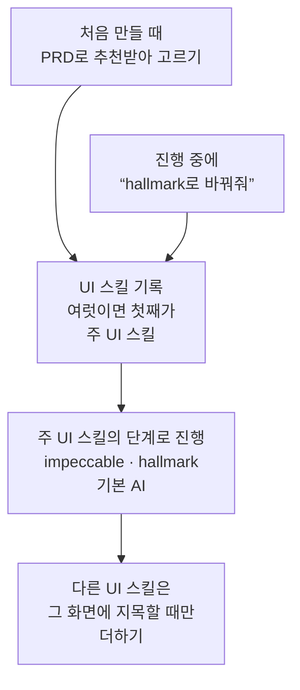
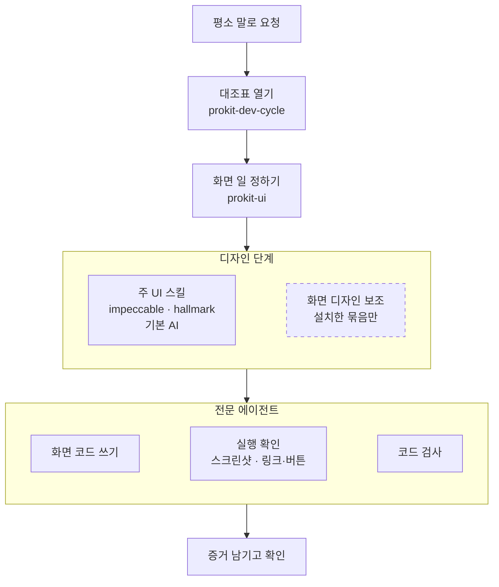

# 프로킷 UI 스킬셋

> 한눈에: DB와 로그인 없이 랜딩페이지, 앱 화면, 눌러 볼 수 있는 프로토타입을 만드는 프로킷 스킬 묶음이에요. 기획, 디자인, 화면, 검사를 정해진 순서로 하고, 결과를 HTML로 내보내거나 GitHub Pages·Vercel에 올려요.

## UI 스킬셋이란

UI 스킬셋은 프로킷에서 화면을 만드는 데 필요한 스킬만 모은 묶음이에요. **예시 데이터로 모든 화면을 만들고, 모든 링크와 버튼이 실제로 동작하는지 검사한 뒤 넘겨줘요.** UI 스킬셋은 [pro-kit-ui](<!-- v:link.repoUi -->https://github.com/roadkwon-ai/pro-kit-ui<!-- /v -->) 저장소로 받아요. <!-- edition:pro -->pro-kit에서 만든 사본이라 pro-kit을 릴리스할 때 같은 버전으로 함께 바뀌어요.<!-- /edition --><!-- edition:ui pro-kit에서 만든 사본이라 pro-kit을 릴리스할 때 같은 버전으로 함께 바뀌어요. --> 저장소에는 화면을 만드는 데 필요한 문서(handbook과 튜토리얼 중 화면 쪽)도 함께 들어 있어요.

이런 분께 맞아요.

- 글과 와이어프레임 대신 눌러 볼 수 있는 시안으로 회의하고 싶은 기획자와 PM
- 멈춰 있는 시안 대신 실제로 동작하는 화면과 HTML을 건네고 싶은 디자이너
- 캠페인 랜딩을 개발 일정 없이 직접 만들어 올리고 싶은 마케터
- 투자나 고객 검증 전에 서비스 소개 랜딩과 핵심 화면이 필요한 1인 창업가

| 들어 있어요 | 들어 있지 않아요 |
|---|---|
| 진행 규칙, 화면 디자인, 검사, 프리셋 팩 활용 스킬과 화면을 맡는 전문 에이전트 | 로그인과 권한, DB, API |
| 디자인 스타일 추천과 `DESIGN.md` | 서버까지 올리는 Vercel 배포와 릴리스 |
| HTML 내보내기, GitHub Pages·Vercel 정적 배포 | 운영 중인 프로젝트에 들이기, 다른 언어에서 옮기기 |

로그인, DB, API가 있는 실제 서비스까지 만들려면 UI 스킬셋을 모두 담은 Pro 스킬셋을 써요.

## 들어 있는 스킬

스킬 이름을 몰라도 돼요. 평소 말로 요청하면 에이전트가 맞는 스킬을 불러와요.

| 스킬 | 하는 일 | 이렇게 말하면 나서요 |
|---|---|---|
| `prokit-init` | PRD를 받아 프로젝트를 만들고 스킬 구성을 골라요. DB 없이 화면만 만드는 프로젝트도 이 스킬이 만들어요 | "이 PRD로 화면만 만드는 프로젝트 만들어줘" |
| `prokit-dev-cycle` | 모든 작업의 시작점이에요. 작업 종류를 정하고 대조표를 열어 순서대로 진행해요 | "랜딩에 요금제 절 추가해줘" |
| `prokit-ui` | 화면 기획, 디자인 스타일 추천, `DESIGN.md`, 화면 구현과 디자인 리뷰를 맡아요. 고른 UI 스킬(impeccable, hallmark, 기본 AI)의 단계로 진행해요. HTML 내보내기와 GitHub Pages·Vercel 정적 배포도 이 스킬이 해요 | "토스처럼 깔끔하게 바꿔줘", "HTML로 내보내줘" |
| `prokit-verify` | 끝났다고 말하기 전에 돌릴 검사를 고르고 실행해 결과를 증거로 남겨요 | "잘 되는지 확인해줘" |
| `prokit-pack-use` | 완성된 프리셋 팩을 복원하고, 품질을 지키며 내 서비스로 바꿔요 | "이 프리셋 팩으로 만들어줘" |
| `prokit-skills-manage` | 두뇌, 과설계 방지 스킬, UI 스킬 같은 스킬 구성을 진행 중에 바꿔요 | "두뇌 바꿔줘", "UI 스킬을 hallmark로 바꿔줘" |
| `prokit-skills-update` | 설치한 외부 스킬에 새 판이 있는지 보고 한 번에 올려요 | "스킬 업데이트해줘" |
| `prokit-skills-assign` | 공식 스킬마다 그 스킬로 일할 에이전트를 정하고, 스킬이 바뀌면 다시 배치해요 | "새 공식 스킬 추가해줘" |

## UI 스킬을 골라요

화면의 디자인 단계(기획, 화면 설계, 리뷰, 감사, 다듬기, `DESIGN.md` 기록)는 UI 스킬이 맡아요. 프로젝트를 만들 때 하나 이상 고르고, 여럿이면 첫 값이 주 UI 스킬이에요. 진행 중에도 바꿀 수 있고, 바꿔도 `PRODUCT.md`, `DESIGN.md`, 화면 설계서, 디자인 토큰은 그대로 이어져요.

| UI 스킬 | 어떤 때 맞나요 |
|---|---|
| `impeccable` (기본) | 점수를 매기는 리뷰와 감사로 다듬는 일이 많은 서비스. 앱 화면과 웹 페이지 모두 |
| `hallmark` | 새 웹 페이지를 AI가 만든 티 없이 만들고, 정한 디자인을 지키며 화면을 하나씩 더하는 서비스 |
| 기본 AI (`none`) | 외부 UI 스킬 없이 Anthropic의 `frontend-design`과 게슈탈트 지침으로 만들고 싶을 때 |

고른 UI 스킬은 프로젝트의 UI 스킬 기록(`.dev-cycle.json`의 `uiSkill`)에 남아요. 진행 중에 "hallmark로 바꿔줘"라고 하면 `prokit-skills-manage`가 `pnpm skills:setup --ui-skill <이름>`으로 이 기록을 바꿔요. 여럿을 고르면 첫째가 주 UI 스킬이고, 다른 UI 스킬은 사용자가 그 화면에 지목할 때만 더해요. 바꾸기 전 스킬이 남긴 작업 기록은 지우지 않지만 새 스킬의 근거로도 쓰지 않아요.

고르는 기준은 [UI 스킬](../skills/brains.md#ui-스킬), 단계마다 하는 일은 [UI/UX 흐름](ui-flow.md#ui-스킬마다-단계에서-하는-일)에 있어요.

## 화면 디자인 보조를 더해요

화면 디자인 보조는 주 UI 스킬의 단계에 보태는 선택 묶음이에요. 랜딩 전환, 레퍼런스 고정, 쇼케이스 모션, 화면 비평처럼 화면 성격에 맞는 일을 더하고, 기획과 화면 설계 확인, 리뷰·감사, 통과 기준은 주 UI 스킬 그대로예요. 처음 만들 때 `prokit-init`이 PRD에 맞는 조합을 추천하고, 나중에 `pnpm skills:setup --optional <묶음>`으로 더할 수도 있어요.

| 묶음 | 이런 화면에 더해요 |
|---|---|
| `landing` | 가입이나 구매 같은 행동 하나로 이끄는 랜딩, 가입, 가격 화면 |
| `tastemaker` | 사용자가 준 레퍼런스 이미지나 화면의 스타일을 이어 가는 화면 |
| `taste` | "taste로"라고 했거나 스타일 질문에서 taste 방향을 고른 화면 |
| `web-design-engineer` | "Linear처럼"처럼 스타일 레시피를 지목한 화면, 다섯 차원 채점 |
| `awwwards` | 스크롤 연출과 모션이 중심인 브랜드·쇼케이스 화면 |
| `animation` | 모션을 넣거나 고치는 화면 |
| `visual-critique` | 디자인 리뷰마다 일곱 차원으로 화면 비평(impeccable이 주 UI 스킬이면 요청할 때만) |
| `ui-design` | 브리프를 쓰는 화면마다 간격, 타입, 그리드 체계를 정하고 리뷰 |

한 화면에는 방향을 정하는 보조(`landing`, `tastemaker`, `taste`, 레시피로 쓰는 `web-design-engineer`)를 하나만 써요. 그 화면에 쓰는 보조는 화면 설계(브리프)의 `보조:` 줄에 적히고, 리뷰 결과나 하지 않은 사유가 없으면 작업을 닫을 수 없어요. 보조마다 더하는 단계는 [UI/UX 흐름](ui-flow.md#화면-디자인-보조가-더하는-단계), 추천 조합은 [선택 스킬 묶음](../skills/optional-bundles.md#화면-디자인-보조-조합)에 있어요.

## 화면을 만드는 순서

1. **PRD 건네기**: 만들 서비스를 적은 PRD로 `prokit-init`이 화면만 프로젝트를 만들어요([PRD 먼저 정하기](../start/prd.md), [빠른 시작: 화면만 만들기](../start/quickstart-screens.md)).
2. **스타일 고르기**: 디자인 스타일 1\~3위를 추천받아 고르고, 정한 색과 글꼴, 간격을 `DESIGN.md`에 적어요([UI/UX 흐름](ui-flow.md), [DESIGN.md](design-md.md)).
3. **화면 만들기**: 화면 설계를 확인한 뒤 모든 화면을 같은 디자인으로 만들어요. 작업마다 대조표를 열고 순서대로 해요. 화면 코드는 `prokit-ui-builder`가 쓰고, 메인 세션은 맡기고 검수해요.
4. **검사하기**: `prokit-runtime-checker`가 페이지마다 데스크톱·모바일 스크린샷을 찍고 모든 링크와 버튼을 눌러 확인해요. 디자인 리뷰와 감사, 그 화면에 쓴 화면 디자인 보조의 리뷰까지 마치고, 실행한 검사를 증거로 남겨요. 스킬과 에이전트가 어떻게 이어지는지는 [UI/UX 흐름의 구조](ui-flow.md#구조)에 있어요.
5. **내보내고 올리기**: `pnpm export:html`로 HTML을 내보내거나 GitHub Pages·Vercel에 올려요([화면만 프로젝트와 HTML 내보내기](screen-only.md)).

스킬과 에이전트는 이렇게 이어져요. 메인 세션이 `prokit-ui`로 디자인 단계를 정하고, 화면 코드는 `prokit-ui-builder`, 실행 확인은 `prokit-runtime-checker`, 코드 검사는 `prokit-reviewer`(ui)가 맡아요. 점선 테두리는 설치했을 때만 쓰는 선택이에요.

## 프리셋 팩으로 시작하기

완성된 프리셋 팩이 있으면 `prokit-pack-use`가 팩의 서체와 색, 자산을 그대로 살려 내 서비스로 바꿔요. 스타일을 다시 고르거나 원본 사이트를 다시 조사하지 않아요([프리셋 팩으로 시작하기](../start/quickstart-pack.md), [완성팩 활용과 담당 구분](preset-publication.md)).

## 실제 서비스로 키울 때

화면만 프로젝트는 나중에 로그인과 DB가 있는 서비스로 키울 수 있어요. 이때 쓰는 스킬<!-- edition:pro -->(`prokit-web`, `prokit-api`, `prokit-db`, `prokit-deploy`)<!-- /edition -->은 Pro 스킬셋에 들어 있어요([실제 서비스로 바꾸기](screen-only.md#실제-서비스로-바꾸기)).

## 관련 문서

- [UI/UX 흐름](ui-flow.md)
- [DESIGN.md](design-md.md)
- [화면만 프로젝트와 HTML 내보내기](screen-only.md)
- [prokit 스킬](../skills/prokit-skills.md)
