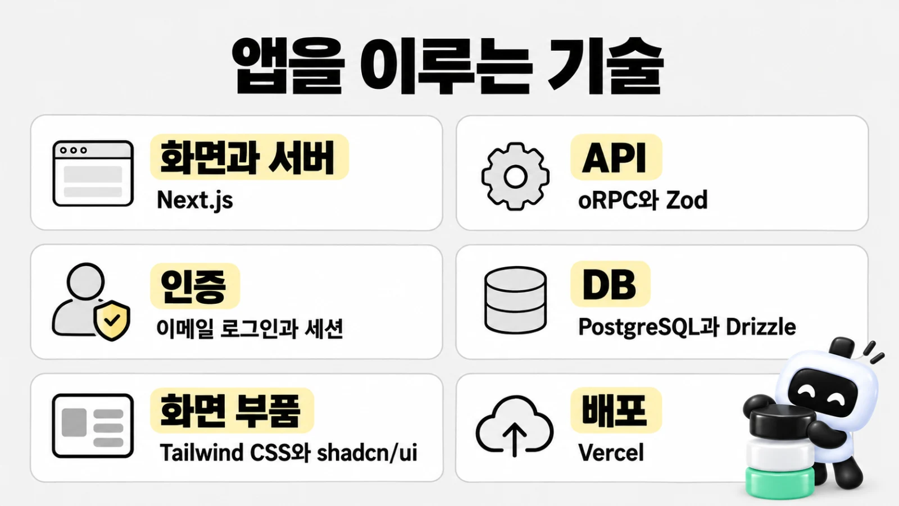

# 프로킷이 쓰는 기술과 도구

> 한눈에: 프로킷으로 만든 프로젝트에 쓰는 기술을 한곳에 모았어요. 앱에 들어가는 기술, 에이전트와 스킬, 개발·검사·배포에 쓰는 명령줄 도구(CLI), 연결할 외부 서비스로 나눴어요. **전역 도구가 없어도 dev-cycle은 끝까지 진행돼요. 빠진 도구는 다른 방법으로 대신해요.**

용어는 [처음 보는 용어](../../tutorials/reference/glossary.md#도구)에 있어요. 네 묶음을 한 줄씩 요약하면 이래요.

- 앱에 들어가는 기술: 만들 서비스의 부품이에요. 화면, 서버, 로그인, DB가 여기에 들어요.
- 에이전트와 스킬: 코딩하는 AI, 그리고 AI가 일하는 법을 적은 설명서예요.
- 명령줄 도구(CLI): 터미널에서 치는 명령 프로그램이에요. 대부분 에이전트가 대신 실행해요.
- 외부 서비스: 배포(Vercel)<!-- edition:pro -->나 DB(Neon, Supabase)<!-- /edition -->처럼 계정을 만들어 쓰는 곳이에요.

> [!TIP]
> 처음이라면 이 쪽을 다 읽지 않아도 돼요. 설치기와 에이전트가 이 도구를 알아서 설치하고 써요. "내 컴퓨터에 무엇이 깔리나", "어떤 서비스 계정이 필요한가"가 궁금할 때 표에서 해당 줄만 찾아보세요.

## 앱에 들어가는 기술

**프로젝트는 Better-T-Stack이 아래 구성으로 만들어요.** 판은 만드는 날의 최신판을 받아요. 표에 적은 판은 2026-10-07에 만든 프로젝트에서 확인한 값이에요.

| 분야 | 기술 | 쓰는 곳 |
|---|---|---|
| 화면과 서버 | Next.js 16(App Router), React 19 | `apps/web`. 별도 서버 없이 Next.js 라우트 핸들러가 API 요청을 받아요 |
| 언어 | TypeScript 6 | 모든 패키지 |
| API | oRPC 1.15, TanStack Query 5, Zod 4 | `packages/api`. 입력 검사는 Zod로 해요 |
| 인증 | Better Auth 1.7 | `packages/auth`. 이메일 로그인과 세션 |
| DB | PostgreSQL, Drizzle ORM 1.0 rc, drizzle-kit | `packages/db`.<!-- edition:pro --> 스키마는 마이그레이션 파일로만 바꿔요<!-- /edition --> |
| 화면 부품 | Tailwind CSS 4, shadcn/ui, lucide-react, next-themes, sonner | `packages/ui`와 `apps/web` |
| 환경 변수 | Varlock(`.env.schema`) | 앱마다 변수 목록을 적고 `src/env.ts`를 만들어요 |
| 모노레포와 형식 | pnpm 워크스페이스, Turborepo 2, Biome 2 | 프로젝트 루트. `pnpm check`가 형식과 lint를 맞춰요 |
| 테스트 | Vitest | 처음에는 없어요. 첫 API·DB 라운드(케이스 D·E)나 서버 코드를 고치는 라운드(C)에서 들여와요 |
| 운영 DB | Neon(neon 템플릿) 또는 Supabase(supabase 템플릿) | 개발 중에는 내 컴퓨터의 DB를 써요. neon은 compose로 띄운 Postgres, supabase는 Supabase 로컬 스택이에요 | <!-- edition:pro -->
| 배포 | Vercel | <!-- edition:pro -->develop과 운영, 두 환경에 올려요. <!-- /edition -->화면만 만든 프로젝트는 GitHub Pages나 Vercel에 정적 HTML로 올려요 |

## 에이전트와 스킬

**prokit 스킬과 에이전트는 템플릿이 늘 설치해요. 두뇌와 과설계 방지 스킬은 고른 것만 설치해요.**

| 무엇 | 내용 | 자세히 |
|---|---|---|
| AI 에이전트 | <!-- v:agents.list -->Claude Code, Codex, Antigravity, Grok Build<!-- /v --> 중 하나 | [지원하는 에이전트](../start/supported-agents.md) |
| prokit 스킬 <!-- edition:pro --><!-- v:prokit.skills.count -->10<!-- /v -->개<!-- /edition --><!-- edition:ui 6개 -->와 에이전트 <!-- edition:pro --><!-- v:prokit.agents.count -->4<!-- /v -->개<!-- /edition --><!-- edition:ui 3개 --> | 분야별로 일하는 법을 적은 스킬<!-- edition:pro -->, 기존 프로젝트를 읽기 전용으로 정밀 분석하는 에이전트<!-- /edition -->, 구현을 맡는 에이전트, 전문 리뷰와 최종 리뷰를 맡는 읽기 전용 에이전트 | [prokit 스킬 <!-- edition:pro --><!-- v:prokit.skills.count -->10<!-- /v -->개<!-- /edition --><!-- edition:ui 6개 -->](../skills/prokit-skills.md), [위임 에이전트와 리뷰 에이전트](../concepts/agent-roles.md) |
| 공식 도메인 스킬 | Next.js, React, Better Auth, shadcn, impeccable, DB, Vercel 배포 등 | [공식 스킬과 연결](../skills/official-skills.md) |
| 프로세스 스킬 | skill-creator, mattpocock 필수 3개(늘 설치), 고른 두뇌(하나 이상, 첫 번째가 주 두뇌. <!-- v:brains.names -->superpowers, agent-skills, pstack, gstack, oh-my, mattpocock, openspec, spec-kit, compound-engineering<!-- /v --> 중에서), 고른 과설계 방지 스킬(ponytail, caveman, karpathy 중 하나) | [프로세스 스킬과 전역 도구](../skills/official-skills.md#프로세스-스킬과-전역-도구) |
| 선택 스킬 묶음 | <!-- v:optional.names -->ops, motion, mobile, i-have-adhd, taste<!-- /v --> | [선택 스킬 묶음](../skills/optional-bundles.md) |

## 명령줄 도구(CLI)

**따로 설치해야 하는 도구는 "설치" 칸에 "전역"으로 적혀 있어요.**

> [!NOTE]
> 설치 칸의 "프로젝트"는 프로젝트를 설치할 때 함께 들어와서 따로 설치할 필요가 없다는 뜻이에요. "전역"은 컴퓨터에 한 번 설치하면 모든 프로젝트에서 써요. `--with-global`은 설치기와 `pnpm skills:setup`에 붙이는 옵션이에요([설치기와 옵션](../templates/installer.md)).

### 기본 준비물과 설치 도구

| 도구 | 설치 | 언제 쓰나 | 쓰는 명령 |
|---|---|---|---|
| Node <!-- v:node.min -->22.20<!-- /v --> 이상, pnpm, git | 전역(준비물) | 늘 | `pnpm install`, `pnpm dev`, `git commit` |
| Better-T-Stack CLI | 받을 필요 없음(`@latest`로 바로 실행) | 프로젝트를 만들 때 | `pnpm create better-t-stack@latest` |
| skills CLI | 받을 필요 없음(`skills@latest`) | 설치기와 `pnpm skills:setup`·`skills:update`가 공식 스킬을 받을 때 | 설치기가 실행해요 |

### 에이전트 CLI

| 도구 | 설치 | 언제 쓰나 | 쓰는 명령 |
|---|---|---|---|
| Claude Code CLI | 전역(에이전트) | 설치기가 플러그인을 이 프로젝트에 넣을 때 | `claude plugin install … --scope project` |
| Codex CLI | 전역(에이전트) | Codex로 개발할 때. Claude Code에서 ChatGPT 로그인으로 그림을 그릴 때(`gpt-image`) | `codex` |
| Antigravity CLI | 전역(에이전트) | Antigravity로 개발할 때 | `agy` |
| Grok Build CLI | 전역(에이전트) | Grok Build로 개발할 때 | `grok --trust` |

<!-- edition:pro -->
### DB와 컨테이너

| 도구 | 설치 | 언제 쓰나 | 쓰는 명령 |
|---|---|---|---|
| Podman 또는 Docker (compose 포함) | 전역(준비물, 서비스만) | 내 컴퓨터에 개발용 DB를 띄울 때 | `podman compose up -d`, `podman machine start` |
| drizzle-kit | 프로젝트 | 스키마를 바꾸고 마이그레이션을 만들고 적용할 때 | `pnpm db:generate`, `pnpm db:migrate` |
| Supabase CLI <!-- v:supabaseCli.min -->2.117<!-- /v --> 이상 | 전역(supabase 준비물). `--with-global`은 Homebrew로 설치 | 로컬 스택, 마이그레이션, 보안 점검, 원격 연결 | `supabase init`, `supabase start -x …`, `supabase migration new`, `supabase db diff`, `supabase db reset`, `supabase db advisors`, `supabase link`, `supabase db push`, `supabase stop` |
| Neon CLI | 전역(<!-- v:cli.neon.installCode -->`npm install -g neon`<!-- /v -->, `--with-global`) | 원격 Neon DB에 연결하고, 브랜치의 연결 문자열을 파일에 남기지 않고 명령마다 받을 때 | `neon link --no-env-pull --no-config`, `neon cs <브랜치>` |
<!-- /edition -->

### 배포와 GitHub

| 도구 | 설치 | 언제 쓰나 | 쓰는 명령 |
|---|---|---|---|
| Vercel CLI | 전역(<!-- v:cli.vercel.installCode -->`npm install -g vercel`<!-- /v -->, `--with-global`) | <!-- edition:pro -->배포 준비, develop·운영 배포, 되돌리기, 보호된 배포 확인<!-- /edition --><!-- edition:ui 화면만 프로젝트의 정적 HTML을 올릴 때 --> | `vercel login`<!-- edition:pro -->, `vercel link`, `vercel env add`·`env pull`, `pnpm vercel:deploy develop`·`production`(안에서 `vercel deploy`), `vercel promote`, `vercel rollback`, `vercel inspect`, `vercel alias set`, `vercel curl`<!-- /edition --><!-- edition:ui , `vercel deploy` --> |
| GitHub CLI (`gh`) | 전역. 배포를 요청하면 없을 때 에이전트가 설치 | 원격 저장소 만들기<!-- edition:pro -->, 릴리스<!-- /edition -->, 화면만 프로젝트의 GitHub Pages | `gh auth login`, `gh repo create`, <!-- edition:pro -->`pnpm release`(안에서 `gh release create`), <!-- /edition -->`gh api …/pages` |

### 화면 확인

| 도구 | 설치 | 언제 쓰나 | 쓰는 명령 |
|---|---|---|---|
| agent-browser CLI | 전역. <!-- v:policy.agentBrowser.cell -->없거나 npm 최신판보다 낮으면 기본으로 최신판을 설치<!-- /v --> | ego lite를 쓸 수 없는 환경에서 화면을 확인할 때 | `agent-browser …` |
| ego lite (`ego-browser`) | 전역(macOS 앱, 직접 설치) | 실제 브라우저 창으로 화면을 확인할 때(1순위) | `ego-browser …` |
| serve | 받을 필요 없음(`pnpm dlx`) | 화면만 프로젝트에서 내보낸 HTML을 내 컴퓨터에서 볼 때 | `pnpm dlx serve html` |

### 두뇌에 딸린 도구

| 도구 | 설치 | 언제 쓰나 | 쓰는 명령 |
|---|---|---|---|
| OMX CLI (`omx`) | 전역(<!-- v:cli.omx.installCode -->`npm install -g oh-my-codex`<!-- /v -->, 두뇌 oh-my를 고를 때) | Codex에서 OMX 스킬을 이 프로젝트에 설정할 때 | `omx setup --scope project` |
| OpenSpec CLI (`openspec`) | 전역(`npm install -g @fission-ai/openspec@latest`, 두뇌 openspec을 고를 때) | 변경마다 제안·설계·작업 목록을 합의하는 스킬을 이 프로젝트에 설정할 때 | `openspec init` |
| uv (`uvx`) | 전역(준비물, 두뇌 spec-kit을 설치할 때만) | Spec Kit을 이 프로젝트에 설정할 때 | `uvx --from specify-cli specify init` |
| gstack | 전역(두뇌 gstack을 고를 때, bun 필요) | 제품 판단, 계획 리뷰, 디버깅, 추가 리뷰, QA | `plan-eng-review`, `investigate`, `review`, `qa-only` |

### 디자인과 검사

| 도구 | 설치 | 언제 쓰나 | 쓰는 명령 |
|---|---|---|---|
| impeccable CLI | 프로젝트(`impeccable` 스킬에 들어 있음) | 디자인 규칙 검사 훅을 켤 때(개발자마다 한 번) | `.agents/skills/impeccable/scripts/impeccable hooks on` |
| DESIGN.md 검사기 | 받을 필요 없음(`pnpm dlx`) | 디자인 규칙 파일을 받거나 고쳤을 때 | `pnpm dlx @google/design.md lint DESIGN.md` |
| Biome | 프로젝트 | 형식과 lint를 검사할 때 | `pnpm check`, `pnpm exec biome check .` |
| Turborepo | 프로젝트 | 여러 패키지의 빌드·타입 검사를 한 번에 돌릴 때 | `pnpm build`, `pnpm check-types` |

## 외부 서비스와 계정

**계정은 처음부터 다 만들지 않아도 돼요. 그 일을 할 때 준비하세요.**

| 서비스 | 언제 필요한가 | 준비할 것 |
|---|---|---|
| GitHub | 원격 저장소<!-- edition:pro -->, 운영 릴리스(GitHub Release)<!-- /edition -->, 화면만 프로젝트의 GitHub Pages | 계정, `gh auth login`. GitHub Pages는 `GH_TOKEN`(classic, `repo` 권한) |
| Vercel | <!-- edition:pro -->develop·운영 배포. <!-- /edition -->화면만 프로젝트의 Vercel 배포 | 계정(Hobby는 무료, 개인 비상업 용도), `vercel login` 또는 `VERCEL_TOKEN` |
| Neon | neon 템플릿의 병합 전 검증 DB(브랜치)와 운영 DB | 계정과 프로젝트 | <!-- edition:pro -->
| Supabase | supabase 템플릿의 스테이징·운영 DB | 계정과 원격 프로젝트 두 개(스테이징, 운영) | <!-- edition:pro -->
| OpenAI 또는 ChatGPT | 시안과 그림을 그릴 때(선택) | `OPENAI_API_KEY` 또는 ChatGPT 유료 요금제로 로그인한 Codex CLI |
| 디자인 카탈로그 | 스타일을 골라 `DESIGN.md`를 받을 때 | 계정 없음(getdesign.kr, awesome-design-md, Refero Styles) |

요금과 키는 튜토리얼 [비용과 키](../../tutorials/reference/costs-and-keys.md)에 있어요.

## 자세히

> [!WARNING]
> <!-- edition:pro -->DB 연결 문자열, <!-- /edition -->Vercel·GitHub 토큰은 파일과 출력에 남기지 않아요. <!-- edition:pro -->Neon 연결 문자열은 `neon cs`로 명령마다 받고, <!-- /edition -->토큰은 그 명령에만 넣어요.

- **최신판을 받아요**: Better-T-Stack, skills CLI, 공식 스킬, Claude 플러그인, agent-browser CLI는 템플릿에 판을 고정하지 않고 설치할 때 최신판을 받아요. <!-- edition:pro -->새 판 때문에 생성이나 설치가 깨지면 템플릿을 고치고 확인한 판을 검증 기록에 남겨요([검증 결과](verification.md)).<!-- /edition -->
- **배포는 정해진 명령으로만 해요**: 서비스 배포는 `prokit-deploy`의 `pnpm vercel:deploy`로 하고, 운영에는 `pnpm release`로 만든 커밋만 올려요. 두뇌 gstack의 `ship`이나 Vercel 플러그인의 배포 명령은 쓰지 않아요([Vercel 배포](../deploy/vercel.md)). <!-- edition:pro -->

## 관련 문서

- [준비물](../start/requirements.md)
- [명령 모음](commands.md)
- [공식 스킬과 연결](../skills/official-skills.md)
- [설치와 업데이트 구조](../skills/install-and-update.md)
