# 검증 결과

> 한눈에: 프로킷의 <!-- v:templates.count.ko -->두<!-- /v --> 템플릿은 **실제 프로젝트에 설치해 확인했어요.** 작은 기능 검사부터 실제 DB에서 처음부터 끝까지 해 본 작업, 스킬이 결과를 바꾸는지 잰 비교까지 기록이 남아 있어요. 화면 프리셋 <!-- v:presets.screen.count -->14<!-- /v -->개는 링크와 버튼을 눌러 확인했어요.

## 무엇으로 검증했나요

전체 기록은 템플릿마다 `VERIFICATION.md`에 있어요([neon](../../templates/prokit-next-neon/VERIFICATION.md) · [supabase](../../templates/prokit-next-supabase/VERIFICATION.md)). 표는 세 묶음으로 나눴어요. 처음에는 "기본 검증"의 앞쪽 몇 줄만 봐도 어떤 식으로 확인했는지 알 수 있어요.

### 기본 검증

| 검증 | 무엇을 봤나요 | 기록 |
|---|---|---|
| 단위 테스트 | 러너 분류·대조표·audit, 에이전트 동기화, 설치기, 스킬 정적 검사, 문서 규칙. <!-- v:templates.count.ko -->두<!-- /v --> 템플릿의 공유 파일이 바이트까지 같은지도 검사해요 | [neon](../../templates/prokit-next-neon/VERIFICATION.md#단위-테스트) |
| fixture 설치 | 실제 Better-T-Stack 프로젝트에 설치해 종료 코드, 설치된 스킬 수, 멱등성(두 번 실행해도 변경 0), 타입 검사를 확인 | [neon](../../templates/prokit-next-neon/VERIFICATION.md#fixture-설치) · [supabase](../../templates/prokit-next-supabase/VERIFICATION.md#fixture-설치-스킬-실제-설치) |
| 스킬 동작 eval | 같은 요청을 스킬이 있을 때와 없을 때로 나눠 체크 항목으로 채점(skill-creator 표준 절차) | [neon](../../templates/prokit-next-neon/VERIFICATION.md#스킬-동작-eval-skill-creator-표준-절차) |
| 트리거 정확도 | 스킬 설명(description)만 보고 맞는 요청에서 스킬이 불리는지 | [neon](../../templates/prokit-next-neon/VERIFICATION.md#트리거-정확도-description) |
| 독립 리뷰 | 구현에 참여하지 않은 리뷰어의 전체 검토와 반영 | [neon](../../templates/prokit-next-neon/VERIFICATION.md#독립-리뷰) · [supabase](../../templates/prokit-next-supabase/VERIFICATION.md#독립-리뷰-opus-읽기-전용) |
| 실제 DB에서 라운드 | 실제 Neon DB에서 케이스 F 라운드(마이그레이션, 2계정 격리 테스트)를 끝까지 진행. supabase는 로컬 Supabase DB와 RLS | [neon](../../templates/prokit-next-neon/VERIFICATION.md#실제-neon-db-e2e-task-14) · [supabase](../../templates/prokit-next-supabase/VERIFICATION.md#로컬-supabase-db와-rls-podman) |
| Codex 스모크 | Codex에서 스킬과 에이전트가 로드되는지. 에이전트는 신뢰한 프로젝트에서만 로드돼요 | [neon](../../templates/prokit-next-neon/VERIFICATION.md#codex-스모크) |
| 스킬 연결 점검 | 단계마다 읽어야 할 공식 스킬을 실제로 읽는지(호출률). [결과](../skills/official-skills.md#호출률과-활용도) | [neon](../../templates/prokit-next-neon/VERIFICATION.md#스킬-연결-점검과-보강-2026-09-30-추가) |

### 위임, 자원, 실행

| 검증 | 무엇을 봤나요 | 기록 |
|---|---|---|
| 외부 위임과 자원 안전성 | 사용자 지정 스킬 선택, 수행·리뷰 분리, 실제 변경과 원시 증거, 자원 분류·차단·정리 경계를 확인했어요. 최종 증분 인수와 미검증 범위는 별도 기록이에요 | [위임·자원 검증 기록](../../docs/reports/2026-10-09-orchestration-resources/README.md#증분-최종-인수-2026-10-10) |
| 병렬 실행과 검사 재사용 | 독립 작업 배정, 상태 격리, 실패·누락·flaky 보존을 검사하고 같은 범위의 직렬·병렬 실행을 비교했어요 | [실제 배치 시간과 검증 범위](../../docs/reports/2026-10-10-parallel-verification/README.md#실제-비교) |
| 스킬·에이전트 실행 준비 | 작업 범위, 검사 담당자, 리뷰 문맥과 평가가 맞는지 확인했어요. 읽기 전용 비교는 실제 개발 시간 측정과 구분해요 | [추가 개선 기록](../../docs/reports/2026-10-10-skill-agent-efficiency/README.md) |
| Ponytail 통합 | 프로젝트 스킬과 선택 플러그인의 설치 회귀, 격리한 실제 Better-T-Stack 설치와 모드 처리를 확인했어요. 직접 훅 스크립트를 실행한 결과와 호스트의 자동 훅 실행은 구분해요 | [통합 결과와 미검증 범위](../../docs/reports/2026-10-10-ponytail-5-integration/README.md) |
| 기존 프로젝트 이행 | 지정한 프로젝트의 H 라운드에서 차이·검사·리뷰를 확인했어요. 다른 프로젝트에 일괄 적용한 결과는 아니에요 | [H 이행 기록](../../docs/reports/2026-10-10-h-migration/README.md) |

### 두뇌, 프로젝트 유형, 디자인

| 검증 | 무엇을 봤나요 | 기록 |
|---|---|---|
| 두뇌 선택과 PRD로 시작하기 | 고른 두뇌·과설계 방지 스킬만 설치하고, 바꾸면 이전 설치본을 지우는지 실제 프로젝트에서 확인했어요. `prokit-init`은 평가와 실제 Claude Code 세션으로 PRD 없이 끝나는 흐름과 PRD를 받아 커밋까지 만드는 흐름을 확인했어요 | [neon](../../templates/prokit-next-neon/VERIFICATION.md#두뇌과설계-방지-스킬-선택-설치-2026-10-20) · [보고서](../../docs/reports/2026-10-20-brain-selection/README.md) |
| 프로젝트 유형별 도입과 Task 게이트 | 새·초기·운영 중·전환 유형 설치, `--adopt`, 두뇌 3종 추가, 진행 계획과 Task 게이트를 실제 프로젝트에서 확인했어요. Codex 실제 세션은 CX1 9/10, 고친 뒤 CX2 10/10이고, Antigravity(Gemini 3.8 Flash)는 AG1\~AG9를 돌렸어요. 화면 리뷰 기록 대조 같은 채점 지적 보완은 실제 세션으로 다시 시험하지 않았어요 | [neon](../../templates/prokit-next-neon/VERIFICATION.md#프로젝트-유형별-도입-두뇌-확장-task-게이트-2026-10-22) |
| 화면 디자인 보조 taste | 선택 묶음 `taste`로 taste-skill을 설치하고, 기록이 프로젝트 안에만 남는지와 브라우저 검사가 도는지 실제 프로젝트에서 확인했어요 | [neon](../../templates/prokit-next-neon/VERIFICATION.md#선택-묶음-taste-taste-skill-화면-디자인-보조-2026-10-20) |
| DESIGN.md 효과 | `DESIGN.md`가 있을 때와 브랜드 이름과 대표 색만 줬을 때의 디자인 일치율 | [neon](../../templates/prokit-next-neon/VERIFICATION.md#designmd-효과-측정-2026-09-30-추가) |

아직 확인하지 못한 항목은 각 기록의 "미검증 항목" 절에 있어요([neon](../../templates/prokit-next-neon/VERIFICATION.md#미검증-항목) · [supabase](../../templates/prokit-next-supabase/VERIFICATION.md#미검증-항목)).

> [!IMPORTANT]
> 최근 기록은 내 컴퓨터에서 구현하고 검증한 결과예요. 공개 사이트 배포나 프리셋 팩 재발행과는 따로예요. 앞서 잰 스킬 유무 비교와 제작 시간 수치를 새 기능의 효과로 내세우지 않아요. Ponytail의 `gain`도 Ponytail 원본 쪽에서 잰 벤치마크예요. 현재 지원 범위와 남은 검사는 위 표의 각 기록에서 확인하세요.

## 스킬이 있을 때와 없을 때

같은 요청 <!-- v:eval.requests -->13<!-- /v -->개를 스킬이 있을 때와 없을 때로 나눠 에이전트(Sonnet 5)에게 맡기고, 체크 항목 <!-- v:eval.checks -->52<!-- /v -->개로 채점했어요. 채점은 Opus 5.5가 했어요. neon 템플릿의 첫 측정이에요. **여섯 스킬 모두 스킬이 있을 때 점수가 더 높았어요.**

| 스킬 | 요청 (체크 항목) | 스킬 있음 | 스킬 없음 |
|---|---|---|---|
| `prokit-dev-cycle` | 3 (14) | <!-- v:eval.dev-cycle.with -->93<!-- /v -->% | <!-- v:eval.dev-cycle.without -->27<!-- /v -->% |
| `prokit-api` | 2 (8) | <!-- v:eval.api.with -->100<!-- /v -->% | <!-- v:eval.api.without -->56<!-- /v -->% |
| `prokit-db` | 2 (7) | <!-- v:eval.db.with -->100<!-- /v -->% | <!-- v:eval.db.without -->38<!-- /v -->% |
| `prokit-web` | 2 (8) | <!-- v:eval.web.with -->88<!-- /v -->% | <!-- v:eval.web.without -->62<!-- /v -->% |
| `prokit-ui` | 2 (8) | <!-- v:eval.ui.with -->100<!-- /v -->% | <!-- v:eval.ui.without -->12<!-- /v -->% |
| `prokit-verify` | 2 (7) | <!-- v:eval.verify.with -->100<!-- /v -->% | <!-- v:eval.verify.without -->71<!-- /v -->% |

아래 그래프는 위 표의 값을 막대로 그린 거예요.

```mermaid
%%{init: {"themeVariables": {"xyChart": {"plotColorPalette": "#2a78d6, #8c929b"}}}}%%
xychart-beta
  title "규칙 준수율, 스킬 있음(파랑)과 스킬 없음(회색) (%)"
  x-axis ["dev-cycle", "api", "db", "web", "ui", "verify"]
  y-axis "%" 0 --> 100
  bar [93, 100, 100, 88, 100, 100]
  bar [27, 56, 38, 62, 12, 71]
```

<!-- b:skill-effect-chart -->

<!-- /b -->

> [!NOTE]
> 체크 항목은 프로킷의 규칙(증거, 데이터 주인 확인, 마이그레이션 순서, 설계 확인)을 지켰는지 봐요. 일반적인 코드 품질 점수가 아니에요.

그 뒤 체크 항목을 늘렸어요. 측정 방법과 실패 사례는 [neon 검증 기록](../../templates/prokit-next-neon/VERIFICATION.md#스킬-동작-eval-skill-creator-표준-절차)에 있어요.

supabase 템플릿의 `prokit-db`도 같은 방식으로 쟀어요. `prokit-db`를 뺀 프로젝트에서도 `AGENTS.md`의 보안 규칙(RLS, `db:push` 금지)이 지켜져서 체크 항목 점수는 스킬이 없을 때가 오히려 높았어요(수정 전 기준 있음 73%, 없음 87%). **차이는 점수 밖에서 났어요.** 스킬이 없으면 세 번 모두 대조표 없이 진행했고, 에이전트 셸에서 실패하는 루트 turbo 명령부터 썼어요. 한 번은 drizzle 스냅샷을 손으로 고쳤어요.

스킬을 쓴 실행에서도 결함을 찾아 고쳤어요. 스냅샷 불일치, expand 단계의 NOT NULL, 격리 테스트를 미루는 해석이에요. 고친 뒤 다시 실행한 요청은 그 체크 항목을 모두 통과했어요([supabase 검증 기록](../../templates/prokit-next-supabase/VERIFICATION.md#bts-스킬-구성-검수-2026-09-27-추가)).

## 위임·자원 변경의 최종 인수 범위 (2026-10-10)

최종 인수(마지막으로 받아들여도 되는지 확인하는 단계)에서는 **이미 통과한 실행 증거를 보존하고 실패한 항목만 보완했어요.** 독립 검수는 고정한 후보와 입력, 작업 범위, 실제 실행 기록에 한정해 통과를 확인했어요. 기존 스킬 유무 비교의 점수를 새 결과로 바꾸지는 않았어요.

반복 비교와 다른 환경에서의 재현성은 이번 인수에 포함하지 않았어요. 새 위임 경로의 실제 실행은 Codex에서 확인했고, 다른 에이전트의 실행 제한은 [검증 기록](../../docs/reports/2026-10-09-orchestration-resources/README.md#한계)에 남겼어요.

## 실제 에이전트 세션 시험 (2026-10-22)

**프로젝트 유형별 도입과 진행 계획을 실제 에이전트 세션으로 시험했어요.** 질문에는 사용자 역할 모델이 답했고, 독립 에이전트가 대화, 도구 호출 기록, git 상태로 채점했어요. 기록 전체는 [neon 검증 기록](../../templates/prokit-next-neon/VERIFICATION.md#실제-프로젝트-시험-prokit-init과-정밀-분석진행-계획-2026-10-22-추가)에 있어요.

| 시험 | 결과 |
|---|---|
| `prokit-init` 시나리오 12개(새 프로젝트, 초기, 운영 중, 일반 Next.js, 전환 등) | 64/64. 원본 자료와 기존 코드가 그대로인 것을 해시와 git 이력으로 확인했어요 |
| 프로젝트 세션 9개(정밀 분석, 진행 계획, Task 라운드, 두뇌 바꾸기) | 49/53. 실패 4개는 고친 뒤 다시 돌려 통과했어요 |
| Claude Code, 고친 판 다시 시험 3개 | 23/23 |
| Codex(Codex CLI 0.163) 전환 프로젝트 | CX1 9/10, 고친 뒤 CX2 10/10 |
| Antigravity(Antigravity CLI 1.4.5, `gemini-3.8-flash-high`) 같은 전환 프로젝트 | AG1 5/10, AG2 7/10, AG3 10/10, 문구를 고친 뒤 AG4 7/10, 확인 지문을 넣은 뒤 AG8 10/10. 계획 전 급한 수정(AG5 7/10, 고친 뒤 AG9)도 돌렸어요 |

Codex와 Antigravity 시험에서 찾아 고친 것은 이래요.

- CX1은 진행 계획 라운드를 커밋하지 않은 채 T1을 열었어요. 그래서 `tasks/plan.md`에 커밋하지 않은 변경이 있으면 Task를 열지 않게 했어요. CX2는 커밋을 마친 뒤 T1을 열었어요.
- Codex의 하위 에이전트는 기본값이 메인 대화를 모두 넘겼어요. 분석·리뷰 에이전트는 대화를 넘기지 않는 `fork_turns: "none"`으로 띄우라고 `AGENTS.md`에 적었고, CX2의 하위 에이전트 세 개가 따랐어요.
- AG1은 스킬을 읽지 않고 `AGENTS.md`만 따라서 Task 게이트를 거치지 않았어요. 그 뒤에는 계획을 보기 전에 받은 "진행해"로 확인 칸을 채우는 문제가 남았어요. 최종 계획을 보여 주고 턴을 끝낸 뒤 받은 답으로만 채우게 바꿔 AG8에서 막았어요.
- 화면 리뷰 기록 대조 같은 채점 지적 보완은 실제 세션으로 다시 시험하지 않았어요. AG9는 독립 채점 없이 직접 확인했어요.
- 한계: critique 기록이나 audit 보고서를 지어내 저장하면 `audit`이 통과시켜요(파일이 남아 리뷰어가 볼 수 있어요). Grok Build는 무료 사용량 한도 때문에 대조표를 여는 데까지만 확인했어요([지원하는 에이전트](../start/supported-agents.md)).

## 자세히

### 화면 프리셋

화면 프리셋 <!-- v:presets.screen.count -->14<!-- /v -->개(랜딩페이지 <!-- v:presets.landing.count -->9<!-- /v -->개, 앱 화면 <!-- v:presets.app.count -->5<!-- /v -->개)의 화면을 확인했어요. 슬라이드랩과 스피커 포트폴리오의 전체 제작 시간·비용·critique 점수는 미측정이에요. 마루빌드와 pliko는 전체 제작 시간·비용을 재지 않았고, critique 점수는 마지막 수정본이 아니라 그 앞 판의 점수예요. 윤슬당한의원은 추천·comp 없이 원본 사이트를 직접 실측해 만들었고, 전체 제작 시간·비용은 싣지 않았으며, critique 점수는 그 뒤 고친 판을 다시 채점하지 않은 점수예요. 아래 추천·comp·비용 기록은 이 다섯 프리셋을 제외한 기존 프리셋의 기록이에요. 자세한 범위는 [슬라이드랩 제작 기록](../../tutorials/samples/slidelab.md#시간과-비용), [스피커 포트폴리오 제작 기록](../../tutorials/samples/speaker-portfolio.md#시간과-비용), [마루빌드 제작 기록](../../tutorials/samples/marubuild.md#시간과-비용), [pliko 제작 기록](../../tutorials/samples/pliko.md#시간과-비용), [윤슬당한의원 제작 기록](../../tutorials/samples/yunseul.md#시간과-비용)을 확인하세요. 클론 코딩 프리셋 <!-- v:presets.clone.count -->2<!-- /v -->개는 이 측정 밖이에요.

| 항목 | 결과 |
|---|---|
| 페이지 | 프리셋당 <!-- v:presets.screen.pages.range -->1\~22<!-- /v -->개, 올곧 프리셋은 <!-- v:preset.olgot.pages -->203<!-- /v -->개(<!-- v:preset.olgot.pageTypes -->48<!-- /v -->종), 모두 <!-- v:presets.screen.pages -->373<!-- /v -->개. 링크와 버튼은 모두 실제 페이지나 동작으로 이어지고, 404나 "준비 중" 페이지는 없어요 |
| 확인 | 공개 주소와 같은 하위 경로로 정적 HTML을 띄우고 페이지의 링크와 버튼을 눌렀어요. 404, 콘솔 오류, 반응 없는 버튼 모두 0이에요. 마루빌드는 처음 공개 때 쇼룸 데모 쪽에서 나온 2건(아이콘 링크가 없어 `/favicon.ico` 자동 요청이 404, "그룹 30회권" 카드가 선택 상태를 보조기기에 알리지 않음)을 고친 뒤 다시 쟀어요 |
| critique (40점 만점) | <!-- v:presets.design.critique.list -->윤슬당한의원 36, 제철상자 35, 하루공부 33, PACECREW 31, 고루 30, 올곧 30, 울림 29, AFTERGLOW 29, 스피커 포트폴리오 29, 핏슬롯 28, Uptrail 28, 슬라이드랩 28, 마루빌드 28, pliko 27<!-- /v -->. 마루빌드와 pliko를 뺀 프리셋은 P0·P1을 모두 고쳤어요 |
| 추천 | 1위는 <!-- v:presets.design.first.summary -->Refero Styles 6개, awesome-design-md 2개<!-- /v -->예요. 이전 판과 같은 계열(토스, Sequel 등)은 에이전트가 먼저 후보에서 뺐어요. 올곧 프리셋은 추천 없이 입시학원 사이트 한 곳을 실측해 만든 `DESIGN.md`를 썼어요 |
| comp | gpt-image-2.5-flare로 그렸어요. 첫 화면은 방향 comp 3장 중에서 골랐고, 나머지 페이지는 고른 comp를 참고로 페이지마다 한 장씩 그렸어요. 올곧 프리셋은 첫 화면 comp 3장만 ChatGPT로 로그인한 Codex(`gpt-image` 스킬)로 그렸어요 |
| 시각 자산 | 서체는 프리셋 <!-- v:presets.screen.count -->14<!-- /v -->개 모두 파일로 받아 프로젝트에 직접 넣었어요(자체 호스팅: Pretendard, Wanted Sans, SUIT, JetBrains Mono, Black Han Sans, Hahmlet, Paperlogy, Outfit, Noto Sans KR, MaruBuri). 사진과 일러스트는 AI로 만들었고, 아이콘은 lucide예요. 사람이 나오는 사진은 원본 크기로 팔다리와 손을 확인해 이상한 사진을 다시 만들었어요. 모션은 마루빌드를 뺀 프리셋 모두 reduced-motion(움직임 줄이기) 설정에서 꺼져요. 마루빌드의 움직임 줄이기는 확인하지 않았어요 |
| 비용 (추천부터 모든 페이지 확인까지) | 에이전트 비용은 프리셋당 $68\~$181, 모두 약 $1,090예요(중간에 작업공간을 기록으로 되살린 세션 포함). OpenAI 이미지 비용은 따로 청구돼요 |

클론 코딩까지 프리셋 <!-- v:presets.count -->16<!-- /v -->개는 [프로킷 사이트](https://prokit-web.vercel.app/)에서 모든 페이지를 열어 볼 수 있어요.

### 측정 보고서

- [실제 CLI 기술 인수와 생성 이미지 보완](../../docs/reports/2026-10-10-cli-acceptance-images/README.md): 연결·차단 검사와 실제 Codex 리뷰, 이미지 생성·선택적 재검수를 기록했어요.
- [스킬 연결 점검 보고서](../../docs/reports/2026-09-30-skill-wiring-check.html)
- [Codex 검수 보고서](../../docs/reports/2026-09-30-codex-skill-wiring-check.html)
- [DESIGN.md 효과 측정 보고서](../../docs/reports/2026-09-30-design-md-effect.html)

GitHub에서는 HTML 원문이 그대로 보이니 내려받아 브라우저로 열어 보세요. claude.ai 게시본은 [스킬 연결 점검](https://claude.ai/artifact/BHpjS12NRAzY36xBxbArBN)과 [DESIGN.md 효과 측정](https://claude.ai/artifact/2tp355rbvt6QC2dBbfBHzb)이고, DESIGN.md 쪽은 공유받은 계정만 열려요.

## 관련 문서

- [공식 스킬과 연결](../skills/official-skills.md)
- [DESIGN.md](../design/design-md.md)
- [prokit 스킬 <!-- v:prokit.skills.count -->10<!-- /v -->개](../skills/prokit-skills.md)
