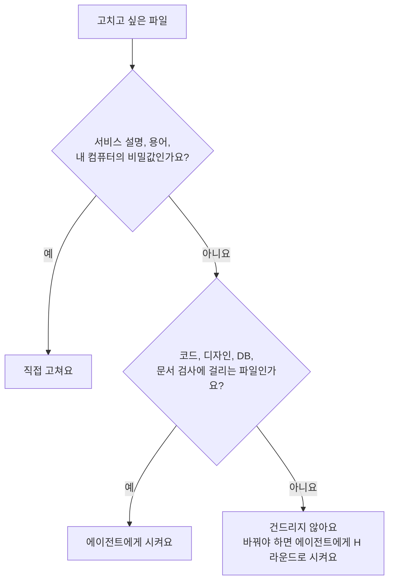

# 고쳐도 되는 파일

> 한눈에: 프로킷이 설치된 프로젝트에는 파일이 많지만, 내가 직접 고쳐도 되는 것은 몇 개뿐이에요. 서비스 설명과 용어, 내 컴퓨터의 비밀값 파일은 직접 고치고, 코드와 디자인 파일은 에이전트에게 시키고, 에이전트 규칙·설정 파일(하네스)과 생성 파일은 건드리지 않아요.

## 왜 나눠서 알아야 하나요

프로킷은 에이전트가 같은 규칙으로 일하게 하려고 설정 파일과 기록 파일을 프로젝트에 둬요. 이 가운데 어떤 파일은 설치기나 명령이 자동으로 만들고 검사해서, 손으로 고치면 검사가 실패하거나 에이전트가 길을 잃어요. 반대로 서비스 설명 같은 파일은 사용자만 알고 있는 내용이라 직접 써야 정확해요.

파일을 하나씩 판단하기 어려우면 이 기준만 기억하세요.

1. 서비스에 관한 내 생각을 적는 문서는 직접 고쳐도 돼요.
2. **코드, 디자인, DB는 에이전트에게 시켜요.** 시키면 대조표와 검사가 따라와요.
3. 이름에 `.dev-cycle.json`, `skills-lock.json`, `.codex`, `.agents`가 들어간 설정과 생성물은 건드리지 않아요.

## 직접 고쳐도 되는 것

**내가 가장 잘 아는 내용을 적는 파일이에요.**

| 파일 | 이유 |
|---|---|
| `GLOSSARY.md` | 서비스에서 쓰는 용어의 뜻을 정하는 용어집이에요. 용어의 뜻은 사용자가 가장 잘 알아요. 새 용어는 라운드에서 에이전트도 더해요. 직접 고쳤다면 "용어집을 바꿨어"라고 알려 주세요 |
| `docs/domain/project.md` | 서비스의 현재 모습(권한, 주요 흐름, 기능 표)이에요. 에이전트는 기능을 바꾼 라운드를 닫기 전에 이 문서를 갱신하거나 `N/A`로 적어요. 사용자가 읽고 틀린 곳을 고쳐도 돼요 |
| `docs/prd.md` 또는 `docs/first-request.md` | 처음에 준 PRD나 요청이에요. 서비스 방향이 바뀌었으면 고쳐도 돼요. 큰 방향 변경은 파일만 고치지 말고 에이전트에게 계획 라운드로 반영해 달라고 하세요 |
| `apps/web/.env`의 값 | 내 컴퓨터에서만 쓰는 비밀값 파일이에요. git이 무시하므로 저장소에 올라가지 않아요. 값을 채우거나 바꿔도 돼요. 새 변수의 이름과 형식은 `apps/web/.env.schema`에 선언하므로 에이전트에게 시켜요 |

직접 고친 파일은 평소처럼 커밋 대상이에요.

> [!WARNING]
> `.env`는 커밋하지 않아요. 에이전트가 커밋하기 전에 `pnpm dev-cycle secrets`로 비밀값이 섞였는지 검사해요([비밀값 지키기](../deploy/secrets.md)).

## 에이전트에게 시킬 것

고치면 대조표와 검사가 따라오는 파일이에요. **"○○ 바꿔줘"처럼 말로 요청하세요.**

| 파일 | 이유 |
|---|---|
| `DESIGN.md` | 디자인 토큰과 이유를 적은 파일이에요. 형식 검사(lint)가 있고, 토큰을 바꾸면 `globals.css`와 화면 코드가 함께 바뀌어야 해서 손으로 고치면 어긋나요. "대표 색을 바꿔줘"처럼 요청하세요([DESIGN.md](../design/design-md.md)) |
| `PRODUCT.md` | 제품 맥락(누구를 위한 서비스인지, 어조)이에요. impeccable의 인터뷰로 만들어요. 서비스 방향이 바뀌면 다시 인터뷰하도록 시켜요 |
| `docs/briefs/` | 사이트맵과 화면 설계예요. 화면을 만들기 전에 확인받는 기준이라 바꾸면 화면도 함께 바뀌어야 해요 |
| `apps/`, `packages/`의 코드 | 코드를 바꾸면 대조표, 검사, 리뷰가 따라와요. 직접 고치면 그 기록 없이 diff만 생겨서 다음 라운드가 케이스를 높게 판정할 수 있어요 |
| `packages/db`의 스키마와 새 마이그레이션 | 스키마는 `db:generate`로 만든 마이그레이션으로만 바꿔요([만든 뒤 개발하기](../start/after-create.md)) |
| `docs/adr/` | 되돌리기 어려운 설계 결정의 기록이에요. 결정을 바꿀 때 에이전트가 이유와 함께 남겨요 |
| `docs/plans/`, `tasks/plan.md` | 진행 계획이에요. Task의 순서와 제목에는 지문(sig)이 있어서 손으로 고치면 검사가 알아채요([정밀 분석과 진행 계획](../concepts/project-plan.md)) |
| `tasks/todo.md`의 할 일과 백로그 | 에이전트에게 "할 일에 ○○ 더해줘"라고 시켜요. 아래 "건드리지 말 것"의 대조표 칸과 한 파일에 있어 직접 고치다 표를 깨기 쉬워요 |
| `skills.manifest.json`, 스킬 구성 | 두뇌, 과설계 방지 스킬, 추가 스킬은 "두뇌 바꿔줘"처럼 요청해요. 에이전트가 H 라운드에서 `pnpm skills:setup`으로 바꿔요([두뇌와 선택 스킬](../skills/brains.md)) |

## 건드리지 말 것

> [!IMPORTANT]
> 바꿔야 한다면 에이전트에게 "이유"와 함께 시키세요. 하네스 파일(스킬, 스크립트, 설정)을 바꾸는 일은 케이스 H 라운드로 열려서 리뷰와 검사를 거쳐요([케이스와 대조표](../concepts/cases.md)).

| 파일 | 왜 건드리지 않나요 |
|---|---|
| `.dev-cycle.json` | 케이스 판정 경로, 검사 명령, 화면 점수 기준이에요. 설치기가 채우고 `dev-cycle`이 읽어요. 잘못 고치면 케이스 판정이 달라져 검사가 느슨해질 수 있어요. 바꿀 때는 H 라운드로만 해요([설정 읽기](dev-cycle-config.md)) |
| `skills-lock.json` | `skills` CLI가 설치한 스킬의 출처와 판을 적은 잠금 파일이에요. 손으로 고치면 설치 상태와 어긋나요 |
| `.codex/agents/`, `.agents/agents/` | `.claude/agents/`의 정본에서 `pnpm agents:sync`가 만든 생성물이에요. 고쳐도 다음 동기화가 덮어쓰고, `pnpm agents:check`가 어긋남을 알려 줘요. 에이전트 규칙을 바꾸려면 정본(`.claude/agents/`)을 H 라운드로 고쳐요 |
| `.agents/skills/prokit-*`, `.claude/skills/` | 프로킷 스킬과 연결이에요. 바꾸면 모든 라운드의 규칙이 달라져요. 템플릿의 새 판은 [갱신 반영](../templates/update-existing.md)으로 가져와요 |
| `scripts/`의 하네스 스크립트 | `dev-cycle.mjs`, `skills-setup.mjs`, `vercel-deploy.mjs` 같은 도구예요. 템플릿과 같아야 `--diff`와 갱신이 깔끔해요 |
| 이미 적용한 마이그레이션 파일 | 적용한 뒤 바꾸면 DB의 기록과 파일이 어긋나요. 고치려면 새 마이그레이션을 더해요 |
| `tasks/todo.md`의 대조표 칸 | 에이전트가 실제로 실행한 명령과 결과로 채우는 증거 칸이에요. `audit`은 빈 칸과 `ok` 같은 형식만 채운 값을 거절하지만, 손으로 지어 쓴 내용까지 가려내지는 못해요. 그래서 손으로 채우지 않아요. 마지막 `[confirm]` 칸은 사용자가 결과를 직접 보고 알려 줘야 채워요 |
| `tasks/archive/` | 닫은 라운드의 기록이에요. 이력이라 고치지 않아요 |
| `release/` 노트, `v*` 태그 | `pnpm release` 절차로만 만들어요. 에이전트가 쓰고 사용자는 동의만 해요([버전과 릴리스](../deploy/release.md)) |
| `licenses/` | 프로킷 사용 조건과 적용 범위 안내예요. 지우지 않아요([폴더 구조](project-structure.md)) |
| `.vercelignore` | 배포에서 비밀값 파일을 빼는 장치예요. 지우면 `.env`가 배포에 올라갈 수 있어요 |
| `.impeccable/`의 기록 | 화면 리뷰(critique)와 점수 기록이에요. `audit`은 이번 라운드에 만든 기록 파일이 있는지와 점수가 증거와 같은지 대조해요. 다만 지어낸 기록을 가려내지는 못하니 손으로 쓰지 않아요 |

## 헷갈릴 때

- 마이그레이션과 `schema/auth.ts`처럼 도구가 다시 만드는 파일은 `biome.json`에서 제외돼 있어요. 손으로 다듬지 말고 만든 도구(`db:generate` 등)로 다시 만들어요.
- 막히면 [막혔을 때](../../tutorials/reference/troubleshooting.md)의 프롬프트를 써요.

> [!TIP]
> 이미 고쳤다면 되돌리지 말고 에이전트에게 "내가 ○○ 파일을 직접 고쳤어. 이 변경을 확인하고 필요한 라운드로 정리해줘"라고 알려 주세요. 에이전트가 `pnpm dev-cycle case`로 어떤 케이스인지 판정하고 필요한 검사를 해요.

## 관련 문서

- [설치된 프로젝트의 폴더 구조](project-structure.md)
- [`.dev-cycle.json` 설정 읽기](dev-cycle-config.md)
- [자주 묻는 질문](faq.md)
