# 두뇌와 과설계 방지 흐름

> 한눈에: 고른 두뇌는 대조표의 단계 행(요구 명확화, 계획, 구현, 디버깅, 리뷰 관점, QA, 검증, 완료 기록)에서 일하는 방법을 바꾸고, 과설계 방지 스킬은 설계부터 리뷰까지 “얼마나 작게 만들지”를 지켜요. **무엇을 골라도 대조표, `prokit-reviewer` 최종 리뷰, audit은 그대로예요.** 고르는 법은 [두뇌와 선택 스킬](brains.md)에 있어요.

## 흐름

라운드 하나에서 두뇌와 과설계 방지 스킬이 붙는 곳이에요. `+` 뒤가 그 단계에 보태는 스킬이에요. 두뇌가 맡지 않는 단계는 프로킷 내장 절차(기본 칸)로 하고, 과설계 방지 스킬을 고르지 않아도 내장 간결성 규칙은 늘 지켜요.

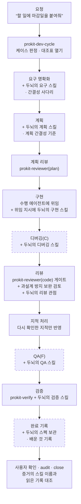

- 점선 단계는 케이스나 두뇌에 따라 있어요. 디버깅은 버그 수정(C), QA는 F 케이스에 있고, 완료 기록은 그 단계를 맡는 두뇌(openspec, spec-kit, compound-engineering)를 골랐을 때만 해요.
- 과설계 방지 스킬은 단계 하나가 아니라 라운드 내내 켜져 있어요. 계획 리뷰와 리뷰에서 그 스킬의 기준으로 한 번 더 봐요([과설계 방지 스킬이 하는 일](#과설계-방지-스킬이-하는-일)).

## 구조

`prokit-dev-cycle`이 `.dev-cycle.json`에 적힌 구성을 읽고, 단계 행마다 어느 파일의 방법을 쓸지 정해요. 메인 세션이 그 스킬을 부르거나 위임 지시에 넣고, 쓴 스킬 이름은 대조표 증거로 모여 audit이 훅 기록과 대조해요. 점선 테두리는 고른 구성에 따라 있을 때만 쓰는 선택이에요.

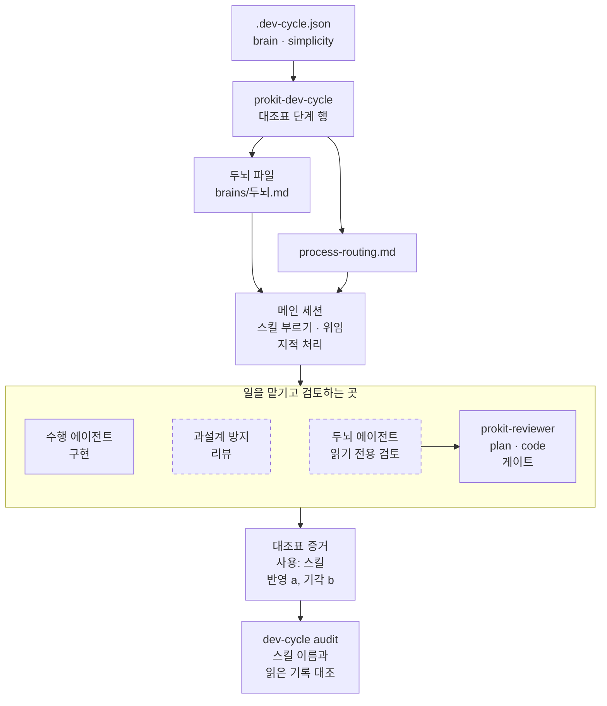

수행 에이전트, 과설계 방지 리뷰, `prokit-reviewer`가 낸 결과가 대조표 증거로 모여요. 두뇌 에이전트의 검토는 `prokit-reviewer`로 이어져요.

| 파일 | 하는 일 |
|---|---|
| `.dev-cycle.json`의 `brain`, `simplicity` | 고른 두뇌(하나면 이름, 여럿이면 목록. 첫 값이 주 두뇌)와 과설계 방지 스킬이에요. `none`이면 기본 칸으로 진행해요 |
| `prokit-dev-cycle/references/process-routing.md` | 두뇌가 없을 때 단계마다 하는 기본 방법(기본 칸), 무엇을 골라도 지키는 간결성 규칙, 과설계 방지 스킬마다 맡는 일(역할 표)이 있어요 |
| `prokit-dev-cycle/references/brains/<두뇌>.md` | 그 두뇌가 맡는 단계의 스킬 이름, 프로킷에서 건너뛰는 단계(커밋, 브랜치, PR 등), 두뇌가 주는 에이전트가 있어요 |
| `prokit-dev-cycle/references/brains/README.md` | 두뇌 목록, 여럿일 때 단계를 나누는 단계 표, PRD로 추천하는 기준이 있어요 |
| `.prokit/skills-used.jsonl` | 훅이 스킬 호출과 `SKILL.md` 읽기를 남기는 기록이에요. 커밋하지 않아요 |

## 단계마다 어느 두뇌를 쓰나

단계 행을 시작할 때 아래 순서로 방법을 정해요. 두뇌가 하나여도 같아요.

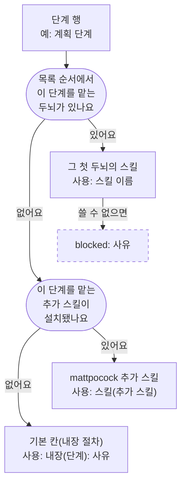

아래 표에서 ●가 그 두뇌가 맡는 단계예요. 빈칸 단계는 다음 두뇌나 기본 칸으로 넘어가요.

| 두뇌 | 요구 명확화 | 계획 | 구현 | 디버깅 | 리뷰 관점 | QA | 검증 | 완료 기록 |
|---|---|---|---|---|---|---|---|---|
| superpowers | ● | ● | ● | ● | ● 지적 처리 | | ● | |
| agent-skills | ● | ● | ● | ● | ● | ● 보조 | | |
| gstack | ● 제품 판단 | ● 리뷰 보강 | | ● | ● | ● | | |
| oh-my | ● | ● | ● | ● | ● | | ● | |
| pstack | ● 요구 확인 | ● | ● | ● | ● | | | |
| mattpocock | ● | 고른 추가 스킬 | 고른 추가 스킬 | 고른 추가 스킬 | 고른 추가 스킬 | | | |
| openspec | ● | ● | ● | | | | | ● 스펙 보관 |
| spec-kit | ● | ● | ● | | | | | ● 남은 일 확인 |
| compound-engineering | ● | ● | ● | ● | ● | | | ● 배운 것 |

- **예**: `--brain openspec,superpowers`면 요구 명확화, 계획, 구현, 완료 기록은 openspec이, 디버깅, 리뷰 지적 처리, 검증은 superpowers가 맡아요. 둘 다 맡지 않는 QA는 기본 칸이에요.
- **겹치면**: 두 두뇌가 같은 단계를 맡으면 목록 앞의 두뇌만 써요. 사용자가 뒤 두뇌의 스킬을 직접 부르면 그 요청을 따라요.
- **함께 고르지 않는 두뇌**: superpowers, gstack, oh-my는 세션 시작 훅이나 전역 지시로 진행 순서를 강제해서 둘 이상 고르지 않아요.

## 두뇌마다 단계에서 하는 일

두뇌가 맡는 단계만 그렸어요. 이름은 Claude Code에서 부르는 이름이고 플러그인 접두어(`superpowers:` 등)는 뺐어요. 다른 도구에서 쓰는 이름은 설치된 프로젝트의 `brains/<두뇌>.md`에 있어요. 점선 테두리는 고른 추가 스킬이 있거나 마무리 점검처럼 필요할 때만 써요.

### 진행 규율: superpowers와 agent-skills

superpowers는 설계 합의, 계획, 테스트 먼저, 작업별 리뷰를 강하게 걸어요. agent-skills는 스펙부터 출시까지 보안·성능·접근성 기준을 단계별 명령(`/spec`, `/plan`, `/build`, `/test`, `/review`, `/ship`)으로 걸어요.

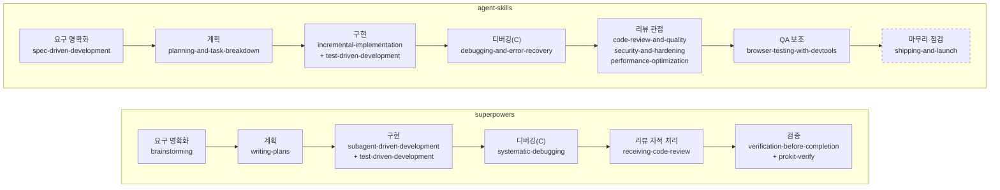

### 진행 규율: pstack과 mattpocock

pstack(Claude Code만)은 `poteto-mode`가 일에 맞는 플레이북을 골라 코드는 적게 쓰고 실행 증거로 검증해요. mattpocock은 늘 설치하는 `grilling`으로 요구를 묻고, 나머지 단계는 고른 추가 스킬로 해요.

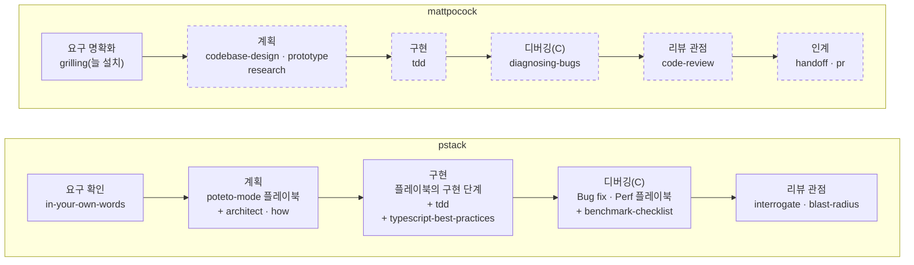

### 스펙 주도: openspec과 spec-kit

둘 다 구현 전에 문서로 합의하고 끝나면 스펙에 남겨요. openspec은 변경마다 제안을 만들어 가볍게, spec-kit은 원칙부터 작업 목록까지 꼼꼼히 밟아요.

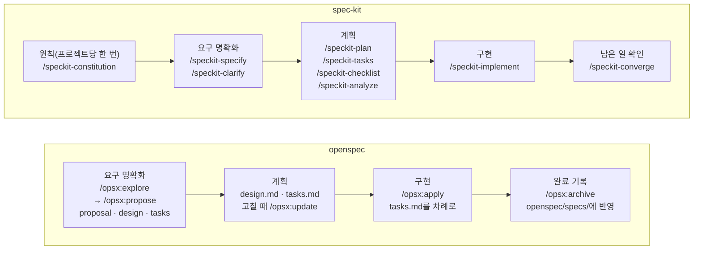

### 제품·장기 실행·학습: gstack, oh-my, compound-engineering

gstack은 무엇을 만들지 검토하는 제품 판단과 실사용 QA가, oh-my는 큰 작업의 병렬·반복 실행이, compound-engineering은 배운 것을 `docs/solutions/`에 쌓는 일이 강해요.

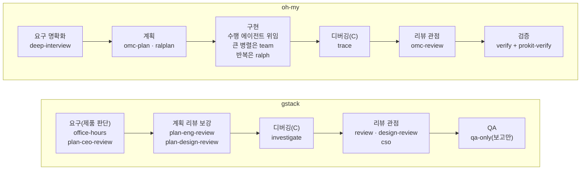

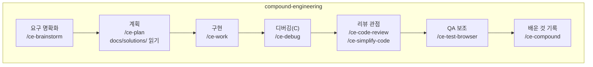

어느 두뇌든 프로킷 라운드 안에서는 이렇게 써요.

- **하지 않는 일**: 두뇌 스킬이 스스로 커밋, 브랜치, worktree, PR을 만들거나 리뷰하면서 바로 고치라고 해도 건너뛰어요.<!-- edition:pro --> 배포는 두뇌의 출시 명령이 아니라 `prokit-deploy`로 해요.<!-- /edition -->
- **끝의 기준**: 두뇌의 실행 모드(oh-my의 `ralph`, `team` 등)가 끝났다고 보고해도 증거가 아니에요. 라운드가 끝났는지는 `pnpm dev-cycle audit`만 판정해요. 구현 스킬이 끝에 브랜치 마무리를 불러도 대조표의 다음 행으로 가요.
- **구현**: 늘 그 계층 수행 에이전트가 해요. 두뇌의 구현 스킬 이름은 위임 지시에 적혀 수행 에이전트가 따라요.

## 과설계 방지 스킬이 하는 일

과설계 방지 스킬은 “얼마나 작게, 어디까지 고칠지”를 정해요. 아래 사다리, “만들지 않는 것” 절, `shortcut:` 주석, 지적 처리는 무엇을 골라도 지키는 하네스 규칙이고, 고른 스킬이 그 위에 기준과 리뷰를 더해요.

### 늘 지키는 사다리

스펙의 범위와 구조를 정할 때마다 위에서부터 물어요. 보안, 입력 검증, 접근성, 사용자가 요청한 것은 사다리로 빼지 않아요.

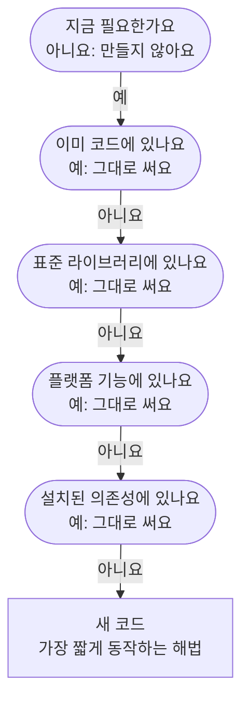

- 첫 질문의 답이 아니요면 만들지 않아요. 스펙의 만들지 않는 것에 뺀 것과 다시 넣을 조건을 적어요.
- 뒤의 네 질문 가운데 하나라도 답이 예면 있는 것을 그대로 써요. 모두 아니요일 때만 새 코드를 써요.

일부러 한계를 둔 단순화는 코드에 `shortcut:` 주석으로 한계와 넘으면 할 일을 적어요.

### 스킬마다 맡는 일

고른 스킬이 계획 간결성 기준, 구현 diff 보완 검토, F 케이스의 공통화·리팩토링 행을 맡아요. diff를 검토하는 스킬이 없는 karpathy와 없음(기본 AI)은 `prokit-reviewer(code)`가 간결성까지 함께 봐요.

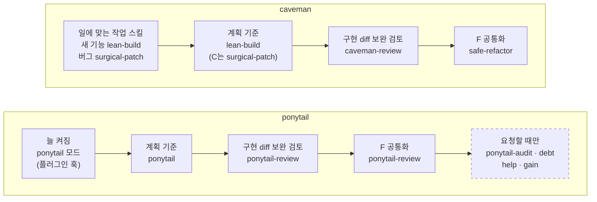

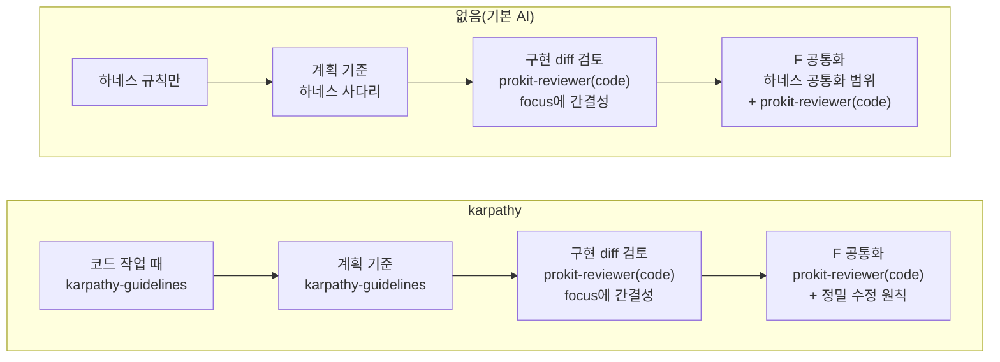

- 계획 기준은 `prokit-reviewer(plan)`이 계획을 볼 때 읽어요. 코드 diff용 보완 검토가 계획 리뷰를 대신하지 않아요.
- 보완 검토는 `prokit-reviewer(code)` 게이트를 대신하지 않아요. 결과는 리뷰 행 증거 뒤에 `ponytail-review: 반영 2(Must fix 1), 기각 1, 백로그 1`처럼 덧붙여요.
- 고른 스킬의 규칙이 `AGENTS.md`, `prokit-*`, 대조표와 부딪히면 프로킷 쪽이 먼저예요. 대조표 행, 구현 전 질문, 보안 검사, 입력 검증은 줄이지 않아요.

### 리뷰 지적 처리

보완 검토와 `prokit-reviewer`의 지적은 같은 기준으로 처리해요. 이번 라운드가 만든 문제만 이 라운드에서 고치고, 잘 돌던 기존 코드는 간결성 지적을 이유로 고치지 않아요.

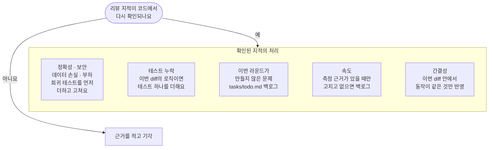

## 관련 문서

- [스킬 구조 한눈에](skill-map.md)
- [두뇌와 선택 스킬](brains.md)
- [공식 스킬과 연결](official-skills.md)
- [대조표와 라운드](../concepts/dev-cycle.md)
- [케이스](../concepts/cases.md)
- [에이전트 역할](../concepts/agent-roles.md)
