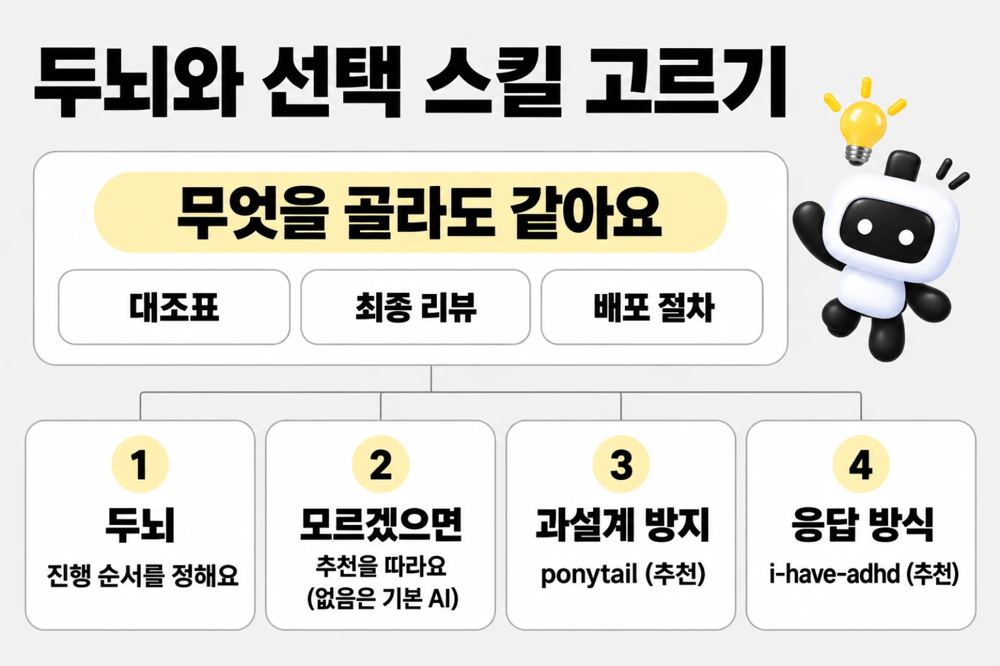
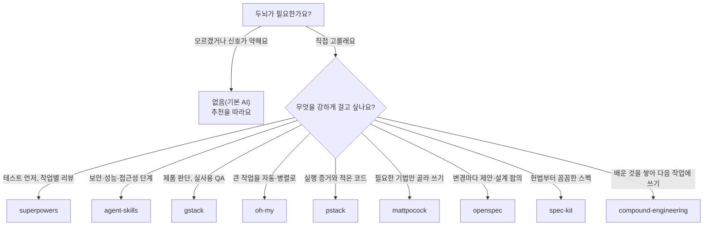

# 두뇌와 선택 스킬

> 한눈에: 프로젝트마다 "어떤 순서로 진행할지"(두뇌)와 "얼마나 작게 만들지"(과설계 방지 스킬)를 고르거나 고르지 않을 수 있어요. **아무것도 고르지 않으면 지금 쓰는 에이전트가 프로킷 내장 절차로 진행해요.** 두뇌는 하나를 권하지만 여럿을 함께 고를 수도 있어요. 프로킷을 처음 들일 때 `prokit-init` 스킬이 PRD<!-- edition:pro -->(기존 프로젝트면 초기 분석)<!-- /edition -->에 맞는 것에 추천 표시를 붙여 물어보고, 진행 중에는 `prokit-skills-manage`로 바꾸거나 더하거나 빼요.

## 모르겠으면 이렇게 해요

두뇌와 스킬 이름을 몰라도 괜찮아요. 처음 프로젝트를 만들 때 에이전트가 PRD(만들 서비스 설명)를 읽고 추천을 붙여 물어요. 추천은 `prokit-init` 스킬이 정한 기준으로 만들고, 뭘 골라도 나중에 말로 바꿀 수 있어요.



> [!TIP]
> 고르기 어려우면 `(추천)`이 붙은 것을 고르거나 "알아서 골라줘"라고 답하면 돼요.

| 항목 | 모르겠을 때 | 이유 |
|---|---|---|
| 두뇌 | 추천을 따라요. 신호가 약하면 추천이 **없음(기본 AI)** 이에요 | 없음은 지금 쓰는 에이전트가 프로킷 내장 절차(요구 정리, 계획, 구현, 확인)로 진행해요. 충돌이 없고 가장 가벼워요 |
| 과설계 방지 스킬 | `ponytail (추천)` | 요청하지 않은 기능이 늘어나지 않게 가장 작게 만들어 줘요. 항상 첫 선택지로 나와요 |
| 응답 방식 | `i-have-adhd (추천)`. 길고 자세한 설명이 좋다면 SKIP | 설치해도 `/i-have-adhd`로 켤 때만 짧은 답으로 바뀌어서 평소 답은 그대로예요 |
| 화면 디자인 보조 | SKIP | 랜딩, 소개, 포트폴리오처럼 읽고 스크롤하는 공개 페이지가 주 화면이거나 "AI가 만든 티가 나지 않게"를 원할 때만 `taste-skill`을 추천해요 |
| mattpocock 추가 스킬 | 아무것도 고르지 않아요 | 필수 3개(`domain-modeling`, `grilling`, `grill-with-docs`)는 늘 설치돼요. 추가 스킬은 PRD에 맞는 것만 `(추천)`이 붙어요 |

뜻을 모르는 말은 [처음 보는 용어](../../tutorials/reference/glossary.md#도구)의 "두뇌", "하네스", "스킬"을 보세요. [선택 스킬 묶음](optional-bundles.md)은 프로젝트가 정해진 뒤에 더해도 늦지 않아요.

## 처음 들일 때 이렇게 물어요

아래는 예시예요. 실제 문구와 선택지는 PRD에 따라 달라져요. Claude Code는 질문 상자(AskUserQuestion)로, 다른 도구는 번호 목록으로 같은 내용을 물어요.

```text
에이전트(예시): PRD를 읽어 보니 사용자 한 종류가 할 일을 적고 끝내는 작은 서비스예요.
요구가 짧고 분명해서 두뇌는 "없음(기본 AI)"을 추천해요.

[질문 1 두뇌]
  - 없음(기본 AI) (추천)   지금 에이전트가 프로킷 내장 절차로 진행해요. 충돌이 없고 가장 가벼워요
  - mattpocock             필수 3개에 PRD에 맞는 추가 스킬을 골라 단계마다 기법으로 써요
  - superpowers            설계 합의, 계획, 테스트 먼저, 작업별 리뷰를 강하게 거는 규율형이에요
  - 다른 두뇌 보기·여럿 고르기
[질문 2 과설계 방지]  ponytail (추천) / caveman / andrej-karpathy-skills / SKIP(기본 AI)
[질문 3 응답 방식]    i-have-adhd (추천) / SKIP
[질문 4 화면 디자인]  SKIP (추천) / taste-skill
```

한 번에 네 가지를 묻고, 답에 따라 이어서 더 물어요.

1. **`다른 두뇌 보기·여럿 고르기`를 골랐을 때**: 두뇌 아홉 개를 세 묶음(진행 규율, 스펙 주도, 제품·장기 실행·학습)에서 골라요. 하나만 골라도 되고, 둘 이상 고르면 "주 두뇌는?"을 한 번 더 물어요.
2. **mattpocock 추가 스킬**: 두뇌가 정해지면 [아래 14개](#mattpocock-추가-스킬-14개)를 네 묶음(구현·설계, 디버깅·검토, 조사·외부 설정, 인계·학습)의 여러 선택으로 물어요. PRD에 맞는 스킬에 `(추천)`이 붙고, 추가하지 않으려면 아무것도 고르지 않거나 Other에 "없음"이라고 적어요.
3. **마무리**: 고른 값이 `install.sh`의 `--brain`, `--simplicity`, `--matt`, `--optional`로 들어가고, 끝나면 보고에 `pnpm skills:check`의 해당 줄이 나와요.

## 고르는 다섯 가지

| 구분 | 고르는 수 | 기본 | 고르는 명령 |
|---|---|---|---|
| 두뇌 | 0개 이상(하나 권장) | 없음(기본 AI) | `pnpm skills:setup --brain <이름>[,<이름>]` |
| 과설계 방지 스킬 | 0\~1 | 없음(기본 AI) | `pnpm skills:setup --simplicity <이름>` |
| mattpocock 추가 스킬 | 0개 이상 | 설치 안 함 | `pnpm skills:setup --matt <스킬>`, 지우기 `--drop <스킬>` |
| 응답 방식(i-have-adhd) | 0\~1 | 설치 안 함 | `pnpm skills:setup --optional i-have-adhd` |
| 화면 디자인 보조(taste-skill) | 0\~1 | 설치 안 함 | `pnpm skills:setup --optional taste` |

## 처음 들일 때 고르는 순서

아래는 새 프로젝트의 순서예요.<!-- edition:pro --> 기존 프로젝트(초기, 운영 중, 전환)를 들일 때는 PRD가 없어도 돼요. 에이전트가 그 프로젝트를 읽기만 하면서 초기 분석을 하고, 그 결과를 PRD와 함께 추천 근거로 써요([기존 프로젝트에 도입하기](../start/adopt.md)).<!-- /edition -->

1. **PRD 건네기**: PRD 파일이나 붙여 넣은 글, 요청 속 서비스 설명(누가 쓰는지와 핵심 기능), 프리셋 팩 중 하나가 있어야 해요. 적을 것은 [PRD 먼저 정하기](../start/prd.md)에 있어요.
   - 받는 방법: pro-kit 폴더에서 에이전트를 열었다면 스킬을 부르면서 줄 수도 있어요(Claude Code는 `/prokit-init <PRD 파일 경로나 내용>`, Codex는 `$prokit-init …`).
   - 없을 때: 에이전트가 맨 먼저 PRD를 달라고 해요. 그래도 주지 않으면 PRD가 왜 필요한지 알리고 프로젝트를 만들지 않은 채 끝나요.
2. **추천 보기**: 에이전트가 PRD로 두뇌 열 개(없음 포함) 가운데 하나를 추천하고 근거 문장을 보여 줘요.
3. **고르기**: 두뇌, 과설계 방지 스킬, 응답 방식, 화면 디자인 보조를 한 번에 골라요. 추천한 선택지에 `(추천)`이 붙어 맨 앞에 있어요. 처음 질문에 없는 두뇌를 고르거나 두뇌를 여럿 고르려면 `다른 두뇌 보기·여럿 고르기`를 골라요. 둘 이상 고르면 주 두뇌를 한 번 더 물어요.
4. **추가 스킬 고르기**: mattpocock 추가 스킬 <!-- v:mattpocock.pool.count -->14<!-- /v -->개를 여러 개 골라요. PRD에 맞는 스킬에 `(추천)`이 붙어 있어요.

이미 정한 항목(예: "두뇌는 superpowers")은 다시 묻지 않고, "알아서 골라줘"처럼 맡긴 항목은 추천대로 설치해요.

## 하나를 권하는 이유와 여럿 쓰는 법

과설계 방지 스킬은 둘이면 "얼마나 작게 만들지"가 엇갈려 하나만 써요. 두뇌도 하나가 가장 단순해서 하나를 권해요. 다만 스펙을 남기는 두뇌와 디버깅·검증에 강한 두뇌처럼 맡는 단계가 다르면 함께 쓸 수 있어요.

- **주 두뇌**: 고른 목록의 첫 두뇌예요. `.dev-cycle.json`의 `brain`에 하나면 이름이, 여럿이면 목록이 적혀요.
- **단계 나누기**: 요구 정리, 계획, 구현, 디버깅, 리뷰, QA, 검증, 완료 기록마다 목록 순서에서 그 단계를 맡는 첫 두뇌를 써요. 예를 들어 `--brain openspec,superpowers`면 요구·계획·구현은 openspec, 디버깅·검증은 superpowers가 맡아요.

> [!WARNING]
> superpowers, gstack, oh-my는 세션 시작 훅이나 전역 지시로 진행 순서를 강제해요. 이 셋 가운데 둘 이상을 고르면 지시가 서로 덮어써서 설치기가 경고하고, `prokit-init`은 하나만 남기게 다시 물어요.

> [!IMPORTANT]
> 대조표, 위임 검증, `prokit-reviewer` 최종 리뷰, audit, <!-- edition:pro -->사용자 확인, `prokit-deploy` 배포는<!-- /edition --><!-- edition:ui 사용자 확인은 --> 무엇을 골라도 그대로예요.

## 단계마다 두뇌를 쓰는 법

대조표에서 두뇌를 쓰는 곳은 단계 행이에요. 행 문구에 `요구 명확화 단계`, `계획 단계`, `구현 단계`, `디버깅 단계`, `고른 두뇌의 계획 방법`이 들어간 행이에요. 화면(B)<!-- edition:pro -->, 서버(D), DB(E)<!-- /edition -->의 구현 행과 하네스(H)의 구현 행에도 `구현 단계`가 붙어요. 스킬이나 설치만 바꾸는 H는 이 행을 `N/A: 사유`로 채워요.

- 에이전트는 이 행을 시작하기 전에 `.agents/skills/prokit-dev-cycle/references/brains/<두뇌>.md` 단계 표의 스킬을 불러요(Claude Code는 Skill 도구, 다른 도구는 `SKILL.md`를 읽어요). 작은 변경이어도 건너뛰지 않고 그 스킬 안에서 짧게 해요. 구현을 맡길 때는 그 스킬 이름을 `prokit-implementer`에게 주는 지시에 적어요.
- 무엇을 부를지는 dev-cycle이 알려 줘요. `pnpm dev-cycle table --write`는 단계 행마다 부를 두뇌 스킬을 보여 주고, `pnpm dev-cycle status`는 다음 행이 단계 행이면 "이 행은 두뇌 …의 …를 먼저 불러서 한다"를 붙여요. 두뇌를 바꾸면 다음 출력부터 바뀐 두뇌로 나와요.
- 증거 칸에는 `사용: <두뇌 파일에 적힌 이름>`, `사용: <스킬>(추가 스킬)`, `사용: 내장(<단계>): <사유>` 중 하나를 적어요. 내장은 두뇌가 맡지 않는 단계에만 써요(두뇌가 `none`이면 사유는 없어도 돼요). 두뇌 스킬을 쓸 수 없으면 `blocked: 사유`예요.
- audit은 단계 행의 증거에서 이 이름들을 확인해요. 이름이 두뇌 파일에 없을 때, 두뇌가 맡는 단계를 내장으로 적었을 때, 내장 사유에 두뇌 스킬 이름이 있을 때(그 방법을 썼으면 그 스킬 이름을 적어야 해요) 막아요. Claude Code에서는 설치기가 넣은 훅이 Skill 호출과 `SKILL.md` 읽기를 `.prokit/skills-used.jsonl`(커밋하지 않는 파일)에 남겨요. audit은 증거에 적은 스킬을 이 라운드에서 정말 불렀는지 이 기록과 대조해요. 고른 과설계 방지 스킬의 리뷰(`ponytail-review` 등)도 같아요. 기록이 없는 Codex 같은 도구에서는 이름만 확인하는 자기 신고라, 리뷰와 내가 직접 보는 확인이 받쳐 줘요.
- 라운드가 열려 있을 때의 `pnpm dev-cycle status`와 `pnpm dev-cycle table --write`에 `두뇌:` 줄이 나와서 고른 두뇌와 두뇌 파일 위치를 바로 볼 수 있어요. `none`이면 `두뇌: 없음(기본 칸)`이에요.

### 두뇌의 에이전트

두뇌 파일마다 "에이전트" 절이 있어서 그 두뇌가 주는 에이전트나 프롬프트 틀을 알려 줘요. 예를 들어 `agent-skills`는 `agent-skills:security-auditor`와 `agent-skills:test-engineer` 같은 에이전트를 줘요. `superpowers`와 `compound-engineering`은 에이전트 대신 스킬 안의 프롬프트 틀을 줘요. `gstack`, `mattpocock`, `openspec`, `spec-kit`은 없어요.

- 두뇌의 에이전트는 **읽기 전용 보완 검토**로만 써요. 파일을 쓰지 않게 지시하고, 부르기 전과 후의 작업 트리를 비교해서 쓰기가 없었는지 확인해요. 쓴 것이 있으면 그 결과를 버리고 `blocked`로 남겨요.
- 결과는 최종 `prokit-reviewer` 리뷰의 입력이에요. 리뷰를 대신하지 않아요. 구현은 늘 `prokit-implementer`가 해요.

## 준비물과 전역 설치

대부분의 두뇌는 프로젝트 안에만 설치돼서 따로 준비할 것이 없어요. 아래 표의 네 가지는 컴퓨터 전체(전역)에 무언가를 설치하거나 먼저 필요한 도구가 있어요.

> [!WARNING]
> 전역 설치는 그 두뇌를 고르고 `--brain`을 명시했거나 `--with-global`을 줄 때만 해요. 설치하기 전에 에이전트가 먼저 알려요.

| 두뇌 | 먼저 있어야 하는 것 | 이 컴퓨터 전체에 설치되는 것 |
|---|---|---|
| `gstack` | Bun | gstack 본체(Claude Code는 `~/.claude/skills/gstack`, Codex는 `~/.codex/skills/gstack`). 설치하면서 `~/.claude/settings.json`에 Stop 훅(자동 실행 설정)을 등록하고 `~/.gstack`에 상태를 만들어요. 다른 프로젝트에서도 Stop 훅은 돌아요(gstack 스킬은 설치기가 그 프로젝트에서 꺼요. Codex 전역 스킬은 끌 수 없어요) |
| `oh-my` | Codex를 쓰면 OMX CLI(`omx`). OMX `team` 모드는 tmux가 있어야 돌아요(없어도 멈추지 않고 보고에만 적어요) | OMX CLI(`npm install -g oh-my-codex`). Codex가 있는 기기에만 설치해요. Claude Code의 OMC는 프로젝트 플러그인이에요 |
| `openspec` | npm | OpenSpec CLI(`npm install -g @fission-ai/openspec@latest`). 사용 통계를 기본으로 보내서 끄려면 `OPENSPEC_TELEMETRY=0`을 셸 설정에 둬요 |
| `spec-kit` | uv(설치할 때만) | 없음. 프로젝트 안에 도구 파일만 만들고 훅은 쓰지 않아요 |
| `superpowers`, `agent-skills`, `pstack`, `mattpocock`, `compound-engineering` | 없음 | 없음. `pstack`은 Claude Code만 지원해요 |

다른 두뇌로 바꿔도 전역에 설치한 것은 지우지 않아요(다른 프로젝트가 쓸 수 있어서요). 도구가 없는데 그 두뇌를 고르면 설치기가 멈추거나 경고하고 설치 방법을 알려 줘요.

## mattpocock 추가 스킬 14개

필수 3개(`domain-modeling`, `grilling`, `grill-with-docs`)는 용어와 설계 질문을 맡아서 무엇을 골라도 설치돼요. 아래 14개는 서로 독립된 기법이라 PRD에 맞는 것만 더해요. "호출"이 사용자인 스킬은 에이전트가 스스로 부르지 않고, 그 단계에서 명령(예: `/handoff`)을 제안해요. "겹치는 두뇌"는 그 두뇌가 같은 일을 자기 스킬로 맡는다는 뜻이라 추천에서만 빼고 설치는 막지 않아요(두뇌가 `mattpocock`이면 겹침을 따지지 않아요).

| 스킬 | 호출 | 하는 일 | 이런 PRD에 맞아요 | 겹치는 두뇌 |
|---|---|---|---|---|
| `tdd` | 모델 | 테스트를 먼저 쓰고 구현해요 | 계산, 상태 전이, 권한, 금액처럼 규칙 로직이 많아요 | superpowers, agent-skills, pstack, oh-my(OMC) |
| `diagnosing-bugs` | 모델 | 어려운 버그와 성능 퇴행을 재현부터 진단해요 | 외부 연동이 많거나 가져온 코드가 있어 원인을 찾기 어려운 버그가 예상되고, 성능 목표가 있어요 | superpowers, agent-skills, gstack, pstack, oh-my(OMC) |
| `codebase-design` | 모델 | 모듈 경계와 인터페이스를 깊게 설계해요 | 패키지와 모듈이 여럿이고 공용 API 설계가 범위에 있어요 | agent-skills, pstack |
| `prototype` | 모델 | 버리는 시안으로 상태 모델과 화면을 먼저 확인해요 | 화면과 흐름이 새롭거나 "느낌을 보고 정하자"는 수준이에요 | oh-my(OMC), pstack |
| `improve-codebase-architecture` | 사용자 | 구조 개선 후보를 보고서로 뽑아요 | 가져온 기존 코드가 있거나 큰 리팩터가 범위에 있어요(새 프로젝트는 보통 해당 없음) | oh-my(OMC) |
| `code-review` | 모델 | 스펙 대비 추가 관점 리뷰를 해요. `prokit-reviewer` 최종 게이트를 대신하지 않아요 | 인수 조건이 길고 엄격해 스펙 기준 검토를 따로 받고 싶어요 | superpowers, agent-skills, gstack, pstack, oh-my |
| `pr` | 모델 | PR(변경 제안) 본문을 써요. 프로킷 기본 마무리는 기본 브랜치 커밋과 push예요 | 팀이 PR로 병합하는 흐름이 PRD에 있어요 | 없음 |
| `writing-for-agents` | 모델 | 프로젝트 전용 스킬과 `AGENTS.md`를 고치는 일을 도와요 | 전용 스킬이나 에이전트 규칙을 만들 계획이 PRD에 있어요 | superpowers, agent-skills, oh-my(OMC) |
| `research` | 모델 | 외부 API, SDK, 규정 조사 결과를 저장소 문서로 남겨요 | 결제, 지도, AI API 같은 외부 연동이나 낯선 도메인 규칙, 법규가 있어요 | 없음 |
| `wizard` | 모델 | 사람이 해야 하는 외부 설정 단계를 안내해요.<!-- edition:pro --> 배포는 `prokit-deploy`가 맡아요<!-- /edition --> | OAuth 앱 등록, 결제 키, DNS, 외부 대시보드 설정이 여러 개예요 | 없음 |
| `to-questionnaire` | 사용자 | 결정권자가 따로 있는 질문을 질문지로 만들어요 | 고객, 기획자, 법무처럼 사용자 밖의 결정권자가 PRD에 있어요 | 없음 |
| `handoff` | 사용자 | 세션이나 두뇌를 넘길 때 인계 문서를 만들어요 | 여러 세션에 걸친 큰 범위이거나 여러 사람이 이어받아요 | 없음 |
| `teach` | 사용자 | 배우면서 만드는 흐름으로 설명해요 | 학습 목적, 입문자, 튜토리얼이에요 | pstack |
| `wait-what` | 사용자 | 설명이 와닿지 않을 때 다시 설명해 달라고 해요 | `teach`와 같은 신호예요 | pstack |

`code-review`, `prototype`, `research`는 Claude Code 같은 도구의 내장 명령과 이름이 겹쳐요. 어느 쪽이 불렸는지는 증거에 이름을 적어서 구분해요. 설치하지 않는 mattpocock 스킬(`grill-me`, `to-spec`, `implement` 등)과 이유는 설치된 프로젝트의 `brains/README.md`에 있어요.

## 직접 고르고 싶을 때: 두뇌 비교

아래는 추천을 따르지 않고 스스로 고를 때 보는 비교표예요. 처음이라면 위의 "모르겠으면 이렇게 해요"만 읽어도 돼요.



| 이름 | 이럴 때 골라요 | 쓰는 도구 |
|---|---|---|
| 없음(기본 AI) | 지금 에이전트가 프로킷 내장 절차로 진행해요. 충돌이 없고 가장 가벼워요 | 모든 도구 |
| `superpowers` | 설계 합의, 계획, 테스트 먼저, 작업별 리뷰를 강하게 거는 규율형이에요 | Claude Code, Codex, Antigravity, Grok Build |
| `agent-skills` (addyosmani) | 스펙부터 출시까지 보안·성능·접근성 기준을 단계별 명령으로 걸어요 | Claude Code, Codex, Antigravity, Grok Build |
| `gstack` | 무엇을 만들지 검토하는 제품 판단, 디자인, 실사용 QA가 강해요. 전역 설치(Bun)가 필요해요 | Claude Code, Codex |
| `oh-my` | 여러 세션에 걸친 큰 작업을 자동·병렬 모드로 돌려요(Claude Code는 OMC, Codex는 OMX) | Claude Code, Codex(전역 OMX CLI 필요) |
| `pstack` | React 코어팀 poteto의 엄격한 엔지니어링 방식이에요. `poteto-mode`가 일에 맞는 플레이북(기능, 버그, 성능, 리팩터, 시안)을 골라 코드는 적게 쓰고 실행 증거로 검증해요 | Claude Code만 |
| `mattpocock` | 늘 설치하는 mattpocock 3개에 PRD에 맞는 추가 스킬을 골라 단계마다 기법으로 써요. 개발자가 진행을 쥐고 필요한 기법만 더해요 | Claude Code, Codex, Antigravity, Grok Build |
| `openspec` | 변경마다 제안·설계·작업 목록을 먼저 합의하고 적용한 뒤 스펙으로 보관해요. 가볍고 이미 있는 프로젝트에 붙이기 좋아요. 전역 CLI(npm)가 필요해요 | Claude Code, Codex, Antigravity, Grok Build |
| `spec-kit` | 헌법(원칙) → 스펙 → 명확화 → 계획 → 작업 목록 → 구현을 꼼꼼히 밟는 GitHub의 스펙 주도형이에요. 설치할 때 uv가 필요해요 | Claude Code, Codex, Antigravity, Grok Build |
| `compound-engineering` | 계획과 리뷰에 힘을 싣고, 끝낸 일에서 배운 것을 `docs/solutions/`에 쌓아 다음 작업을 쉽게 만들어요 | Claude Code, Codex, Antigravity, Grok Build |

두뇌를 지원하지 않는 도구로 같은 프로젝트를 열면 그 도구는 내장 절차로 진행해요. 용어와 설계 결정을 묻고 적는 일은 두뇌와 상관없이 `grilling`·`domain-modeling`이 맡아요.

## 과설계 방지 스킬

| 이름 | 이럴 때 골라요 |
|---|---|
| `ponytail` (추천) | 늘 켜지는 미니멀 모드로 가장 작게 만들고, 구현 diff를 `ponytail-review`로 점검해요. 가장 활발히 갱신 중이에요 |
| `caveman` | 새 기능·버그·리팩터마다 간결 패턴을 쓰고 한 줄 리뷰를 받아요. `/caveman`으로 답변도 짧게 줄여요. 압축 규칙은 영어 기준이에요 |
| `karpathy` (andrej-karpathy-skills) | 카파시의 네 원칙(코딩 전 생각, 단순함, 정밀 수정, 검증 목표)을 담은 지침 하나예요. 가장 유명하지만 최근 갱신은 적어요 |
| 없음(기본 AI) | 따로 설치하지 않고 프로킷 내장 간결성 규칙(재사용 순서, "만들지 않는 것")으로 진행해요 |

고른 스킬이 계획의 간결성 기준, 구현 diff 보완 검토, 공통화 점검을 맡아요. diff를 검토하는 스킬이 없는 karpathy와 "없음"은 `prokit-reviewer`가 간결성까지 함께 봐요. 어느 쪽이든 스킬이 없다는 이유로 리뷰 행을 막지 않아요.

## mattpocock 스킬과 응답 방식

- **늘 설치**: `domain-modeling`, `grilling`, `grill-with-docs`. 용어와 설계 질문에 써요.
- **고르면 설치**: <!-- v:mattpocock.pool.count -->14<!-- /v -->개예요. 구현·설계, 디버깅·검토, 조사·외부 설정, 인계·학습 네 묶음으로 나눠 물어봐요(스킬별 설명은 위 [mattpocock 추가 스킬 14개](#mattpocock-추가-스킬-14개)). 목록에는 모두 나오고 PRD에 맞는 스킬에 `(추천)`이 붙어요. 고른 두뇌가 같은 일을 하는 스킬은 추천하지 않아요(두뇌가 `mattpocock`이면 겹침을 따지지 않아요).
- **i-have-adhd**([ayghri/i-have-adhd](https://github.com/ayghri/i-have-adhd)): 에이전트가 답을 긴 글 속에 묻어 두지 않게 하는 스킬이에요. 다음 행동부터 말하고, 여러 단계는 번호로 나누고, 구체적인 다음 할 일 하나로 끝내요. 목록은 5개까지 쓰고 서론, 요약, 마무리 인사는 빼요. `/i-have-adhd`(Codex는 `$i-have-adhd`)로 켤 때만 쓰고 "stop adhd mode"로 꺼요. 대화 답에만 적용하고 파일, 커밋 메시지, 라운드 보고는 프로킷 형식을 따라요. 켜기 전에는 평소 답 그대로라 새 프로젝트에서는 설치를 추천해요.

## 화면 디자인 보조

**taste-skill**([Leonxlnx/taste-skill](https://github.com/Leonxlnx/taste-skill))은 갤러리 사이트를 분석한 라이브러리에서 화면 방향을 뽑고, 공개 아카이브 사진과 실제 브라우저 검사로 AI가 만든 듯한 기본 화면을 피하게 하는 스킬이에요. 선택 묶음 `taste`로 설치해요.

- **언제 추천하나**: 기본은 설치하지 않아요. PRD의 주 화면이 랜딩, 소개, 포트폴리오, 행사, 매장처럼 읽고 스크롤하는 공개 페이지이거나 "AI가 만든 티가 나지 않게"처럼 시각 완성도를 따로 요구하면 추천해요.
- **어떻게 쓰나**: 설치해도 사용자가 고른 화면에만 써요. 화면을 요청할 때 "taste로"라고 하거나, 스타일 고르기 질문에서 "taste-skill로 방향 뽑기"를 고르면 돼요.
- **impeccable과의 관계**: 대신하지 않고 보태요. 기획, 화면 설계 확인, critique·audit과 통과 기준은 그대로예요. 한글 서체와 `DESIGN.md`, 토큰 규칙은 프로킷 쪽이 우선이에요.
- **준비물**: 검사(`inspect.mjs`)에 Chrome, Edge, Chromium 중 하나가 있어야 해요. 기록과 작업 파일은 프로젝트 안 `.taste-skill/`에 남기고 커밋하지 않아요.

## 바꾸기

진행 중에 언제든 "두뇌를 openspec으로 바꿔줘", "superpowers도 같이 쓰고 싶어", "taste 빼줘", "전부 빼고 기본으로만 해줘"처럼 말하면 `prokit-skills-manage` 스킬이 받아요. 열린 라운드가 없으면 H 라운드를 열어 바꾸고, 열린 라운드가 있으면 닫지 않고 그 라운드에서 바로 바꿔요. 라운드 중에 바꾸면 설치기가 대조표에 바꾼 구성을 적어요. audit은 설치기가 바꾼 파일을 그 라운드의 케이스 판정에서 빼고, 바꾸기 전 두뇌로 채운 단계 행도 그대로 받아요. 남은 단계 행은 새 구성으로 해요.

> [!NOTE]
> Claude Code는 바꾼 뒤 `/reload-plugins`를 입력하면 지금 세션에 바뀐 플러그인, 스킬, 훅을 불러와요(새 세션을 열어도 돼요). 다시 불러오기 전에는 세션에 남은 이전 스킬 목록이나 훅 안내(예: ponytail 모드)가 아니라 `.dev-cycle.json`을 따라요. Codex는 새 세션을 열어요.

> [!TIP]
> 폴더를 옮겼거나 다른 기기에서 받은 프로젝트는 Claude Code에 project 플러그인 설치 기록이 없어 플러그인이 켜지지 않을 수 있어요. `pnpm skills:check`가 `Claude 플러그인 미등록`으로 알려 주면 `pnpm skills:setup`을 한 번 실행해요.

```bash
pnpm skills:setup --brain openspec                     # 두뇌를 바꾼다. 고르지 않은 두뇌의 설치본은 지운다
pnpm skills:setup --brain openspec,superpowers         # 두뇌를 더한다. 남길 목록 전부를 주고 첫 값이 주 두뇌다
pnpm skills:setup --brain none --simplicity ponytail   # 두뇌를 빼고 내장 절차로 돌아간다
pnpm skills:setup --matt tdd,research                  # 추가 스킬을 더한다(기록하지 않는다)
pnpm skills:setup --drop tdd,taste                     # 추가 스킬이나 선택 묶음을 지운다
pnpm skills:setup --brain none --simplicity none --drop all   # 순수 AI: 두뇌·과설계 방지·추가 스킬·선택 묶음을 모두 뺀다
pnpm skills:check                                      # 고르지 않은 두뇌·과설계 방지 스킬이 남아 있으면 exit 1
```

두뇌를 바꿔도 그 두뇌가 만든 문서(`openspec/`, `specs/`, `.specify/memory/`, `docs/solutions/`)는 지우지 않아요. 새 두뇌가 그 문서를 읽고 이어 가요. 지금 두뇌가 없음(`none`)이면 더할 때도 새 두뇌 이름만 줘요. 이번 세션에서만 잠시 끄는 일(`stop ponytail` 등)은 구성 변경이 아니라서 이 스킬을 쓰지 않아요.

## 자세히

- **정리 기준**: `--brain`이나 `--simplicity`를 주면 그 항목에서 고르지 않은 설치본을 이름이 아니라 출처로 찾아 지워요. 스킬은 `skills-lock.json`의 출처, 플러그인은 ID, OMX는 `.omx/setup-scope.json`, OpenSpec·Spec Kit은 그 도구가 만든 파일로 판정해요. 추가 스킬과 선택 묶음은 `--drop`으로 줄 때만 지워요. 필수 3개와 공식 스킬은 지우지 않아요.
- **전역 설치본**: 이 컴퓨터 전역에 켜져 있지만 이 프로젝트에서 고르지 않은 플러그인(예: superpowers, ponytail)과 gstack 개인 스킬은 `.claude/settings.local.json`(커밋하지 않는 개인 설정)으로 이 프로젝트에서만 꺼요. impeccable과 같은 일을 하는 `frontend-design` 플러그인도 같아요. 전역 `~/.claude/CLAUDE.md`의 OMC 블록과 Codex 전역 스킬은 끌 수 없어 경고만 해요.
- **전역 설치가 필요한 두뇌**: gstack, OMX CLI, OpenSpec CLI는 정식 설치가 전역뿐이라 그 두뇌를 고를 때만 설치해요. 다른 두뇌로 바꿔도 전역 설치본은 지우지 않아요. OpenSpec CLI는 기본으로 사용 통계(명령 이름과 판)를 보내요. 끄려면 셸 설정에 `OPENSPEC_TELEMETRY=0`을 둬요.
- **정본**: 선택지 설명, 추천 기준, 단계 표, 두뇌별 단계 이름은 설치된 프로젝트의 `.agents/skills/prokit-dev-cycle/references/brains/`에 있어요. 고른 과설계 방지 스킬이 맡는 일은 같은 폴더의 `process-routing.md` 규칙 6 역할 표예요.

## 관련 문서

- [공식 스킬과 연결](official-skills.md)
- [선택 스킬 묶음](optional-bundles.md)
- [설치와 업데이트 구조](install-and-update.md)
- [기존 프로젝트에 갱신 반영](../templates/update-existing.md)
