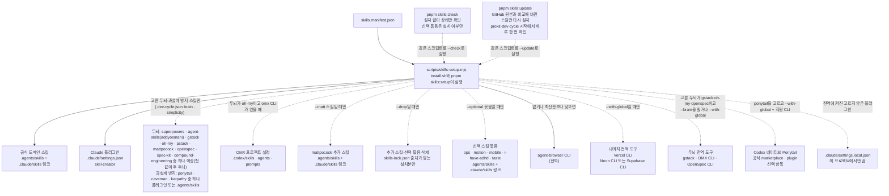

# 설치와 업데이트 구조

> 한눈에: 스킬 목록은 파일 하나에 모여 있고, 설치할 때 프로젝트에 빠진 것만 넣어요. **설치한 스킬은 프로젝트와 함께 저장돼요.** 새 버전은 하루 한 번 확인해서 올릴지 물어요.

## 먼저 이것만 알면 돼요

스킬(에이전트가 읽는 작업 설명서. [용어](../../tutorials/reference/glossary.md#도구))은 프로젝트에 설치될 때 한 번 복사돼요. 대신 프로킷이 새 버전이 있는지 알아봐 줘요.

> [!IMPORTANT]
> 원본 저장소가 바뀌어도 내 프로젝트의 스킬은 저절로 바뀌지 않아요.

| 누가 | 무엇을 |
|---|---|
| 프로킷이 자동으로 | 새 프로젝트를 만들 때 최신판을 받아 설치해요. 작업을 시작할 때(`pnpm dev-cycle status`) 하루에 한 번 새 버전이 있는지 확인하고, 있으면 에이전트가 물어봐요 |
| 내가 | 보통은 에이전트가 물을 때 답하기만 하면 돼요. 직접 하려면 "스킬 업데이트해줘"라고 말하고, 상태만 보려면 `pnpm skills:check`를 실행해요 |

"스킬 업데이트해줘", "스킬 최신인지 확인해줘"라고 요청하면 `prokit-skills-update` 스킬이 받아서 바뀐 스킬을 확인하고, 한 번의 작업(케이스 H 라운드)으로 올려서 커밋해요. 두뇌나 추가 스킬을 바꾸는 일은 이 스킬이 아니라 `prokit-skills-manage`가 해요([두뇌와 선택 스킬](brains.md#바꾸기)). 에이전트 없이 프로젝트의 `pnpm` 명령으로 하는 방법은 아래 "업데이트"에 있어요.

## status가 알려 주는 것

작업을 시작하려고 `pnpm dev-cycle status`를 실행하면(열린 라운드가 없을 때만) 상태 줄 아래에 스킬 업데이트 알림이 붙을 수 있어요. 아래는 알림 이름과 뜻, 할 일이에요. 에이전트는 이 줄을 보면 `prokit-skills-update` 1절대로 처리해서 대부분 직접 할 일은 없어요.

| 알림 | 뜻 | 할 일 |
|---|---|---|
| `UPDATE_AVAILABLE mode=ask N: 스킬 목록` | 원격 원본에 새 버전이 있는 스킬이 N개예요. `mode=ask`는 올리기 전에 묻는다는 뜻이에요. 목록 뒤에 `(스크립트 변경: …)`이 붙으면 스크립트가 바뀐 스킬이 있어서 알림 방식이 자동이어도 물어요 | 에이전트의 질문에 답해요. 선택지는 지금 업데이트, 항상 자동으로, 나중에, 다시 묻지 않기예요 |
| `UPDATE_AVAILABLE mode=auto …` | 알림 방식을 자동으로 두었어요 | 묻지 않고 에이전트가 바로 업데이트 라운드를 해요 |
| `UPSTREAM_GONE N: 스킬 목록` | 원격 저장소에서 그 스킬이 없어졌어요(이름이 바뀌었거나 옮겼어요) | 업데이트로는 고칠 수 없어요. 설치본은 그대로 쓸 수 있고 더 갱신되지 않아요. 에이전트가 옮긴 곳을 찾아 알려 줘요. 목록이 바뀔 때만 다시 알려요 |
| `CHECK_FAILED …` | 적힌 저장소를 확인하지 못했거나 확인 명령 자체가 실패했어요(네트워크, GitHub 한도 등) | 최신이라는 뜻이 아니에요. 한 시간 뒤 다시 확인해요. 자주 나오면 `gh auth login`으로 로그인하면 GitHub 호출 한도가 늘어요 |

알림은 이렇게 보여요(예시).

```text
(예시) UPDATE_AVAILABLE mode=ask 2: next-dev-loop, shadcn → 라운드를 열기 전에 prokit-skills-update 스킬 1절을 따른다
```

### 알림 조절하기

> [!TIP]
> 에이전트에게 말로 부탁해도 되고, 같은 명령을 직접 실행해도 돼요.

| 하고 싶은 일 | 말 | 명령 |
|---|---|---|
| 지금은 알림을 미루기 | "나중에" | `pnpm skills:update --snooze`. 처음 하루, 그다음 이틀, 그다음 일주일씩 늘어나요. 알림 목록이 바뀌면 미뤘어도 다시 알려요 |
| 묻지 않고 자동으로 | "항상 자동으로" | `pnpm skills:update --mode auto` |
| 확인 자체를 끄기 | "다시 묻지 않기" | `pnpm skills:update --mode off`. 다시 켜려면 `--mode ask` |
| 지금 한 번 확인만 | "스킬 최신인지 확인해줘" | `pnpm skills:update --check` |
| 하루 한 번 확인(자동으로 불리는 명령) | | `pnpm --silent skills:update --if-due`. 설치하지 않고, 알릴 것이 있을 때만 출력해요 |

> [!NOTE]
> 확인 결과와 알림 설정은 이 컴퓨터의 `node_modules/.cache/skills-update.json`에만 저장돼요. 커밋하지 않고, `node_modules`를 지우면 기본값(묻기)으로 돌아가요.

## 설치되는 길



### 설치할 때 알아 둘 것

- **최신판을 받아요**: 공식 스킬은 템플릿에 복사해 두지 않고, 설치할 때 원본 저장소의 최신 커밋을 받아요(skills CLI도 `skills@latest`). Claude 플러그인은 마켓플레이스를 최신으로 받은 뒤 설치해요.
- **프로젝트 설치와 Codex 선택 설치는 달라요**: 프로젝트 스킬과 Claude 플러그인은 프로젝트 범위(project scope)에 들어가요. Codex 네이티브 Ponytail은 `--with-global`일 때만 사용자 설정에 공식 marketplace와 플러그인을 등록하는 선택 항목이에요. 기본 설치와 `pnpm skills:check`는 그 설정을 바꾸지 않아요.
- **전역 도구는 둘로 나뉘어요**: <!-- v:policy.agentBrowser.yo -->agent-browser CLI는 없거나 npm 최신판보다 낮으면 기본으로 최신판을 설치해요<!-- /v -->. 나머지 전역 도구는 `--with-global`을 줄 때만 설치해요.
- **openspec과 spec-kit은 자기 init 명령으로 설치해요**: OpenSpec은 전역 npm CLI(고를 때만 설치), Spec Kit은 설치할 때만 uv가 필요해요. 지울 때는 도구 파일만 지우고 `openspec/`, `specs/`, `.specify/memory/` 문서는 남겨요. Compound Engineering은 Claude 프로젝트 플러그인과 skills CLI로 받는 Codex 스킬이에요([두뇌와 선택 스킬](brains.md)).
- **기존 프로젝트 도입(`--adopt`)**: `install.sh --adopt`는 하네스만 넣어요. `prokit-dev-cycle`, `prokit-verify`, `prokit-web`, `prokit-ui`, `prokit-skills-update`, `prokit-skills-manage`만 복사하고, 매니페스트에서 `stack: true`인 Better-T-Stack 전용 스킬(neon 템플릿은 better-auth, neon, turborepo, supabase 템플릿은 better-auth, turborepo)은 건너뛰어요([기존 프로젝트에 도입하기](../start/adopt.md)).

## 설치 목록과 실제 선택은 달라요

매니페스트는 프로킷이 관리해 설치할 스킬 목록이에요. 현재 쓸 수 있는 외부 스킬을 한 번 선택했다고 이 목록을 바꾸지는 않아요. 반복해서 관리할 스킬만 출처·권한·지원 환경·행동 평가를 확인해 등록해요.

새 외부 스킬을 만드는 작업은 `skill-creator`를 적용하는 전문 수행자에게 맡겨요. 기본 선택과 결과 검수는 [위임과 자원 관리](../concepts/delegation-and-resources.md)를 따라요.

## 업데이트

`pnpm skills:update`는 이미 고른 스킬만 최신으로 올려요. 두뇌나 추가 스킬을 바꾸고 더하고 빼는 일은 `prokit-skills-manage`가 받아요([두뇌와 선택 스킬](brains.md#바꾸기)).

설치한 외부 스킬은 프로젝트에 복사되어 커밋돼요. 그래서 원격 저장소가 바뀌어도 저절로 따라가지 않아요.

```bash
pnpm skills:update --check     # 설치한 외부 스킬을 GitHub 원본과 비교해 새 버전만 알려 준다
pnpm skills:update             # 바뀐 스킬과 빠진 스킬만 다시 설치한다
pnpm skills:update <이름>...   # 지정한 스킬만 다시 설치한다
pnpm skills:setup --drop <스킬|묶음>[,…]   # 추가 스킬이나 선택 묶음을 지운다
```

> [!WARNING]
> `--drop`은 `skills-lock.json`의 출처가 맞는 설치본만 지워요. 필수 mattpocock 3개와 공식 스킬은 지울 수 없고, `--check`와 함께 쓸 수 없어요.

- **하루 한 번 확인**: 진행 중인 라운드가 없을 때 `pnpm dev-cycle status`가 하루 한 번 새 버전을 확인해요(GitHub API를 저장소마다 한 번 호출). 새 버전이 있으면 `prokit-skills-update`가 업데이트할지 물어요(지금, 항상 자동, 나중에, 다시 묻지 않기).
- **케이스 H로 커밋**: 업데이트는 하네스를 바꾸는 일이라 케이스 H 라운드로 커밋해요.
- **비교 방법**: `pnpm skills:update`는 `skills-lock.json`에 적힌 GitHub 폴더와 설치본을 파일 단위로 비교하고, 바뀐 스킬만 목록에 적힌 에이전트(Claude, Codex)로 다시 설치해요.

## 자세히

### 스크립트가 바뀐 스킬은 먼저 읽어요

훅이 스킬 스크립트를 바로 실행하므로 스크립트나 설정 파일이 바뀐 스킬은 설치 전에 원격 파일을 먼저 읽어요. 알림 방식을 자동으로 둬도 이런 스킬은 물어요. `--check`로 검토한 그 판을 이름으로 지정해야 설치되고, 그사이 원격이 바뀌면 설치하지 않아요. 원격에서 없어진 스킬은 지우지 않고 알리기만 해요.

### 플러그인은 따로 올려요

> [!WARNING]
> Claude 플러그인은 `skills:update`가 업데이트하지 않아요. 네 플러그인 모두 훅이 있어서 업데이트하는 즉시 새 코드가 실행되기 때문이에요.

사용자가 요청하면 플러그인 저장소의 `hooks/` 변경을 먼저 보고 올려요.

```bash
claude plugin marketplace update <마켓플레이스>
claude plugin update <플러그인> --scope project   # 세션을 다시 열어야 적용된다
```

### Ponytail 훅과 Codex 네이티브 플러그인

과설계 방지 스킬로 ponytail을 고르면 Claude 플러그인이 훅 3개(SessionStart, SubagentStart, UserPromptSubmit)로 세션과 서브에이전트에 과설계를 막는 규칙을 넣어요. 상태는 `CLAUDE_CONFIG_DIR` 또는 `~/.claude` 아래에 두며, `CLAUDE_PROJECT_DIR`이 있으면 프로젝트 hash별 모드와 공유 플래그를 써요.

없으면 shared 상태를 써요. 같은 저장소의 세션은 모드를 함께 쓰므로 `stop ponytail`도 함께 적용돼요. 전역 helper 파일을 쓸 수 있지만 statusline 설정은 사용자가 원할 때만 바꿔요.

고르지 않았는데 전역에 켜져 있으면 설치기가 `.claude/settings.local.json`의 `enabledPlugins`에 `"ponytail@ponytail": false`를 넣어 이 프로젝트에서만 꺼요([두뇌와 선택 스킬](brains.md)).

시작 훅의 대략적 코드 지도는 재사용 후보를 찾는 참고 자료예요. 지도에 나온 항목은 실제 코드·호출자·테스트·설정·내보내기를 읽고 확인해요.

ponytail을 고르면 Codex는 프로젝트에 `ponytail`, `ponytail-review`, `ponytail-audit`, `ponytail-debt`, `ponytail-help`, `ponytail-gain` <!-- v:skills.codex.ponytail -->6<!-- /v -->개 스킬을 받아요. 지원하는 CLI에서 `--with-global`을 주면 공식 원본 marketplace와 네이티브 플러그인을 추가할 수 있어요. 설치된 플러그인의 출처와 비활성화 선택은 보존하며, 설치기가 다시 설치하거나 자동으로 올리지 않아요.

플러그인 설치와 훅 신뢰는 별개예요. Codex에서 `/hooks`로 현재 플러그인을 신뢰하고 새 세션을 연 뒤에만 자동 훅 실행을 기대할 수 있어요. 신뢰 기록을 대신 쓰거나 우회하지 않아요.

Codex 네이티브 플러그인을 쓸 수 있으면 `$ponytail:ponytail-review`처럼 이름공간으로 불러요. 없으면 프로젝트의 같은 스킬을 읽어요. 둘을 같은 검토에 함께 쓰지 않고, 사용자가 ponytail을 끈 상태면 대체 경로로 다시 켜지 않아요.

review는 한 번의 검토일 뿐 세션을 영구 review 모드로 바꾸지 않아요. audit·debt·help·gain은 요청할 때만 읽고 파일을 고치지 않아요.

### 상태 확인

`pnpm skills:check`는 설치하지 않고 상태만 봐요. 프로젝트 범위 항목이 빠졌으면 exit 1이에요. 선택 묶음과 Codex 네이티브 Ponytail은 상태만 보여 주며, 없어도 누락으로 세지 않아요. `omx`가 없는 기기도 OMX를 누락으로 세지 않아요.

## 관련 문서

- [공식 스킬과 연결](official-skills.md)
- [두뇌와 선택 스킬](brains.md)
- [선택 스킬 묶음](optional-bundles.md)
- [기존 프로젝트에 도입하기](../start/adopt.md)
- [설치기와 옵션](../templates/installer.md)
- [만든 뒤 개발하기](../start/after-create.md)
