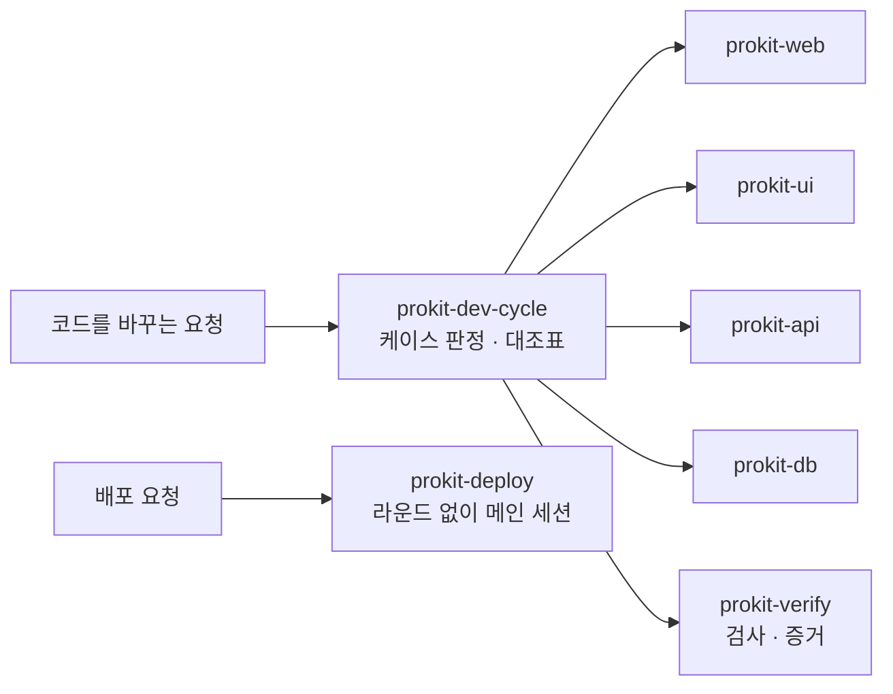

# prokit 스킬 <!-- v:prokit.skills.count -->10<!-- /v -->개

> 한눈에: 프로킷 전용 스킬 <!-- v:prokit.skills.count -->10<!-- /v -->개는 이 프로젝트에서 일하는 방법을 에이전트에게 알려 주는 작업 설명서예요. 스킬 이름을 몰라도 돼요. "할 일에 마감일 붙여줘"처럼 평소 말로 요청하면 에이전트가 맞는 스킬을 스스로 불러와요. 그 전에 프로젝트를 만들거나 기존 프로젝트에 들이는 처음 설정은 `prokit-init`이 맡아요.

## 처음 설정은 prokit-init

`prokit-init`은 pro-kit 폴더에 있는 스킬이에요. 설치한 프로젝트에는 들어가지 않고, 아래 <!-- v:prokit.skills.count -->10<!-- /v -->개 스킬은 이 스킬이 설치를 마친 뒤부터 일해요.

1. **유형 점검**: 새 프로젝트, 초기 프로젝트(기획 자료·프로토타입만 있음), 운영 중인 Next.js, 다른 언어에서 전환 가운데 어느 것인지 먼저 정해요.
2. **분석과 추천**: 새 프로젝트는 PRD를 받고, 기존 프로젝트는 폴더를 읽기만 하면서 초기 분석을 해요. 그 결과로 템플릿, 적용 방식, 두뇌, 과설계 방지 스킬, 추가 스킬을 추천하고 고르게 해요.
3. **동의와 적용**: 기존 프로젝트는 동의를 받은 뒤에만 파일을 바꿔요. 템플릿, 전용 스킬, 에이전트를 설치하고 결과를 커밋해요.
4. **새 세션으로 넘기기**: 그다음 일은 프로젝트 폴더에서 새로 연 세션이 `prokit-dev-cycle`로 이어 가요. 기존 프로젝트는 정밀 분석과 진행 계획부터 해요.

자세한 순서는 [PRD 먼저 정하기](../start/prd.md)와 [기존 프로젝트에 도입하기](../start/adopt.md)에 있어요.

## <!-- v:prokit.skills.count -->10<!-- /v -->개의 스킬

| 스킬 | 맡는 일 | 이런 요청에 쓰여요 | 지키게 하는 것 |
|---|---|---|---|
| `prokit-dev-cycle` | 작업과 검사 배정·감독·통합. 요청을 케이스로 나누고 대조표를 열어요. 큰 일은 진행 계획을 세워 Task로 나눠요 | 만들어줘, 고쳐줘, 바꿔줘, 완료 처리, 진행 계획 세워줘, 다음 Task 하자 | 공식 전문 스킬을 연결하고 모든 단계의 증거·최종 검수·`audit` 통과를 확인. 앞 Task가 끝나야 다음 Task를 열고, 기존 프로젝트는 정밀 분석과 진행 계획을 확정한 뒤 개발 |
| `prokit-pack-use` | 완성팩 복원·개인화·실전 개발 | 이 팩으로 만들어줘, 프리셋처럼 유지해줘 | 팩 무결성과 충돌 확인, 실제 복원·실행 검사, 완성 프리셋 대비 화면·모션 유지 |
| `prokit-web` | 화면 동작(라우팅, 데이터 불러오기, 캐시) | 페이지 추가, 로그인한 사람만, 느려요 | 로그인 확인은 서버에서, 로딩·빈·오류 상태 구분, 서버 비밀값은 브라우저로 보내지 않기 |
| `prokit-ui` | 화면 모양과 사용 경험(impeccable) | 디자인해줘, 예쁘게, 접근성 점검 | 새 디자인의 스타일 후보 추천, 완성팩이 제공하는 디자인 유지, `DESIGN.md` 스펙 검사(lint), 코드 전에 화면 설계 확인, 선택 묶음 `taste`가 있으면 고른 화면에 taste-skill 방향·검사 보태기, 디자인 토큰만 사용, 점수 기준(audit <!-- v:devCycle.ui.auditMin -->16<!-- /v -->/20)과 실행 기록 파일. 기존 프로젝트는 기존 디자인 유지와 리디자인 중 먼저 고르기 |
| `prokit-api` | 서버 API, 로그인, 권한 | API 추가, 남의 데이터가 보여요 | 로그인 필수, 자기 데이터에만 접근, 입력 검증, 2계정 격리 테스트 |
| `prokit-db` | 테이블과 마이그레이션 | 컬럼 추가, 테이블 만들기, 쿼리가 느려요 | 마이그레이션 파일로만 변경, 로컬 → 병합 전(기본 브랜치에 합치기 전) → 운영 순서, 데이터를 잃을 수 있는 변경은 두 단계. Supabase는 모든 테이블에 RLS(행 단위 접근 제한) |
| `prokit-verify` | 영향 검사 선택, 담당자·재사용 조건 확인과 증거 기록 | 검증해줘, 테스트 돌려, 끝났어? | 실행하지 않은 검사는 통과로 적지 않고, 전문 증거 재사용과 새 최종 검수를 구분 |
| `prokit-deploy` | Vercel 배포(develop, production)와 되돌리기 | develop에 올려줘, 운영에 배포해줘, 롤백해줘 | 요청하거나 라운드 끝에서 고를 때만 배포, DB 먼저 적용, 로컬 `.env`는 올리지 않고 배포 값은 Vercel 환경변수에만, 운영은 기본 브랜치에서만. 운영 중에 들인 프로젝트는 기존 배포를 이 방식에 맞췄다는 기록(ADR)을 남기기 전까지 라운드 끝에 배포하지 않음 |
| `prokit-skills-update` | 에이전트가 쓰는 이미 고른 외부 스킬을 최신으로 업데이트 | 스킬 업데이트해줘, 스킬 최신이야? | 작업을 시작할 때 하루 한 번 새 버전 확인, 업데이트는 물어보고 한 라운드로 커밋, 원격에서 없어진 스킬은 지우지 않고 알림 |
| `prokit-skills-manage` | 두뇌, 과설계 방지 스킬, mattpocock 추가 스킬, 선택 묶음을 진행 중에 바꾸기·더하기·빼기 | 두뇌를 openspec으로 바꿔줘, tdd 스킬 빼줘, 선택 스킬 묶음 더해줘 | 열린 라운드를 닫은 뒤 H 라운드로 처리, 바뀐 구성을 보여 주고 확인받은 뒤 커밋, 필수 mattpocock 3개와 공식 스킬은 지우지 않음 ([두뇌와 선택 스킬](brains.md#바꾸기)) |

프로킷 스킬은 프로젝트 계약과 진행 관리를 맡아요. 일반 기술 지식과 전문 구현·설계·리뷰는 작업에 맞는 외부 스킬에 연결하고, 실제 결과를 확인해 재지시하거나 최종 수용해요. 스킬 선택과 증거 경계는 [위임과 자원 관리](../concepts/delegation-and-resources.md)에 있어요.

## 이런 말을 하면 이 스킬이 나서요

> [!TIP]
> 스킬 이름을 외울 필요는 없어요. 아래 말투로 요청하면 에이전트가 맞는 스킬을 읽고 일해요(예시이고, 비슷한 뜻이면 돼요). 어떤 스킬이 쓰였는지는 작업이 끝날 때 대조표의 증거 칸에 이름으로 남아요.

| 이렇게 말하면 | 나서는 스킬 | 에이전트가 하는 일 |
|---|---|---|
| "할 일에 마감일 붙여줘", "로그인 버그 고쳐줘", "다 됐어, 완료 처리해줘" | `prokit-dev-cycle` | 코드를 바꾸기 전에 케이스를 정하고 대조표를 열어요. 끝날 때 증거와 검수를 확인해요 |
| "이 팩으로 만들어줘", "프리셋처럼 유지해줘" | `prokit-pack-use` | 완성팩을 내려받아 무결성과 충돌을 확인하고 복원한 뒤 개인화와 실전 개발로 이어 가요 |
| "마이페이지 추가해줘", "로그인한 사람만 보이게 해줘", "이 페이지가 느려요" | `prokit-web` | 라우팅, 서버·클라이언트 경계, 데이터 불러오기, 캐시를 맞게 만들어요 |
| "화면 예쁘게 해줘", "토스처럼 만들어줘", "접근성 점검해줘", "taste로 만들어줘" | `prokit-ui` | 화면 설계를 먼저 확인하고 디자인 토큰으로 만든 뒤 점수(audit)로 검사해요 |
| "할 일 목록 API 추가해줘", "남의 데이터가 보여요" | `prokit-api` | 로그인을 요구하고 입력을 검증하고, 내 데이터에만 접근하는지 2계정 테스트로 확인해요 |
| "컬럼 추가해줘", "테이블 만들어줘", "쿼리가 느려요", "로컬 DB 띄워줘" | `prokit-db` | 마이그레이션 파일로만 DB를 바꾸고 로컬, 병합 전, 운영 순서로 적용해요 |
| "검증해줘", "테스트 돌려", "끝났어?" | `prokit-verify` | 바뀐 것에 맞는 검사를 골라 실행하고 결과를 증거로 적어요 |
| "develop에 올려줘", "운영에 배포해줘", "릴리스해줘", "롤백해줘" | `prokit-deploy` | 배포 전 검사, DB 마이그레이션, 배포, 되돌리기 안내를 맡아요. 코드는 바꾸지 않아요 |
| "스킬 업데이트해줘", "스킬 최신이야?" | `prokit-skills-update` | 설치한 외부 스킬의 새 버전을 확인하고 한 번의 작업으로 올려요([설치와 업데이트 구조](install-and-update.md#status가-알려-주는-것)) |
| "두뇌를 openspec으로 바꿔줘", "tdd 스킬 빼줘", "taste 추가해줘" | `prokit-skills-manage` | 고른 두뇌, 과설계 방지 스킬, 추가 스킬, 선택 묶음을 바꿔요([두뇌와 선택 스킬](brains.md#바꾸기)) |

> [!NOTE]
> "이 프로젝트에 프로킷 적용해줘"나 "새 프로젝트 만들어줘"처럼 처음 들이는 요청은 위 열 개가 아니라 pro-kit 폴더의 `prokit-init`이 맡아요.

## 스킬이 필요할 때 읽는 참고 자료

스킬 폴더에는 `SKILL.md` 말고도 필요할 때만 여는 참고 자료(`references/`)가 있어요. 에이전트가 해당 상황에서 알아서 읽어서, **처음에는 직접 읽지 않아도 돼요.** 어떤 규칙이 어디에 적혀 있는지 궁금할 때만 찾아보세요. 위치는 설치된 프로젝트의 `.agents/skills/<스킬>/references/`예요.

참고 자료 목록 보기

| 스킬 | 참고 자료 | 무슨 내용이에요 |
|---|---|---|
| `prokit-dev-cycle` | `analysis.md` | 기존 프로젝트를 읽기 전용으로 정밀 분석하는 점검표와 보고서 틀 |
| | `project-plan.md` | 큰 일을 Task로 나누는 진행 계획 절차와 Task 게이트 |
| | `reuse-design.md` | 화면과 기능을 만들기 전에 재사용과 설정을 정하는 기준 |
| | `process-routing.md` | 단계마다 두뇌와 과설계 방지 스킬 중 무엇을 쓸지 정한 라우팅 표 |
| | `execution-efficiency.md` | 일을 나누고 이미 한 검사를 다시 하지 않는 기준 |
| | `delegation.md` | 다른 수행자와 전문 스킬에 일을 맡길 때 출처와 범위, 증거를 확인하는 규칙 |
| | `brains/` | 두뇌와 과설계 방지 스킬, mattpocock 스킬의 카탈로그와 추천 기준(`README.md`)과 두뇌별 설명 |
| `prokit-ui` | `impeccable-map.md` | 화면 작업의 단계마다 impeccable 기능을 어디에 쓰는지 |
| | `taste.md` | 선택 묶음 taste를 언제 어떻게 쓰는지 |
| | `preset-settings.md` | 완성팩의 설정을 적용할 때의 기준 |
| | `screen-only.md` | DB 없이 예시 데이터로 만드는 화면만 프로젝트의 규칙 |
| `prokit-db` | `migration-flow.md` | 로컬 DB에서 원격 DB까지 마이그레이션을 적용하는 순서 |
| `prokit-api` | `ownership-test.md` | 다른 계정의 데이터에 접근할 수 없는지 확인하는 2계정 격리 테스트 |
| `prokit-verify` | `evidence.md` | 대조표 증거 칸에 적는 형식 |
| | `browser.md` | 브라우저로 화면을 확인하고 스크린샷 증거를 남기는 절차 |
| | `pack-baseline.md` | 완성 프리셋과 복원한 앱을 비교하는 기준 |

`prokit-web`, `prokit-deploy`, `prokit-pack-use`, `prokit-skills-update`, `prokit-skills-manage`는 `SKILL.md` 하나만 있어요. 이 목록은 neon과 supabase 템플릿이 같아요.

## 스킬끼리 이어지는 방식

> [!IMPORTANT]
> 설치한 뒤 진입점은 `prokit-dev-cycle`이에요. 코드를 바꾸는 요청은 모두 여기서 시작해요. 케이스를 정하고 대조표를 열어요([dev-cycle 라운드](../concepts/dev-cycle.md)).

- **큰 일은 진행 계획부터**: 기존 프로젝트 도입, 전환, 큰 기능 묶음은 `prokit-dev-cycle`이 진행 계획 라운드를 먼저 열어요. 기존 프로젝트는 읽기 전용 `prokit-analyzer`가 정밀 분석하고, 주 두뇌(고르지 않았으면 기본 AI)가 계획 문서와 Task 표(`tasks/plan.md`)를 써요. 리뷰와 사용자 확인으로 계획을 확정하면 Task마다 라운드를 하나씩 열어요([정밀 분석과 진행 계획](../concepts/project-plan.md)).
- **두뇌가 단계 방법을 정해요**: `prokit-dev-cycle`은 `.dev-cycle.json`에 기록한 두뇌와 과설계 방지 스킬로 요구 정리, 계획, 구현, 디버깅의 방법을 골라요. 두뇌가 여럿이면 단계마다 그 단계를 맡는 첫 두뇌를 써요. 대조표, 리뷰, audit은 어느 두뇌든 같아요([두뇌와 선택 스킬](brains.md)).
- **계층 스킬**: 행을 실행할 때 화면 동작은 `prokit-web`, 화면 모양과 사용 경험은 `prokit-ui`, API와 인증은 `prokit-api`, DB는 `prokit-db`, 검사와 증거는 `prokit-verify`를 불러요.
- **공식 스킬 연결**: 분야별 스킬(web, ui, api, db, verify)과 dev-cycle 대조표의 각 행은 그 단계에서 읽을 공식 스킬(Next.js, React, Better Auth, shadcn, impeccable, Neon 또는 Supabase, Vercel)을 정해 둬요([공식 스킬과 연결](official-skills.md)).
- **외부 스킬도 연결해요**: 기본 공식 스킬 외에 현재 접근 가능한 사용자 지정·프로젝트별 스킬도 선택할 수 있어요. 문서 작업에는 필요한 문서·글쓰기·한국어 검수 단계를 연결하고, 내장 리뷰와 겹치는 검토는 반복하지 않아요.
- **개발 자원을 함께 봐요**: `prokit-dev-cycle`은 관리하는 개발·빌드·설치·검증 작업에서 자원 상태를 확인해요. 명령은 [명령 모음](../reference/commands.md#위임과-자원)에 있어요.
- **배포는 따로**: 배포 요청은 코드를 바꾸지 않으므로 라운드 없이 `prokit-deploy`가 메인 세션에서 맡아요.

완성팩 작업은 `prokit-pack-use`가 다운로드·무결성 확인·복원 계획 검사·실제 복원을 거쳐 개인화와 실전 개발로 연결해요. 화면과 모션은 완성 프리셋을 기준으로 비교해요. 원본 사이트 조사와 COPY 제작은 별도 비공개 저장소 `pro-kit-preset-skills`가 맡아요([담당 구분](../design/preset-publication.md#담당-구분)).

`prokit-skills-update`는 이미 고른 스킬을 최신으로 올리는 일만 맡고, 고른 구성을 바꾸는 일은 `prokit-skills-manage`가 맡아요. `prokit-skills-update`는 프로젝트 스킬 갱신과 네이티브 플러그인·훅 상태를 [설치와 업데이트 구조](install-and-update.md)대로 따로 확인해요.

## 자세히

- **위치**: 설치된 프로젝트의 `.agents/skills/prokit-*/SKILL.md`예요. Claude Code는 `.claude/skills/`의 링크로 같은 파일을 읽어요.
- **기존 프로젝트에 도입할 때**: 초기 프로젝트, 전환, Better-T-Stack 구조의 운영 중 프로젝트는 <!-- v:prokit.skills.count -->10<!-- /v -->개를 모두 설치해요. `install.sh --adopt`는 Better-T-Stack이 아닌 Next.js 프로젝트에 `prokit-dev-cycle`, `prokit-verify`, `prokit-web`, `prokit-ui`, `prokit-skills-update`, `prokit-skills-manage`만 복사해요. Better-T-Stack 전용 스킬은 건너뛰어요([기존 프로젝트에 도입하기](../start/adopt.md)).
- **에이전트**: 스킬과 별개로 읽기 전용 정밀 분석을 맡는 `prokit-analyzer`를 포함해 프로젝트 에이전트가 <!-- v:prokit.agents.count -->4<!-- /v -->개예요([에이전트 역할](../concepts/agent-roles.md)).
- **Next.js는 설치된 판의 문서부터**: `node_modules/next/dist/docs`를 먼저 읽게 해요. 에이전트가 학습한 옛 API를 그대로 쓰는 일을 줄이려는 거예요.
- **효과**: 같은 요청을 스킬이 있을 때와 없을 때로 나눠 체크 항목으로 채점했어요. 스킬이 있을 때 `prokit-dev-cycle` <!-- v:eval.dev-cycle.with -->93<!-- /v -->%(없을 때 <!-- v:eval.dev-cycle.without -->27<!-- /v -->%), `prokit-ui` <!-- v:eval.ui.with -->100<!-- /v -->%(<!-- v:eval.ui.without -->12<!-- /v -->%)였어요. 스킬별 수치는 [검증 결과](../reference/verification.md)에 있어요.
- **스킬을 고치는 일**: `prokit-*` 스킬을 바꾸는 작업은 케이스 H 라운드로 하고, 스킬 본문을 바꿨으면 skill-creator eval을 다시 돌려요([케이스 <!-- v:devCycle.cases.range -->A\~F·H<!-- /v -->와 대조표](../concepts/cases.md)).

## 관련 문서

- [공식 스킬과 연결](official-skills.md)
- [선택 스킬 묶음](optional-bundles.md)
- [하네스 엔지니어링](../concepts/harness.md)
- [UI/UX 흐름](../design/ui-flow.md)
