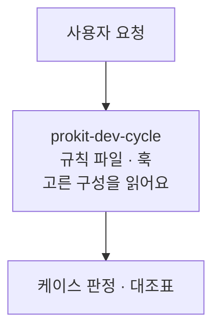
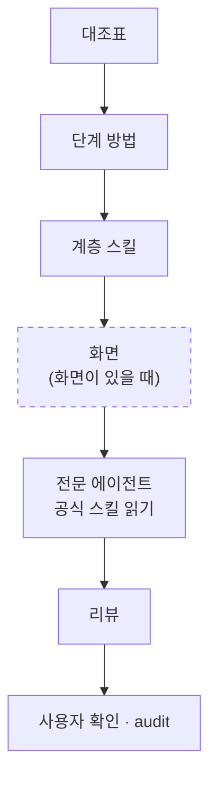
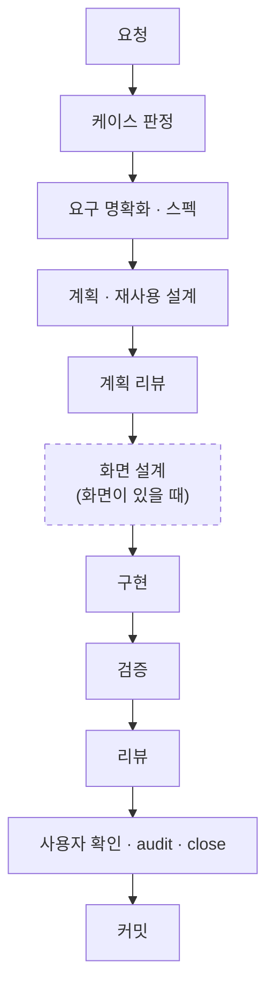
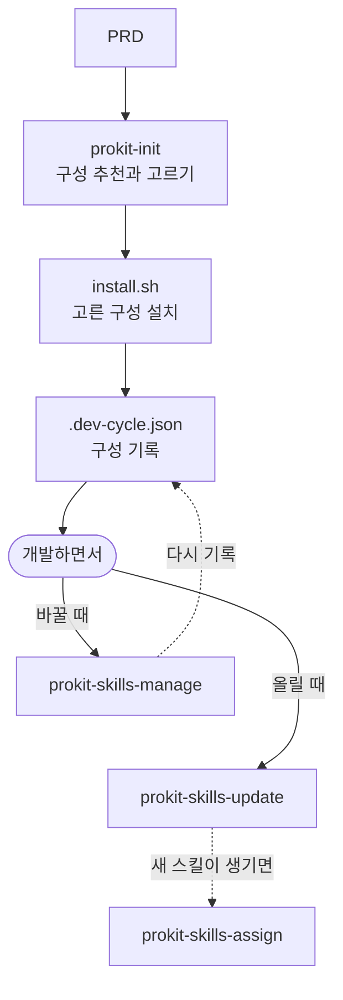

# 스킬 구조 한눈에

> 한눈에: 프로킷의 스킬과 에이전트가 어떻게 이어지는지 도식으로 한 번에 봐요. 전체 구조, 라운드 하나의 흐름, 구성을 고르고 바꾸는 흐름 순서예요. **어떤 구성을 골라도 대조표, `prokit-reviewer` 최종 리뷰, audit은 같아요.** 도식에 나온 이름마다 더 읽을 쪽은 전체 구조 도식 바로 아래 표에 있어요.

## 전체 구조

요청은 늘 `prokit-dev-cycle`로 들어가요. 규칙 파일과 훅, 고른 구성도 함께 읽어요.

대조표가 열리면 고른 구성이 단계마다 일하는 방법을 정하고, 계층 스킬이 분야마다 읽을 스킬과 맡을 에이전트를 정해요. 화면 단계는 화면이 있을 때만 거치고, 없으면 건너뛰어요(점선 테두리).

| 도식에 나온 것 | 들어 있는 것 | 더 읽을 쪽 |
|---|---|---|
| 규칙 파일 · 훅, 고른 구성 | `AGENTS.md`, `CLAUDE.md`, 훅, `.dev-cycle.json` | [하네스 엔지니어링](../concepts/harness.md) |
| `prokit-dev-cycle`, 대조표 | 케이스 판정, 단계 행, audit, close | [dev-cycle 라운드](../concepts/dev-cycle.md) |
| 단계 방법 | 두뇌, 과설계 방지 스킬, mattpocock 스킬, 응답 방식 | [두뇌와 선택 스킬](brains.md), [두뇌와 과설계 방지 흐름](brain-flow.md) |
| 계층 스킬 | `prokit-ui`, `prokit-verify` 등 | [prokit 스킬](prokit-skills.md) |
| 화면 | UI 스킬, 화면 디자인 보조. 디자인 단계는 메인 세션이 해요 | [UI/UX 흐름](../design/ui-flow.md), [프로킷 UI 스킬셋](../design/ui-skillset.md) |
| 전문 에이전트 | 구현, 실행 확인. 공식 도메인 스킬은 맡은 에이전트가 읽어요 | [위임 에이전트와 리뷰 에이전트](../concepts/agent-roles.md), [공식 스킬과 연결](official-skills.md) |
| 리뷰 | `specialist-reviewer` 보완, `prokit-reviewer` 최종 판정 | [위임 에이전트와 리뷰 에이전트](../concepts/agent-roles.md) |
| 선택 스킬 묶음(도식 밖) | motion, mobile 등. 설치했을 때만 그 계층 스킬이 읽어요 | [선택 스킬 묶음](optional-bundles.md) |
| 설치, 업데이트, 바꾸기(도식 밖) | `install.sh`, `prokit-skills-manage`, `prokit-skills-update` | [설치와 업데이트 구조](install-and-update.md), [두뇌와 선택 스킬의 바꾸기](brains.md#바꾸기) |

- **메인 세션은 맡기고 검수해요**: 구현과 실행 확인은 전문 수행 에이전트가 하고, 공식 도메인 스킬도 그 에이전트가 읽어요. 메인 세션은 위임 지시에 스킬 이름을 넣고 보고와 스킬 기록으로 검수해요.
- **배포는 라운드 없이**: 배포 요청은 코드를 바꾸지 않아서 라운드를 열지 않고 메인 세션이 맡아요.
- **구성은 방법만 바꿔요**: 두뇌와 과설계 방지 스킬은 단계 행의 방법을 바꾸고, UI 스킬과 화면 디자인 보조는 디자인 단계의 방법을 바꿔요. 대조표의 행, 리뷰 게이트, audit은 그대로예요.

## 라운드 하나의 흐름

새 기능(F 케이스)은 단계가 가장 많아서 붙는 스킬을 모두 볼 수 있어요. 다른 케이스는 이 가운데 일부 단계만 써요([케이스와 대조표](../concepts/cases.md)). 화면 설계 단계는 화면이 있을 때만 거쳐요(점선 테두리).

단계마다 붙는 스킬은 이래요.

1. **요청**: “할 일에 마감일을 붙여줘”처럼 말로 해요.
2. **케이스 판정**: `prokit-dev-cycle`이 케이스를 정하고 대조표를 열어요.
3. **요구 명확화 · 스펙**: 두뇌의 요구 스킬, `grilling`, `domain-modeling`, 간결성 사다리
4. **계획 · 재사용 설계**: 두뇌의 계획 스킬, 계층 스킬의 공식 스킬 연결 표
5. **계획 리뷰**: `prokit-reviewer`(plan), 과설계 방지 스킬의 계획 기준
6. **화면 설계(화면이 있을 때만)**: 주 UI 스킬의 브리프, 화면 디자인 보조
7. **구현**: 전문 수행 에이전트에 맡겨요. 공식 도메인 스킬, 두뇌의 구현 스킬
8. **검증**: `prokit-verify`, `prokit-runtime-checker`, 브라우저 도구
9. **리뷰**: 디자인 리뷰와 보조 결과, 과설계 방지 보완 검토, `prokit-reviewer` 최종 판정
10. **사용자 확인 · audit · close**: 증거의 스킬 이름과 읽은 기록을 대조해요.
11. **커밋**

- **버그(C)**: 재현 테스트부터 써요. 두뇌의 디버깅 스킬이나 mattpocock `diagnosing-bugs`가 붙고, 고친 뒤 같은 검증과 리뷰를 거쳐요.
- **단계마다 더 자세히**: 두뇌와 과설계 방지 스킬은 [두뇌와 과설계 방지 흐름](brain-flow.md), 화면 단계는 [UI/UX 흐름](../design/ui-flow.md)에 있어요.

## 구성을 고르고 바꾸는 흐름

처음 들일 때 PRD로 구성을 고르고, 개발하면서 말로 바꾸거나 올려요. 바꾸는 일은 열린 라운드가 있으면 그 라운드에서, 없으면 H 라운드를 하나 열어 해요.

1. **PRD 건네기**: `prokit-init`이 PRD로 두뇌, 과설계 방지 스킬, UI 스킬, 응답 방식, 추가 스킬, 화면 디자인 보조를 추천하고 고르게 해요.
2. **설치**: `install.sh`가 `skills.manifest.json`대로 고른 구성을 설치해요.
3. **기록**: `.dev-cycle.json`에 구성이 남고, `pnpm skills:check`로 확인해요.
4. **바꾸기**: “두뇌 바꿔줘”, “묶음 더해줘”라고 하면 `prokit-skills-manage`가 바꾸고 다시 기록해요. 열린 라운드가 있으면 그 라운드에서, 없으면 H 라운드를 열어 해요.
5. **올리기**: “스킬 업데이트해줘”라고 하면 `prokit-skills-update`가 올려요. 새 스킬이 생기거나 하는 일이 바뀌면 `prokit-skills-assign`이 맡을 에이전트와 대조표 행을 정해요.

## 관련 문서

- [스킬과 에이전트](README.md)
- [하네스 엔지니어링](../concepts/harness.md)
- [두뇌와 과설계 방지 흐름](brain-flow.md)
