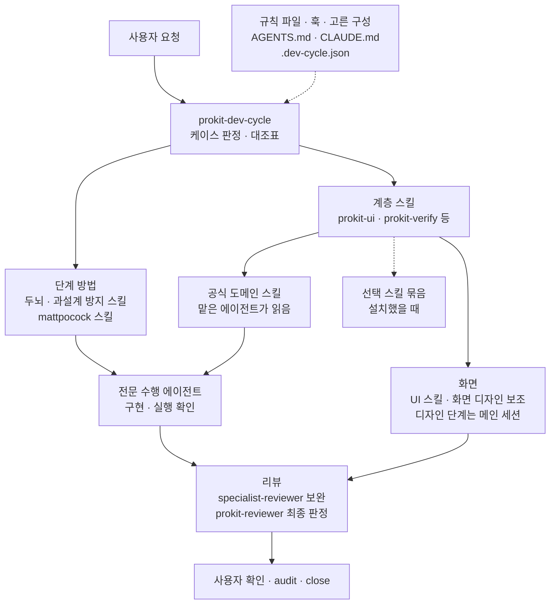
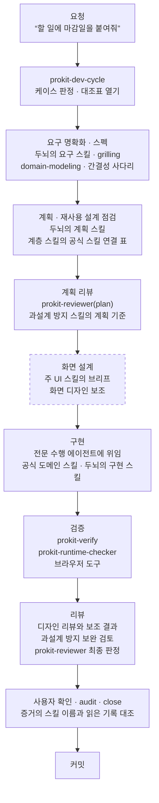
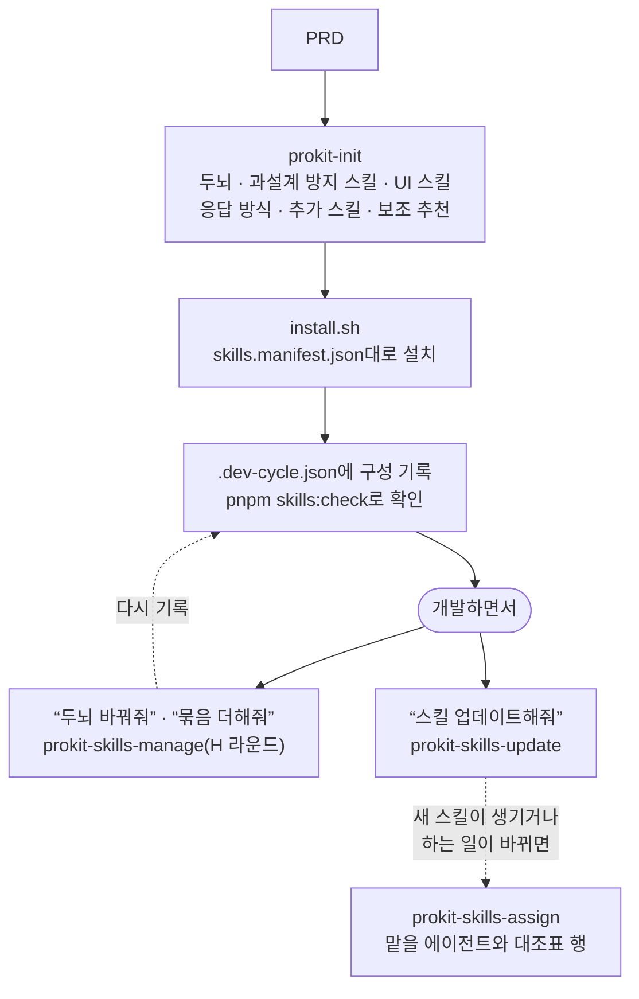

# 스킬 구조 한눈에

> 한눈에: 프로킷의 스킬과 에이전트가 어떻게 이어지는지 도식 세 장으로 한 번에 봐요. 전체 구조, 라운드 하나의 흐름, 구성을 고르고 바꾸는 흐름 순서예요. **어떤 구성을 골라도 대조표, `prokit-reviewer` 최종 리뷰, audit은 같아요.** 상자마다 자세한 쪽은 맨 아래 표에 있어요.

## 전체 구조

요청은 늘 `prokit-dev-cycle`로 들어가요. 고른 구성이 단계마다 일하는 방법을 정하고, 계층 스킬이 분야마다 읽을 스킬과 맡을 에이전트를 정해요. 점선은 상황에 따라 있는 연결이에요.

- **메인 세션은 맡기고 검수해요**: 구현과 실행 확인은 전문 수행 에이전트가 하고, 공식 도메인 스킬도 그 에이전트가 읽어요. 메인 세션은 위임 지시에 스킬 이름을 넣고 보고와 스킬 기록으로 검수해요([위임 에이전트와 리뷰 에이전트](../concepts/agent-roles.md)).
- **배포는 라운드 없이**: 배포 요청은 코드를 바꾸지 않아서 라운드를 열지 않고 메인 세션이 맡아요.
- **구성은 방법만 바꿔요**: 두뇌와 과설계 방지 스킬은 단계 행의 방법을 바꾸고, UI 스킬과 화면 디자인 보조는 디자인 단계의 방법을 바꿔요. 대조표의 행, 리뷰 게이트, audit은 그대로예요.

## 라운드 하나의 흐름

새 기능(F 케이스)은 단계가 가장 많아서 붙는 스킬을 모두 볼 수 있어요. 다른 케이스는 이 가운데 일부 단계만 써요([케이스와 대조표](../concepts/cases.md)). 점선 상자는 화면이 있을 때만 있어요.

- **버그(C)**: 재현 테스트부터 써요. 두뇌의 디버깅 스킬이나 mattpocock `diagnosing-bugs`가 붙고, 고친 뒤 같은 검증과 리뷰를 거쳐요.
- **단계마다 붙는 스킬**: 두뇌와 과설계 방지 스킬은 [두뇌와 과설계 방지 흐름](brain-flow.md), 화면 단계는 [UI/UX 흐름](../design/ui-flow.md)에서 더 자세히 봐요.

## 구성을 고르고 바꾸는 흐름

처음 들일 때 PRD로 구성을 고르고, 개발하면서 말로 바꾸거나 올려요. 바꾸는 일은 열린 작업을 닫은 뒤 H 라운드 하나로 해요.

## 상자마다 자세히

| 상자 | 쪽 |
|---|---|
| 규칙 파일, 훅, 대조표, audit | [하네스 엔지니어링](../concepts/harness.md), [dev-cycle 라운드](../concepts/dev-cycle.md) |
| 두뇌, 과설계 방지 스킬, mattpocock 스킬, 응답 방식 | [두뇌와 선택 스킬](brains.md), [두뇌와 과설계 방지 흐름](brain-flow.md) |
| 계층 스킬 | [prokit 스킬](prokit-skills.md) |
| 공식 도메인 스킬, 맡는 에이전트 | [공식 스킬과 연결](official-skills.md) |
| UI 스킬, 화면 디자인 보조 | [UI/UX 흐름](../design/ui-flow.md), [프로킷 UI 스킬셋](../design/ui-skillset.md) |
| 선택 스킬 묶음 | [선택 스킬 묶음](optional-bundles.md) |
| 전문 수행 에이전트, 리뷰 에이전트 | [위임 에이전트와 리뷰 에이전트](../concepts/agent-roles.md) |
| 설치, 업데이트, 바꾸기 | [설치와 업데이트 구조](install-and-update.md), [두뇌와 선택 스킬의 바꾸기](brains.md#바꾸기) |

## 관련 문서

- [스킬과 에이전트](README.md)
- [하네스 엔지니어링](../concepts/harness.md)
- [두뇌와 과설계 방지 흐름](brain-flow.md)
