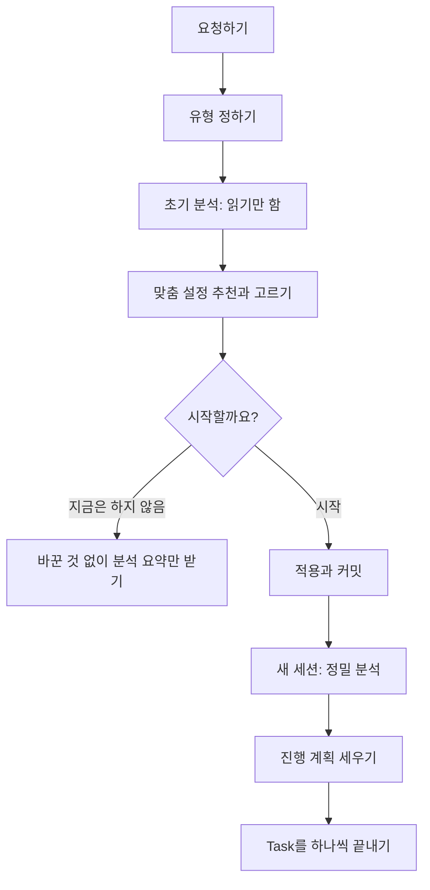

# 기존 프로젝트에 도입하기

> 한눈에: 이미 진행하던 프로젝트에도 프로킷을 들일 수 있어요. 에이전트가 먼저 그 프로젝트를 읽기만 하며 분석하고, 프로젝트에 맞는 설정을 추천해요. **동의하기 전에는 프로젝트를 하나도 바꾸지 않아요.** 적용한 뒤에는 새 세션에서 정밀 분석을 하고, 진행 계획을 Task로 나눠 하나씩 끝내요.

## 먼저 알아 둘 약속

기존 프로젝트를 다루는 일이라 걱정되기 마련이에요. 프로킷은 이렇게 약속해요.

- **동의하기 전에는 아무것도 쓰지 않아요.** 처음 하는 일은 프로젝트를 읽기만 하는 초기 분석이에요. 설치, 빌드, 테스트 실행, 서버 실행도 하지 않아요.
- **비밀값은 값을 보여 주지 않아요.** `.env` 같은 파일은 "있음"만 알려 줘요.
- **"지금은 하지 않음"을 고르면 바뀐 것 없이 끝나요.** 분석 요약과 고른 설정만 보고받아요. 나중에 같은 요청을 다시 하면 처음부터 시작해요.
- **되돌릴 기준을 남겨요.** 운영 중인 프로젝트는 새 브랜치(`prokit/setup`)에서 작업하고, 앱 코드는 바꾸지 않아요. 전환은 기존 코드를 읽기만 하고 그 배포와 CI도 건드리지 않아요.
- **push와 원격 저장소 만들기는 요청할 때만 해요.**

## 어떤 유형인가요

| 유형 | 이런 프로젝트예요 | 적용 방식 |
|---|---|---|
| 초기 프로젝트 | PRD, 화면 정의서, 디자인 시스템, 프로토타입까지만 있고 개발 환경은 아직 없어요 | 같은 폴더에 Next.js를 적용하고 프로토타입을 옮겨 구현을 이어 가요 |
| 운영 중인 Next.js | 개발하고 운영 중인 Next.js 프로젝트예요 | 앱 코드는 두고 새 브랜치에 하네스를 설치해요. 구조 맞추기는 정밀 분석 뒤 Task로 해요 |
| 전환 | PHP, Django, Rails, Spring, React SPA처럼 다른 언어나 프레임워크로 만든 서비스를 Next.js로 옮겨요 | 새 폴더에 Next.js 프로젝트를 만들고 기존 서비스는 그대로 둔 채 기능 단위로 옮겨요 |

아직 코드가 없는 새 프로젝트는 [PRD 먼저 정하기](prd.md)와 빠른 시작을 따라요. 기존 프로젝트 유형은 PRD가 꼭 있지 않아도 돼요. 있으면 함께 주세요. 분석과 추천이 더 정확해져요.

### 유형을 모르겠으면 에이전트가 물어요

내 프로젝트가 어느 유형인지 몰라도 돼요. 요청에서 분명하지 않으면 에이전트가 네 유형(새 프로젝트 포함)을 한 질문에 보여 주고, 신호로 고른 것에 `(추천)`을 붙여요. 이런 신호로 판단해요.

| 에이전트가 보는 것 | 유형 후보 |
|---|---|
| PRD, 화면 정의서, 디자인 시스템 문서, 프로토타입(HTML, Figma 내보내기, Vite·CRA 시안)만 있고 운영 배포나 실사용자 흔적이 없어요 | 초기 프로젝트 |
| `package.json`에 `next`가 있고, 배포 설정(Vercel, Docker, CI의 배포 단계), DB 마이그레이션, 운영 환경 변수 흔적이 있어요 | 운영 중인 Next.js |
| PHP, Django, Rails, Spring, Express, React SPA, Vue처럼 Next.js가 아닌 서비스를 Next.js로 옮기려 해요 | 전환 |
| 아직 코드가 없고 PRD만 있어요 | 새 프로젝트 |

신호가 섞이면(예: 배포는 됐지만 실사용자가 없어요) 가까운 두 유형을 추천과 함께 물어요. 초기 분석이 고른 유형과 다르게 나오면 적용하기 전에 근거와 함께 다시 물어요. 예를 들어 운영 중인 Next.js라고 했는데 `next`가 없으면 전환을, 초기 프로젝트라고 했는데 운영 배포 흔적이 있으면 운영 중인 Next.js를 권해요.

이미 프로킷을 쓰는 프로젝트(`.dev-cycle.json`이 있어요)는 도입하지 않아요. 에이전트가 템플릿 갱신 반영(`install.sh --diff`로 차이를 보고 그 프로젝트에서 반영)으로 안내해요.

## 흐름



1. **요청하기**: 작업 폴더나 pro-kit 폴더에서 에이전트를 열고 아래처럼 요청해요. 기존 프로젝트 안에서 열었다면 에이전트가 pro-kit을 그 옆에 받아요.
2. **유형 정하기**: 요청에서 유형이 분명하면 그대로 정하고, 아니면 네 유형(새 프로젝트 포함) 가운데 고르게 물어요.
3. **초기 분석**: 지금 쓰는 에이전트가 프로젝트 폴더를 읽기만 해요. 스택, 폴더 구조, 기획 자료, 디자인 시스템, 테스트와 배포, 위험을 요약해 보여 줘요. 유형이 맞지 않으면(예: 운영 중인 Next.js라고 했는데 PHP 프로젝트) 근거를 대고 다시 물어요.
4. **맞춤 설정**: 분석과 PRD로 템플릿, 적용 방식, 작업 브랜치, 스킬 구성(두뇌, 과설계 방지 스킬, 추가 스킬, 응답 방식, 화면 디자인 보조)을 추천해요. 두뇌는 하나를 권하지만 여럿을 고를 수도 있어요([두뇌와 선택 스킬](../skills/brains.md)).
5. **동의**: 유형별로 한 번 물어요. 예를 들어 운영 중인 프로젝트는 "프로킷을 안전하게 적용하려면 정밀 분석부터 해야 해요. 새 브랜치에 하네스를 설치하고 정밀 분석을 시작할까요?"예요. 하지 않겠다고 하면 아무것도 바꾸지 않고 분석 요약만 남겨요.
6. **적용**: 초기 프로젝트와 운영 중인 프로젝트에 커밋하지 않은 변경이 있으면 멈추고 알려요. git으로 관리하지 않던 폴더면 첫 커밋 전에 `.env` 같은 비밀값 파일과 `node_modules/`를 `.gitignore`에 넣고 확인받아요. 그다음 유형대로 적용하고 커밋해요. 도입 기록 `docs/prokit/intake.md`와 다음 요청 `docs/first-request.md`도 함께 커밋해요.
7. **새 세션**: 에이전트가 알려 준 한 줄로 그 프로젝트에서 새 세션을 열어요. 새 세션은 [정밀 분석과 진행 계획](../concepts/project-plan.md)부터 이어 가요.

## 초기 분석 요약은 이런 모양이에요

에이전트가 프로젝트를 읽고 대화로 보여 주는 요약이에요. 아래는 예시이고, 실제 항목과 내용은 프로젝트마다 달라요. 적용하면 같은 내용이 `docs/prokit/intake.md`에 남아요.

```text
초기 분석 요약 (~/work/shop)
- 유형 판단: 운영 중인 Next.js. 근거: next 15 의존성, Vercel 배포 설정
- 스택: TypeScript, Next.js, pnpm, Better-T-Stack 구조 아니오
- 규모: 파일 312개, 주요 폴더 src/, prisma/
- 기획 자료: docs/prd.md
- 디자인: 디자인 토큰 있음, DESIGN.md 없음
- 데이터·인증: Postgres, 자체 로그인
- 테스트·배포: 테스트 14개, GitHub Actions에서 Vercel 배포
- 위험: 추적 중인 .env 파일 1개(이름만 알려 줘요)
- 적용 방식 제안: 하네스 먼저(--adopt, 하네스만 설치)
```

## 동의 질문

설정을 확정하면 한 번 물어요. 선택지는 `시작 (추천)`과 `지금은 하지 않음`이에요. 질문은 유형마다 달라요.

| 유형 | 질문(예시) |
|---|---|
| 초기 프로젝트 | 지금 프로젝트에 Next.js를 적용하고, 프로토타입을 프로킷 개발 환경으로 옮겨 구현을 이어 갈까요? 새 브랜치에서 기획 자료를 docs/로, 프로토타입을 prototype/으로 옮긴 뒤 같은 폴더에 Better-T-Stack을 만들어요 |
| 운영 중인 Next.js | 프로킷을 안전하게 적용하려면 정밀 분석부터 해야 해요. 새 브랜치(prokit/setup)에 하네스를 설치하고, 새 세션에서 정밀 분석을 시작할까요? 앱 코드는 바꾸지 않아요 |
| 전환 | Next.js 전환을 시작할까요? 안정적으로 전환하려면 지금 프로젝트를 먼저 정밀 분석해요. 새 폴더에 Next.js 프로젝트를 만들고 기존 코드와 배포는 그대로 둬요 |

## 적용 전 안전 점검

동의한 뒤, 적용하기 전에 에이전트가 이것들을 확인해요. 하나라도 걸리면 멈추거나 물어요.

| 점검 | 걸리면 |
|---|---|
| 커밋하지 않은 변경(초기 프로젝트, 운영 중) | 멈추고 알려요. 내가 정리한 뒤 다시 해요. 전환은 기존 코드를 읽기만 하므로 막지 않고 보고에 적어요 |
| git 저장소가 아님 | 초기 프로젝트는 지금 자료 그대로 `git init`과 첫 커밋을 하고 시작해요. 운영 중인 프로젝트는 되돌릴 기준이 없어서 멈추고 "지금 상태를 첫 커밋으로 남기고 시작할까요?"라고 물어요. 전환은 git이 아니어도 돼요 |
| `git init`을 했을 때 | 첫 커밋 전에 `.env*`, `node_modules/`, `.next/`, `dist/`, 10MB가 넘는 파일의 이름을 보여 주고 `.gitignore`에 더해도 되는지 확인받아요. 비밀값은 한 번 커밋하면 이력에 남기 때문이에요 |
| 지금 브랜치가 기본 브랜치가 아님 | 알리고, 그 브랜치에서 갈라도 되는지 물어요 |
| `prokit/setup` 브랜치가 이미 있음 | 이어 쓸지, 다른 이름(`prokit/setup-2`)을 쓸지 물어요 |
| 추적 중인 `.env*` 비밀 파일 | 파일 이름만 알려요. 값은 출력하지 않고, 프로킷은 이 파일을 고치지 않아요 |

## 유형별로 달라지는 것

### 초기 프로젝트
- 새 브랜치 `prokit/setup`에서 기획 자료는 `docs/`로, 프로토타입 코드는 `prototype/`으로 옮기고 커밋해요.
- 같은 폴더에 Better-T-Stack 프로젝트를 만들고 프로킷을 설치해요. 옮긴 파일은 원본 그대로 돌려놓고, `prototype/`은 검사(Biome)에서 빼요.
- 같은 폴더에 만들어서 폴더 이름이 패키지 이름이 돼요. 소문자와 하이픈(kebab-case)이 아니면 바꿀 이름을 묻고, 동의하면 적용 전에 폴더 이름을 바꿔요. 경로가 바뀐다고 미리 알려 줘요.
- 로컬 DB와 첫 마이그레이션까지 마치고 기본 브랜치에 합쳐요. 운영 전이라 브랜치를 오래 두지 않아요.

### 운영 중인 Next.js
- 새 브랜치 `prokit/setup`에 하네스(dev-cycle, 두뇌, 리뷰 게이트, 분석 에이전트)만 설치해요. 앱 코드와 배포 설정은 바꾸지 않아요.
- Better-T-Stack 구조이고 DB가 Postgres와 Drizzle이면 실제 DB(Neon이나 Supabase)에 맞는 템플릿(`--project-type operating`)을 골라요. 실제 DB가 Supabase면 `prokit-next-supabase`, Neon이나 일반 Postgres면 `prokit-next-neon`이에요. 그렇지 않으면 하네스만 설치하는 `--adopt`로 설치하고, Better-T-Stack 전용 스킬(API, DB, 배포)은 설치하지 않아요. 계층별 경로 규칙은 정밀 분석 뒤 첫 Task에서 이 프로젝트에 맞춰요.
- 하네스 커밋을 검토해 기본 브랜치에 합치길 권해요. 도입 브랜치에서 계속할 수도 있어요. 계속했다가 나중에 합치면 기준 브랜치 기록(`.dev-cycle.json`의 `defaultBranch`)을 기본 브랜치로 되돌려요.
- `dev`·`build` 명령에는 자원 보호 래퍼를 씌우지 않아요. 배포와 CI가 쓰는 명령이라서예요.
- 라운드가 끝나도 커밋까지만 하고 배포는 하지 않아요. 기본 브랜치에 push하면 기존 배포가 돌 수 있어서 push도 요청할 때만 해요. 배포 방법을 프로킷에 맞출지는 정밀 분석 뒤 첫 Task에서 정해요.

### 전환
- 새 폴더(기본은 pro-kit 옆)에 Next.js 프로젝트를 만들어요. 기존 코드와 그 배포·CI는 건드리지 않아요.
- 새 프로젝트는 기존 코드 경로를 기억해 두고 읽기만 해요(`pnpm dev-cycle status`에 보여요).
- 정밀 분석에서 기능·데이터 대응표, 전환 순서, 기존 서비스를 켜 둔 채 옮기는 방법을 정하고, 진행 계획의 Task마다 옮겨요.

## 요청 예

작업 폴더에서 연 에이전트에게 보내요. `[ ]` 안을 바꿔요.

```text
https://github.com/roadkwon-ai/pro-kit 을 이 폴더에 받고, 그 안의 AGENTS.md대로 [~/work/shop] 프로젝트에 프로킷을 적용해줘. [Next.js로 만들어 운영 중인 쇼핑몰이야.]
```

```text
https://github.com/roadkwon-ai/pro-kit 을 이 폴더에 받고, 그 안의 AGENTS.md대로 [~/work/booking]의 [PHP 예약 서비스]를 Next.js로 옮기고 싶어. 지금 서비스는 계속 운영해야 해.
```

pro-kit 폴더에서 열었다면 Claude Code는 `/prokit-init [프로젝트 경로]`, Codex는 `$prokit-init [프로젝트 경로]`로 시작해도 돼요.

## 남는 파일

| 파일 | 내용 |
|---|---|
| `docs/prokit/intake.md` | 유형, 초기 분석 요약, 고른 설정, 동의 질문과 답. 첫 화면 작업에서 정한 디자인 방향도 여기에 적어요 |
| `docs/first-request.md` | 새 세션이 이어 갈 요청(정밀 분석 → 진행 계획 → Task별 진행)과 처음 요청 |
| `docs/prokit/analysis.md` | 새 세션의 정밀 분석 결과 |
| `tasks/plan.md` | 진행 계획의 Task 표 |

## 관련 문서

- [처음 한 시간](first-hour.md)
- [요청하고 이어 가는 법](ask-well.md)
- [정밀 분석과 진행 계획](../concepts/project-plan.md)
- [두뇌와 선택 스킬](../skills/brains.md)
- [설치기](../templates/installer.md)
- [UI/UX 흐름](../design/ui-flow.md)
- [PRD 먼저 정하기](prd.md)
