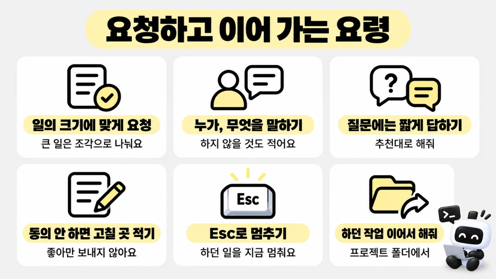

# 요청하고 이어 가는 법

> 한눈에: 프로킷을 설치한 프로젝트에서는 평소 말로 요청하면 돼요. **일의 크기에 맞게 요청하고, 에이전트의 질문에는 짧게 답하고, 멈추거나 끊겼을 때는 "하던 작업 이어서 해줘"로 이어 가요.** 이 쪽은 요청하는 법, 멈추는 법, 이어 가는 법, 멈췄을 때 보내는 말을 모았어요.

## 왜 요청 크기가 중요한가요

에이전트는 요청 하나를 라운드(만들고 확인까지 마치는 작업 묶음) 하나로 처리해요. 라운드마다 스펙, 구현, 검사, 리뷰, 내 확인을 거쳐요. 요청이 너무 크면 한 라운드에 확인할 것이 쌓여서 내가 결과를 다 보기 어렵고, 중간에 사용량 한도에 걸리면 어디까지 했는지 흐려져요. 그래서 큰 일은 먼저 작은 조각(Task)으로 나눠 하나씩 끝내요.



## 요청 크기별로 이렇게 말해요

| 크기 | 예 | 이렇게 요청해요 | 에이전트가 하는 일 |
|---|---|---|---|
| 작은 수정 | 문구 바꾸기, 색이나 간격 고치기, 버튼 위치 옮기기 | `메인 화면의 제목을 "오늘의 정산"으로 바꿔줘` | 작은 라운드를 열고(케이스 A나 B) 고친 뒤 내가 확인해요 |
| 버그 고치기 | 눌러도 반응이 없음, 목록이 안 바뀜 | `예약을 취소했는데 목록에 계속 보여. 고쳐줘` | 먼저 재현하는 테스트를 만들고, 고친 뒤 통과하는지 봐요(케이스 C) |
| 기능 하나 | 예약하기, 글쓰기, 검색 | `회원이 수업을 예약하고 취소하는 화면 만들어줘. 정원이 차면 예약할 수 없어야 해` | 스펙과 화면 설계를 먼저 보여 주고 확인받은 뒤 만들어요(케이스 B\~F) |
| 기능 여러 개 | 서비스의 모든 화면, 로그인과 결제와 알림까지 | `이 기능 묶음을 진행 계획으로 나눠줘` | Task 목록을 세우고 확인받은 뒤 Task 하나씩 라운드를 열어요 | <!-- edition:pro -->

**`전부 한 번에 만들어줘`는 권하지 않아요.** 한 번에 확인할 양이 너무 많고, 어디서 틀렸는지 찾기 어렵고, 한도에 걸려 끊기면 이어 가기 힘들어요.

> [!IMPORTANT]
<!-- edition:pro -->
> 큰 일은 진행 계획으로 나누고 Task 하나가 끝날 때마다 내가 확인해요. 앞 Task가 끝나야 다음 Task를 열 수 있어요([정밀 분석과 진행 계획](../concepts/project-plan.md)).
<!-- /edition -->

케이스 이름의 뜻은 [케이스와 대조표](../concepts/cases.md)에 있어요.

## 요청 문장 만드는 법

**좋은 요청에는 세 가지가 있으면 충분해요.**

1. **누가, 무엇을**: 누가 쓰는 화면이고 무엇을 할 수 있어야 하는지
2. **지켜야 할 조건**: 예를 들어 "내 예약만 보여야 해", "휴대폰에서도 써야 해"
3. **이번에 하지 않을 것**(있으면): 예를 들어 "결제는 이번에 만들지 않아"

| 모호한 요청 | 더 나은 요청 |
|---|---|
| 예약 기능 만들어줘 | 회원이 수업을 골라 예약하고 취소할 수 있게 해줘. 회원은 자기 예약만 봐. 결제는 이번에 만들지 않아 |
| 화면이 이상해 | 예약 목록 화면에서 카드가 서로 겹쳐 보여. 휴대폰 크기에서 그래 |
| 더 예쁘게 해줘 | 메인 화면을 더 깔끔하게 다듬어줘. 색은 지금 `DESIGN.md`를 그대로 따라줘 |
| 고쳐줘 | 로그인 뒤에 빈 화면이 나와. 어제는 됐어. 오류 메시지는 아래와 같아: (메시지 붙여 넣기) |

> [!TIP]
> 스킬 이름을 쓰지 않아도 돼요. 요청에 맞는 스킬을 에이전트가 스스로 불러요.

요청 예시를 더 보려면 [만든 뒤 개발하기](after-create.md#이렇게-요청해요)를 보세요.

## 에이전트의 질문에 답하는 법

- 에이전트는 결과를 바꾸는 모호함이 있을 때만 구현 전에 물어요. 짧게 답하면 돼요.
- Claude Code는 선택지로 보여 줘요. 방향키로 고르고 엔터를 눌러요. 원하는 답이 없으면 직접 입력하는 칸을 골라요.
- Codex는 보통 글로 물어요. 대화창에 답을 써서 보내요.

> [!TIP]
> - 잘 모르겠으면 `추천대로 해줘`라고 보내요. 이유가 궁금하면 `왜 이게 추천이야?`라고 물어요.
> - 이해가 안 되는 용어가 나오면 `쉬운 말로 다시 설명해줘`라고 보내요.

> [!TIP]
> 스펙이나 설계에 동의하지 않으면 "좋아"만 보내지 말고 고칠 곳을 말로 적어요. 에이전트는 확인 없이 다음으로 넘어가지 않아요.

## 에이전트를 멈추는 법

| 하고 싶은 일 | Claude Code | Codex |
|---|---|---|
| 하던 일을 지금 멈추기 | `Esc` | `Esc` |
| 에이전트 닫기 | `/exit` | `/quit` |

지난 대화를 이어 여는 명령은 [에이전트별 차이](../../tutorials/reference/claude-code-and-codex.md)의 표에 있어요. 멈춘 뒤에는 무엇을 하려던 건지 물어보거나, 하고 싶은 일을 다시 말해 주면 돼요. 멈춘다고 지금까지 만든 파일이 지워지지는 않아요. 방금 바뀐 것이 마음에 안 들면 `방금 바꾼 걸 되돌려줘`라고 해요.

에이전트마다 조작이 달라요. Claude Code와 Codex의 표는 [에이전트별 차이](../../tutorials/reference/claude-code-and-codex.md)에 있어요. Antigravity와 Grok Build의 닫기, 멈추기, 이어 하기는 각 도구의 안내를 보세요.

## 이어 가는 법

사용량 한도에 걸렸거나, 에이전트를 닫았거나, 며칠 뒤에 다시 와도 같아요.

1. 새 세션을 **프로젝트 폴더**에서 열어요. 그 폴더에서 열어야 프로젝트의 규칙과 스킬이 켜져요([만든 뒤 개발하기](after-create.md#새-세션-열기)).
2. 이렇게 보내요.

```text
하던 작업 이어서 해줘
```

새로 연 세션은 지난 대화를 기억하지 못해요(`claude --continue`나 `codex resume`으로 지난 대화를 이어 열 수는 있어요). 대신 프로젝트에 남은 기록으로 이어 가요.

| 읽는 것 | 알려 주는 것 |
|---|---|
| `AGENTS.md` | 이 프로젝트의 규칙 |
| `GLOSSARY.md` | 서비스에서 쓰는 용어 |
| `docs/domain/project.md` | 서비스의 현재 모습(기능, 화면, API, 데이터) |
| `pnpm dev-cycle status` | 열려 있는 라운드가 있는지, 있으면 어느 단계인지<!-- edition:pro -->, 진행 계획이 있으면 다음 Task가 무엇인지<!-- /edition --> |

그래서 프로젝트 소개를 채워 두면 새 세션에서 프로젝트를 다시 설명하지 않아도 돼요. 한도는 튜토리얼 [<!-- v:limit.window -->5시간<!-- /v --> 한도에 걸리면](../../tutorials/reference/costs-and-keys.md#5시간-한도에-걸리면)에서 설명해요.

**이렇게 되면 성공**

- 열린 라운드가 있으면 그 라운드를 이어서 진행해요
- 열린 라운드가 없으면 새 요청을 기다려요

## 멈췄을 때

증상을 그대로 에이전트에게 말하면 대부분 풀려요. 아래는 프로킷의 규칙 때문에 일어나는 멈춤을 뜻과 함께 모았어요. 일반 증상(<!-- edition:pro -->DB 연결, <!-- /edition -->화면이 안 열림, 오류 메시지)은 튜토리얼 [막혔을 때](../../tutorials/reference/troubleshooting.md)에 있어요.

| 증상 | 뜻 | 이렇게 보내요 |
|---|---|---|
| 사용량 한도에 걸렸다고 해요 | 정해진 시간 동안 쓸 수 있는 양을 다 썼어요. 만든 파일과 진행 기록은 그대로예요 | 안내된 시각 뒤에 프로젝트 폴더에서 `하던 작업 이어서 해줘` |
| 에이전트가 질문하고 멈춰 있어요 | 내 답을 기다리는 중이에요. 답하기 전에는 다음으로 가지 않아요 | 질문에 답하거나 `추천대로 해줘` |
| 어떤 행이 `blocked`라고 해요 | 그 확인을 실제로 실행하지 못했다는 뜻이에요. 사유가 적혀 있어요. 한 것처럼 적어 넘기지 않아요 | `blocked 된 항목과 이유를 알려주고, 풀 수 있는 방법을 제안해줘` |
| "부분 완료"라고 보고해요 | 막힌 칸이나 실행하지 못한 칸이 남은 채예요 | 먼저 `막힌 걸 풀어서 마저 끝내줘`. 그대로 닫아도 된다면 "그대로 닫아줘"라고 동의해요. 그러면 `close --partial`로 닫아요.<!-- edition:pro --> 진행 계획에서는 그 Task가 "진행"으로 남으니 다시 열어 끝내야 해요<!-- /edition --> |
| 결과를 확인하라고 하는데 그냥 넘기고 싶어요 | 마지막 사용자 확인 칸은 에이전트가 대신 채우거나 N/A로 넘길 수 없어요 | 결과를 직접 보고 "확인했어"라고 답해요. 정말 보지 않고 닫는다면 그 말이 날짜와 함께 기록돼요 |
| 리뷰에서 계속 지적이 나와요 | 독립 리뷰 에이전트가 high 이상 지적을 하면 에이전트가 직접 확인해 고친 뒤 같은 관점으로 다시 리뷰받아요. 수행자나 공급자에게 근거를 다시 요청하는 재지시는 두 번까지만 해요. 그 뒤에도 풀리지 않으면 `blocked`로 남겨요 | `지적 내용을 쉬운 말로 설명하고, 고칠 것과 기각할 것을 나눠줘` |
| 테스트가 실패해요 | 첫 실패의 출력은 보관돼요. 다시 돌려 통과해도 첫 실패를 통과로 바꾸지 않아요 | `실패한 테스트와 원인을 알려주고 고쳐줘` |
| <!-- v:port.web -->3001<!-- /v --> 포트를 다른 프로그램이 쓰고 있대요 | 로그인 주소가 이 포트에 묶여 있어서 에이전트는 포트를 바꾸지 않고 물어봐요 | 그 프로그램(예전에 켠 다른 개발 서버 등)을 직접 닫고 `정리했어. 개발 서버 다시 켜줘` |
| 커밋이 비밀값 검사에서 막혔대요 | 커밋하려는 변경에 비밀번호나 키처럼 보이는 값이 있어요. 에이전트는 커밋과 push를 하지 않고 걸린 파일과 변수 이름만 알려 줘요(값은 적지 않아요) | `걸린 파일에서 비밀값을 빼고 환경변수로 옮긴 뒤 다시 검사해줘`. 검사를 실행하지 못했다는 보고(비밀값 발견이 아님)라면 출력을 알려 달라고 해요 |
| 진행 계획부터 확정하라고 해요 | 기존 프로젝트는 진행 계획을 확정한 뒤 Task 단위로 일해요. 정상이에요 | `진행 계획부터 확정하자` | <!-- edition:pro -->
| 스킬이나 플러그인이 없다고 해요 | 설치가 빠졌거나 설치하지 못했어요 | `pnpm skills:check로 확인하고 없는 것을 알려줘` |
| 캐시나 설치 환경이 커서 막혔대요 | 디스크 예산을 넘으면 새 무거운 작업을 막아요. 무작정 지우지 않아요 | `현재 자원 사용량과 막힌 이유를 확인하고, 안전하게 정리할 수 있는 후보를 알려줘` |

## 자세히

- **라운드가 열려 있는 채로 새 요청을 하면**: 에이전트가 `pnpm dev-cycle status`로 열린 라운드를 먼저 봐요. 열려 있으면 그 라운드를 이어서 진행해요. 코드를 바꾸지 않는 질문이나 설명 요청에는 라운드를 열지 않아요.
- **`close --partial`의 한계**: 막힌 칸이 있는 라운드를 사용자가 그대로 닫자고 할 때만 써요. 마지막 사용자 확인 칸은 `--partial`로도 넘기지 못해요([증거와 audit, 사용자 확인](../concepts/audit-and-confirm.md)).
- **비밀값 검사**: 커밋 전에 에이전트가 `pnpm dev-cycle secrets`를 실행해요([비밀값 지키기](../deploy/secrets.md)).
- **명령 모음**: `status`, `audit`, `close` 같은 dev-cycle 명령은 [명령 모음](../reference/commands.md)에 있어요. 평소에는 에이전트가 실행하니 직접 칠 필요는 없어요.

## 관련 문서

- [처음 한 시간](first-hour.md)
- [만든 뒤 개발하기](after-create.md)
- [정밀 분석과 진행 계획](../concepts/project-plan.md)
- [증거와 audit, 사용자 확인](../concepts/audit-and-confirm.md)
- [막혔을 때](../../tutorials/reference/troubleshooting.md)
