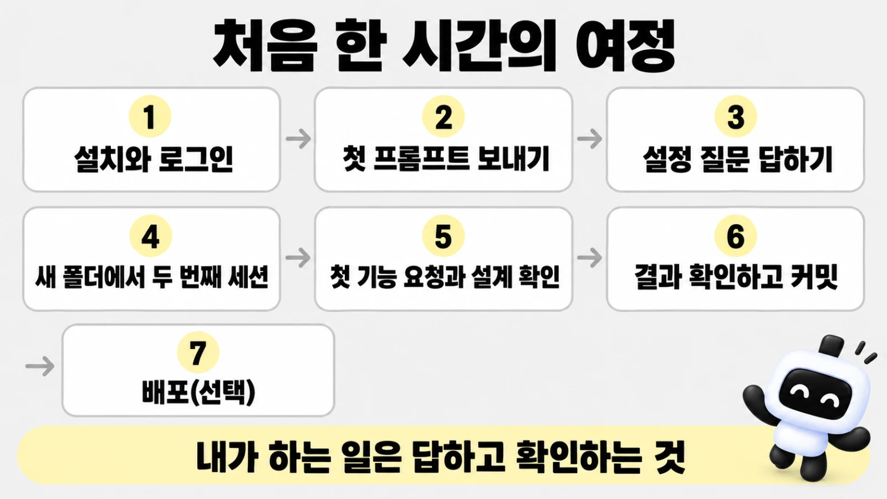
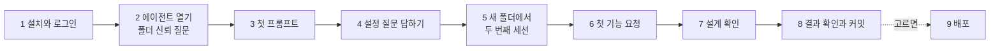

# 처음 한 시간

> 한눈에: 프로킷을 처음 쓰는 날, 에이전트를 열어 첫 프롬프트를 보내고 첫 결과를 내 눈으로 확인하기까지 무슨 일이 어떤 순서로 일어나는지 따라가 봐요. **내가 하는 일은 질문에 답하고, 결과를 보고 확인하는 것이에요.** 나머지는 에이전트가 해요. 걸리는 시간은 서비스 크기와 사용량에 따라 달라서 정해진 시간은 적지 않았어요([시간과 비용](../../tutorials/reference/process-and-time.md)).

## 왜 이 쪽이 있나요

에이전트(<!-- v:agents.list -->Claude Code, Codex, Antigravity, Grok Build<!-- /v --> 중 하나. 대화로 부탁하면 코드를 쓰고 명령을 실행해 주는 AI, [용어](../../tutorials/reference/glossary.md#도구))를 처음 열면 낯선 화면과 질문이 연달아 나와요. 무엇이 정상이고 어디서 내가 답해야 하는지 모르면 불안해져요. 이 쪽은 첫 만남의 전체 흐름을 한 번 보여 줘서, 질문이 나왔을 때 "아, 이 단계구나" 하고 알아보게 해요.

## 나와 에이전트가 하는 일



| 순서 | 나 | 에이전트 |
|---|---|---|
| 1 | 에이전트를 설치하고 로그인해요(처음 한 번) | |
| 2 | 작업 폴더에서 에이전트를 열고, 폴더를 믿을지 묻는 질문에 답해요 | 폴더의 규칙 파일을 읽을 준비를 해요 |
| 3 | 첫 프롬프트를 붙여 넣어요(만들 서비스 설명 포함) | pro-kit을 받고 준비물을 확인해요 |
| 4 | 유형, 템플릿, 이름, 스킬 구성 질문에 답해요 | PRD로 추천을 만들어 보여 주고 물어요 |
| 5 | 보고를 읽고, 알려 준 한 줄로 새 폴더에서 두 번째 세션을 열어요 | 프로젝트를 만들고 설치하고 커밋한 뒤 이어 갈 명령을 알려 줘요 |
| 6 | 첫 기능을 말로 요청해요 | 스펙과 화면 설계를 먼저 보여 줘요 |
| 7 | 설계가 맞는지 확인하거나 고칠 점을 말해요 | 구현하고, 실행한 증거를 모으고, 다른 에이전트에게 리뷰를 받아요 |
| 8 | 결과를 직접 보고 "확인했어"라고 답해요 | 라운드를 닫고 커밋해요 |
| 9 | (선택) 배포할지 정해요 | 배포 준비가 되어 있으면 물어보고, 아니면 커밋까지만 해요 |



## 1. 에이전트 설치와 로그인

**에이전트 하나만 설치하고 로그인하면 돼요.** pro-kit을 받고 필요한 프로그램을 확인하는 일은 첫 프롬프트를 받은 에이전트가 해요. 설치 명령은 튜토리얼 [시작하기](../../tutorials/start/README.md)에 있고, 필요한 프로그램은 [준비물](requirements.md)에 있어요.

## 2. 에이전트를 열고 처음 나오는 질문에 답하기

프로젝트를 모아 둘 작업 폴더(예: `~/projects`)에서 에이전트를 열어요. **처음 열면 두 가지를 물을 수 있어요.**

| 처음 나오는 것 | 무슨 뜻인가 | 어떻게 답하나 |
|---|---|---|
| 이 폴더를 믿을지 묻는 질문 | 에이전트가 이 폴더의 규칙과 설정을 읽어도 되는지 확인해요 | 내가 만든 작업 폴더나 프로젝트 폴더라면 "예"를 골라요. 모르는 폴더라면 믿지 않아요 |
| 명령이나 파일 변경을 허락할지 묻는 질문 | 옵션 없이 열면 에이전트가 명령을 실행하거나 파일을 바꾸기 전에 하려는 일을 보여 주고 허락을 구해요 | 무엇을 하려는지 읽고 허락해요. 이해가 안 되면 "이 명령이 뭘 하는지 쉽게 설명해줘"라고 물어요 |

화면 모양과 문구는 도구와 판에 따라 달라요. 이 쪽의 화면 설명은 모두 예시예요.

### 허락을 매번 묻는 모드와 묻지 않는 모드

| | 옵션 없이 열기(기본) | 묻지 않고 진행하게 열기 |
|---|---|---|
| 여는 명령 | <!-- v:agent.claude.startCode -->`claude`<!-- /v -->, <!-- v:agent.codex.startCode -->`codex`<!-- /v --> | <!-- v:agent.claude.yoloCode -->`claude --dangerously-skip-permissions`<!-- /v -->, <!-- v:agent.codex.yoloCode -->`codex --yolo`<!-- /v --> |
| 동작 | 명령과 파일 변경마다 허락을 물어요 | 묻지 않고 파일을 바꾸고, 프로그램을 설치하고, 인터넷에서 파일을 받아요 |
| 장점 | 더 안전해요 | 설치와 검사 명령이 많아서 훨씬 빨라요 |
| 위험 | 허락 횟수가 많아 느려요 | 폴더 밖까지 보호되지는 않아요. 출처를 모르는 프롬프트를 붙여 넣으면 그 안의 명령도 그대로 실행돼요 |

튜토리얼은 편의상 묻지 않는 모드로 열어요. 처음이라 걱정되면 옵션 없이 열어도 프롬프트는 똑같이 쓸 수 있어요.

> [!WARNING]
> 어느 쪽이든 작업 폴더나 그 안의 프로젝트 폴더에서만 열고, 키나 비밀번호는 대화창에 붙여 넣지 않아요.

이상한 일을 하면 `Esc`로 바로 멈춰요. 위험과 지키는 일은 [묻지 않고 진행하게 열기](../../tutorials/reference/claude-code-and-codex.md#묻지-않고-진행하게-열기)에 있어요.

## 3. 첫 프롬프트 보내기

만들고 싶은 서비스를 한두 문장으로 적어 보내요. 이 서비스 설명이 PRD(만들 서비스를 적은 기획 문서, [PRD 먼저 정하기](prd.md))예요. **가장 쉬운 시작은 DB 없이 화면만 만드는 것이에요.**

- 화면만 만들기: [빠른 시작: 화면만 만들기](quickstart-screens.md)의 프롬프트
- 로그인과 DB까지 갖춘 서비스: [빠른 시작: 서비스 만들기](quickstart-service.md)
- 완성된 프리셋으로 시작: [프리셋 팩으로 시작하기](quickstart-pack.md)
- 이미 진행하던 프로젝트: [기존 프로젝트에 도입하기](adopt.md)

에이전트는 pro-kit을 받고, 필요한 프로그램(Node, pnpm, git)이 있는지 확인해요. 빠진 것이 있으면 설치 명령을 알려 주고 멈춰요. 비밀번호가 필요한 명령은 내가 터미널에서 직접 실행하게 명령만 알려 줘요.

## 4. 설정 질문에 답하기

에이전트가 PRD를 읽고 추천을 만든 뒤 아래 순서로 물어요. Claude Code는 선택지로 보여 주고(방향키로 고르고 엔터), Codex 같은 도구는 대화창에 글로 물어요. 모든 질문의 선택지와 고르는 기준은 [빠른 시작: 서비스 만들기](quickstart-service.md#에이전트가-물어보는-것)에 표로 모았어요.

1. **프로젝트 유형**: 요청에서 새 프로젝트인지 기존 프로젝트인지 분명하지 않을 때만 물어요.
2. **PRD**: 없으면 가장 먼저 달라고 해요. 짧아도 돼요.
3. **템플릿, 이름, 위치**: 서비스에 DB가 필요한지, 프로젝트 이름은 무엇인지를 한 번에 물어요.
4. **스킬 구성**: 두뇌, 과설계 방지 스킬, 응답 방식, 화면 디자인 보조를 한 번에 물어요. 추천에는 이름 뒤에 `(추천)`이 붙고 맨 앞에 있어요. 잘 모르겠으면 `(추천)`을 고르세요. 두뇌가 정해지면 mattpocock 추가 스킬(여러 개 선택)도 한 번 더 물어요. 추천만 고르거나 아무것도 고르지 않아도 돼요. 모두 나중에 말로 바꿀 수 있어요.

예시(실제 문구와 선택지는 PRD와 판에 따라 달라요):

```text
스킬 구성을 추천해 봤어요. 근거: "회원이 예약하고 취소한다"는 문장에서 데이터가 틀리면 안 되는 서비스로 봤어요.
- 두뇌: superpowers (추천) / 없음(기본 AI) / 다른 두뇌 보기·여럿 고르기
- 과설계 방지: ponytail (추천) / caveman / andrej-karpathy-skills / SKIP(기본 AI)
- 응답 방식: i-have-adhd (추천) / SKIP
- 화면 디자인 보조: SKIP (추천) / taste-skill
```

답을 하면 에이전트가 앱 뼈대를 만들고, 프로킷의 규칙과 스킬을 설치하고, 화면만이 아니라면 내 컴퓨터에 개발용 DB를 띄운 뒤 결과를 커밋해요. 끝나면 보고와 함께 **새 폴더에서 이어 갈 한 줄**을 알려 줘요.

## 5. 새 폴더에서 두 번째 세션 열기

> [!IMPORTANT]
> 프로젝트의 규칙과 스킬, 전용 에이전트는 그 프로젝트 폴더에서 열어야 켜져요.

그래서 처음 만든 세션을 닫고 알려 준 한 줄로 새 폴더에서 에이전트를 열어요. 예시:

```bash
cd ~/projects/living && claude "docs/first-request.md의 요청대로 이어서 해줘"
```

여기서도 폴더를 믿을지 물어요. 같은 방식으로 "예"를 골라요. 화면 디자인 검사를 켜는 `impeccable hooks on`은 작업 폴더에서 시작했다면 에이전트가 이미 해 두었고, pro-kit 폴더에서 시작했다면 [만든 뒤 개발하기](after-create.md#새-세션-열기)의 명령을 내가 한 번 실행해요.

## 6. 첫 기능 요청하기

**이제부터는 평소 말로 부탁해요.** 스킬 이름이나 명령을 몰라도 돼요.

- 화면만 만들기라면 `docs/first-request.md`에 적어 둔 요청이 이어서 진행돼요.
- 서비스라면 먼저 서비스를 소개하고(`GLOSSARY.md`와 `docs/domain/project.md`를 채워 달라고 해요), 그다음 기능을 하나 요청해요. 요청 문장 예시와 큰 일을 나누는 법은 [요청하고 이어 가는 법](ask-well.md)에 있어요.

## 7. 스펙과 화면 설계 확인하기

에이전트는 만들기 전에 이번 라운드(요청 하나를 만들고 확인까지 마치는 작업 묶음, [용어](../../tutorials/reference/glossary.md#만들기))의 스펙(기능의 범위와 동작)과 화면 설계를 보여 줘요. **첫 화면이면 어울리는 디자인 스타일 1\~3위를 추천하고 하나를 고르게 해요.** 그림을 그릴 수 있는 환경이면 시안 세 장을 비교해 고르기도 해요.

예시:

```text
스펙을 정리했어요.
- 하는 일: 회원이 수업 목록에서 예약하고 취소한다
- 만들지 않는 것: 결제, 알림 메일
- 확인 방법: 회원 두 명으로 로그인해 서로의 예약이 보이지 않는지 본다
이대로 만들까요? 고치고 싶은 부분이 있으면 말해 주세요.
```

> [!TIP]
> 이 단계에서 고치는 것이 가장 싸요. 읽어 보고 "만들지 않는 것에 알림도 넣어줘", "화면은 휴대폰 기준으로 해줘"처럼 말로 바꿔요. 맞으면 "좋아, 진행해줘"라고 답해요.

## 8. 결과 확인하고 커밋하기

에이전트가 구현하고 나면 실제로 실행한 증거(타입 검사, 테스트, 화면 스크린샷)를 모으고, 구현하지 않은 리뷰 에이전트에게 검토를 받아요. 그 뒤 나에게 결과를 보여 주며 직접 확인해 달라고 해요. 화면이 있으면 개발 서버 주소(<!-- v:port.web.urlCode -->`http://localhost:3001`<!-- /v -->)와 스크린샷, 써 보는 순서를 알려 줘요.

> [!IMPORTANT]
> 이 확인은 에이전트가 대신하거나 건너뛸 수 없어요.

내가 하는 일은 이래요.

1. 알려 준 주소를 브라우저로 열고 알려 준 순서대로 써 봐요.
2. **맞으면 "확인했어"라고 답해요.**
3. 고칠 것이 있으면 무엇이 어떻게 보이는지 말로 적어요. 예: "예약 버튼을 눌러도 목록이 안 바뀌어. 고쳐줘". 고친 뒤 다시 확인을 받아요.

확인하면 에이전트가 라운드를 닫고 바뀐 파일을 커밋해요(커밋은 작업 내용을 git에 기록해 두는 일이에요, [용어](../../tutorials/reference/glossary.md#도구)).

GitHub 같은 원격 저장소(`origin`)가 있으면 push도 해요. 다만 Vercel의 Git 자동 배포가 켜져 있으면 push가 곧 운영 배포라서 push하지 않고 알려 줘요. `origin`이 없으면 커밋까지만 해요.

비밀값이 섞이지 않았는지는 커밋 전에 자동으로 검사해요([요청하고 이어 가는 법](ask-well.md#멈췄을-때)).

**이렇게 되면 성공**

- 알려 준 한 줄로 새 폴더에서 두 번째 세션이 열렸어요.
- 스펙과 화면 설계를 보고 확인했어요.
- 결과를 직접 써 보고 "확인했어"라고 답했어요.
- 에이전트가 라운드를 닫고 바뀐 파일을 커밋했어요.

## 9. 그다음은

- 다음 기능을 같은 방식으로 요청해요. 큰 일은 진행 계획으로 먼저 나눠요([요청하고 이어 가는 법](ask-well.md)).
- 인터넷에 올리고 싶으면 "Vercel 배포 준비해줘"라고 말해요. 배포는 선택이고, 처음 한 번은 Vercel 계정과 GitHub 저장소 준비가 필요해요([Vercel 배포와 되돌리기](../deploy/vercel.md)).
- **오늘은 여기까지 하고 닫아도 돼요.** 다음에 프로젝트 폴더에서 열고 "하던 작업 이어서 해줘"라고 하면 이어서 해요.

## 막히면

| 이런 때 | 이렇게 해요 |
|---|---|
| 질문이 나왔는데 뭐라고 답할지 모르겠어요 | `추천대로 해줘`라고 보내요 |
| 에이전트가 이상한 일을 해요 | `Esc`로 멈추고 무엇을 하려던 건지 물어요 |
| 닫았다가 다시 열었어요 | 프로젝트 폴더에서 열고 `하던 작업 이어서 해줘` |
| 오류 메시지가 나왔어요 | 메시지를 복사해 `이 오류 해결해줘`와 함께 보내요 |

더 많은 증상은 [요청하고 이어 가는 법](ask-well.md#멈췄을-때)과 튜토리얼 [막혔을 때](../../tutorials/reference/troubleshooting.md)에 있어요.

## 관련 문서

- [프로킷이란](what-is-prokit.md)
- [준비물](requirements.md)
- [요청하고 이어 가는 법](ask-well.md)
- [만든 뒤 개발하기](after-create.md)
- [dev-cycle 라운드](../concepts/dev-cycle.md)
