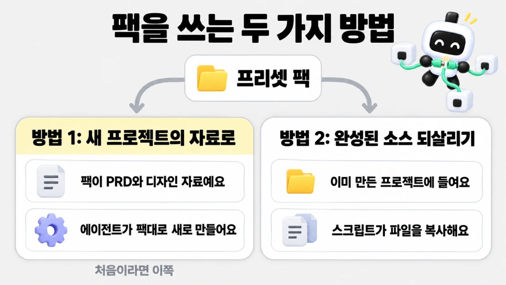

# 프리셋 팩으로 시작하기

> 한눈에: 프리셋 팩은 만들 서비스의 화면 구성, 디자인, 예시 데이터, 그림을 zip 하나로 묶어 둔 완성 자료예요. **에이전트에게 처음부터 설계하게 하는 대신, 이미 검증된 결과를 바탕으로 시작해요.** 팩은 두 가지로 써요. 새 프로젝트를 만들 때 기획과 디자인 자료로 주거나, 이미 만든 프로젝트에 완성된 소스를 되살려요.

## 왜 팩으로 시작하나요

처음부터 만들면 스타일을 고르고, 시안을 비교하고, 모든 페이지를 설계하는 데 시간이 많이 들어요. 팩에는 그 결과(화면 구성, 디자인, 그림)가 이미 들어 있어요.

> [!IMPORTANT]
> 에이전트는 스타일을 새로 고르거나 원본 사이트를 다시 조사하지 않고 팩을 그대로 따라 만들어요. 팩을 써도 AI가 만들기 때문에 100% 똑같지는 않을 수 있어요.

## 프리셋 팩이란

프리셋 팩(Preset Pack)은 <!-- v:gloss.presetPack -->만들 서비스의 화면 구성, 디자인, 예시 데이터, 그림을 묶어 둔 폴더<!-- /v -->예요([용어](../../tutorials/reference/glossary.md#만들기)). 비유하면 가구 조립 키트예요. 설계도와 부품이 다 들어 있어서 조립 순서만 따르면 돼요. 프리셋(프로킷으로 미리 만들어 둔 서비스)마다 팩이 하나씩 있어요.

팩 안에는 서비스 소개와 기능, 화면 설명, 디자인 규칙, 사이트맵, 그림과 스크린샷이 들어 있고, 소스를 되살릴 수 있는 팩에는 복원용 소스와 무결성 목록도 있어요. 팩마다 든 파일은 조금 달라서, 에이전트는 팩의 `README.md`를 먼저 읽고 그 순서를 따라요.

## 팩을 쓰는 두 가지 방법



| | 새 프로젝트의 자료로 쓰기 | 완성된 소스 되살리기 |
|---|---|---|
| 언제 | 프리셋과 같은 서비스를 처음부터 만들어 보고 싶을 때 | 이미 프로킷으로 만든 Better-T-Stack 프로젝트에 완성된 프리셋 화면을 들이고 싶을 때 |
| 팩의 역할 | PRD와 디자인 자료. 에이전트가 팩대로 새로 만들어요 | 복원할 소스. 스크립트가 파일을 그대로 복사해요 |
| 어떻게 | 튜토리얼 프리셋 쪽의 프롬프트를 작업 폴더에서 보내요 | 프로젝트에서 연 에이전트에게 팩 복원을 요청해요(`prokit-pack-use`) |
| 결과 | 화면만 만든 새 프로젝트와 HTML | 팩의 화면이 들어간 <!-- edition:pro -->기존 프로젝트<!-- /edition --><!-- edition:ui 이미 만든 프로젝트 --> |

**처음 쓰는 분은 대부분 왼쪽 방법이 맞아요.**

## 방법 1: 팩을 자료로 새 프로젝트 만들기

1. 아래 표에서 만들어 보고 싶은 프리셋을 골라 그 쪽을 열어요.
2. 그 쪽의 "프리셋 팩으로 만들어 보기" 프롬프트를 복사해요. 같은 쪽에 팩으로 이름·색·페이지·주제를 바꿔 만드는 프롬프트와, 팩 없이 같은 컨셉으로 처음부터 만드는 프롬프트도 있어요.
3. 작업 폴더에서 연 에이전트에 붙여 넣어요([처음 한 시간](first-hour.md)).
4. 프롬프트에 `packs/<이름> 프리셋 팩`이 있으면 에이전트가 pro-kit의 `AGENTS.md`대로 그 팩만 받아요. 직접 받아 둔 zip이 있으면 프롬프트 끝에 `프리셋 팩 zip은 [받은 zip 경로]에 받아 뒀어.` 한 줄을 더해요.

팩은 PRD로도 쓰여서 에이전트가 스킬 구성을 추천하고 물어봐요. 질문과 답하는 법은 <!-- edition:pro -->[빠른 시작: 서비스 만들기](quickstart-service.md#에이전트가-물어보는-것)와<!-- /edition --><!-- edition:ui [처음 한 시간](first-hour.md)과 --> 같아요.

**이렇게 되면 성공**

- 에이전트가 `packs/<이름>/`에 팩을 받았다고 알려요(같은 판이면 "이미 받은 판"이라고 해요)
- 팩을 PRD로 삼아 스킬 구성을 추천하고 물어봐요

## 팩 받기

에이전트가 대신 받지만, 직접 받을 때는 pro-kit 폴더에서 해요. 명령은 저장소 루트에서 실행해요.

```bash
node scripts/pack.mjs                 # 받을 수 있는 팩 이름 보기
node scripts/pack.mjs goru            # 팩을 받아 packs/goru/ 에 풀기
node scripts/pack.mjs goru --zip ~/Downloads/goru-pack.zip   # 받아 둔 zip 쓰기
```

| 하는 일 | 설명 |
|---|---|
| 받기 | `tutorials/packs.json`에 적힌 주소에서 zip을 받아요 |
| 확인 | 받은 파일의 sha256(내용이 바뀌지 않았는지 보는 지문)이 목록의 값과 같은지 확인해요. 다르면 아무것도 바꾸지 않고 멈춰요 |
| 풀기 | `packs/<이름>/`에 풀어요. 같은 판을 이미 받았으면 "이미 받은 판"이라고 알려 주고 그대로 둬요 |
| `--zip` | 받아 둔 zip에도 같은 sha256 확인을 해요. 옛 판이면 새로 받아요 |
| 아직 공개하지 않은 팩 | 원격으로는 받지 않아요. 사용자가 준 로컬 zip을 `--zip`으로 검증해 쓸 수 있고, 없거나 sha256이 다르면 멈춰요 |

`packs/` 폴더는 저장소에 들어가지 않는 받은 자료 폴더예요. zip을 푸는 `unzip`(없으면 `python3`)이 필요해요.

## 방법 2: 완성된 소스를 프로젝트에 되살리기

이미 프로킷으로 만든 프로젝트에서 팩의 완성된 화면 소스를 그대로 들이는 방법이에요. 프로젝트의 `prokit-pack-use` 스킬이 이 일을 맡아요.

### 보내는 프롬프트

프로젝트 폴더에서 연 에이전트에게 이렇게 보내요(경로는 내 폴더에 맞게 바꿔요).

```text
고루 프리셋 팩을 이 프로젝트에 복원해줘. pro-kit은 ~/projects/pro-kit에 있어. 먼저 복원 계획과 충돌만 확인해서 보여주고, 내가 괜찮다고 하면 적용해줘.
```

### 에이전트가 하는 일

1. 팩의 `README.md`, `CUSTOMIZE`, `SOURCES`와 `preset-manifest.json`(있으면)을 읽고, 팩의 템플릿, Next.js와 pnpm 버전, 화면만 여부가 내 프로젝트와 맞는지 대조해요.
2. 팩이 없으면 pro-kit의 `scripts/pack.mjs`로 받아요.
3. 복원 계획을 확인해요. 아무것도 쓰지 않고 새로 쓸 파일, 지울 파일, 이미 같은 파일을 JSON으로 보여 줘요. 내 파일과 겹치는 충돌이 있으면 계획 대신 `사용자 파일 충돌` 오류로 멈춰요.

   ```bash
   node <pro-kit 절대 경로>/scripts/apply-pack.mjs --pack <팩 폴더> --project <프로젝트> --check
   ```

4. 내가 동의하면 같은 명령에서 `--check`만 빼서 실제로 복원해요.
5. 에이전트가 의존성을 설치하고 타입 검사, 빌드, 실행으로 복원이 잘 됐는지 확인해요. 복원 스크립트는 설치와 빌드를 하지 않아요.
6. 실제 복원 상태와 확인하지 못한 것을 보고해요.

### 복원이 지키는 것

> [!WARNING]
> 내 프로젝트의 파일이 팩과 같거나 템플릿이 처음 만든 그대로일 때만 덮어써요. 내가 고친 파일과 겹치면 충돌로 보고 아무것도 적용하지 않아요.

- 팩의 소스 파일마다 sha256이 맞아야 하고, 경로와 링크 검사를 통과해야 적용해요.
- `.env*`, `AGENTS.md`·`CLAUDE.md`, `.agents`·`.claude` 같은 에이전트 설정 폴더, `tasks/`, `.dev-cycle.json`, `skills.manifest.json`, 하네스 스크립트는 팩이 건드리지 못해요.
- 복원하는 동안에는 같은 프로젝트를 고치는 다른 작업을 멈춰 둬요.

복원 뒤 이름이나 문구를 바꾸고 싶으면 그대로 요청해요. **에이전트는 바꾼 범위만 기록하고 나머지 화면과 모션은 유지해요.** 복원한 화면을 완성 프리셋과 견주는 일, 설정 적용 기준은 프로젝트의 `prokit-pack-use` 스킬과 [완성팩 활용과 담당 구분](../design/preset-publication.md)에 있어요.

## 받을 수 있는 팩

`node scripts/pack.mjs`가 보여 주는 이름은 아래와 같아요(공개한 팩만 나와요). 처음이면 마음에 드는 서비스 하나를 골라 오른쪽 쪽을 열어 보세요.

| 팩 이름 | 분류 | 어떤 서비스 | 쪽 |
|---|---|---|---|
| `slidelab` | <!-- v:preset.slidelab.kindLabel -->랜딩페이지<!-- /v --> | <!-- v:preset.slidelab.summary -->과정과 교육 시간을 고르는 AI·PPT 교육 랜딩<!-- /v --> | [<!-- v:preset.slidelab.title -->슬라이드랩<!-- /v -->](../../tutorials/samples/slidelab.md) |
| `speaker-portfolio` | <!-- v:preset.speaker-portfolio.kindLabel -->랜딩페이지<!-- /v --> | <!-- v:preset.speaker-portfolio.summary -->활동과 콘텐츠를 소개하는 개인 브랜딩 포트폴리오<!-- /v --> | [<!-- v:preset.speaker-portfolio.title -->스피커 포트폴리오<!-- /v -->](../../tutorials/samples/speaker-portfolio.md) |
| `pliko` | <!-- v:preset.pliko.kindLabel -->랜딩페이지<!-- /v --> | <!-- v:preset.pliko.summary -->팀 이야기·기술 글·행사 소식을 한곳에 모은 제품 팀 블로그<!-- /v --> | [<!-- v:preset.pliko.title -->pliko<!-- /v -->](../../tutorials/samples/pliko.md) |
| `goru` | <!-- v:preset.goru.kindLabel -->앱 화면<!-- /v --> | <!-- v:preset.goru.summary -->같이 사는 사람들의 생활비 정산<!-- /v --> | [<!-- v:preset.goru.title -->고루<!-- /v -->](../../tutorials/samples/goru.md) |
| `ullim` | <!-- v:preset.ullim.kindLabel -->랜딩페이지<!-- /v --> | <!-- v:preset.ullim.summary -->대본을 한국어 내레이션으로 만드는 AI 스튜디오<!-- /v --> | [<!-- v:preset.ullim.title -->울림<!-- /v -->](../../tutorials/samples/ullim.md) |
| `studyday` | <!-- v:preset.studyday.kindLabel -->앱 화면<!-- /v --> | <!-- v:preset.studyday.summary -->시험 날짜까지 하루 공부 나누기와 공부 기록<!-- /v --> | [<!-- v:preset.studyday.title -->하루공부<!-- /v -->](../../tutorials/samples/studyday.md) |
| `afterglow` | <!-- v:preset.afterglow.kindLabel -->랜딩페이지<!-- /v --> | <!-- v:preset.afterglow.summary -->가정용 태양광 배터리 소개와 설치 상담<!-- /v --> | [<!-- v:preset.afterglow.title -->AFTERGLOW<!-- /v -->](../../tutorials/samples/afterglow.md) |
| `marubuild` | <!-- v:preset.marubuild.kindLabel -->랜딩페이지<!-- /v --> | <!-- v:preset.marubuild.summary -->서비스와 제작 사례를 보여 주고 프로젝트 문의로 잇는 제작사 소개<!-- /v --> | [<!-- v:preset.marubuild.title -->마루빌드<!-- /v -->](../../tutorials/samples/marubuild.md) |
| `fitslot` | <!-- v:preset.fitslot.kindLabel -->앱 화면<!-- /v --> | <!-- v:preset.fitslot.summary -->필라테스 수업 예약과 수강권 관리<!-- /v --> | [<!-- v:preset.fitslot.title -->핏슬롯<!-- /v -->](../../tutorials/samples/fitslot.md) |
| `jecheol` | <!-- v:preset.jecheol.kindLabel -->랜딩페이지<!-- /v --> | <!-- v:preset.jecheol.summary -->제철 농산물 정기배송<!-- /v --> | [<!-- v:preset.jecheol.title -->제철상자<!-- /v -->](../../tutorials/samples/jecheol.md) |
| `pacecrew` | <!-- v:preset.pacecrew.kindLabel -->랜딩페이지<!-- /v --> | <!-- v:preset.pacecrew.summary -->동네 러닝 크루 매칭과 레이스 신청<!-- /v --> | [<!-- v:preset.pacecrew.title -->PACECREW<!-- /v -->](../../tutorials/samples/pacecrew.md) |
| `uptrail` | <!-- v:preset.uptrail.kindLabel -->앱 화면<!-- /v --> | <!-- v:preset.uptrail.summary -->개발팀의 서비스 상태와 배포 모니터링<!-- /v --> | [<!-- v:preset.uptrail.title -->Uptrail<!-- /v -->](../../tutorials/samples/uptrail.md) |
| `olgot` | <!-- v:preset.olgot.kindLabel -->앱 화면<!-- /v --> | <!-- v:preset.olgot.summary -->고등부 수학·과학 입시학원 웹 앱<!-- /v --> | [<!-- v:preset.olgot.title -->올곧<!-- /v -->](../../tutorials/samples/olgot.md) |
| `nextflix` | <!-- v:preset.nextflix.kindLabel -->클론 튜토리얼<!-- /v --> | <!-- v:preset.nextflix.field -->영상 구독 서비스<!-- /v --> 만들기 | [<!-- v:preset.nextflix.title -->Nextflix<!-- /v -->](../../tutorials/01-nextflix/README.md) | <!-- edition:pro -->
| `claudle` | <!-- v:preset.claudle.kindLabel -->클론 튜토리얼<!-- /v --> | <!-- v:preset.claudle.field -->AI 대화 서비스<!-- /v --> 만들기 | [<!-- v:preset.claudle.title -->Claudle<!-- /v -->](../../tutorials/02-claudle/README.md) | <!-- edition:pro -->

팩은 팩에 함께 든 이용 조건을 따라요. pro-kit 자체의 조건은 [LICENSE](../../LICENSE), 팩과 외부 원본의 조건은 [제3자 안내](../../THIRD_PARTY_NOTICES.md#사용자-작성-코드와-프리셋-팩)에 있어요.

## 막히면

| 증상 | 이렇게 해요 |
|---|---|
| `없는 팩`이라고 나와요 | 이름을 확인해요. `node scripts/pack.mjs`로 받을 수 있는 이름을 볼 수 있어요 |
| `아직 공개하지 않은 팩`이라고 나와요 | 원격으로는 받을 수 없어요. 받아 둔 zip이 있으면 `--zip <경로>`를 붙여요 |
| `sha256이 다름`이라고 나와요 | 받은 zip이 옛 판이거나 깨졌어요. `--zip` 없이 다시 받아요. 그래도 같으면 이슈로 알려요 |
| `zip을 풀 도구가 없어요`라고 나와요 | `unzip`을 설치해요(Ubuntu와 WSL은 `sudo apt install unzip`) |
| pro-kit을 최신으로 맞추는 `git pull --ff-only`가 실패해요(옛 저장소 사본) | pro-kit 폴더 이름을 `pro-kit-old`로 바꾸고 새로 받아요 | <!-- edition:pro -->
| 복원 계획에서 `사용자 파일 충돌`이 나와요 | 충돌한 파일은 보존돼요. 에이전트에게 차이와 최소 병합안을 보여 달라고 해요. 팩이나 목록을 고쳐 검사를 피하지 않아요 |
| 복원 뒤 빌드가 실패해요 | 오류 메시지를 붙여 `이 오류 해결해줘`라고 보내요. 팩의 호환 정보(Next.js, pnpm 버전)가 내 프로젝트와 맞는지도 확인해 달라고 해요 |

그 밖의 증상은 [막혔을 때](../../tutorials/reference/troubleshooting.md)에 있어요.

## 관련 문서

- [빠른 시작: 화면만 만들기](quickstart-screens.md)
- [PRD 먼저 정하기](prd.md)
- [완성팩 활용과 담당 구분](../design/preset-publication.md)
- [컨셉으로 화면 만들기와 프리셋 고르기](../../tutorials/samples/README.md#프리셋으로-만들어-보기)
