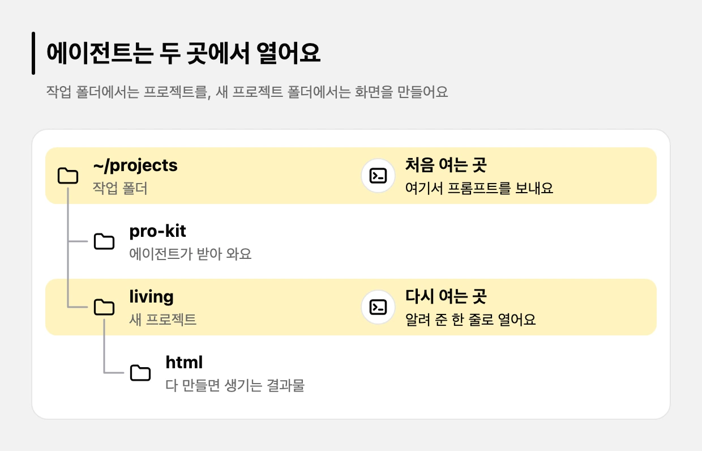

# 빠른 시작: 화면만 만들기

> 한눈에: DB 없이 화면만 먼저 만들어 볼 수 있어요. 만들 서비스를 한두 문장의 PRD로 정해 작업 폴더의 에이전트에게 프롬프트 하나로 보내면, pro-kit을 받는 일부터 모든 화면을 만들어 HTML 파일로 내보내는 일까지 이어져요. 코드를 몰라도 돼요.

## 흐름

1. **작업 폴더에서 에이전트 열기**: 프로젝트를 모아 둘 폴더(예: `~/projects`)에서 에이전트(<!-- v:agents.list -->Claude Code, Codex, Antigravity, Grok Build<!-- /v --> 중 하나)를 열어요.
2. **프롬프트 보내기**: 누가 쓰고 무엇을 할 수 있는 서비스인지 한두 문장으로 적어 아래 프롬프트처럼 보내요. 이 서비스 설명이 PRD예요.
3. **프로젝트 준비**: 에이전트가 pro-kit을 받고, 서비스 설명으로 두뇌와 스킬을 추천해 물어요. 고르면 DB 없는 프로젝트를 만들고 전용 스킬과 검사 도구를 설치한 뒤 커밋해요. 끝나면 새 폴더에서 이어 갈 명령 한 줄을 알려 줘요.
4. **새 폴더에서 이어 가기**: 알려 준 한 줄로 새 폴더에서 에이전트를 열어요. 그 프로젝트의 규칙과 스킬은 새 폴더에서 열어야 켜져요.
5. **화면 만들기**: 화면 설계(사이트맵과 페이지), 디자인 스타일 추천과 `DESIGN.md`, 모든 페이지를 예시 데이터로 만들기, 검사, HTML 내보내기(`pnpm export:html`)까지 이어져요.



```text
https://github.com/roadkwon-ai/pro-kit 을 이 폴더에 받고, 그 안의 AGENTS.md대로 화면만 만들 프로젝트를 pro-kit 옆에 living 폴더로 만들어줘. DB는 쓰지 않아. 없는 준비물은 설치해줘. 같이 사는 사람들이 함께 쓴 생활비를 적고, 월말에 누가 누구에게 얼마를 보내면 되는지 알려 주는 서비스를 만들고 싶어. 필요한 화면을 모두 예시 데이터로 만들어줘. 로그인이나 저장 같은 기능은 빼고 화면만 만들어. 시스템·라이트·다크 모드 전환과 한국어·영어 전환을 모든 페이지의 기본 기능으로 넣어줘. 화면 문구는 같은 키를 가진 두 언어의 번역 사전에서 관리하고, 전환해도 현재 페이지와 입력을 유지해줘. 개발 화면과 HTML로 내보낸 결과에서 모든 페이지의 전환과 상태 유지를 실제로 확인해줘. 디자인 스타일은 서비스에 어울리는 걸로 추천해주고, 다 만들면 HTML 파일로 내보내줘.
```

> [!IMPORTANT]
> 프로킷은 이 서비스 설명으로 스킬 구성을 추천하고 개발 환경을 만들어요. 설명이 빠지면 에이전트가 먼저 묻고, 끝내 없으면 프로젝트를 만들지 않아요.

무엇을 적으면 좋은지는 [PRD 먼저 정하기](prd.md)에 있어요. 에이전트를 처음 열어 본다면 처음 나오는 질문과 흐름을 [처음 한 시간](first-hour.md)에서 먼저 봐요.

단계별로 따라 하려면 튜토리얼 [컨셉으로 화면 만들기](../../tutorials/samples/README.md#가장-쉬운-방법)를 보세요. 프리셋과 같은 컨셉으로 만들어 볼 수도 있어요([프리셋으로 만들어 보기](../../tutorials/samples/README.md#프리셋으로-만들어-보기)).

> [!NOTE]
> 위 프롬프트의 모드·언어 문장은 **새 화면만 프로젝트의 요구**예요. 이미 공개한 프리셋이나 받은 프리셋 팩을 자동으로 바꾸지는 않아요. 만든 뒤에는 개발 화면과 HTML 결과에서 전환, 현재 페이지, 입력 상태를 직접 확인해요.

## 프롬프트의 문장이 하는 일

위 프롬프트는 긴 문장 하나가 아니라 역할이 다른 문장 열 개예요. **내 서비스에 맞게 바꿀 곳은 서비스 설명 문장과 폴더 이름(`living`)이에요.** 나머지는 그대로 두면 돼요.

| 문장 | 하는 일 | 바꿔도 되나요 |
|---|---|---|
| `https://github.com/roadkwon-ai/pro-kit 을 이 폴더에 받고, 그 안의 AGENTS.md대로 …` | pro-kit을 받고 그 안의 절차 문서(`AGENTS.md`)를 따르게 해요 | 주소와 `AGENTS.md`는 그대로 둬요 |
| `화면만 만들 프로젝트를 pro-kit 옆에 living 폴더로 만들어줘.` | 만들 곳을 정해요. pro-kit 안이 아니라 옆에 새 폴더가 생겨요 | 폴더 이름은 소문자와 하이픈으로 바꿔도 돼요 |
| `DB는 쓰지 않아.` | 화면만 프로젝트로 정하고 로컬 DB와 마이그레이션을 건너뛰게 해요 | 서비스까지 만들 거라면 [서비스 만들기](quickstart-service.md)를 따라요 |
| `없는 준비물은 설치해줘.` | 빠진 Node, pnpm, git을 에이전트가 설치하게 허락해요. 비밀번호가 필요한 명령은 내게 알려 줘요 | 직접 설치하고 싶으면 빼요 |
| `같이 사는 사람들이 … 알려 주는 서비스를 만들고 싶어.` | 서비스 설명이에요. 이것이 PRD가 되어 스킬 구성을 추천하는 근거예요 | 내 서비스에 맞게 꼭 바꿔요. 누가 쓰고 무엇을 하는지 두 가지는 들어가야 해요 |
| `필요한 화면을 모두 예시 데이터로 만들어줘. 로그인이나 저장 같은 기능은 빼고 화면만 만들어.` | 화면 범위를 정해요. 가짜 데이터로 모든 페이지를 만들게 해요 | 그대로 둬요 |
| `시스템·라이트·다크 모드 전환과 한국어·영어 전환을 모든 페이지의 기본 기능으로 넣어줘.` | 모든 페이지에 테마와 언어 전환을 넣게 해요 | 필요 없으면 지워요 |
| `화면 문구는 같은 키를 가진 두 언어의 번역 사전에서 관리하고, 전환해도 현재 페이지와 입력을 유지해줘.` | 문구를 한곳에서 관리하게 하고, 전환해도 보던 페이지와 입력이 사라지지 않게 해요 | 위 문장을 지웠다면 같이 지워요 |
| `개발 화면과 HTML로 내보낸 결과에서 모든 페이지의 전환과 상태 유지를 실제로 확인해줘.` | 만들기만 하지 않고 실제로 눌러 보고 확인하게 해요 | 위 문장을 지웠다면 같이 지워요 |
| `디자인 스타일은 서비스에 어울리는 걸로 추천해주고, 다 만들면 HTML 파일로 내보내줘.` | 스타일을 추천받아 고르게 하고, 마지막에 열어 볼 수 있는 HTML 파일로 내보내게 해요 | 그대로 둬요 |

**이렇게 되면 성공**

- `living` 폴더에 화면만 프로젝트가 만들어지고 설치 결과가 커밋돼요.
- 필요한 화면이 모두 예시 데이터로 보여요.
- `pnpm export:html`로 HTML 파일이 나와요.

## 자세히

### 프로젝트 준비 단계에서 에이전트가 하는 일

[AGENTS.md](../../AGENTS.md)의 "작업 폴더에서 시작했을 때"와 "화면만 만들기" 절을 따라요.

- **pro-kit 받기**: 작업 폴더에 `pro-kit`이 없으면 `git clone`으로 받고, 있으면 `git pull --ff-only`로 최신으로 맞춰요. 이어 받을 수 없는 옛 사본이면 멈추고 `pro-kit-old`로 이름을 바꾼 뒤 새로 받으라고 알려 줘요.
- **템플릿**: 화면만 만들 때는 `prokit-next-neon`으로 정하고 묻지 않아요. 로컬 DB와 첫 마이그레이션은 건너뛰어요.
- **스킬 고르기**: 프롬프트의 서비스 설명을 PRD로 보고 두뇌, 과설계 방지 스킬, 추가 스킬, 응답 방식, 화면 디자인 보조를 추천해 물어요. **맨 앞의 `(추천)`을 고르면 돼요.** 질문과 선택지는 [서비스 만들기의 표](quickstart-service.md#에이전트가-물어보는-것), 선택지의 뜻은 [두뇌와 선택 스킬](../skills/brains.md)에 있어요.
- **첫 요청 저장**: 프롬프트에서 pro-kit 받기와 프로젝트 만들기 지시를 뺀 나머지(서비스 컨셉부터 끝까지)를 새 프로젝트의 `docs/first-request.md`에 적어요. 문장은 바꾸지 않아요.
- **화면만 프로젝트 표시**: 새 프로젝트의 `AGENTS.md` 맨 위에 "화면만 프로젝트" 한 줄을 넣어요. 그 프로젝트의 에이전트는 이 줄을 보고 DB 없이 화면만 만들어요([화면만 프로젝트와 HTML 내보내기](../design/screen-only.md)).
- **화면 디자인 검사 켜기**: `impeccable hooks on`을 에이전트가 직접 실행해요.
- **커밋과 보고**: 설치 결과와 포맷 정리를 커밋하고, 새 폴더에서 이어 갈 한 줄을 알려 줘요.

```bash
cd <프로젝트 절대 경로> && claude "docs/first-request.md의 요청대로 이어서 해줘"
```

다른 에이전트로 열었다면 `claude "…"` 대신 그 에이전트를 여는 명령이에요(Codex는 <!-- v:agent.codex.open -->codex<!-- /v -->, Antigravity는 <!-- v:agent.agy.open -->agy -i "<요청>"<!-- /v -->, Grok Build는 <!-- v:agent.grok.open -->grok --trust "<요청>"<!-- /v -->. [지원하는 에이전트](supported-agents.md)). 묻지 않고 진행하는 모드로 열었다면 같은 옵션(<!-- v:agent.claude.yoloCode -->`claude --dangerously-skip-permissions`<!-- /v -->, <!-- v:agent.codex.yoloCode -->`codex --yolo`<!-- /v -->, <!-- v:agent.agy.yoloCode -->`agy --dangerously-skip-permissions`<!-- /v -->, <!-- v:agent.grok.yoloCode -->`grok --permission-mode bypassPermissions`<!-- /v -->)이 붙어요([묻지 않고 진행하게 열기](../../tutorials/reference/claude-code-and-codex.md#묻지-않고-진행하게-열기)).

### 이렇게도 요청할 수 있어요

- pro-kit 폴더에서 에이전트를 열었다면 "화면만 만들 living 프로젝트 만들어줘. 같이 사는 사람들이 생활비를 함께 적고 월말에 정산하는 서비스야"처럼 요청해도 돼요. 누가 쓰고 무엇을 하는 서비스인지 빠지면 에이전트가 먼저 물어봐요. 그래도 답하지 않으면 프로젝트를 만들지 않고 끝나요.
- 프롬프트 끝에 "GitHub Pages에 배포해줘"나 "Vercel에 배포해줘"를 붙이면 화면을 다 만든 뒤 인터넷에 올려요. 원격 저장소와 프로젝트 만들기까지 요청한 것으로 봐요. 토큰 준비는 [배포하기](../../tutorials/reference/deploy.md)에 있어요.
- 나중에 "실제 서비스로 바꿀 거야"라고 하면 로컬 DB와 첫 마이그레이션을 더해 로그인과 저장이 되는 개발로 이어져요.

## 관련 문서

- [처음 한 시간](first-hour.md)
- [프리셋 팩으로 시작하기](quickstart-pack.md)
- [요청하고 이어 가는 법](ask-well.md)
- [준비물](requirements.md)
- [화면만 프로젝트와 HTML 내보내기](../design/screen-only.md)
- [UI/UX 흐름](../design/ui-flow.md)
- [GitHub Pages 배포](../deploy/github-pages.md)
- [튜토리얼: 컨셉으로 화면 만들기](../../tutorials/samples/README.md)
