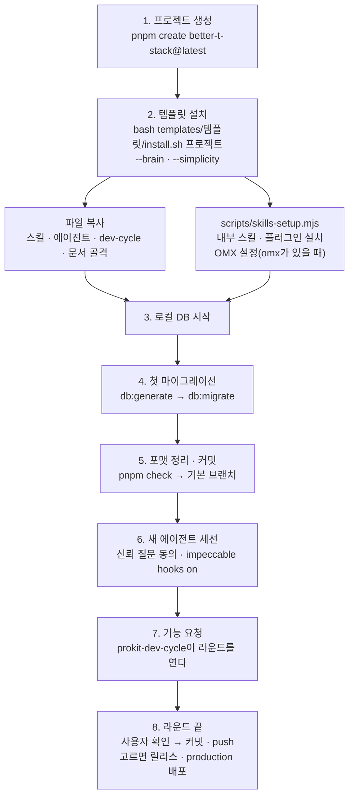

# 빠른 시작: 서비스 만들기

> 한눈에: 로그인과 DB까지 갖춘 서비스는 pro-kit 폴더에서 에이전트에게 PRD와 템플릿, 프로젝트 이름을 말하면 만들어져요. 에이전트가 PRD로 스킬 구성을 추천해 고르게 하고, 앱 뼈대와 템플릿 설치부터 내 컴퓨터의 개발용 DB와 결과 저장(커밋)까지 마쳐요. 기능 개발은 그다음 새 폴더에서 시작해요.

## 0단계: 어디서 열까

에이전트를 어느 폴더에서 여느냐가 달라요. **아직 pro-kit을 받지 않았는지, 이미 받았는지로 정해요.**

| 지금 상황 | 어디서 열까 | 프롬프트 |
|---|---|---|
| pro-kit을 아직 받지 않았어요 | 프로젝트를 모아 둘 작업 폴더(예: `~/projects`) | 에이전트가 pro-kit을 받는 일부터 하게 하는 프롬프트(아래 "pro-kit을 아직 받지 않았다면") |
| pro-kit을 이미 받았어요 | pro-kit 폴더 | 받는 일 없이 바로 프로젝트를 만들어 달라는 프롬프트(아래 "요청하기"의 예) |

작업 폴더에서 시작하는 프롬프트는 아래 [pro-kit을 아직 받지 않았다면](#pro-kit을-아직-받지-않았다면)에 있어요. 에이전트를 처음 열 때 나오는 질문은 [처음 한 시간](first-hour.md)에 있어요.

## 요청하기

> [!IMPORTANT]
> 먼저 만들 서비스의 PRD를 정해요. 누가 쓰고 무엇을 할 수 있는지 몇 줄이면 되고, 적을 것은 [PRD 먼저 정하기](prd.md)에 있어요.

그다음 pro-kit 폴더에서 에이전트를 열고(받지 않았다면 위 0단계) PRD, DB 종류, 프로젝트 이름을 넣어 요청해요.

> [!NOTE]
> 이미 진행하던 프로젝트(초기 프로젝트, 운영 중인 Next.js, 다른 언어에서 전환)에 들일 때는 이 쪽이 아니라 [기존 프로젝트에 도입하기](adopt.md)를 따라요. 그 경우에는 PRD가 꼭 있지 않아도 돼요.

<!-- b:open-in-kit -->
```bash
cd pro-kit          # pro-kit 폴더
claude              # Codex는 codex, Antigravity는 agy, Grok Build는 grok --trust
```
<!-- /b -->

여는 명령과 도구마다 읽는 파일은 [지원하는 에이전트](supported-agents.md)에 있어요.

```text
supabase 템플릿으로 my-app 프로젝트 만들어줘. PRD는 [~/Documents/my-app-prd.md]에 있어.
```

```text
neon 템플릿으로 study-planner 프로젝트 만들어줘. 학생이 과목별 공부 계획을 세우고, 매일 한 일을 체크하고, 주간 달성률을 보는 서비스야.
```

- **PRD**: 만들 서비스를 적은 기획 문서예요. 파일 경로를 주거나, 누가 쓰고 무엇을 할 수 있는 서비스인지 요청에 적어요. Claude Code라면 `/prokit-init <PRD 파일 경로나 내용>`으로 스킬을 바로 불러도 돼요. 없으면 에이전트가 먼저 PRD를 달라고 하고, 그래도 주지 않으면 프로젝트를 만들지 않고 끝나요. 에이전트가 PRD로 스킬을 추천하고 개발 환경을 맞추기 때문이에요.
- **DB 종류**: `supabase` 또는 `neon`이에요. 고르기 어려우면 빼고 요청하세요. 에이전트가 차이를 설명하고 물어봐요([템플릿 고르기](../templates/choose.md)).
- **프로젝트 이름**: 영어 소문자와 하이픈(`-`)으로 지어요. 예: `my-app`, `study-planner`
- **만들어지는 곳**: pro-kit과 같은 폴더에 프로젝트 이름으로 새 폴더가 생겨요. 다른 곳을 원하면 요청에 경로를 적어요.
- **Windows**: WSL2의 Ubuntu에서 열어요([준비물](requirements.md#windows)).

### pro-kit을 아직 받지 않았다면

프로젝트를 모아 둘 작업 폴더(예: `~/projects`)에서 에이전트를 열고, 받는 일부터 맡겨요. `[ ]` 안을 내 것으로 바꿔요.

```text
https://github.com/roadkwon-ai/pro-kit 을 이 폴더에 받고, 그 안의 AGENTS.md대로 [supabase] 템플릿으로 [my-app] 프로젝트를 pro-kit 옆에 만들어줘. [동네 꽃집의 손님은 꽃다발을 고르고 받을 날짜를 예약하고, 사장님은 날짜별 예약을 본다. 로그인과 저장이 필요해.]
```

이 방식에서는 서비스 설명이 PRD이고, 에이전트가 첫 요청을 새 프로젝트의 `docs/first-request.md`에 적어 두어요. 끝나면 새 폴더에서 이어 갈 명령 한 줄을 알려 줘요.

## 요청하면 이렇게 진행돼요

1. **확인**: PRD가 없으면 먼저 달라고 하고, DB 종류와 이름이 없으면 물어요.
2. **스킬 고르기**: PRD로 두뇌와 스킬을 추천하고 물어요. `(추천)`이 붙은 것을 고르면 돼요([물어보는 것 표](#에이전트가-물어보는-것), [두뇌와 선택 스킬](../skills/brains.md)).
3. **준비 확인**: 같은 이름의 폴더가 이미 있거나 필요한 프로그램(고른 두뇌에 필요한 것 포함)이 없으면 멈추고 설치 방법을 알려 줘요.
4. **앱 뼈대 만들기**: Better-T-Stack으로 로그인까지 되는 Next.js 앱을 만들어요.
5. **템플릿 설치**: 프로젝트 규칙, 전용 스킬 <!-- v:prokit.skills.count -->10<!-- /v -->개, 구현 수행·전문 리뷰·최종 리뷰·정밀 분석(`prokit-analyzer`) 에이전트, 작업 확인 도구(dev-cycle), 배포 스크립트를 넣어요. 공식 스킬과 플러그인은 그때의 최신판으로 설치해요.
6. **개발용 DB 준비**: 내 컴퓨터에 DB를 띄우고 로그인에 필요한 테이블을 만들어요.
7. **점검과 커밋**: 코드 형식을 정리하고 검사를 모두 통과하는지 확인한 뒤 결과와 PRD를 git에 커밋해요.
8. **보고**: 프로젝트 위치, DB 주소와 끄는 명령, 검사 결과, 이어서 할 일을 알려 줘요.

**원격 DB 연결, Vercel 배포, GitHub에 올리기(push), 전역 도구 설치는 요청할 때만 해요.** 다만 <!-- v:policy.agentBrowser.yo -->agent-browser CLI는 없거나 npm 최신판보다 낮으면 기본으로 최신판을 설치해요<!-- /v -->.



**이렇게 되면 성공**

- 프로젝트 폴더가 pro-kit 옆에 만들어져요.
- `pnpm skills:check`, `pnpm agents:check`, `pnpm check-types`, `pnpm exec biome check .`가 모두 exit 0이에요.
- 설치 결과와 첫 마이그레이션, PRD가 기본 브랜치에 커밋돼요.
- 에이전트가 프로젝트 위치, DB 주소와 끄는 명령, 이어서 할 일을 보고해요.

## 에이전트가 물어보는 것

에이전트는 PRD를 읽고 추천을 만든 뒤 아래를 물어요. 요청에 이미 적었거나 "알아서 골라줘"라고 맡긴 항목은 묻지 않고 추천대로 진행하고, 고른 값과 근거를 알려 줘요. **추천은 제안이고 고르는 것은 나예요.** 선택지마다 한 줄 설명이 붙고 추천에는 `(추천)`이 붙어 맨 앞에 있어요.

| 질문 | 선택지 | 추천과 기본 | 잘 모르겠으면 | 안 물을 때 |
|---|---|---|---|---|
| 프로젝트 유형 | 새 프로젝트, 초기 프로젝트, 운영 중인 Next.js, 전환 | 요청과 폴더의 신호로 고른 것 | PRD만 있고 코드가 없으면 새 프로젝트 | 요청에서 분명하면 한 줄로 알리고 넘어가요 |
| PRD | 파일 경로 또는 서비스 설명 글 | 없음 | 누가 쓰고 무엇을 하는지 한두 문장 | 요청에 있으면 묻지 않아요. 새 프로젝트는 끝내 없으면 만들지 않아요 |
| 템플릿(DB) | neon, supabase | 없음(화면만 만들 때는 neon으로 정해요) | `차이를 설명해줘`([템플릿 고르기](../templates/choose.md)) | 요청과 PRD에서 DB가 드러나면 묻지 않아요 |
| 프로젝트 이름과 위치 | 소문자와 하이픈 이름, 위치 | 위치는 pro-kit 옆(`../<이름>`) | 서비스를 한 단어로 줄인 영어 이름 | 요청에 이름이 있으면 묻지 않아요 |
| 두뇌 | `없음(기본 AI)`, superpowers, agent-skills (addyosmani), pstack, gstack, oh-my, mattpocock, openspec, spec-kit, compound-engineering | PRD에 맞는 하나. 신호가 약하면 `없음(기본 AI)` | `(추천)`을 고르세요. 나중에 말로 바꿀 수 있어요 | 요청에서 정했거나 맡겼을 때 |
| 과설계 방지 스킬 | ponytail, caveman, andrej-karpathy-skills, `SKIP(기본 AI)` | ponytail | `(추천)` | 요청에서 정했거나 맡겼을 때 |
| 응답 방식 | i-have-adhd, SKIP | i-have-adhd. 길고 자세한 설명을 원한다고 했으면 SKIP | `(추천)`. 자세한 설명이 좋으면 SKIP | 요청에서 정했거나 맡겼을 때 |
| 화면 디자인 보조 | taste-skill, SKIP | SKIP. 주 화면이 랜딩·소개 같은 공개 페이지면 taste-skill | `(추천)` | 요청에서 정했거나 맡겼을 때 |
| mattpocock 추가 스킬 | 14개를 네 묶음(구현·설계, 디버깅·검토, 조사·외부 설정, 인계·학습)으로. 여러 개 고를 수 있어요 | 두뇌와 PRD에 맞는 것 | `(추천)`만 고르거나 아무것도 고르지 않아요. 필수 3개는 늘 설치돼요 | 두뇌가 정해진 뒤에 늘 묻고, 요청에서 정했거나 맡겼을 때만 건너뛰어요 |

두뇌에서 `다른 두뇌 보기·여럿 고르기`를 고르면 세 묶음의 여러 선택 질문으로 묻고, 둘 이상 고르면 주 두뇌(첫째 두뇌)를 한 번 더 물어요. 진행 순서를 강제하는 두뇌(superpowers, gstack, oh-my)를 둘 이상 고르면 지시가 서로 덮어써서 하나만 남기게 다시 물어요. 각 선택지의 뜻은 [두뇌와 선택 스킬](../skills/brains.md)에 있어요.

이미 진행하던 프로젝트는 두 번에 나눠 물어요. 먼저 유형별 항목(적용 방식, 작업 브랜치, 필요하면 템플릿과 이름)을, 그다음 위의 스킬 구성 네 질문을 물어요. 마지막에 유형별 동의 질문을 한 번 더 하고(`시작 (추천)`, `지금은 하지 않음`), **동의하기 전에는 프로젝트를 바꾸지 않아요**([기존 프로젝트에 도입하기](adopt.md)).

## 자세히

### 에이전트가 따르는 절차

에이전트는 [AGENTS.md](../../AGENTS.md)의 "템플릿으로 새 프로젝트 만들기" 1\~10번을 순서대로 따르고, 명령은 템플릿 README의 "새 프로젝트 시작"과 "설치한 뒤"를 그대로 써요.

| 단계 | 하는 일 |
|---|---|
| 위치 | pro-kit 밖에 만들어요. 기본은 pro-kit의 상위 폴더(`../<이름>`)예요. 대상 폴더가 이미 있으면 멈추고 물어요 |
| 생성 | neon은 `--db-setup docker`, supabase는 `--db-setup supabase --manual-db`로 `pnpm create better-t-stack@latest <이름> …`을 실행해요 |
| 설치 | `bash <pro-kit>/templates/<템플릿>/install.sh <프로젝트 경로> --brain <값> --simplicity <값>`으로 설치해요. 고르지 않았으면 둘 다 `none`을 명시해요. 추가 스킬은 `--matt <스킬>[,<스킬>]`, 응답 방식은 `--optional i-have-adhd`, 화면 디자인 보조는 `--optional taste`를 더해요. `--with-global`은 전역 도구 설치를 요청할 때만 붙여요 |
| 로컬 DB (neon) | <!-- v:port.neonDb -->5432<!-- /v --> 포트가 쓰이는지 먼저 보고, 쓰이면 `DB_PORT`로 바꿔요. `packages/db`에서 `podman compose up -d`(Docker면 `db:start`)로 띄워요 |
| 로컬 DB (supabase) | Podman이면 `DOCKER_HOST`를 먼저 설정해요. `packages/db`에서 `supabase init`을 실행하고 `project_id`를 프로젝트 이름으로 바꾼 뒤 `supabase start -x …`로 DB만 띄워요 |
| 첫 마이그레이션 | `db:generate`로 인증 테이블 마이그레이션을 만들고 `db:migrate`로 적용해요. supabase는 적용 전에 `enable_rls_auth` 커스텀 마이그레이션을 더하고, 적용 뒤 `supabase db advisors --local --type security`가 `No issues found`인지 확인해요. Better-T-Stack이 만든 README의 `db:push` 단계는 따르지 않아요 |
| 확인 | `pnpm check`로 포맷과 정렬을 한 번 정리한 뒤 `pnpm skills:check`, `pnpm agents:check`, `pnpm check-types`, `pnpm exec biome check .`가 모두 exit 0인지 봐요 |
| 커밋 | 설치 결과, 포맷 정리, 첫 마이그레이션을 기본 브랜치에 커밋해요 |

> [!IMPORTANT]
> 첫 커밋을 건너뛰면 설치한 파일과 첫 마이그레이션(`packages/db`, 케이스 E)이 첫 라운드의 변경 내용(diff)에 섞여요. 그러면 `audit`이 실제 작업보다 무거운 케이스로 올리라고 요구해요. 라운드는 기본 브랜치와 갈라진 지점(merge-base)부터 바뀐 내용을 보므로 기능 브랜치에 커밋해도 해결되지 않아요([케이스 <!-- v:devCycle.cases.range -->A\~F·H<!-- /v -->와 대조표](../concepts/cases.md)).

### 직접 하기

명령 전체는 각 템플릿 README의 "새 프로젝트 시작"에 있어요([neon](../../templates/prokit-next-neon/README.md#새-프로젝트-시작) · [supabase](../../templates/prokit-next-supabase/README.md#새-프로젝트-시작)).

1. 상위 폴더에서 `pnpm create better-t-stack@latest my-app …`을 실행해요. 옵션은 템플릿 README에 적힌 그대로 써요.
2. `bash pro-kit/templates/<템플릿>/install.sh my-app --brain <값> --simplicity <값>`으로 설치해요. 두뇌와 과설계 방지 스킬을 고르지 않으면 둘 다 `none`으로 줘요([두뇌와 선택 스킬](../skills/brains.md)).
3. 로컬 DB를 띄워요. neon은 `packages/db`에서 `podman compose up -d`, supabase는 `supabase init`, `project_id` 변경, `supabase start -x …`예요.
4. `db:generate` → (supabase는 `enable_rls_auth` 커스텀 마이그레이션) → `db:migrate` 순서로 첫 마이그레이션을 적용해요.
5. `pnpm check`로 포맷을 정리하고 `pnpm exec biome check .`가 exit 0인지 본 뒤 기본 브랜치에 커밋해요.
6. 새 에이전트 세션을 열고 신뢰 질문에 동의해요. 프로젝트 루트에서 `.agents/skills/impeccable/scripts/impeccable hooks on`을 실행하고 `GLOSSARY.md`, `docs/domain/project.md`를 채워요.

이미 만든 프로젝트를 팀원이 클론했다면 `pnpm install` 뒤에 `pnpm skills:setup`을 한 번 실행해요. 선택 스킬 묶음을 쓰는 프로젝트면 `--optional <묶음>`을 붙여요.

## 관련 문서

- [처음 한 시간](first-hour.md)
- [프리셋 팩으로 시작하기](quickstart-pack.md)
- [템플릿 고르기](../templates/choose.md)
- [설치기와 옵션](../templates/installer.md)
- [기존 프로젝트에 도입하기](adopt.md)
- [만든 뒤 개발하기](after-create.md)
- [dev-cycle 라운드](../concepts/dev-cycle.md)
