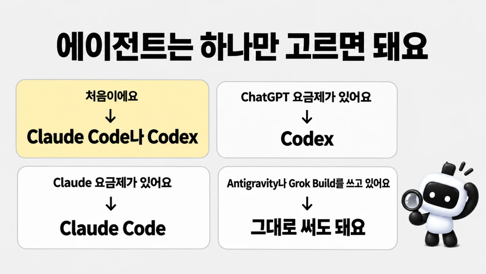

# 지원하는 에이전트

> 한눈에: 프로킷을 설치한 프로젝트는 <!-- v:agents.list -->Claude Code, Codex, Antigravity, Grok Build<!-- /v --> 중 어느 것으로 열어도 같은 규칙과 스킬로 일해요. 도구마다 읽는 파일 위치와 여는 명령만 조금 달라요.

## 어떤 에이전트를 고를까요

에이전트(대화로 부탁하면 코드를 쓰고 명령을 실행해 주는 AI, [용어](../../tutorials/reference/glossary.md#도구))는 **하나만 있으면 돼요.** 프로킷은 네 도구에 같은 규칙과 스킬을 설치하므로, 이미 쓰는 요금제에 맞춰 고르면 돼요.

| 상황 | 권하는 선택 |
|---|---|
| 처음이고 어떤 것을 쓸지 모르겠어요 | Claude Code나 Codex. 튜토리얼을 이 두 도구로 확인했고 질문에 답하는 법, 멈추는 법, 이어 하는 법이 [에이전트별 차이](../../tutorials/reference/claude-code-and-codex.md)에 표로 있어요 |
| 이미 ChatGPT 요금제가 있어요 | Codex. 이미지도 자체 도구로 준비 없이 그려요 |
| 이미 Claude 요금제가 있어요 | Claude Code. 이미지를 그리려면 ChatGPT 요금제와 Codex CLI 또는 OpenAI API 키가 더 필요하고, 없으면 배치도로 구성을 골라요 |
| Antigravity나 Grok Build를 쓰고 있어요 | 그대로 써도 돼요. 같은 규칙과 스킬을 읽지만 시험한 범위가 좁아요(아래 "확인한 범위") |

요금제 이름과 비용은 [비용과 키](../../tutorials/reference/costs-and-keys.md)에 있어요.

## 도구별로 읽는 것

| | <!-- v:agent.claude.name -->Claude Code<!-- /v --> | <!-- v:agent.codex.name -->Codex<!-- /v --> | <!-- v:agent.agy.name -->Antigravity<!-- /v --> | <!-- v:agent.grok.name -->Grok Build<!-- /v --> |
|---|---|---|---|---|
| 규칙 | `CLAUDE.md`(`@AGENTS.md`로 `AGENTS.md`를 읽어요) | `AGENTS.md` | `AGENTS.md` | `AGENTS.md`, `CLAUDE.md` |
| 스킬 | `.claude/skills`(`.agents/skills`로 가는 링크) | `.agents/skills` | `.agents/skills` | `.agents/skills` |
| 서브에이전트 | `.claude/agents`(정본) | `.codex/agents`(생성물) | `.agents/agents`(생성물) | `.claude/agents` |
| 이미지 그리기 | `OPENAI_API_KEY`가 있으면 impeccable `generate-image`, 없으면 ChatGPT로 로그인한 Codex CLI(`gpt-image` 스킬) | 자체 도구 `image_gen` | 자체 도구 `generate_image` | 자체 도구 `image_gen` |
| 여는 명령 | <!-- v:agent.claude.openCode -->`claude`<!-- /v --> | <!-- v:agent.codex.openCode -->`codex`<!-- /v --> | <!-- v:agent.agy.openCode -->`agy -i "<요청>"`<!-- /v --> | <!-- v:agent.grok.openCode -->`grok --trust "<요청>"`<!-- /v --> |
| 묻지 않고 진행하게 열 때 | <!-- v:agent.claude.yoloCode -->`claude --dangerously-skip-permissions`<!-- /v --> | <!-- v:agent.codex.yoloCode -->`codex --yolo`<!-- /v --> | <!-- v:agent.agy.yoloCode -->`agy --dangerously-skip-permissions`<!-- /v --> | <!-- v:agent.grok.yoloCode -->`grok --permission-mode bypassPermissions`<!-- /v --> |

서브에이전트는 구현이나 리뷰처럼 한 가지 일을 맡아 따로 일하는 보조 에이전트예요. 생성물은 `pnpm agents:sync`가 `.claude/agents`에서 만들어요. 그림을 그릴 길이 없으면 배치도로 구성을 골라요([UI/UX 흐름](../design/ui-flow.md#이미지-그리기)).

> [!WARNING]
> 묻지 않고 진행하게 여는 옵션은 위험도 함께 알고 써요([묻지 않고 진행하게 열기](../../tutorials/reference/claude-code-and-codex.md#묻지-않고-진행하게-열기)).

## 자세히

### 신뢰 질문

> [!IMPORTANT]
> 새 프로젝트를 처음 열면 도구가 이 폴더를 믿을지 물어요. 동의해야 프로젝트 설정이 켜져요.

- Claude Code: 프로젝트 플러그인(skill-creator와 고른 두뇌·과설계 방지 스킬의 플러그인)
- Codex: `.codex/agents`의 구현 수행·전문 리뷰·최종 리뷰·정밀 분석 에이전트와 프로젝트 스킬을 써요.
  - ponytail을 고르고 `--with-global`로 Ponytail 네이티브 플러그인을 설치한 경우에는 `/hooks`에서 별도로 신뢰하고 새 세션을 열어야 훅이 자동으로 돌아요. 설치만으로 신뢰를 대신하지 않으며, 플러그인이 없어도 프로젝트의 Ponytail <!-- v:skills.codex.ponytail -->6<!-- /v -->개 스킬은 보여요.
  - 두뇌는 고른 것에 따라 쓰는 도구가 달라요([두뇌와 선택 스킬](../skills/brains.md))
- Grok Build: 규칙과 스킬. 신뢰하지 않은 폴더에서는 에이전트만 보여요. `grok --trust`로 열면 묻지 않고 신뢰해요

### 쓰지 않는 것과 대신하는 것

- **Antigravity**는 Claude 플러그인 훅, Claude Code·Codex 전용 두뇌(OMC, OMX, gstack, pstack), impeccable 편집 훅을 쓰지 않아요. 그 자리는 Codex와 같은 대체 절차(설치된 프로젝트의 `.agents/skills/prokit-dev-cycle/references/process-routing.md`)가 맡고, 화면을 고친 뒤에는 critique의 detector로 확인해요.
- **Grok Build**는 Claude 호환이 기본으로 켜져 있어 사용자 전역의 Claude 플러그인과 훅, `~/.claude/CLAUDE.md`, `~/.claude/skills`도 함께 불러와요. 신뢰한 폴더에서는 프로젝트 `.claude/settings.json`과 `settings.local.json`의 훅도 읽어요. 이 훅이 실제로 도는지는 확인하지 않았으므로, Grok Build에서도 화면을 고친 뒤 critique의 detector로 확인해요.

<!-- edition:pro -->
### 확인한 범위

**네 도구 모두 같은 규칙과 스킬을 읽지만, 실제 세션으로 어디까지 시험했는지는 도구마다 달라요.** 아래는 확인한 판과 범위만 줄였어요. 채점 점수, 고친 점, 시험 방법은 [검증 결과](../reference/verification.md#실제-에이전트-세션-시험-2026-10-22)와 템플릿의 `VERIFICATION.md`에 있어요.

| 도구 | 확인한 판과 날짜 | 어디까지 |
|---|---|---|
| Antigravity | CLI 1.3.1, 2026-10-08 | 새로 설치한 프로젝트에서 첫 화면 제목을 바꾸는 라운드를 사용자 확인 직전까지 진행했어요 |
| Grok Build | 1.0.46, 2026-10-08 | 규칙, 스킬, 에이전트를 읽고 대조표를 여는 데까지 확인했어요. 리뷰와 audit은 무료 사용량 한도에 걸려 확인하지 못했어요 |
| Antigravity | CLI 1.4.5(Gemini 3.8 Flash), 2026-10-22 | 전환 프로젝트의 정밀 분석부터 첫 Task 세부 계획까지, 진행 계획 라운드, 계획 리뷰, 사용자 확인, 커밋, Task 라운드를 거쳤어요 |
| Codex | CLI 0.163, 2026-10-22 | 같은 전환 시나리오를 했어요. 분석과 리뷰는 Codex 하위 에이전트로 떴고 기존 코드는 읽기만 했어요 |

표 밖의 한계는 이래요.

- 2026-10-22 시험은 전환 시나리오 하나만 했고, Grok Build는 이 시나리오를 시험하지 않았어요.
- 외부 위임과 자원 관리는 위 표와 따로 확인했어요. Codex는 실제 네이티브 수행자의 실행 기록을 확인했어요. 다른 도구는 로그인, 명령 권한, 실행 기록 문제로 완료를 확인하지 못했어요.
- 지원 파일이 있다는 사실을 실제 실행 통과로 세지 않아요([최종 증분 인수와 한계](../../docs/reports/2026-10-09-orchestration-resources/README.md#한계)).

기록 위치: [neon VERIFICATION](../../templates/prokit-next-neon/VERIFICATION.md#실제-프로젝트-시험-prokit-init과-정밀-분석진행-계획-2026-10-22-추가) · [neon Antigravity·Grok Build](../../templates/prokit-next-neon/VERIFICATION.md#antigravitygrok-build-2026-10-08-추가) · [supabase](../../templates/prokit-next-supabase/VERIFICATION.md#antigravitygrok-build-2026-10-08-추가)
<!-- /edition -->
<!-- edition:ui **네 도구 모두 같은 규칙과 스킬을 읽어요.** -->

## 관련 문서

- [처음 한 시간](first-hour.md)
- [준비물](requirements.md)
- [검증 결과](../reference/verification.md)
- [위임 에이전트와 리뷰 에이전트](../concepts/agent-roles.md)
- [Claude Code와 Codex](../../tutorials/reference/claude-code-and-codex.md)
- [자주 묻는 질문](../reference/faq.md)
