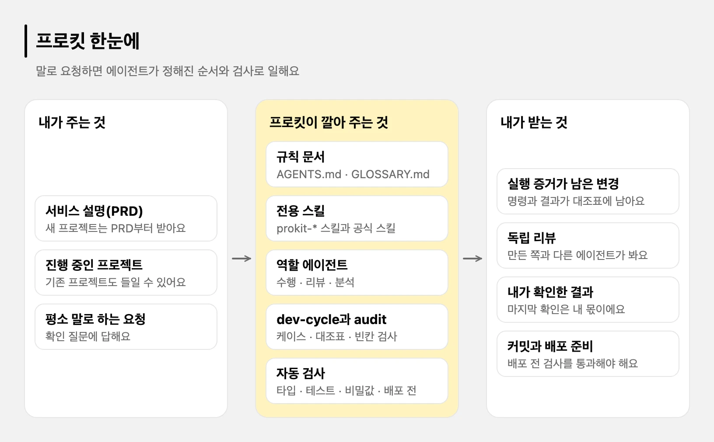
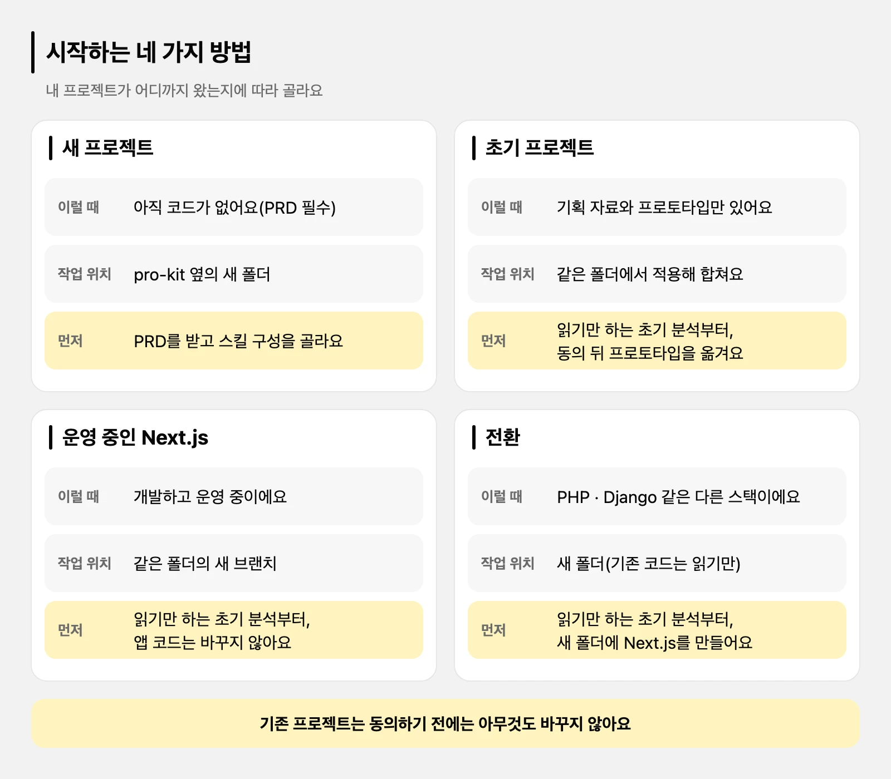
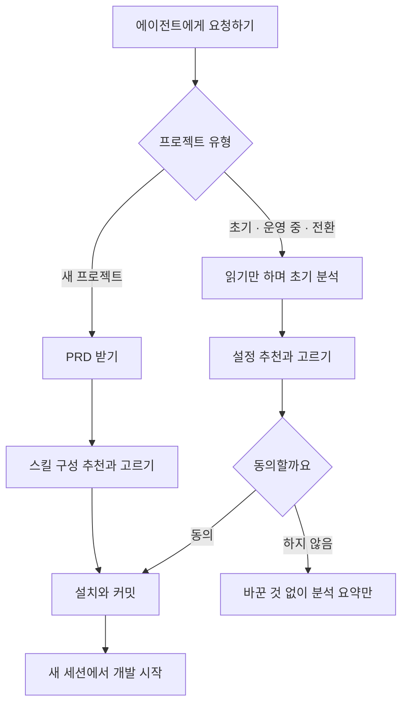
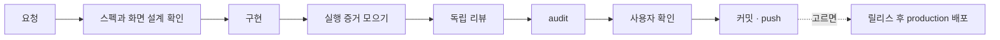

# 프로킷이란

> 한눈에: 프로킷(pro-kit)은 Claude Code나 Codex 같은 AI 에이전트가 일할 개발 환경을 프로젝트에 설치해 주는 키트예요. 새 프로젝트는 만들 서비스를 적은 PRD를 먼저 받아, 그 PRD에 맞는 스킬 구성을 추천하고 개발 환경을 만들어요. <!-- edition:pro -->이미 진행하던 프로젝트에도 들일 수 있어요. <!-- /edition -->**설치하면 에이전트가 전문 개발자처럼 정해진 순서와 검사를 지키며 일해요.** 사용자는 평소 말로 요청하고 확인 질문에 답하면 돼요.

## 왜 프로킷이 필요한가요

AI 에이전트에게 "서비스 만들어줘"라고만 하면 겉보기에는 그럴듯한 결과가 나와요. 하지만 처음 쓰는 사람은 그 결과가 정말 동작하는지, 안전한지, 다음 기능을 얹어도 되는지 혼자 판단하기 어려워요. 에이전트도 순서를 자주 건너뛰어요. 테스트를 돌리지 않고 완료했다고 하거나, 내가 보기도 전에 다음 기능으로 넘어가고, 새 세션을 열면 프로젝트를 잊어요. 아래 "그냥 AI에게 맡길 때와 다른 점" 표가 이런 일을 하나씩 보여 줘요.

**프로킷은 이 문제를 사람의 주의력이 아니라 장치로 풀어요.** 프로 개발자의 일하는 순서와 검사 습관을 에이전트가 읽는 규칙과 스킬(작업 설명서), 자동 검사로 프로젝트에 미리 넣어 둬요. 이런 규칙, 스킬, 자동 검사의 묶음을 하네스(harness, 말에 씌우는 마구처럼 에이전트가 정해진 길로 일하게 하는 장치)라고 불러요([하네스 엔지니어링](../concepts/harness.md)).

프로킷이 에이전트에게 지키게 하는 것은 이래요.

- 만들기 전에 스펙(기능의 범위와 동작)과 화면 설계를 보여 주고 확인받아요.
- 실제로 실행한 증거가 없으면 완료라고 하지 않아요.
- 만든 에이전트가 아닌 다른 에이전트가 리뷰해요.
- 마지막 결과 확인은 내가 해요. 에이전트가 대신하거나 건너뛰지 못해요.
- 데이터 보안, <!-- edition:pro -->DB 변경 순서, <!-- /edition -->비밀값, 배포 같은 위험한 일에는 안전 절차가 따라붙어요.
- 새 세션에서도 프로젝트 기록을 읽고 이어서 일해요.

그래서 **사용자는 코드를 몰라도 평소 말로 요청하고, 질문에 답하고, 결과를 확인하는 일만 하면 돼요.** 이 쪽만으로는 전체를 알기 어려우니, 처음이면 아래 순서로 읽어요.

## 처음이면 이 순서로

| 순서 | 쪽 | 무엇을 알게 되나요 |
|---|---|---|
| 1 | [이런 분께 추천해요](who-is-it-for.md) | 내게 맞는지, 어떤 사례가 있는지 |
| 2 | [처음 한 시간](first-hour.md) | 처음 열어서 첫 결과를 확인하기까지의 흐름 |
| 3 | [준비물](requirements.md), [지원하는 에이전트](supported-agents.md) | 설치할 것과 고를 에이전트 |
| 4 | [PRD 먼저 정하기](prd.md) | 만들 서비스를 한두 문장으로 적기 |
| 5 | [화면만 만들기](quickstart-screens.md), <!-- edition:pro -->[서비스 만들기](quickstart-service.md), <!-- /edition -->[프리셋 팩으로 시작하기](quickstart-pack.md) | 내 상황에 맞는 시작 방법 하나 |
| 6 | [만든 뒤 개발하기](after-create.md), [요청하고 이어 가는 법](ask-well.md) | 평소 요청하는 법, 멈췄을 때 이어 가는 법 |
| 7 | [하네스 엔지니어링](../concepts/harness.md), [dev-cycle 라운드](../concepts/dev-cycle.md) | 에이전트가 왜 그 순서로 일하는지(더 알고 싶을 때) |

이미 진행하던 프로젝트가 있다면 5번 대신 [기존 프로젝트에 도입하기](adopt.md)를 읽어요. <!-- edition:pro -->

## 무엇이 들어 있나요

pro-kit 저장소는 새 프로젝트를 만들어 주는 생성기예요. 안에는 <!-- edition:pro -->템플릿 <!-- v:templates.count.ko -->두<!-- /v --> 개와<!-- /edition --><!-- edition:ui 템플릿 한 개와 --> 학습 자료가 있어요.

| 들어 있는 것 | 하는 일 |
|---|---|
| [prokit-next-neon](../../templates/prokit-next-neon/README.md) | 운영 DB가 Neon인 프로젝트용 템플릿 |
| [prokit-next-supabase](../../templates/prokit-next-supabase/README.md) | 운영 DB가 Supabase인 프로젝트용 템플릿 |
| [튜토리얼](../../tutorials/README.md) | 코드를 몰라도 프롬프트를 붙여 넣으며 서비스를 만들어 보는 단계별 안내 |

템플릿 <!-- v:templates.count.ko -->두<!-- /v --> 개는 앱 코드 구성이 같고 운영 DB만 달라요. 고르는 법은 [템플릿 고르기](../templates/choose.md)에 있어요. <!-- edition:pro -->

템플릿은 [Better-T-Stack](../templates/what-it-adds.md)으로 만든 Next.js 풀스택 앱 위에 설치돼요. 설치하면 앱 뼈대에 다음이 더해져요.

- 프로젝트 전용 스킬 <!-- edition:pro --><!-- v:prokit.skills.count -->10<!-- /v --><!-- /edition --><!-- edition:ui 6 -->개
- 에이전트 <!-- edition:pro -->세<!-- /edition --><!-- edition:ui 두 --> 종류
  - 외부 전문 스킬을 연결해 구현을 맡는 수행 에이전트
  - 구현에 참여하지 않은 독립 리뷰 에이전트
  - 기존 프로젝트를 읽기만 하며 분석하는 정밀 분석 에이전트(`prokit-analyzer`) <!-- edition:pro -->
- 빌드 캐시, 설치 패키지, Python 실행환경, 관리 임시 폴더를 감시하는 자원 보호 도구
- 작업마다 확인 결과를 남기는 dev-cycle(작업을 한 번 돌리는 절차와 도구)
- 큰 일을 Task(나눈 작업 조각)로 나눠 앞 Task가 끝나야 다음을 여는 진행 계획 <!-- edition:pro -->
- 스타일 추천부터 `DESIGN.md`까지 이어지는 UI/UX 흐름
- 내 컴퓨터의 Vercel CLI로 develop과 운영에 배포하는 스크립트와 절차 <!-- edition:pro -->
- 에이전트가 쓰는 공식 스킬과 플러그인(그때의 최신판)
- 프로젝트마다 고르는 두뇌(하나를 추천하고 여럿도 고를 수 있어요)와 과설계 방지 스킬. 고르지 않으면 지금 에이전트가 내장 절차로 진행해요([두뇌와 선택 스킬](../skills/brains.md))
- 필요할 때 더하는 선택 스킬 묶음(<!-- v:optional.namesCode -->`ops`, `motion`, `mobile`, `i-have-adhd`, `taste`<!-- /v -->)



```text
projects/
├── pro-kit/            이 저장소 (생성기). 여기서 요청한다
└── my-app/             새 프로젝트. 개발은 여기서 한다
```

프로킷은 작업에 맞는 공식 스킬뿐 아니라 사용자가 지정한 스킬과 프로젝트별 스킬에도 일을 맡겨요. 코디네이터(지금 내가 대화하는 메인 에이전트)는 작업 범위와 진행을 관리하고, 결과의 증거를 확인해 수정 지시와 최종 검수를 해요. 스킬 선택과 설치·배포 권한은 따로 다뤄요([위임과 자원 관리](../concepts/delegation-and-resources.md)).

프로젝트에 설치되는 파일은 이렇게 놓여요. 앱 코드(`apps/`, `packages/`)는 Better-T-Stack이 만든 것이고, **프로킷은 규칙과 도구를 더해요.**

<!-- edition:pro -->
```text
my-app/
├── AGENTS.md · CLAUDE.md          프로젝트 규칙(에이전트가 시작할 때 읽어요)
├── GLOSSARY.md                    용어집
├── .dev-cycle.json                dev-cycle 설정(두뇌·과설계 방지 스킬 기록 포함)
├── skills.manifest.json           설치할 스킬과 플러그인 목록
├── .agents/skills/prokit-*        프로젝트 전용 스킬
├── .claude/agents/                prokit-implementer · prokit-reviewer · specialist-reviewer · prokit-analyzer
├── scripts/                       dev-cycle, 자원 보호, 배포(vercel-deploy), 릴리스, HTML 내보내기 같은 도구
├── docs/                          dev-workflow.md(케이스별 절차), domain/project.md, adr/
└── tasks/                         todo.md(백로그), archive/(끝난 라운드 기록)
```
<!-- /edition -->
<!-- edition:ui
```text
my-app/
├── AGENTS.md · CLAUDE.md          프로젝트 규칙(에이전트가 시작할 때 읽어요)
├── GLOSSARY.md                    용어집
├── .dev-cycle.json                dev-cycle 설정(두뇌·과설계 방지 스킬 기록 포함)
├── skills.manifest.json           설치할 스킬과 플러그인 목록
├── .agents/skills/prokit-*        프로젝트 전용 스킬
├── .claude/agents/                prokit-implementer · prokit-reviewer · specialist-reviewer
├── scripts/                       dev-cycle, 자원 보호, 배포(vercel-deploy), 릴리스, HTML 내보내기 같은 도구
├── docs/                          dev-workflow.md(케이스별 절차), domain/project.md, adr/
└── tasks/                         todo.md(백로그), archive/(끝난 라운드 기록)
```
-->

<!-- edition:pro -->
## 시작하는 네 가지 방법

프로킷은 어떤 프로젝트냐에 따라 시작하는 방법이 달라요. 요청에서 유형이 분명하지 않으면 **에이전트가 먼저 물어요.**





| 유형 | 이런 때 | PRD | 어디에 만들어요 |
|---|---|---|---|
| 새 프로젝트 | 아직 코드가 없어요. 화면만 먼저 만들 수도 있어요 | 필수 | pro-kit 옆의 새 폴더 |
| 초기 프로젝트 | PRD, 화면 정의서, 프로토타입만 있어요 | 없어도 돼요 | 같은 폴더(작업 브랜치에서 적용해 합쳐요) |
| 운영 중인 Next.js | 개발하고 운영 중이에요 | 없어도 돼요 | 같은 폴더의 새 브랜치. 앱 코드는 바꾸지 않아요 |
| 전환 | PHP, Django 같은 다른 스택의 서비스를 Next.js로 옮겨요 | 없어도 돼요 | 새 폴더. 기존 코드는 읽기만 해요 |

새 프로젝트는 PRD로 템플릿과 스킬 구성을 추천받고, 앱 뼈대 생성, 템플릿 설치, 로컬 DB, 첫 마이그레이션, 커밋까지 이어져요([빠른 시작: 서비스 만들기](quickstart-service.md), [화면만 만들기](quickstart-screens.md)). 기존 프로젝트는 동의를 받기 전에는 아무것도 바꾸지 않아요([기존 프로젝트에 도입하기](adopt.md)).
<!-- /edition -->
<!-- edition:ui ## 시작하는 방법 -->

<!-- edition:ui 새 프로젝트는 PRD로 스킬 구성을 추천받고, 앱 뼈대 생성과 템플릿 설치, 커밋까지 이어져요. 화면만 먼저 만들 수도 있어요([빠른 시작: 화면만 만들기](quickstart-screens.md)). -->

스킬 구성은 PRD<!-- edition:pro -->나 초기 분석으<!-- /edition -->로 추천받아 고르고, 나중에 바꿀 수도 있어요.

| 고르는 것 | 선택지 |
|---|---|
| 두뇌 | 요구 정리, 계획, 구현 진행의 방법을 주도하는 스킬이에요. superpowers, agent-skills, gstack, oh-my, pstack, mattpocock, openspec, spec-kit, compound-engineering 중 하나를 권하고 여럿도 고를 수 있어요. 고르지 않으면(`none`) 지금 에이전트가 내장 절차로 진행해요 |
| 과설계 방지 스킬 | ponytail(추천), caveman, karpathy 중 하나. 고르지 않으면 내장 간결성 규칙을 따라요 |
| 더하는 것 | mattpocock 추가 스킬, 응답 방식(`i-have-adhd`), 화면 디자인 보조(`taste`) |

두뇌와 과설계 방지 스킬은 일하는 방식만 바꿔요. 대조표, 리뷰 게이트, 배포 절차는 무엇을 골라도 같아요([두뇌와 선택 스킬](../skills/brains.md)).

## 요청이 배포까지 가는 길

프로젝트가 만들어진 뒤에는 새 프로젝트 폴더에서 연 세션에서 평소 말로 요청해요. <!-- edition:pro -->큰 일은 먼저 Task로 나누고(기존 프로젝트는 정밀 분석부터), Task마다<!-- /edition --><!-- edition:ui 요청마다 --> 아래 라운드를 한 번씩 돌려요.

<!-- edition:pro -->

<!-- /edition -->
<!-- edition:ui 요청은 스펙과 화면 설계 확인, 구현, 실행 증거 모으기, 독립 리뷰, audit, 사용자 확인, 커밋 순서로 가요. -->

- 대조표(할 일 목록)의 칸마다 실행한 증거가 있어야 `audit`(칸이 다 채워졌는지 검사하는 명령)을 통과하고, **마지막 사용자 확인은 건너뛸 수 없어요**([dev-cycle 라운드](../concepts/dev-cycle.md), [증거와 audit, 사용자 확인](../concepts/audit-and-confirm.md)).
- develop 배포는 요청할 때, production 배포는 릴리스(버전 태그, 노트, GitHub Release)를 만든 커밋만 해요([Vercel 배포와 되돌리기](../deploy/vercel.md), [버전과 릴리스](../deploy/release.md)). <!-- edition:pro -->
- 큰 일의 Task 순서와 게이트는 [정밀 분석과 진행 계획](../concepts/project-plan.md)에 있어요. <!-- edition:ui - 배포는 요청할 때만 하고, 올리기 전에 검사를 통과해야 해요. --> <!-- edition:pro -->

## 새 프로젝트는 PRD부터 정해요

프로킷은 새 프로젝트를 만들기 전에 PRD를 읽어요. <!-- edition:pro -->로그인과 DB가 필요한지로 템플릿을 정하고, <!-- /edition -->진행을 이끄는 두뇌와 추가 스킬, 화면 디자인 보조를 PRD에 맞춰 추천한 뒤 고른 대로 설치해요.

> [!IMPORTANT]
> 새 프로젝트는 PRD가 없으면 추천할 근거가 없어서 만들지 않아요.

PRD는 누가 쓰는지와 무엇을 할 수 있는지 몇 줄이면 돼요. 적을 것과 주는 법은 [PRD 먼저 정하기](prd.md)에 있어요.

<!-- edition:pro -->
## 이미 진행하던 프로젝트도 들일 수 있어요

PRD, 화면 정의서, 프로토타입만 있는 초기 프로젝트, 운영 중인 Next.js 프로젝트, 다른 언어나 프레임워크에서 Next.js로 옮기는 전환 프로젝트가 대상이에요. 이 경우에는 PRD가 없어도 돼요. 에이전트가 프로젝트를 읽기만 하며 분석하고 맞는 설정을 추천해요. **동의하기 전에는 프로젝트를 바꾸지 않아요.** 자세한 흐름은 [기존 프로젝트에 도입하기](adopt.md)에 있어요.
<!-- /edition -->

## 누구나 전문 개발자처럼

전문 개발자와 초보자는 코드를 쓰는 속도보다 일하는 순서와 확인하는 습관이 달라요. AI 에이전트에게 그냥 맡기면 이 단계를 자주 건너뛰어요. 프로킷은 그 습관을 스킬, 에이전트, 자동 검사로 프로젝트에 넣어 두었어요. **사용자가 절차를 몰라도 에이전트가 같은 절차를 따라요.**

| 전문 개발자라면 | 프로킷에서 에이전트가 하는 일 |
|---|---|
| 만들기 전에 요구사항과 화면을 정리해요 | 스펙과 화면 설계를 먼저 보여 주고 확인을 받은 뒤 구현해요<!-- edition:pro -->. 큰 일은 진행 계획(Task 목록)으로 먼저 나눠요<!-- /edition --> |
| 디자인 시스템을 정하고 지켜요 | 첫 화면을 만들기 전에 어울리는 디자인 스타일 1\~3위를 추천받아 `DESIGN.md` 파일 하나에 정해 둬요. 새 세션도 이 파일을 따라요 |
| 직접 돌려 보고 나서 끝났다고 해요 | 타입 검사, 테스트, 화면 스크린샷을 실제로 실행한 증거(명령과 결과)가 모여야 `audit`을 통과해요. 브라우저 콘솔과 서버 로그의 오류는 0개여야 해요 |
| 다른 사람에게 코드 리뷰를 받아요 | 구현에 참여하지 않은 읽기 전용 리뷰 에이전트(`prokit-reviewer`)가 코드, 보안, DB를 따로 살펴봐요. 고른 과설계 방지 스킬(예: `ponytail-review`)이나 리뷰어가 불필요한 복잡도도 점검해요 |
| 보안과 데이터를 지켜요 | 서버에서 로그인과 데이터 주인을 확인하고, 계정 두 개로 남의 데이터에 접근할 수 없는지 테스트해요. DB는 마이그레이션 파일로만 바꿔요 | <!-- edition:pro -->
| 배포는 확인하며 해요 | 배포 전 검사를 통과해야만 배포해요. 비밀값이 새지 않게 막고, 되돌리는 명령을 알려 줘요 | <!-- edition:ui | 배포는 확인하며 해요 | 내보낸 HTML에 비밀값이 섞이지 않았는지 검사한 뒤 올려요 | --> <!-- edition:pro -->
| 프로젝트 맥락을 기억해요 | 용어집(`GLOSSARY.md`)과 프로젝트 소개(`docs/domain/project.md`)를 작업마다 읽고 고쳐요. 새 세션에서 프로젝트를 다시 설명하지 않아도 돼요 |

> [!IMPORTANT]
> 사용자는 확인 질문에 답하고 결과를 확인해요. <!-- edition:pro -->릴리스와 <!-- /edition -->배포처럼 되돌리기 어려운 일만 직접 결정해요.

## 그냥 AI에게 맡길 때와 다른 점

| 흔히 생기는 일 | 프로킷에서 |
|---|---|
| 사용자가 결과를 보기도 전에 다음 기능으로 넘어가요 | 대조표의 마지막 행이 사용자 확인이라서 확인해야 라운드가 끝나요. 이 행은 N/A(해당 없음)로 넘길 수 없어요<!-- edition:pro -->. 큰 일은 진행 계획의 앞 Task가 끝나야 다음 Task를 열어요<!-- /edition --> |
| 테스트를 돌리지 않고 "완료했습니다"라고 해요 | 대조표의 모든 칸에 실행한 명령과 결과가 있어야 `audit`이 통과해요. 통과하기 전에는 완료라고 하지 않아요 |
| 로그인만 확인하고 다른 사람 데이터를 보여 주는 API | 데이터 주인은 로그인 세션에서만 알아내요. 계정 두 개로 서로의 데이터에 접근할 수 없는지 테스트해요 | <!-- edition:pro -->
| 운영 DB 구조를 바로 바꿔 데이터를 잃어요 | 마이그레이션 파일을 만들어 로컬에서 먼저 적용해요. 컬럼 삭제와 이름 변경은 두 번에 나눠요. 운영 DB는 요청할 때만 다뤄요 | <!-- edition:pro -->
| 매번 다른 모양, 기본 컴포넌트 그대로인 화면 | 첫 화면 전에 디자인 스타일을 골라 `DESIGN.md`로 정해 두고, 코드 전에 화면 설계를 확인받아요. 만든 뒤에는 스크린샷과 디자인·접근성 점수로 검사해요. 점수만 적어서는 통과하지 못하고, 이번 라운드에 실행한 리뷰 기록 파일이 있어야 해요 |
| 자기가 짠 코드를 자기가 검토해요 | 읽기 전용 `prokit-reviewer`가 따로 검토하고, 리뷰 칸은 그 결과로만 채워요 |
| 새 세션마다 프로젝트를 다시 설명해야 해요 | 시작할 때 `AGENTS.md`, `GLOSSARY.md`, `docs/domain/project.md`를 읽어요. 라운드마다 두 문서에 바꿀 내용이 있는지 확인해 고쳐요 |
| 막힌 단계를 조용히 건너뛰어요 | 실행하지 못한 검사는 `blocked: 사유`로 남기고 "부분 완료"로 보고해요. 그런 라운드는 사용자가 동의해야 끝나요 |
| 콘솔 오류를 "브라우저 확장 탓"이라며 넘겨요 | 오류 예산이 0이에요. 확장 프로그램 탓처럼 보여도 깨끗한 브라우저에서 원인을 가려내고, 사용자 브라우저에도 보이면 고쳐요 |
| 쓰지 않을 기능과 복잡한 구조까지 만들어요 | 스펙에 "만들지 않는 것" 절을 두고, 기획·계획에는 재사용 순서와 독립 리뷰를 적용하고, 구현 diff의 불필요한 복잡도는 고른 과설계 방지 스킬(ponytail 추천)이나 리뷰어가 확인해요 |
| 비슷한 기능마다 같은 코드와 설정을 새로 만들어요 | 기획 때 기존 코드, 공통 설정과 환경 변수의 원본을 먼저 찾아요. 실제로 함께 쓸 부분만 재사용하고, 흐름이 다른 독립 앱은 억지로 합치지 않아요 |
| 캐시와 설치 환경이 커져 디스크를 채워요 | 관리 명령이 용량과 여유 공간을 확인하고 예산을 넘으면 새 무거운 작업을 막아요. 큰 설치 환경을 크기만 보고 지우지는 않아요 |
| 미룬 리뷰 지적이 닫힌 기록 속에 묻혀요 | 라운드를 닫기 전에 미룬 지적을 `tasks/todo.md`의 백로그(할 일 목록)로 옮겨요 |
| 배포하면서 로컬 `.env`의 비밀값까지 올리거나 `.env.production`에 운영 키를 적어 둬요 | `.vercelignore`가 로컬 `.env`를 빼고, 배포 값은 Vercel 환경변수에만 둬요. 배포 스크립트의 검사를 통과해야 배포해요. 커밋 전에는 `pnpm dev-cycle secrets`가 커밋할 변경에서 비밀값을 찾아요 |

## 자세히

- **지원하는 에이전트**: <!-- v:agents.list -->Claude Code, Codex, Antigravity, Grok Build<!-- /v -->예요. 도구마다 읽는 파일과 여는 명령은 [지원하는 에이전트](supported-agents.md), Claude Code와 Codex의 조작 차이는 [Claude Code와 Codex](../../tutorials/reference/claude-code-and-codex.md)에 있어요.
- **스킬이 결과를 바꾸나요**: 같은 요청을 스킬이 있을 때와 없을 때로 나눠 비교했어요. 규칙을 지킨 비율이 작업 진행(`prokit-dev-cycle`)은 <!-- v:eval.dev-cycle.without -->27<!-- /v -->%에서 <!-- v:eval.dev-cycle.with -->93<!-- /v -->%로, 화면 설계(`prokit-ui`)는 <!-- v:eval.ui.without -->12<!-- /v -->%에서 <!-- v:eval.ui.with -->100<!-- /v -->%로 올랐어요. 골라 둔 `DESIGN.md`가 있으면 목표 디자인과 팔레트가 맞는 비율이 <!-- v:eval.designMd.palette.without -->71<!-- /v -->%에서 <!-- v:eval.designMd.palette.with -->99<!-- /v -->%로 올랐어요. <!-- edition:pro -->측정 방법은 [검증 결과](../reference/verification.md)에 있어요.<!-- /edition -->
- **만든 것**: 프로킷으로 만든 프리셋 <!-- edition:pro --><!-- v:presets.count -->16<!-- /v --><!-- /edition --><!-- edition:ui 11 -->개(랜딩페이지 <!-- v:presets.landing.count -->9<!-- /v -->개, 앱 화면 <!-- v:presets.app.count -->5<!-- /v -->개<!-- edition:pro -->, 클론 코딩 <!-- v:presets.clone.count -->2<!-- /v -->개<!-- /edition -->)를 [프로킷 사이트](https://prokit.highvalue.kr/)에서 모든 페이지까지 열어 볼 수 있어요.
- **라이선스**: [MIT](../../LICENSE)예요. 상업 이용·유료 고객 개발·수정·재판매를 허용하며 저작권 표시와 허가문을 보존해야 해요. 사이트의 홍보용 제작 표시는 선택 사항이고, [외부 구성 요소](../../THIRD_PARTY_NOTICES.md)에는 원래 조건을 적용해요.

## 관련 문서

- [처음 한 시간](first-hour.md)
- [요청하고 이어 가는 법](ask-well.md)
- [프리셋 팩으로 시작하기](quickstart-pack.md)
- [이런 분께 추천해요](who-is-it-for.md)
- [준비물](requirements.md)
- [PRD 먼저 정하기](prd.md)
- [기존 프로젝트에 도입하기](adopt.md) <!-- edition:pro -->
- [빠른 시작: 화면만 만들기](quickstart-screens.md)
- [빠른 시작: 서비스 만들기](quickstart-service.md) <!-- edition:pro -->
- [하네스 엔지니어링](../concepts/harness.md)
- [위임과 자원 관리](../concepts/delegation-and-resources.md)
- [튜토리얼](../../tutorials/README.md)
