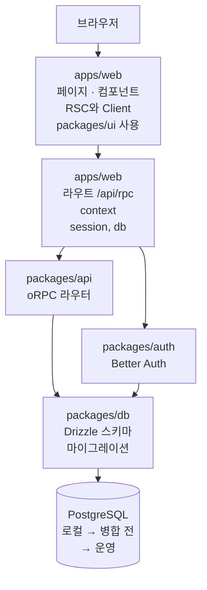

# 앱 구조

> 한눈에: 프로킷으로 만든 앱은 웹 앱 하나와 여럿이 함께 쓰는 부품 묶음(패키지)으로 나뉘어요.<!-- edition:pro --> 화면이 서버에 요청을 보내면 서버가 로그인 정보를 확인한 뒤 DB를 읽고 써요. 다른 사람의 데이터는 로그인한 사용자 정보로 걸러 내요.<!-- /edition --> <!-- edition:ui 화면만 만드는 프로젝트는 `apps/web`과 `packages/ui`를 고쳐요. 서버 폴더와 DB 폴더는 만들어지지만 쓰지 않아요. -->

<!-- edition:pro -->
## 요청이 오가는 길

화면은 oRPC 클라이언트로 `/api/rpc`에 요청을 보내요. 라우트 핸들러는 요청마다 Better Auth 세션을 읽어 oRPC 라우터가 쓸 context(`session`, `db`)를 만들어요. 사용자 데이터를 다루는 프로시저는 `protectedProcedure`로 로그인 세션을 요구하고, 데이터 주인은 세션의 사용자 ID로 확인해요.

> [!IMPORTANT]
> 데이터 주인은 로그인 세션에서만 알아내요. 입력으로 받은 사용자 ID를 믿지 않고, 계정 두 개로 서로의 데이터에 접근할 수 없는지 테스트해요(2계정 격리 테스트, 케이스 D).

- **`/api/rpc`**: 화면이 oRPC 클라이언트로 요청을 보내는 곳이에요. `packages/auth`로 세션을 조회해요.
- **`/api/auth`**: `apps/web`에 있는 인증 라우트예요. 곧바로 `packages/auth`를 불러요.

<!-- /edition -->

| 위치 | 하는 일 | 맡는 prokit 스킬 |
|---|---|---|
| `apps/web` | Next.js App Router 화면과 라우트 핸들러(`/api/rpc`, `/api/auth`) | <!-- edition:pro -->`prokit-web`, <!-- /edition -->`prokit-ui` |
| `packages/ui` | 화면에서 함께 쓰는 shadcn 컴포넌트 | `prokit-ui` |
| `packages/api` | oRPC 라우터와 프로시저. 로그인이 필요한 프로시저는 `protectedProcedure` | `prokit-api` | <!-- edition:pro -->
| `packages/auth` | Better Auth 설정 | `prokit-api` | <!-- edition:pro -->
| `packages/db` | Drizzle 스키마와 마이그레이션 | `prokit-db` | <!-- edition:ui | `packages/api`, `packages/auth`, `packages/db` | 서버와 DB 폴더예요. 화면만 만드는 프로젝트에서는 쓰지 않아요 | 없음 | --> <!-- edition:pro -->
| `packages/config` | 앱과 패키지가 함께 쓰는 공유 설정(tsconfig) | 없음 |

계층마다 고치는 에이전트도 달라요. 화면(`apps/web`의 화면 파일, `packages/ui`)은 `prokit-ui-builder`<!-- edition:pro -->, 서버·API(`packages/api`, `packages/auth`, `apps/web/src/app/api/`)는 `prokit-api-builder`, DB(`packages/db`)는 `prokit-db-builder`<!-- /edition -->가 맡아요. 열린 라운드에서 메인 세션이나 다른 계층 에이전트가 이 파일들을 고치려 하면 훅이 막아요([위임 에이전트와 리뷰 에이전트](../concepts/agent-roles.md)).

## 내 요청은 어디를 바꾸나

> [!TIP]
> 처음에는 폴더 이름을 몰라도 돼요. “할 일에 마감일 붙여줘”처럼 말하면 에이전트가 아래 위치 가운데 필요한 곳을 골라 고치고, 그 위치에 맞는 스킬을 읽어요.

| 이런 요청 | 바뀌는 곳 |
|---|---|
| 화면 모양, 문구, 버튼 | `apps/web`, `packages/ui` |
| 서버에 새 기능(데이터 저장, 조회) | `packages/api` | <!-- edition:pro -->
| 로그인, 권한 | `packages/auth`, `packages/api` | <!-- edition:pro -->
| 저장하는 데이터 항목 추가 | `packages/db`(마이그레이션 파일이 생겨요) | <!-- edition:pro -->

<!-- edition:pro -->
> [!WARNING]
> 데이터를 잃을 수 있는 변경(컬럼 삭제, 이름 변경)은 두 번에 나눠요.
<!-- /edition -->

<!-- edition:pro -->
용어 풀이: oRPC는 화면이 서버 기능을 함수처럼 부르게 하는 도구, Better Auth는 로그인 도구, Drizzle은 DB를 코드로 다루는 도구예요. 프로시저는 서버에 만들어 두고 화면이 부르는 기능 하나예요([용어](../../tutorials/reference/glossary.md#만들기)). 서버 컴포넌트(RSC)는 화면 일부를 서버에서 그려 보내는 Next.js 방식이에요.
<!-- /edition -->

## 자세히

- **DB는 마이그레이션으로만 바꿔요**: 스키마를 고치면 마이그레이션 파일을 만들어 로컬 → 병합 전 → 운영 순서로 적용해요. <!-- edition:pro -->
- **같은 드라이버**: <!-- v:templates.count.ko -->두<!-- /v --> 템플릿 모두 일반 Postgres 드라이버(`pg`)를 써서 로컬 DB와 원격 DB(Neon, Supabase)에 같은 코드로 붙어요. <!-- edition:pro -->
- **로그인 경로는 보안 리뷰**: `packages/auth`, `apps/web/src/app/api/auth/` 같은 인증 경로를 건드리면 대조표에 보안 리뷰 행이 자동으로 붙어요([케이스 <!-- v:devCycle.cases.range -->A\~F·H<!-- /v -->와 대조표](../concepts/cases.md)). <!-- edition:pro -->
- **Next.js 문서**: 에이전트는 설치된 Next.js 판의 문서(`node_modules/next/dist/docs`)를 먼저 읽어요. 학습한 옛 API를 그대로 쓰는 일을 줄이려는 거예요.

## 관련 문서

- [템플릿이 더하는 것](what-it-adds.md)
- [prokit 스킬](../skills/prokit-skills.md)
- [설치된 프로젝트의 폴더 구조](../reference/project-structure.md)
- [케이스 <!-- v:devCycle.cases.range -->A\~F·H<!-- /v -->와 대조표](../concepts/cases.md)
