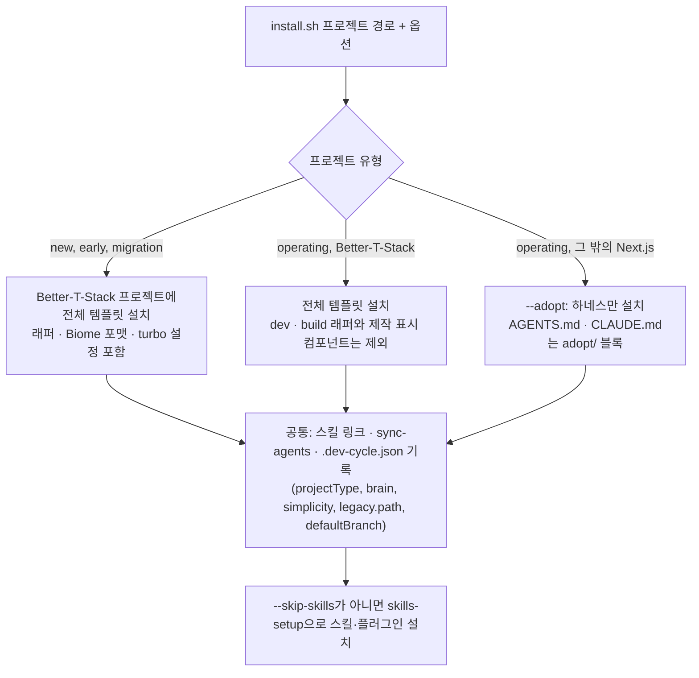

# 설치기와 옵션

> 한눈에: 템플릿은 명령 하나로 새 프로젝트에 설치돼요. 이미 진행하던 프로젝트에도 유형 옵션으로 설치할 수 있어요. 이미 있는 파일은 건드리지 않고, 여러 번 실행해도 결과가 같아요. 설치한 뒤에는 DB 준비, 코드 정리와 저장(커밋), 새 대화 열기 순서로 마무리해요.

## 직접 실행할 일은 거의 없어요

새 프로젝트를 만들거나 기존 프로젝트에 들일 때는 에이전트(`prokit-init` 스킬)가 이 설치기를 알아서 실행하고 옵션도 골라요. 이 쪽은 그 명령이 무엇을 하는지 알고 싶거나, 설치기를 직접 실행해야 할 때(팀원이 클론한 뒤, 에러가 났을 때, 옵션을 바꿔 다시 실행할 때) 찾아보는 참고 쪽이에요. 처음이라면 [빠른 시작: 서비스 만들기](../start/quickstart-service.md)부터 따라 하세요. 설치기는 이미 있는 파일을 건드리지 않고 여러 번 실행해도 결과가 같아서, 실행해 보고 틀리면 다시 실행해도 안전해요.

## 실행하기

```bash
bash <pro-kit>/templates/prokit-next-neon/install.sh my-app       # supabase면 prokit-next-supabase
```

| 옵션 | 동작 |
|---|---|
| (없음) | 파일 복사, `package.json` 스크립트 추가, Claude Code 키 훅(`.claude/settings.json`) 추가, 이 프로젝트에 스킬·플러그인 설치(두뇌·과설계 방지 스킬은 없음), agent-browser CLI(<!-- v:policy.agentBrowser.cell -->없거나 npm 최신판보다 낮으면 기본으로 최신판을 설치<!-- /v -->) |
| `--diff` | 미리 보기예요. 템플릿과 다른 기존 파일의 차이, 복사할 파일, `package.json`·`.gitignore`·`biome.json`·`turbo.json`·`.claude/settings.json`에 더할 항목을 보여 주고, 파일은 쓰지 않아요. 스킬·플러그인도 설치하지 않아요 |
| `--skip-skills` | 스킬·플러그인·OMX 설치와 agent-browser CLI 자동 설치를 건너뛰어요. 고른 두뇌·과설계 방지 스킬은 `.dev-cycle.json`에 기록만 하고, 나중에 `pnpm skills:setup`이 설치해요 |
| `--brain <이름>[,…]` | 두뇌를 골라요. 여러 개는 쉼표로 잇고 첫 번째가 주 두뇌예요(<!-- v:brains.names -->superpowers, agent-skills, pstack, gstack, oh-my, mattpocock, openspec, spec-kit, compound-engineering<!-- /v -->). 기본은 `none`이에요 |
| `--simplicity <이름>` | 과설계 방지 스킬을 하나 골라요(ponytail, caveman, karpathy). 기본은 `none`이에요 |
| `--matt <스킬>`, `--optional <묶음>` | mattpocock 추가 스킬과 선택 스킬 묶음(i-have-adhd, taste 포함)을 설치해요. 여러 개는 쉼표로 이어요 |
| `--project-type <유형>` | 프로젝트 유형을 `.dev-cycle.json`의 `projectType`에 기록해요. `new`(새 프로젝트), `early`(기획 자료와 프로토타입만 있는 초기), `operating`(운영 중), `migration`(다른 스택에서 전환). `early`는 옮겨 둔 `prototype/`을 Biome 검사에서 빼요 |
| `--legacy <경로>` | `migration`에서만 써요. 기존 코드 폴더를 새 프로젝트 기준 상대 경로로 `legacy.path`에 기록해요. 안내용이라 코드는 읽기만 하고, `pnpm dev-cycle status`에 보여 줘요 |
| `--adopt` | `operating`이면서 Better-T-Stack이 아닌 Next.js 프로젝트에 하네스만 설치해요. 아래 "기존 프로젝트에 설치하기"를 보세요 |
| `--default-branch <브랜치>` | dev-cycle의 기준 브랜치를 기록해요. 기존 프로젝트를 `prokit/setup` 브랜치에서 들일 때 써요(합칠 기본 브랜치, 또는 도입 브랜치에서 계속하면 `prokit/setup`) |
| `--with-global` | 전역 도구(agent-browser CLI, Vercel CLI, Neon CLI 또는 Supabase CLI, 고른 두뇌의 gstack·OMX·OpenSpec CLI) 중 없는 것을 설치한 뒤 프로젝트 설치를 이어 가요. ponytail을 골랐으면 지원하는 Codex CLI에서 공식 Ponytail marketplace와 네이티브 플러그인도 선택 설치해요 |

- `AGENTS.md`, `CLAUDE.md`가 이미 있으면 템플릿 블록을 끝에 한 번만 덧붙여요.
- 무엇을 고를지는 [두뇌와 선택 스킬](../skills/brains.md)에 있어요. 모르는 이름을 주면 아무것도 쓰지 않고 멈춰요.
- `--with-global`은 전역 설정과 훅을 바꾸므로 사용자가 전역 도구 설치를 요청할 때만 붙여요. 두뇌 gstack은 bun이 필요하고, 설치하면서 `~/.claude/settings.json`에 전역 훅을 등록해요. Codex Ponytail은 지원하는 CLI에만 설치하고, 이미 비활성화했거나 다른 출처로 설치한 플러그인은 바꾸지 않아요. 설치 성공은 훅 신뢰나 자동 실행을 뜻하지 않아요. `--with-global`은 Supabase CLI를 Homebrew로만 설치해요.
- `--project-type`, `--legacy`, `--default-branch`는 값을 띄어 써요(`--legacy=경로`처럼 `=`로 이으면 멈춰요). `--adopt`는 `operating`에만, `--legacy`는 `migration`에만 쓸 수 있어요.
- Windows의 PowerShell이나 Git Bash에서 실행하면 WSL2를 안내하고 멈춰요.

## 기존 프로젝트에 설치하기

유형 판단, 분석, 동의, 브랜치까지 에이전트가 이끄는 흐름은 [기존 프로젝트에 도입하기](../start/adopt.md)에 있어요. 설치기 쪽에서는 이렇게 달라요.

| 유형 | 설치 |
|---|---|
| `early` | 같은 폴더에 Better-T-Stack 프로젝트를 만든 뒤 `--project-type early`로 보통처럼 설치해요 |
| `operating`(Better-T-Stack) | 보통 설치에 `--project-type operating`만 더해요. 배포와 CI가 쓰는 `dev`·`build`에는 자원 보호 래퍼를 씌우지 않고, 쓰지 않는 제작 표시 컴포넌트도 더하지 않아요. 이 둘은 필요하면 H 라운드에서 바꿔요 |
| `operating`(그 밖의 Next.js) | `--adopt`. `next`가 루트나 `apps/*`, `packages/*`에 있어야 해요. 없으면 멈춰요 |
| `migration` | 새 폴더에 Better-T-Stack 프로젝트를 만들고 `--project-type migration --legacy <기존 코드 경로>`로 설치해요 |



### 유형별 설치 범위 한눈에

| 유형(설치 옵션) | 설치하는 것 | 설치하지 않거나 바꾸는 것 |
|---|---|---|
| 새 프로젝트(`new` 또는 옵션 없음) | 전체 템플릿: 스킬 10개, 에이전트, dev-cycle과 스크립트 전부(배포, 릴리스, HTML 내보내기 포함), 문서 골격, `licenses/`, `tasks/`, 제작 표시 컴포넌트. `dev`·`build`에 자원 보호 래퍼, Biome 포맷, turbo 설정 | 없음 |
| 초기 프로젝트(`early`) | 새 프로젝트와 같아요. `.dev-cycle.json`에 `projectType: early`를 기록해요 | 옮겨 둔 `prototype/` 폴더는 Biome 검사에서 빼요 |
| 운영 중, Better-T-Stack(`operating`) | 전체 템플릿에서 아래만 빼고 같아요 | `dev`·`build`에 자원 보호 래퍼를 씌우지 않고(배포와 CI가 쓰는 명령), 제작 표시 컴포넌트를 더하지 않아요 |
| 운영 중, 그 밖의 Next.js(`operating --adopt`) | 하네스만: 스킬 6개(`prokit-dev-cycle`, `prokit-verify`, `prokit-web`, `prokit-ui`, `prokit-skills-update`, `prokit-skills-manage`), 스크립트 6개(`dev-cycle`, `delegation`, `resource-guard`, `skills-setup`, `sync-agents`, `load-keys`), `.claude/agents`, `tasks/`, `licenses/`, `AGENTS.md`·`CLAUDE.md`(adopt 블록), `.dev-cycle.json`, `skills.manifest.json`, `GLOSSARY.md`, `docs/dev-workflow.md`, `docs/domain/project.md` | `prokit-api`, `prokit-db`, `prokit-deploy`, `prokit-pack-use`, 배포·릴리스·HTML 내보내기 스크립트와 그 `package.json` 명령(`vercel:deploy`, `export:html`, `release`), `.vercelignore`, `docs/adr/`, 제작 표시 컴포넌트, 자원 보호 래퍼, Biome 포맷, `biome.json`·`turbo.json` 수정. Better-T-Stack 전용 공식 스킬도 건너뛰어요 |
| 전환(`migration`) | 새 프로젝트와 같고(새 폴더에 설치), `legacy.path`에 기존 코드 위치를 적어요 | 기존 코드는 읽기만 하고 바꾸지 않아요 |

위 표의 `.claude/agents`는 에이전트 원본이고, `.codex/agents`와 `.agents/agents`는 설치할 때 `sync-agents`가 이 원본에서 만들어요. 새 프로젝트에서 설치기가 쓰는 파일의 전체 목록은 [설치된 프로젝트의 폴더 구조](../reference/project-structure.md)에 있어요.

`--adopt`는 하네스만 설치해요.

- 하네스 파일(dev-cycle, 두뇌, 리뷰 게이트, 분석 에이전트와 일부 `prokit-*` 스킬)과 `AGENTS.md`·`CLAUDE.md` 블록(템플릿의 `adopt/`)만 복사해요. DB·API·배포 스킬은 설치하지 않아요.
- 자원 보호 래퍼, Better-T-Stack용 `biome.json`·`turbo.json` 수정, Biome 포맷, `vercel:deploy`·`export:html`·`release` 스크립트, `.gitignore`의 `/html/` 줄은 더하지 않아요.
- ESLint flat config(`eslint.config.*`)가 있으면 `globalIgnores`에 벤더 스킬(`.agents/**`)과 하네스 스크립트만 더해요. 그대로 두면 설치만으로 `lint`가 실패해서예요. `globalIgnores([`가 없거나 옛 `.eslintrc`면 직접 더하라고 경고해요. Biome 2 `biome.json`이 있으면 `files.includes`에 하네스·벤더 파일 제외만 더하고, Biome 1이나 `biome.jsonc`면 직접 빼라고 경고해요.
- `package.json`에도 `vercel:deploy`·`export:html`·`release` 스크립트를 더하지 않아요. 그래서 이 프로젝트에는 프로킷의 `pnpm release`와 Vercel 배포 절차가 없고, 라운드는 배포를 묻지 않고 커밋까지 해요([버전과 릴리스](../deploy/release.md), [Vercel 배포와 되돌리기](../deploy/vercel.md)).
- `.dev-cycle.json`에 `adopt: true`와 추정한 경로 규칙(H, E·D·B, 나머지 코드는 F)을 적어요. 정밀 분석 뒤 첫 H Task에서 이 프로젝트에 맞게 고쳐요.
- 그 프로젝트의 패키지 관리자와 타입 검사 스크립트 이름(`check-types`, `typecheck`, `type-check`)을 써요.
- 나중에 `--adopt` 없이 다시 실행해도 adopt 상태를 유지해요.

## 설치한 뒤 할 일

에이전트가 따르는 규칙의 원문은 [AGENTS.md의 "템플릿으로 새 프로젝트 만들기"](../../AGENTS.md#템플릿으로-새-프로젝트-만들기)이고, 명령은 템플릿 README "새 프로젝트 시작"의 "설치한 뒤"([neon](../../templates/prokit-next-neon/README.md#새-프로젝트-시작), [supabase](../../templates/prokit-next-supabase/README.md#새-프로젝트-시작))가 정본이에요.

1. **첫 마이그레이션**: 로컬 DB를 띄우고 `db:generate`로 인증 테이블 마이그레이션을 만든 뒤 `db:migrate`로 적용해요. supabase는 적용 전에 `enable_rls_auth` 커스텀 마이그레이션(인증 테이블의 RLS 켜기)을 더하고, 적용 뒤 `supabase db advisors --local --type security`가 `No issues found`인지 확인해요. Better-T-Stack이 만든 프로젝트 `README.md`의 `db:push` 단계는 따르지 않아요. 화면만 프로젝트는 건너뛰어요.
2. **포맷 정리와 커밋**: `pnpm check`로 Better-T-Stack이 만든 코드의 포맷과 정렬을 한 번 정리하고 `pnpm exec biome check .`가 exit 0인지 봐요. 설치 결과, 포맷 정리, 첫 마이그레이션을 기본 브랜치에 커밋해요.
3. **새 세션 열기**: 스킬과 에이전트는 새 세션부터 보여요. 첫 실행 때 묻는 신뢰 질문에 동의해야 프로젝트 설정이 켜져요. Claude Code는 플러그인, Codex는 에이전트와 프로젝트 스킬, Grok Build는 규칙과 스킬이에요(`grok --trust`로 열면 묻지 않고 신뢰해요). `--with-global`로 Codex Ponytail을 선택 설치했다면 `/hooks`에서 별도로 신뢰한 뒤 새 세션을 열어요. Antigravity는 `AGENTS.md`, `.agents/skills`, `.agents/agents`를 그대로 읽어요([지원하는 에이전트](../start/supported-agents.md#신뢰-질문)).
4. **화면 디자인 검사 켜기**: 개발자마다 한 번, 프로젝트 루트에서 `.agents/skills/impeccable/scripts/impeccable hooks on`을 실행해요. 켠 뒤 `.claude/settings.local.json`의 훅 명령이 `…/scripts/impeccable" hook`인지 확인해요.
5. **프로젝트 소개 채우기**: `GLOSSARY.md`와 `docs/domain/project.md`를 채워요.
6. **첫 요청**: "…을 만들어줘"처럼 요청하면 `prokit-dev-cycle`이 라운드를 열어요([dev-cycle 라운드](../concepts/dev-cycle.md)). 기존 프로젝트를 들였다면 새 세션이 `docs/first-request.md`를 읽고 정밀 분석부터 시작해요([기존 프로젝트에 도입하기](../start/adopt.md)).

## 자세히

### 설치기가 하는 일

- `templates/<템플릿>/files/` 아래 파일(스킬, 에이전트, dev-cycle, 문서 골격, 스크립트)을 프로젝트에 복사해요.
- `package.json`에 스크립트(`dev-cycle`, `skills:*`, `agents:*`, `export:html`, `vercel:deploy` 등)를 더해요.
- 다시 생성되는 파일(마이그레이션, `schema/auth.ts`, varlock의 `src/env.ts`)과 `pnpm export:html`이 만든 `html/`을 `biome.json` 검사 대상에서 빼요.
- 설치된 turbo가 2.11.5 이상이면 `turbo.json`에 `"agentGuidance": false`를 넣어요. turbo가 AI 에이전트를 감지하면 루트 `AGENTS.md`에 규칙 블록을 쓰고 커밋하라고 지시하기 때문이에요.
- `scripts/skills-setup.mjs`로 `skills.manifest.json`의 스킬과 플러그인을 이 프로젝트에 설치해요([설치와 업데이트 구조](../skills/install-and-update.md)). 두뇌는 여럿을 고를 수 있고, openspec·spec-kit·compound-engineering은 그 두뇌를 골랐을 때만 필요한 도구를 받아요.

### 첫 커밋이 중요한 이유

커밋하지 않고 첫 라운드를 열면 설치한 파일 전체가 라운드 diff에 섞여 `audit`이 더 무거운 케이스(템플릿 README의 예는 F)로 올리라고 요구해요. 라운드 기준이 기본 브랜치와의 merge-base라서 기능 브랜치에 커밋해도 마찬가지예요.

### 화면 디자인 검사를 스킬로 켜지 않는 이유

개인(전역) impeccable 스킬이 있을 때 스킬 호출(`$impeccable hooks on`, Claude Code의 `impeccable` 스킬 인자)로 켜면 Claude Code가 그쪽을 불러와 이 프로젝트에 없는 `scripts/hook.mjs`를 훅 명령으로 적어요. 그러면 Stop 훅이 매번 `MODULE_NOT_FOUND`로 실패해요.

### 팀원이 클론했을 때

`pnpm install` 뒤 `pnpm skills:setup`을 한 번 실행해요. 스킬 파일은 이미 커밋돼 있어서 빠진 것만 받아요. 전역 도구까지 맞추려면 `pnpm skills:setup --with-global`, 상태만 보려면 `pnpm skills:check`예요.

## 관련 문서

- [빠른 시작: 서비스 만들기](../start/quickstart-service.md)
- [기존 프로젝트에 도입하기](../start/adopt.md)
- [기존 프로젝트에 갱신 반영](update-existing.md)
- [설치와 업데이트 구조](../skills/install-and-update.md)
- [명령 모음](../reference/commands.md)
