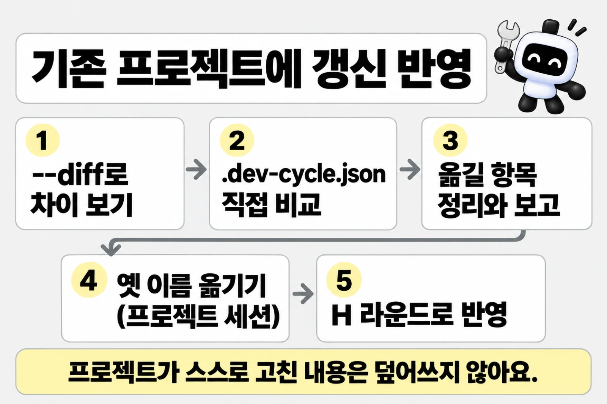
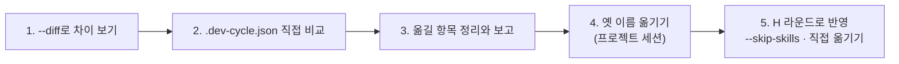

# 기존 프로젝트에 갱신 반영

> 한눈에: 템플릿이 바뀌어도 이미 만든 프로젝트는 그대로예요. 바뀐 내용을 옮기려면 차이를 미리 보고 옮길 것을 정리한 뒤, 그 프로젝트에서 새 대화를 열어 작업 한 번(라운드)으로 반영해요. **그 프로젝트가 스스로 고친 내용은 덮어쓰지 않아요.**

프로킷이 없는 프로젝트에 처음 들이는 일은 "도입"이라 [기존 프로젝트에 도입하기](../start/adopt.md)가 맡아요. 이 쪽은 이미 프로킷이 설치된 프로젝트를 새 판 템플릿에 맞추는 "갱신 반영"만 다뤄요.

## 일반 업데이트 3줄

템플릿이 새 판이 되어도 이미 만든 프로젝트는 저절로 바뀌지 않아요. 대부분은 이 세 가지면 돼요.

1. pro-kit 폴더에서 `git pull --ff-only`로 최신판을 받아요. 로컬 변경이 있어 실패하면 멈추고 알려 달라고 해요.
2. pro-kit 폴더에서 에이전트에게 요청해요: "템플릿 변경을 my-app에 반영해줘". 에이전트가 차이를 미리 보고 옮길 항목을 정리해 보고해요.
3. 그 프로젝트 폴더에서 새 세션을 열어 같은 정리를 넘기고, 작업 한 번(H 라운드)으로 반영하고 확인해요.

요청 예시(복사해서 써요):

```text
템플릿 변경을 my-app에 반영해줘
```

> [!IMPORTANT]
> 에이전트는 파일을 바로 덮어쓰지 않고 "이 파일들이 바뀌었고, 이 항목은 프로젝트가 직접 고친 거라 뺐어요" 같은 정리를 먼저 보여 줘요(예시). 그 정리를 확인한 뒤 프로젝트 세션에서 반영해요.

> [!TIP]
> 막히면 `--diff` 출력과 에러 메시지를 그대로 에이전트에게 붙여 넣어요. 옛 판에서 올라오는 프로젝트라면 아래 "옛 판에서 올 때"를 먼저 봐요.

## 순서

pro-kit 폴더에서 "템플릿 변경을 <프로젝트>에 반영해줘"처럼 요청하면 에이전트가 1\~3번을 하고, 4번과 5번은 그 프로젝트에서 연 세션에서 하도록 안내해요([AGENTS.md](../../AGENTS.md) "기존 프로젝트에 템플릿 갱신 반영").



1. **차이 보기**: `bash templates/<템플릿>/install.sh <프로젝트> --diff`로 차이를 봐요. 파일을 쓰지 않고, 템플릿과 다른 파일의 diff, 복사할 파일, `package.json`·`.gitignore`·`biome.json`·`turbo.json`·`.claude/settings.json`에 더할 항목을 보여 줘요.
2. **`.dev-cycle.json` 따로 보기**: 설치기가 값을 채우는 파일이라 `--diff`에 나오지 않아요. 템플릿의 `files/.dev-cycle.json`과 직접 비교해요.
3. **옮길 항목 정리**: 옮길 항목을 정리해 보고해요. 그 프로젝트가 스스로 고친 내용(예: `DB_PORT` 변수화)은 옮길 항목에서 빼요.
4. **옛 이름 옮기기** (프로젝트 세션): 아래 "옛 이름이 남아 있을 때"를 먼저 해요.
5. **라운드로 반영** (프로젝트 세션): 실제 반영은 그 프로젝트에서 연 세션이 dev-cycle 케이스 H 라운드로 해요(도입한 프로젝트가 아직 진행 계획을 확정하지 않았으면 `--no-task`를 붙여 열어요). 라운드에서는 `install.sh <프로젝트> --skip-skills`로 없는 파일과 설정 항목을 더하고(템플릿 파일은 덮어쓰지 않고 설정 파일에는 항목만 더해요), 템플릿과 다른 파일은 직접 옮겨요.



## 자세히

### 공식 스킬과 Codex 선택 플러그인은 따로 업데이트해요

템플릿 갱신 반영은 템플릿이 설치한 파일과 설정을 옮기는 일이에요. 공식 스킬의 새 버전은 그 프로젝트에서 `pnpm skills:update`로 받아요([설치와 업데이트 구조](../skills/install-and-update.md)).

도입 브랜치에서 `--adopt`로 설치한 프로젝트(`.dev-cycle.json`의 `adopt: true`)는 `--adopt` 없이 `install.sh`를 다시 실행해도 adopt로 보고, 하네스 파일만 비교해요. 두뇌를 여러 개로 늘리거나 바꾸는 일은 갱신이 아니라 구성 변경이라 `prokit-skills-manage` 스킬로 해요([두뇌와 선택 스킬](../skills/brains.md)).

## 옛 판에서 올 때

오래된 프로젝트를 올릴 때만 읽어요. 이름이 바뀐 것, 새로 생긴 파일, 구성 방식이 바뀐 판 순서로 모았어요.

### 옛 이름이 남아 있을 때

| 옛 이름 | 새 이름 | 옮기는 법 |
|---|---|---|
| `CONTEXT.md` | `GLOSSARY.md` | 반영할 때 먼저 `git mv CONTEXT.md GLOSSARY.md`로 옮긴 뒤 참조를 고쳐요. 옮기지 않으면 `install.sh --skip-skills`가 빈 `GLOSSARY.md`를 따로 만들어요 |
| `bts-*` 스킬·에이전트·템플릿 (2026-10-06 이전) | `prokit-*` | 아래 순서로 옮겨요 |

`bts-*`에서 `prokit-*`로 옮기는 순서예요. `--diff`가 `옛 이름이 남아 있다`로 알려 줘요.

> [!WARNING]
> 옮기지 않고 `install.sh --skip-skills`를 먼저 실행하면 `prokit-*`가 따로 생겨 두 벌이 돼요. 열린 dev-cycle 라운드가 있으면 아래 1번처럼 먼저 닫아요.

1. 열린 dev-cycle 라운드가 있으면 먼저 닫아요. `audit`이 옛 리뷰 행을 누락으로 보기 때문이에요.
2. `.agents/skills/bts-*`, `.claude/agents/bts-*.md`, `docs/adr/0001-bts-next-<DB>-stack.md`를 `git mv`로 `prokit-*`로 옮겨요.
3. `.claude/skills/bts-*` 링크를 지워요.
4. `AGENTS.md`·`CLAUDE.md`의 `bts-template` 마커와 문서의 `bts-*` 참조를 고쳐요.
5. `pnpm agents:sync`로 `.codex/agents`와 `.agents/agents`를 다시 만들어요.

### v0.3.0 이전에 만든 프로젝트

기존 프로젝트 도입(v0.3.0)이 더한 것은 새 파일과 바뀐 파일로 나뉘어요. 먼저 `--diff`로 차이를 본 뒤 H 라운드에서 옮겨요.

| 종류 | 항목 | 옮기는 법 |
|---|---|---|
| 새 파일 | 에이전트 `prokit-analyzer`, 스킬 `prokit-skills-manage`, `prokit-dev-cycle`의 `references/project-plan.md`·`references/analysis.md` | `install.sh <프로젝트> --skip-skills`가 없는 파일을 복사하고, 스킬 링크를 만들고, `.codex/agents`와 `.agents/agents`를 다시 만들어요 |
| 바뀐 파일 | `scripts/dev-cycle.mjs`, `scripts/skills-setup.mjs`, `skills.manifest.json`, `prokit-*` 스킬의 `SKILL.md`와 `references/`, `AGENTS.md`·`CLAUDE.md`의 템플릿 블록 | 설치기는 이미 있는 파일을 덮어쓰지 않아요. `--diff`로 본 차이를 H 라운드에서 직접 옮겨요 |
| 설정 | `.dev-cycle.json` | 템플릿의 `files/.dev-cycle.json`과 비교해 빠진 항목을 직접 더해요. 규칙 중 빌드·배포 설정(`next.config`, `vercel.json`, `turbo.json`, CI 파일)과 작업공간 설정(루트 `package.json`, `tsconfig.json`, `biome.json` 등)을 H로 보는 규칙이 새로 생겼고, `ui`와 `resources` 항목도 같이 봐요 |

- **Task 게이트는 `projectType`이 있어야 켜져요**: `dev-cycle.mjs`는 `projectType`이 `early`, `operating`, `migration`일 때만 진행 계획과 Task 게이트를 적용해요. 값이 없거나 `new`이면 이전처럼 라운드를 바로 열어요. 기존 프로젝트로 다루려면 `install.sh <프로젝트> --skip-skills --project-type <유형>`으로 유형을 기록해요. 설치기는 다시 실행해도 이 값을 기록해요.
- **새 두뇌와 구성 변경**: openspec, spec-kit, compound-engineering과 두뇌 여러 개 고르기는 옮긴 `skills-setup.mjs`와 `skills.manifest.json`이 있어야 돼요. 옛 판이면 `--brain`을 줄 때 설치기가 경고해요. 고르는 일 자체는 `prokit-skills-manage`로 해요([두뇌와 선택 스킬](../skills/brains.md#바꾸기)).
- **열린 라운드와 진행 계획**: 열린 라운드는 먼저 닫아요. 도입한 프로젝트가 아직 진행 계획을 확정하지 않았다면 이 반영 라운드는 `--no-task`로 열어요([정밀 분석과 진행 계획](../concepts/project-plan.md)).

### 두뇌와 과설계 방지 스킬을 고르게 된 판(2026-10-20) 이전

이 판으로 옮기면, 기록이 없는 프로젝트는 둘 다 없음으로 읽혀 `pnpm skills:check`가 옛 기본 설치본(superpowers, OMC, OMX, ponytail)을 충돌로 알려요. 이렇게 옮겨요.

1. 열린 라운드를 닫아요.
2. H 라운드에서 템플릿의 `scripts/skills-setup.mjs`와 `skills.manifest.json`을 먼저 옮겨요(설치기는 이 두 파일을 덮어쓰지 않고, 옛 판은 `--brain`을 모른 채 그냥 끝나요).
3. `pnpm skills:setup --brain <이름|none> --simplicity <이름|none>`으로 골라요. 지금과 가장 가깝게는 `--brain superpowers --simplicity ponytail`, 가볍게는 `--brain none --simplicity ponytail`이에요([두뇌와 선택 스킬](../skills/brains.md)). ponytail을 고르면 Ponytail <!-- v:skills.codex.ponytail -->6<!-- /v -->개 프로젝트 스킬도 같은 명령이 받아요.

> [!WARNING]
> Codex 네이티브 Ponytail은 전역 선택 항목이라 이행으로 자동 설치·갱신하지 않아요. 사용자가 요청했을 때만 원본 훅·코드를 검토하고 `pnpm skills:setup --with-global`과 `/hooks` 신뢰를 따로 진행해요.

화면 디자인 보조 선택 묶음 `taste`(2026-10-20)를 쓰려면 H 라운드에서 템플릿의 `skills.manifest.json`과 `prokit-ui`(`SKILL.md`, `references/taste.md`)를 옮긴 뒤 `pnpm skills:setup --optional taste`로 설치해요. `install.sh --skip-skills`가 `.gitignore`에 `/.taste-skill/`을 더해요([화면 디자인 보조](../skills/brains.md#화면-디자인-보조)).

## 관련 문서

- [기존 프로젝트에 도입하기](../start/adopt.md)
- [설치기와 옵션](installer.md)
- [케이스 <!-- v:devCycle.cases.range -->A\~F·H<!-- /v -->와 대조표](../concepts/cases.md)
- [설치와 업데이트 구조](../skills/install-and-update.md)
