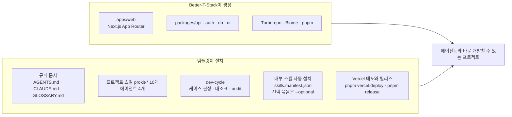

# 템플릿이 더하는 것

> 한눈에: 앱 뼈대를 만들어 주는 도구(Better-T-Stack)는 실행되는 앱까지만 만들어요. 에이전트가 그 위에서 안정적으로 개발하려면 프로젝트 규칙, 분야별 작업 지식, 끝났다고 말하기 전에 거치는 확인 절차가 더 필요해요. **템플릿이 이 세 가지를 채워요.**

## 뼈대와 그 위에 더하는 것

<!-- b:what-it-adds-diagram -->

<!-- /b -->

표는 위 그림의 오른쪽 상자(템플릿이 설치)를 풀어 쓴 거예요. 처음에는 스킬과 에이전트, dev-cycle만 읽어도 돼요.

### 스킬과 에이전트

| 구성 | 내용 |
|---|---|
| 프로젝트 스킬 <!-- v:prokit.skills.count -->10<!-- /v -->개 | `prokit-dev-cycle`(작업 진행), `prokit-web`(라우팅·RSC·캐시), `prokit-ui`(화면·UX), `prokit-api`(oRPC·인증·데이터 주인 확인), `prokit-db`(스키마·마이그레이션), `prokit-verify`(검사·증거), `prokit-deploy`(Vercel 배포·릴리스), `prokit-pack-use`(완성팩 활용), `prokit-skills-update`(외부 스킬 업데이트), `prokit-skills-manage`(진행 중 두뇌·스킬 구성 바꾸기) |
| 에이전트 <!-- v:prokit.agents.count -->4<!-- /v -->개 | `prokit-analyzer`(기존 프로젝트를 읽기만 하며 정밀 분석), `prokit-implementer`(범위를 받은 수행), `specialist-reviewer`(부족한 전문 계약만 읽기 전용 검토), `prokit-reviewer`(증거·통합 수용을 보는 최종 읽기 전용 게이트). 프로킷은 외부 전문 수행자에게 일을 맡기고 범위·증거·재지시를 관리해요. `.claude/agents`가 원본이고, `.codex/agents`(Codex)와 `.agents/agents`(Antigravity)는 이 원본에서 자동으로 만들어요 |
| 내부 스킬 (이 프로젝트에만, 자동 설치) | 공식 도메인 스킬(Next.js, React, Better Auth, shadcn, impeccable, turborepo, DB 스킬, Vercel 배포 스킬 등), mattpocock 필수 3개, skill-creator(Claude 플러그인과 Codex 스킬). 두뇌와 과설계 방지 스킬은 고른 것만 설치해요(기본은 없음. [두뇌와 선택 스킬](../skills/brains.md)). ponytail을 고르면 Codex 스킬 Ponytail <!-- v:skills.codex.ponytail -->6<!-- /v -->종도 받고, Codex 네이티브 Ponytail은 `--with-global`일 때만 선택 설치해요 |
| 외부 스킬 위임 | 설치 목록 밖에서도 현재 접근 가능한 사용자 지정·프로젝트별 전문 스킬을 확인해 연결해요. 출처와 부작용을 확인하고 결과와 증거를 받아 최종 검수해요 |
| 선택 스킬 묶음 (기본 설치 안 함) | `ops`(배포한 서비스의 비용·성능 점검. neon은 Neon 함수·파일 저장·LLM 게이트웨이 포함), `motion`(화면 전환 애니메이션), `mobile`(React Native·Expo 앱), `i-have-adhd`(짧은 행동 중심 응답), `taste`(화면 디자인 보조 taste-skill) |

### 작업 흐름과 문서

| 구성 | 내용 |
|---|---|
| dev-cycle | 작업을 케이스(<!-- v:devCycle.cases.range -->A\~F·H<!-- /v -->)로 나눠요. 케이스별 대조표의 모든 행에 증거를 채워야 라운드가 끝나요(`pnpm dev-cycle …`). 기존 프로젝트는 진행 계획을 확정한 뒤 Task 단위(`--task T<n>`)로 라운드를 열어요 |
| 기존 프로젝트 도입 | 이미 있는 프로젝트에도 설치할 수 있어요. 유형(`--project-type`)에 따라 같은 폴더, 새 브랜치, 새 폴더로 적용하고 `docs/prokit/intake.md`(도입 기록), `docs/prokit/analysis.md`(정밀 분석), `tasks/plan.md`(진행 계획)를 남겨요([기존 프로젝트에 도입하기](../start/adopt.md), [정밀 분석과 진행 계획](../concepts/project-plan.md)) |
| 문서 골격 | `AGENTS.md`(맨 앞에 개발 원칙: 계획, 서브에이전트, 교훈 기록, 완료 전 확인. 이어서 공통 규칙), `CLAUDE.md`(`@AGENTS.md`로 같은 지침을 읽어요), `GLOSSARY.md`, `docs/adr/`, `docs/domain/project.md`, `docs/dev-workflow.md` |
| 개발 자원 보호 | 캐시·Next 출력·설치 패키지·Python 실행환경·관리 임시 폴더를 감시해요. 새 프로젝트의 개발·빌드 명령에 연결하고, 이미 프로킷을 설치한 프로젝트는 H 라운드에서 반영해요([위임과 자원 관리](../concepts/delegation-and-resources.md)) |

### 화면, 배포, 전역 도구

| 구성 | 내용 |
|---|---|
| 화면만 프로젝트 | `scripts/export-html.mjs`로 DB 없이 만든 화면을 정적 HTML로 내보내요(`pnpm export:html`). 선택해서 쓸 수 있는 사이트 하단 제작 표시 컴포넌트 `apps/web/src/components/prokit-credit.tsx`를 함께 둬요. `scripts/load-keys.mjs`와 SessionStart 훅이 프로젝트나 작업 폴더 `.env`의 `OPENAI_API_KEY`를 Claude Code 세션에 불러와요 |
| Vercel 배포와 릴리스 | `pnpm vercel:deploy develop`·`production`이 배포 전 검사, 배포, 되돌리기 명령 안내를 맡아요. 운영에는 `pnpm release`로 버전 태그, `release/` 노트, GitHub Release를 만든 커밋만 배포해요. `.vercelignore`와 `.gitignore`의 `.env.*` 규칙 덕분에 로컬 비밀값이 배포나 커밋에 섞이지 않아요. `--adopt`로 하네스만 들인 프로젝트에는 이 스크립트가 없어요 |
| 전역 도구 | <!-- v:policy.agentBrowser.yo -->agent-browser CLI는 없거나 npm 최신판보다 낮으면 기본으로 최신판을 설치해요<!-- /v -->. 두뇌 gstack, OMX CLI, OpenSpec CLI는 그 두뇌를 고를 때만 설치해요. ego lite(macOS)는 직접 설치해요 |

> [!WARNING]
> Vercel CLI, Neon CLI 또는 Supabase CLI, 그리고 네이티브 플러그인을 지원하는 Codex의 Ponytail(ponytail을 고른 경우)은 `--with-global`을 줄 때만 설치해요. 이 옵션은 전역 설정을 바꿔요.

## 설치한 뒤 폴더에 생기는 것

앱 폴더(`apps/`, `packages/`)는 Better-T-Stack이 만들고, 아래는 템플릿이 더하는 파일이에요. 전체 모양은 [설치된 프로젝트의 폴더 구조](../reference/project-structure.md)에 그려져 있어요. 평소에는 열어 볼 일이 거의 없어요.

| 위치 | 한 줄 설명 |
|---|---|
| `AGENTS.md`, `CLAUDE.md`, `GLOSSARY.md` | 에이전트가 읽는 규칙과 용어집. `CLAUDE.md`는 `@AGENTS.md`로 같은 규칙을 읽어요 |
| `.agents/skills/` | 설치한 스킬(작업 설명서)의 원본. `.claude/skills/`는 Claude Code가 같은 파일을 읽게 하는 링크예요 |
| `.claude/agents/` | 에이전트(읽기 전용 분석, 구현, 전문 리뷰, 최종 리뷰) 정의의 원본이에요 |
| `.codex/agents/`, `.agents/agents/` | 위 원본에서 `pnpm agents:sync`가 만드는 복사본이에요. Codex는 앞의 것, Antigravity는 뒤의 것을 읽어요. 직접 고치지 않아요 |
| `.claude/settings.json` | Claude Code 프로젝트 설정(플러그인, 키를 불러오는 훅). `settings.local.json`은 개인 설정이라 커밋하지 않아요 |
| `scripts/` | dev-cycle, 스킬 설치, 에이전트 동기화, 위임 검증, 자원 보호, Vercel 배포, 릴리스, HTML 내보내기 도구 |
| `.dev-cycle.json` | 케이스 판정 경로, 검사 명령, 두뇌와 과설계 방지 스킬 기록, 프로젝트 유형 같은 작업 규칙 |
| `skills.manifest.json`, `skills-lock.json` | 설치할 스킬 목록과 실제로 설치한 판의 기록 |
| `docs/` | `dev-workflow.md`(케이스별 대조표 행), `adr/`(설계 결정 기록), `domain/project.md`(프로젝트 소개). 진행 계획을 세우면 `plans/`, 기존 프로젝트를 들였으면 `prokit/`(도입 기록 `intake.md`, 정밀 분석 `analysis.md`)와 `first-request.md`가 생겨요 |
| `tasks/` | `todo.md`(남은 일과 진행 중인 대조표), `plan.md`(진행 계획의 Task 표. 계획 라운드를 열면 생겨요), `archive/`(끝낸 일의 기록). 증거 파일은 `tasks/evidence/`에 쌓여요 |
| `licenses/` | 프로킷이 제공한 파일의 MIT 라이선스 사본(`PROKIT-LICENSE.txt`)과 어느 파일이 해당하는지 적은 `PROKIT-SCOPE.md` |
| `.vercelignore` | 배포할 때 `.env` 같은 비밀값 파일이 올라가지 않게 빼요 |
| `release/` | `pnpm release`가 production 배포 전에 쓰는 릴리스 노트(처음엔 없어요) |
| `apps/web/src/components/prokit-credit.tsx` | 사이트 하단에 제작 표시를 달고 싶을 때 쓰는 선택 컴포넌트예요 |

> [!NOTE]
> `--adopt`로 하네스만 들인 프로젝트에는 이 중 일부만 들어가요([설치기와 옵션](installer.md#기존-프로젝트에-설치하기)).

## Better-T-Stack이란

[Better-T-Stack](https://www.better-t-stack.dev/)은 TypeScript 프로젝트의 뼈대를 만들어 주는 오픈 소스(MIT) 명령줄 도구예요([GitHub](https://github.com/AmanVarshney01/create-better-t-stack)). 화면부터 DB까지 타입이 처음부터 이어져 있어서 코드가 서로 어긋나지 않아요. 프런트엔드, 백엔드, 런타임, DB, ORM(DB를 코드로 다루는 도구), API, 인증, 결제, 애드온(덧붙이는 기능)을 고른 뒤 `pnpm create better-t-stack` 한 번으로 모노레포(앱과 패키지를 한 저장소에 담은 구조)를 만들어요. 웹의 [Stack Builder](https://www.better-t-stack.dev/new)에서 조합을 고르면 같은 명령을 만들어 줘요. 만든 프로젝트의 `bts.jsonc`에는 고른 조합과 다시 만들 때 쓰는 명령이 남아요.

템플릿은 그중 한 조합을 고정해서 써요.

| 계층 | 선택 | Better-T-Stack 옵션 |
|---|---|---|
| 프런트엔드 | Next.js App Router | `--frontend next` |
| 백엔드 | 별도 서버 없이 Next.js 라우트 핸들러가 API를 받아요 | `--backend self --runtime none` |
| API | oRPC | `--api orpc` |
| DB·ORM | PostgreSQL + Drizzle | `--database postgres --orm drizzle` |
| 인증 | Better Auth | `--auth better-auth` |
| 모노레포·린트 | Turborepo, Biome | `--addons turborepo biome` |
| 패키지 매니저 | pnpm | `--package-manager pnpm` |
| CLI 버전 | 생성할 때의 최신판 (마지막 확인 3.47.0) | `pnpm create better-t-stack@latest` |

DB 옵션만 템플릿마다 달라요(neon은 `--db-setup docker`, supabase는 `--db-setup supabase --manual-db`).

## 자세히

- **최신판을 받아요**: 생성기(`@latest`), 공식 스킬, Claude 플러그인은 템플릿에 복사해 두지 않고 설치할 때의 최신판을 받아요. 새 판 때문에 생성이나 설치가 깨지면 pro-kit 쪽에서 템플릿을 고치고, 확인한 판을 `VERIFICATION.md`에 적어요(pro-kit 관리 규칙).
- **템플릿 파일 위치**: 설치기는 `templates/<템플릿>/files/` 아래 파일을 프로젝트에 복사해요. 스킬 목록의 정본은 `files/skills.manifest.json`이에요([설치와 업데이트 구조](../skills/install-and-update.md)).
- **설치된 결과**: 설치한 뒤 프로젝트의 폴더 구조는 [설치된 프로젝트의 폴더 구조](../reference/project-structure.md)에 있어요.

## 관련 문서

- [템플릿 고르기](choose.md)
- [앱 구조](app-structure.md)
- [설치기와 옵션](installer.md)
- [기존 프로젝트에 도입하기](../start/adopt.md)
- [prokit 스킬 <!-- v:prokit.skills.count -->10<!-- /v -->개](../skills/prokit-skills.md)
- [하네스 엔지니어링](../concepts/harness.md)
