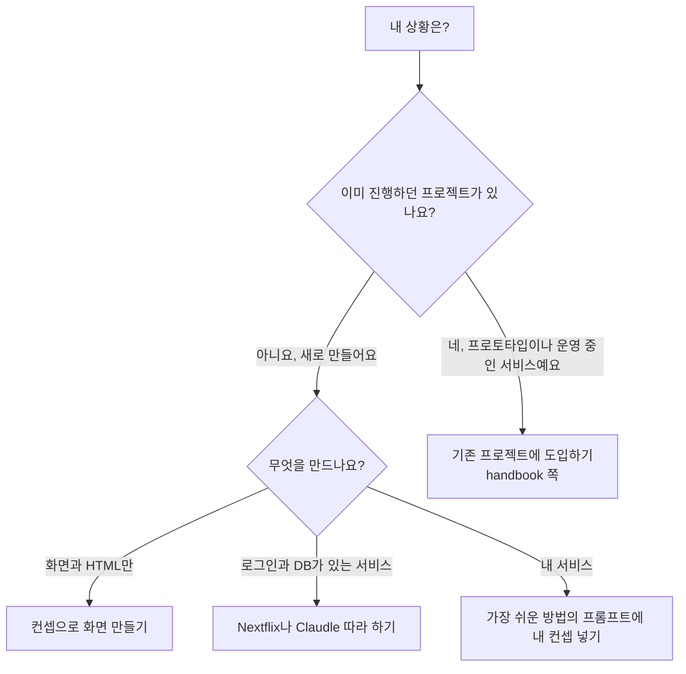
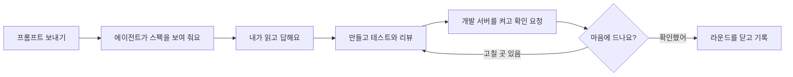

# pro-kit 튜토리얼

AI 에이전트(<!-- v:agents.list -->Claude Code, Codex, Antigravity, Grok Build<!-- /v --> 중 하나)와 pro-kit으로 내 서비스를 직접 만들어 보는 튜토리얼이에요. **코드를 몰라도 프롬프트 하나로 시작하면 돼요.** pro-kit이 설치한 규칙과 스킬, 전문 에이전트가 개발자와 디자이너가 밟는 절차를 단계마다 나눠 맡아서, 짧은 요청으로도 전문가 수준의 결과물을 얻을 수 있어요.

> [!NOTE]
> 튜토리얼에서 만드는 서비스는 모두 연습용이에요. 데이터도 모두 예시예요.

## 읽는 순서

**시작하기** → **튜토리얼 고르기** → **막히면 가이드**

1. **[시작하기](start/README.md)**: 에이전트를 설치하고 로그인해요. 처음 한 번만 해요.
2. **튜토리얼 고르기**: [프리셋으로 만들어 보기](samples/README.md#프리셋으로-만들어-보기)에서 만들어 볼 프리셋을 고르고, 그 쪽의 프롬프트를 붙여 넣으세요. 만들고 싶은 서비스가 따로 있으면 [가장 쉬운 방법](samples/README.md#가장-쉬운-방법)의 프롬프트에 내 컨셉을 넣으세요. pro-kit은 에이전트가 받아요.
3. **막히면**: [막혔을 때](reference/troubleshooting.md)와 [처음 보는 용어](reference/glossary.md)를 보세요.

## 어떤 길로 갈까요

> [!TIP]
> 처음이라면 아래 표의 맨 위 두 줄 중 하나로 시작하세요.<!-- edition:pro --> 기존 프로젝트가 있을 때만 도입 쪽으로 가면 돼요.<!-- /edition -->

<!-- edition:pro -->
처음부터 새로 만드는지, 이미 진행하던 프로젝트가 있는지에 따라 길이 달라요. 튜토리얼은 새로 만드는 길을 따라 해 보는 교재예요.



기존 프로젝트에 프로킷을 들이는 방법은 따라 하는 과정이 따로 없어요. [기존 프로젝트에 도입하기](https://github.com/roadkwon-ai/pro-kit/blob/main/handbook/start/adopt.md)에서 유형(초기 프로젝트, 운영 중인 Next.js, 다른 언어에서 전환)을 고르고, 에이전트에게 요청하세요. 도입한 뒤에는 새 세션이 프로젝트를 분석하고 진행 계획을 세워 Task 하나씩 진행해요. 튜토리얼의 장별 프롬프트는 새 프로젝트용이에요.
<!-- /edition -->

| 이런 분이라면 | 이 길로 가세요 |
|---|---|
| AI 에이전트를 처음 써 봐요. 어디서 무엇을 눌러야 할지 막막해요 | [시작하기](start/README.md)로 준비하고, 해 보기 전에 [처음 한 시간](https://github.com/roadkwon-ai/pro-kit/blob/main/handbook/start/first-hour.md)과 [요청하고 이어 가는 법](https://github.com/roadkwon-ai/pro-kit/blob/main/handbook/start/ask-well.md)을 읽어요 |
| 화면과 HTML만 만들고 싶어요. DB와 로그인은 필요 없어요 | [컨셉으로 화면 만들기](samples/README.md)로 시작해요.<!-- edition:pro --> Docker도 필요 없어요<!-- /edition --> |
| 로그인과 저장이 되는 진짜 서비스를 만들어 보고 싶어요 | [Nextflix](01-nextflix/README.md)나 [Claudle](02-claudle/README.md)를 장마다 따라 해요. 프로젝트 만들기부터 배포까지 프로킷의 기능을 거의 모두 써 봐요 | <!-- edition:pro -->
| 이미 진행하던 프로젝트가 있어요 | 튜토리얼 대신 [기존 프로젝트에 도입하기](https://github.com/roadkwon-ai/pro-kit/blob/main/handbook/start/adopt.md)로 가요 | <!-- edition:pro -->
| 팩을 받아 바로 시작하고 싶어요 | [프리셋 팩으로 시작하기](https://github.com/roadkwon-ai/pro-kit/blob/main/handbook/start/quickstart-pack.md)를 보세요 |

## 프로킷이 작업을 맡기는 방식

프로킷은 공식 스킬뿐 아니라 현재 쓸 수 있는 사용자 지정·프로젝트별 전문 스킬에도 작업을 맡겨요. 진행을 관리하는 에이전트는 범위와 실행 증거를 확인하고, 필요한 수정 지시와 최종 검수를 맡아요. 자세한 기준은 [위임과 자원 관리](https://github.com/roadkwon-ai/pro-kit/blob/main/handbook/concepts/delegation-and-resources.md)에 있어요.

개발 중에는 빌드 캐시와 설치 환경의 용량도 확인해요. 새 프로젝트에는 자원 보호가 연결되고, 이미 프로킷을 설치한 프로젝트는 [템플릿 갱신](https://github.com/roadkwon-ai/pro-kit/blob/main/handbook/templates/update-existing.md)으로 반영해요. 큰 환경을 크기만 보고 지우지는 않아요.

## 튜토리얼 목록

<!-- 튜토리얼 목록: 완성된 튜토리얼만 싣는다(설계 2026-10-01 4절). -->

| 튜토리얼 | 무엇을 만드나요 |
|---|---|
| [컨셉으로 화면 만들기](samples/README.md) | 서비스 컨셉 한두 문장으로 모든 페이지의 화면을 만들고 HTML로 내보내요. 프로킷 사이트의 화면 프리셋 <!-- v:presets.screen.count -->14<!-- /v -->개(랜딩페이지 <!-- v:presets.landing.count -->9<!-- /v -->개, 앱 화면 <!-- v:presets.app.count -->5<!-- /v -->개) 중 하나를 골라 같은 컨셉으로 만들어 봐도 되고, 내 컨셉으로 만들어도 돼요. 시간은 프리셋 하나에 처음부터 만들 때 <!-- v:presets.scratch.time.text -->한 번에 완성하면 약 1시간 5분\~11시간 30분(여러 번 고쳐 달라고 하면 약 17시간 15분까지)<!-- /v -->, 프리셋 팩으로 만들 때 <!-- v:presets.pack.time.text -->한 번에 완성하면 약 36분\~7시간 50분(여러 번 고쳐 달라고 하면 약 11시간 45분까지)<!-- /v --> 걸려요 |
| [넷플릭스 같은 영상 구독 서비스 만들기](01-nextflix/README.md) | 유명 서비스 클론하기 첫 튜토리얼이에요. 넷플릭스를 본뜬 영상 구독 서비스 <!-- v:preset.nextflix.title -->Nextflix<!-- /v -->를 프리셋 팩으로 만들어요. 4장까지 모든 화면을 만들고, 5장부터 로그인, DB, 검색, 찜, 평가, 이어 보기를 붙여 배포까지 가요. 화면까지는 <!-- v:preset.nextflix.screens.time.text -->한 번에 완성하면 약 2시간 25분\~4시간 50분(여러 번 고쳐 달라고 하면 약 7시간 15분까지)<!-- /v -->, 끝까지는 <!-- v:preset.nextflix.full.time.text -->한 번에 완성하면 약 5시간 15분\~10시간 30분(여러 번 고쳐 달라고 하면 약 15시간 45분까지)<!-- /v --> 걸려요 | <!-- edition:pro -->
| [Claude 같은 AI 대화 서비스 만들기](02-claudle/README.md) | 유명 서비스 클론하기 두 번째 튜토리얼이에요. Claude를 본뜬 AI 대화 서비스 <!-- v:preset.claudle.title -->Claudle<!-- /v -->을 프리셋 팩으로 만들어요. 4장까지 모든 화면을 만들고, 5장부터 로그인과 대화 저장, 대화 관리, 실제 AI 답, 검색, 프로젝트, 아티팩트를 붙여 배포까지 가요. 화면까지는 <!-- v:preset.claudle.screens.time.text -->한 번에 완성하면 약 2시간 25분\~4시간 50분(여러 번 고쳐 달라고 하면 약 7시간 15분까지)<!-- /v -->, 끝까지는 <!-- v:preset.claudle.full.time.text -->한 번에 완성하면 약 5시간\~10시간(여러 번 고쳐 달라고 하면 약 15시간까지)<!-- /v --> 걸려요 | <!-- edition:pro -->

프리셋은 <!-- edition:pro -->모두 <!-- v:presets.count -->16<!-- /v -->개예요. <!-- /edition -->화면 프리셋 <!-- v:presets.screen.count -->14<!-- /v -->개<!-- edition:pro -->와 유명 서비스 클론하기 <!-- v:presets.clone.count -->2<!-- /v -->개(Nextflix, Claudle)이고, 모두<!-- /edition --><!-- edition:ui 이고, 모두 --> 프리셋 팩이 있어요.

**표의 시간에서 앞 숫자는 순조롭게 한 번에 끝날 때의 최솟값이에요.** 범위의 끝은 쓰는 AI와 끊김에 따라, 괄호는 결과를 보고 여러 번 고쳐 달라고 할 때 걸릴 수 있는 시간이에요.

<!-- edition:pro -->
> [!WARNING]
> **유명 서비스 클론하기는 토큰을 많이 써요.** 끝까지 만들 때 튜토리얼 하나에 <!-- v:clones.full.time.text -->한 번에 완성하면 약 5시간\~10시간 30분(여러 번 고쳐 달라고 하면 약 15시간 45분까지)<!-- /v --> 걸리고, 토큰은 최소 약 <!-- v:clones.full.tokens.range -->610만\~770만<!-- /v -->(캐시 포함 약 <!-- v:clones.full.cached.range -->3억\~3.9억<!-- /v -->)이 들어요. 토큰도 시간처럼 <!-- v:cost.multiplier -->2~3<!-- /v -->배까지 늘 수 있어요. 튜토리얼마다 값은 각 튜토리얼 소개 쪽의 "시간과 비용"에, 읽는 법은 [시간과 비용 읽는 법](reference/costs-and-keys.md#시간과-비용-읽는-법)에 있어요.
<!-- /edition -->

여기 없는 서비스도 pro-kit과 프롬프트를 응용해 만들 수 있어요. [가장 쉬운 방법](samples/README.md#가장-쉬운-방법)의 프롬프트에 내 컨셉을 넣어 보세요.

## 튜토리얼 읽는 법

튜토리얼의 장은 모두 같은 모양이에요.

- **이번 장에서 할 일**: 무엇을 만드는지와 완성 화면
- **프롬프트**: 복사해서 에이전트 대화창에 붙여 넣는 글

  ```prompt
  지금까지 만든 거 검증해줘
  ```

- **터미널에 입력**: 터미널에 직접 치는 명령. 튜토리얼 전체에서 몇 번 안 나와요

  ```bash
  cd ~/projects/living
  ```

- **이렇게 되면 성공**: 잘 됐는지 확인할 화면과 내용
- **막히면**: 눌러서 펼치는 상자. 흔한 문제와 붙여 넣을 복구 프롬프트가 있어요
- **에이전트가 물어보면**: 그 장에서 나오는 질문과 고를 답

<!-- edition:pro -->
기능을 하나 만드는 장(5장부터)은 모두 이런 흐름이에요. 내가 하는 일은 프롬프트 보내기, 스펙 읽고 답하기, 직접 써 보고 `확인했어` 보내기예요.


<!-- /edition -->

## 가이드

| 쪽 | 내용 |
|---|---|
| [처음 보는 용어](reference/glossary.md) | 튜토리얼에 나오는 말 풀이 |
| [막혔을 때](reference/troubleshooting.md) | 증상별로 붙여 넣을 프롬프트, 에이전트가 멈췄을 때(blocked, 부분 완료, 리뷰 반복, 비밀값 검사 등) 보낼 말 |
| [에이전트별 차이](reference/claude-code-and-codex.md) | 지원하는 에이전트 <!-- v:agents.count -->4<!-- /v -->개의 요금제, 설치, 조작 차이 |
| [비용과 키](reference/costs-and-keys.md) | 요금제, 시간과 비용 읽는 법, <!-- v:limit.window -->5시간<!-- /v --> 한도, 이미지 그리기(Codex CLI, OpenAI 키) |
| [만드는 과정과 걸리는 시간](reference/process-and-time.md) | 시작하는 방법 세 가지, 레퍼런스 사이트 리서치부터 하는 과정, 프리셋을 만들 때 실제로 걸린 시간, 고칠 때마다 더 드는 시간, 시간을 줄이는 법 |
| [배포하기](reference/deploy.md) | 만든 화면을 인터넷에 올리기. GitHub Pages와 Vercel 준비, 배포 프롬프트 |
| [Windows 준비](reference/windows.md) | WSL2 설치.<!-- edition:pro --> 실제 서비스로 만들 때는 Docker Desktop도<!-- /edition --> |
