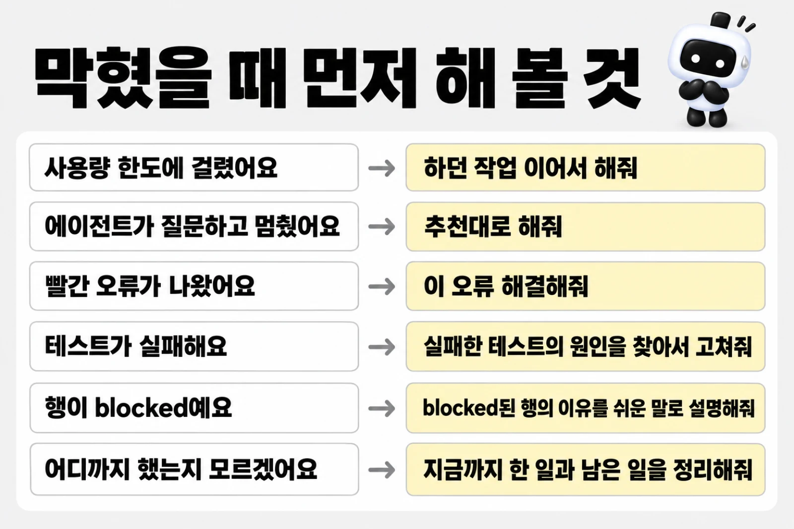

# 막혔을 때

대부분은 증상을 그대로 에이전트에게 말하면 풀려요. 아래 표에서 비슷한 증상을 찾아 프롬프트를 붙여 넣으세요.

> [!TIP]
> 어디서부터 볼지 모르겠으면 에이전트에게 `지금까지 한 일과 남은 일을 정리해줘`라고 보내세요. 무엇을 기다리는지 모르겠으면 `추천대로 해줘`로 넘어가도 돼요.

### 시작과 연결

| 증상 | 이렇게 해 보세요 |
|---|---|
| 에이전트가 질문하고 멈춰 있어요 | 튜토리얼의 "에이전트가 물어보면"에서 답을 찾아 보내세요. 없으면 `추천대로 해줘` |
| 사용량 한도에 걸렸다고 해요 | 안내된 시간이 지난 뒤 같은 폴더에서 에이전트를 열고 `하던 작업 이어서 해줘` |
| 에이전트를 닫았다가 다시 열었어요 | 프로젝트 폴더에서 열고 `하던 작업 이어서 해줘` |
| 빨간 오류 메시지가 나왔어요 | 메시지를 복사해 `이 오류 해결해줘`와 함께 붙여 넣으세요 |
| DB에 연결할 수 없다고 해요 | Docker Desktop이 켜져 있는지 보고 `DB가 켜져 있는지 확인하고 안 켜져 있으면 켜줘` | <!-- edition:pro -->
| 포트(<!-- v:port.neonDb -->5432<!-- /v -->)가 이미 쓰이고 있다고 해요 | `DB 포트가 겹친대. 다른 포트로 바꿔줘` | <!-- edition:pro -->
| 브라우저에서 화면이 안 열려요 | `개발 서버를 켜고 브라우저로 열 주소를 알려줘` |
| <!-- v:port.web -->3001<!-- /v --> 포트를 다른 프로그램이 쓰고 있대요 | 에이전트는 개발 서버를 켜기 전에 이 포트를 살피고, 다른 프로그램이 쓰고 있으면 그 프로그램을 끄거나 다른 포트로 피하지 않고 물어봐요.<!-- edition:pro --> 로그인 주소가 이 포트에 묶여 있어서 포트를 바꾸면 로그인이 깨져요.<!-- /edition --> 그 프로그램(예전에 켠 다른 개발 서버, 다른 프로젝트 등)을 직접 닫고 `정리했어. 개발 서버 다시 켜줘`라고 보내세요 |

### 화면과 되돌리기

| 증상 | 이렇게 해 보세요 |
|---|---|
| 화면이 깨지거나 이상해요 | 어느 화면의 무엇이 이상한지 말로 적어요. 예: `상품 목록 화면에서 카드가 겹쳐 보여. 고쳐줘` |
| 방금 바뀐 게 마음에 안 들어요 | `방금 바꾼 걸 되돌려줘` |

### 작업 이어 가기

| 증상 | 이렇게 해 보세요 |
|---|---|
| 이미 진행하던 프로젝트에서 라운드가 안 열리고 진행 계획부터 확정하라고 해요 | 정상이에요. 기존 프로젝트는 진행 계획을 확정한 뒤 Task 단위로 작업해요. `진행 계획부터 확정하자`라고 보내세요. 급한 버그 수정이나 템플릿 갱신 반영처럼 계획 전에 해도 되는 일은 에이전트가 그렇게 안내해요. 흐름은 [기존 프로젝트에 도입하기](https://github.com/roadkwon-ai/pro-kit/blob/main/handbook/start/adopt.md)에 있어요 | <!-- edition:pro -->
| 지금 어디까지 했는지 모르겠어요 | `지금까지 한 일과 남은 일을 정리해줘` |
| 튜토리얼 스크린샷과 내 화면이 달라요 | 정상이에요. 같은 프롬프트라도 결과가 매번 조금씩 달라요 |

## 멈췄을 때

에이전트가 일을 멈추고 알려 줄 때는 대부분 이유가 있어요. 라운드의 규칙이 "증거와 내 확인 없이는 넘어가지 않는다"이기 때문이에요. 아래에서 증상을 찾고 보낼 말을 붙여 넣으세요. 용어는 [처음 보는 용어](glossary.md#만들기)에 있어요.

| 멈춘 모습 | 무슨 뜻인가요 | 보낼 말 |
|---|---|---|
| 사용량 한도에 걸렸다고 해요 | 요금제의 시간당 사용량을 다 썼어요. 만든 파일과 기록은 그대로예요 | 안내된 시간이 지난 뒤 같은 폴더에서 열고 `하던 작업 이어서 해줘`([<!-- v:limit.window -->5시간<!-- /v --> 한도](costs-and-keys.md#5시간-한도에-걸리면)) |
| 행 하나를 `blocked`라고 적었어요 | 그 단계를 할 수 없었어요. 도구가 없거나, 연결이 안 되거나, 검증할 방법이 없는 경우예요. 이유가 함께 적혀 있어요 | `blocked된 행의 이유를 쉬운 말로 설명하고, 풀 방법을 알려줘`. 방법이 나오면 따라 한 뒤 `풀었어. 그 행부터 다시 해줘` |
| 부분 완료라며 `--partial`로 닫을지 물어요 | 막힌 행(`blocked`)이나 하지 않은 행(`미실행`)이 남아 있어요. 에이전트가 먼저 보고하고 내 결정을 기다려요 | 남겨도 되면 `그 행들은 남기고 그대로 닫아줘`. 아니면 `막힌 행부터 해결해줘`. 내가 직접 확인하는 마지막 행은 `--partial`로도 넘길 수 없어요 |
| 에이전트가 질문하고 기다려요 | 결과가 달라지는 선택이라 먼저 묻는 거예요 | 튜토리얼의 "에이전트가 물어보면"에서 고르거나 `추천대로 해줘`. 무엇을 기다리는지 모르겠으면 `지금 무엇을 기다리는지 한 줄로 알려줘` |
| 리뷰가 계속 `changes-required`로 나와요 | 리뷰어가 고칠 점을 찾았어요. 에이전트가 지적을 직접 확인해 고치고 다시 리뷰받아요. 큰 지적(high 이상)을 고쳤으면 같은 관점으로 꼭 다시 받아요 | 두세 번 돌았으면 `리뷰 지적을 고칠 것과 기각할 것으로 나누고 이유를 알려줘`. 리뷰어가 응답하지 못하면 그 행은 `blocked`로 남아요 |
| 테스트가 실패해요 | 코드가 기대와 다르게 동작해요. 테스트를 지우거나 건너뛰어 통과시키면 안 돼요 | `실패한 테스트의 원인을 찾아서 고쳐줘. 테스트를 건너뛰지는 마` |
| 커밋이 비밀값 검사에서 막혔어요 | 커밋하려는 변경에 키나 토큰 같은 값이 섞여 있어요(`pnpm dev-cycle secrets`가 1을 돌려줘요). 에이전트는 파일과 변수 이름만 보여 주고 값은 출력하지 않아요 | `걸린 파일과 변수 이름만 알려주고, 그 값을 파일에서 지우거나 스테이징에서 빼줘. 값은 출력하지 마`. 진짜 키였다면 만든 곳에서 폐기하고 새로 만드세요 |
| 비밀값 검사를 실행하지 못했다고 해요 | 검사 자체가 돌지 않았어요. 비밀값이 발견됐다는 뜻은 아니에요 | 출력을 `이 오류 해결해줘`와 함께 보내세요. 해결되기 전에는 커밋하지 않아요 |
| 앞 Task가 끝나지 않아 다음 Task가 안 열려요 | 진행 계획은 Task를 순서대로 해요. 앞 Task가 `완료`나 `제외`여야 다음이 열려요 | `앞 Task가 어디까지 됐는지 알려줘`. 미루고 싶으면 에이전트가 제외할지 순서를 바꿀지 물어요 | <!-- edition:pro -->
| 진행 계획을 확정하라고 해요(기존 프로젝트) | 기존 프로젝트는 정밀 분석과 진행 계획을 확정해야 Task 라운드가 열려요 | `진행 계획부터 확정하자`. 급한 버그 수정, 템플릿 갱신 반영, 스킬 구성 변경은 내가 계획보다 먼저 하자고 할 때만 계획 없이 열 수 있어요 | <!-- edition:pro -->
| 계획 파일(`tasks/plan.md`)에 커밋하지 않은 변경이 있다며 라운드를 못 열어요 | 앞 라운드가 남긴 계획 변경이 아직 커밋되지 않았어요 | `앞 라운드 결과를 커밋하고 다음 Task를 열어줘` | <!-- edition:pro -->

> [!WARNING]
> 키나 토큰이 섞인 메시지는 붙여 넣기 전에 값을 지우세요. 테스트를 지우거나 건너뛰어 통과시키는 방법은 쓰지 마세요.

> [!NOTE]
> 에이전트가 같은 지적을 되풀이하며 맴돌면 `지금까지 시도한 것과 막힌 지점을 정리해줘`라고 보내세요. 원인을 정리하게 하면 다른 길이 나와요. 보낼 말을 잘 쓰는 법은 [요청하고 이어 가는 법](https://github.com/roadkwon-ai/pro-kit/blob/main/handbook/start/ask-well.md)에 있어요.

## 자원 예산이나 외부 스킬 때문에 멈추면

캐시나 설치 환경이 커져 작업이 막혔으면 `현재 자원 사용량과 막힌 이유를 확인하고, 안전하게 정리할 수 있는 후보를 알려줘`라고 보내세요. 쓰는 환경이나 전역 저장소를 무작정 지우지 않아요. 감시 범위와 정리 조건은 [자원 관리 안내](https://github.com/roadkwon-ai/pro-kit/blob/main/handbook/concepts/delegation-and-resources.md#관리-범위-안-자원만-다루기)에 있어요.

외부 스킬을 실행하지 못했으면 `선택한 스킬과 사용할 수 없는 이유를 확인하고, 검증된 대안이 있는지 알려줘`라고 보내세요. 막힌 검사를 완료로 처리하지 않아요. 선택 순서와 권한은 [위임 안내](https://github.com/roadkwon-ai/pro-kit/blob/main/handbook/concepts/delegation-and-resources.md#위임할-때-남기는-근거)를 따라요.

## 그래도 안 풀리면

- 에이전트를 닫고(`/exit`, Codex는 `/quit`) 프로젝트 폴더에서 다시 연 뒤 `하던 작업 이어서 해줘`라고 보내 보세요. 하던 일은 프로젝트의 `tasks/todo.md`에 기록돼 있어서 새로 열어도 이어 가요.
- 같은 문제가 계속되면 [pro-kit 이슈](https://github.com/roadkwon-ai/pro-kit/issues)에 증상과 오류 메시지를 남겨 주세요. 오류 메시지에 비밀번호나 키가 섞여 있지 않은지 먼저 확인하세요.
