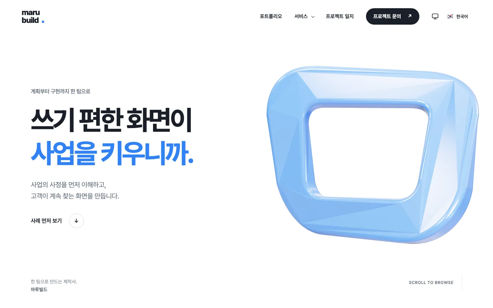
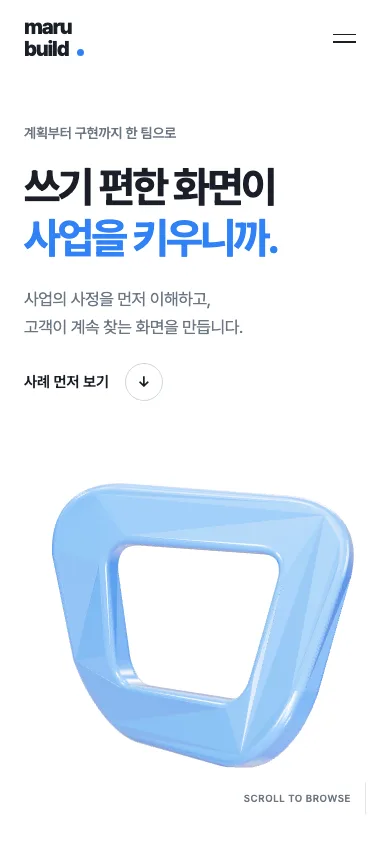

# 마루빌드

웹·앱 제작사의 서비스, 제작 사례, 프로젝트 일지를 보여 주고 프로젝트 문의로 잇는 회사 소개 샘플 프리셋이에요. 가상 제작사 마루빌드의 서비스 13쪽, 사례 6곳, 일지 6편을 살펴볼 수 있어요. 카카오 상담과 실제 사이트·영상 주소는 비어 있는 예시이고, 문의와 신청은 내용을 복사하는 데모예요. 프리미엄 팩으로 제공하며, 아래 안내에서 다운로드하고 복원할 수 있어요.

| 항목 | 내용 |
|---|---|
| 페이지 | 비교 기준 화면은 <!-- v:preset.marubuild.pages -->19<!-- /v -->쪽이고, 팩에는 홈·서비스 13쪽·포트폴리오·사례 6곳·일지 목록과 글 6편·상담·이용약관까지 서른 경로가 들어 있어요 |
| 디자인 참고 | [honest-family.com](https://honest-family.com/)의 구조·서체·색·배치·모션·상호작용을 참고해요. 회사·사례·글·인물·수치는 가상 예시이고, 사례 화면은 다른 프로킷 프리셋의 가상 브랜드 화면이에요 |
| 대표 색 | <!-- v:preset.marubuild.design.color -->화이트·잉크·블루<!-- /v -->, 강조색은 <!-- v:preset.marubuild.design.hexCode -->`#3182f6`<!-- /v -->예요 |
| 서체 | Pretendard Variable을 수정 없이 자체 호스팅하고, OFL 라이선스와 출처를 팩에 담았어요 |
| 생성 이미지 | <!-- v:preset.marubuild.design.images -->10<!-- /v -->개예요. 보안 쪽 3D 그림 8개와 쇼핑형 3D 그림 2개이고, 쇼핑형 2개는 현재 소스에서 쓰지 않아요 |
| 설정 | 국기 언어 메뉴(한국어·영어)와 테마 아이콘 메뉴(시스템·라이트·다크)를 제공해요 |
| 검사 상태 | 정적 사본에서 31쪽을 열어 링크와 버튼을 <!-- v:preset.marubuild.design.clicks -->220<!-- /v -->번 눌렀어요. 없는 페이지, 콘솔 오류, 반응 없는 버튼 모두 0이에요. 원본과의 충실도는 전 범위 합격이 아니에요([검증 상태](#검증-상태)). 실결제·운영 DB·배포는 포함하지 않아요 |





## 프리셋 팩으로 만들어 보기

<!-- b:preset-pack name=marubuild -->
작업 폴더 `~/projects`에서 연 에이전트에 이 프롬프트를 보내면 마루빌드 프리셋과 같은 서비스를 만들어요. [프리셋 팩](https://github.com/roadkwon-ai/pro-kit-premium-packs/releases/tag/pack-marubuild)의 화면 구성, 디자인, 예시 데이터, 그림을 그대로 써서 AI 그림을 새로 그리지 않아요. `[ ]` 안의 이름을 바꿔 같은 구성의 서비스를 만들어요. 팩을 써도 AI가 만들기 때문에 100% 똑같지는 않을 수 있어요.

```prompt
https://github.com/roadkwon-ai/pro-kit 을 이 폴더에 받고, 그 안의 AGENTS.md대로 화면만 만들 프로젝트를 pro-kit 옆에 [marubuild] 폴더로 만들어줘.
DB는 쓰지 않아. 없는 준비물은 설치해줘.
옆 폴더 pro-kit의 packs/marubuild에 프리셋 팩을 받아줘.
그 팩대로 마루빌드 프리셋과 똑같은 서비스를 만들 거야. 이름은 [마루빌드].
팩의 README.md 순서대로 하고, 팩은 고치지 마. 이름을 바꿨으면 팩의 이름 대신 내가 정한 이름을 써.
디자인, 화면 구성, 그림은 팩에 있는 것을 써. 스타일 추천, 시안, 새 그림은 만들지 마.
모든 페이지의 기본 디자인은 팩의 스크린샷과 같게 만들어줘.
시스템·라이트·다크 모드 전환과 한국어·영어 전환을 모든 페이지의 기본 기능으로 넣어줘. 화면 문구는 같은 키를 가진 두 언어의 번역 사전에서 관리하고, 전환해도 현재 페이지와 입력을 유지해줘. 개발 화면과 HTML로 내보낸 결과에서 모든 페이지의 전환과 상태 유지를 실제로 확인해줘.
다 만들면 HTML 파일로 내보내줘.
```

> [!IMPORTANT]
> **프롬프트만 보내면 에이전트가 이 프리셋 팩을 자동으로 받아 설치해요. 따로 받지 않아도 돼요.**
>
> 직접 받으려면 [marubuild-pack.zip](https://github.com/roadkwon-ai/pro-kit-premium-packs/releases/download/pack-marubuild/marubuild-pack.zip)(22.8MB, [릴리스](https://github.com/roadkwon-ai/pro-kit-premium-packs/releases/tag/pack-marubuild))을 받고, 프롬프트 끝에 `프리셋 팩 zip은 [~/Downloads/marubuild-pack.zip]에 받아 뒀어.` 한 줄을 더하세요. 에이전트가 그 zip이 최신 판인지 확인하고, 옛 판이면 새로 받아요.
<!-- /b -->

### 직접 받은 ZIP으로 자세히 복원하기

ZIP을 미리 받았다면 아래 절차로 파일을 검증하고 복원해요.

`tutorials/packs.json`에 등록된 판과 같은 ZIP을 준비하고 pro-kit 폴더의 터미널에서 실행해요. `[팩 ZIP 경로]`에는 받아 둔 파일의 실제 경로를 넣어요.

```bash
node scripts/pack.mjs marubuild --zip "[팩 ZIP 경로]"
```

이 명령은 등록된 SHA-256을 대조해 `packs/marubuild/`에 풀어요. 파일이 없거나 해시가 다르면 다운로드한 파일과 등록 정보를 확인해요.

팩이 준비되면 작업 폴더에서 연 에이전트에 아래 프롬프트를 보내요. [처음부터 만들기](#이-컨셉으로-처음부터-만들기)의 프로젝트 생성 절차처럼 에이전트가 템플릿 초기 구성을 먼저 처리해요. 프로젝트 이름은 `marubuild`로 둬요. 팩 소스가 `@marubuild/*` 워크스페이스 이름을 그대로 써서, 이름이 다르면 복원이 충돌로 멈춰요.

```prompt
pro-kit의 AGENTS.md대로 pro-kit 옆 marubuild 폴더에 새 화면만 프로젝트를 만들어줘.
검증해 풀어 둔 pro-kit/packs/marubuild의 README와 manifest를 읽고 prokit-pack-use로 복원해줘. 이름은 [마루빌드].
apply-pack.mjs --check로 충돌을 확인한 뒤 실제 적용하고, 환경·하네스를 보존한 채 설치·타입·빌드·실행을 확인해줘.
DB는 쓰지 않아. 없는 준비물은 설치해줘.
팩은 고치지 말고 소스, 디자인, 그림, 폰트와 이용 조건을 재사용해줘. 스타일 추천이나 새 그림은 필요 없어.
문의 창과 신청 폼은 입력 검사·내용 복사 데모로 유지해줘. 실제 전송·결제·DB 저장은 하지 마.
한국어·영어와 시스템·라이트·다크 전환 후에도 입력 내용과 현재 위치를 유지해줘.
서른 경로의 메뉴·문의 창·포트폴리오와 일지 필터·사례 갤러리·소개 영상·스크롤 모션·3D 조각을 확인하고 manifest의 화면 기준과 비교해줘.
다 만들면 HTML 파일로 내보내줘.
```

팩에 환경값·환경 schema·하네스·제작 스킬은 없어요. 초기 구성한 프로젝트의 로컬 설정은 그대로 두고, 필요한 환경 선언은 실제 소스와 따로 대조해요. ZIP을 푼 것과 프로젝트를 복원한 것은 달라요.

**이렇게 되면 성공**

- 서른 경로를 직접 열 수 있고 새로고침·홈 왕복 뒤에도 화면이 유지돼요.
- 국기 언어 메뉴와 테마 아이콘 메뉴로 바꿔도 현재 쪽과 입력 내용이 남아요.
- 문의 창과 신청 폼이 필수 항목과 이메일 형식을 검사하고, 정상 입력이면 "샘플이라 전송되지 않았습니다"와 내용 복사를 보여 줘요.
- 카카오 상담·고객사 사이트·실제 사이트·프로젝트 영상 칸은 비활성으로 보여요.

<details>
<summary>막히면</summary>

- **ZIP 검증이 멈춰요**: 받은 파일과 `tutorials/packs.json`의 판이 같은지 확인해요. 다른 판이면 위 다운로드 안내에서 현재 팩을 다시 받아요.
- **복원이 충돌로 멈춰요**: 프로젝트 이름이 `marubuild`인지 확인해요. 충돌이 있으면 사용자 파일을 보존하고 차이를 검토해요.
- **복사가 막혀요**: 브라우저가 복사를 막으면 화면에 직접 선택할 수 있는 내용이 보여요. 그 내용을 선택해 복사해요.

</details>

프롬프트를 보낸 뒤에는 [알려 준 한 줄로 이어 가기](README.md#3-알려-준-한-줄로-이어-가기)로 작업 폴더에서 이어서 진행해요.

## 프리셋 팩으로 나만의 서비스 만들기

복원한 프로젝트에서 회사 이름·소개·서비스부터 바꿔요. 팩의 `CUSTOMIZE.md`는 바꿀 항목과 다시 확인할 동작을 안내해요.

```prompt
복원한 마루빌드를 [내 회사 이름]의 소개 사이트로 바꿔줘.
업종은 [내 업종]이고 소개할 서비스는 [서비스 이름들]이야.
팩의 CUSTOMIZE.md를 보고 바꾸는 부분만 수정해줘. 원본 팩은 고치지 마.
사례·글·수치는 내가 확인해 준 내용만 쓰고, 가상 예시를 실제 실적처럼 쓰지 마.
한국어와 영어 문구를 함께 바꾸고 모바일 배치를 맞춰줘. 문의·신청은 내용 복사 방식으로 유지해줘.
나머지 서체 크기·간격·모션·3D 조각은 유지하고 완성 프리셋과 비교해줘.
```

새 그림이 필요하면 [이미지 그리기 안내](../reference/costs-and-keys.md#이미지-그리기)를 확인해요. 사례 화면 이미지를 바꿀 때는 같은 이름과 비율로 바꾸고, 옆의 `*.webp.json`(출처·해시)도 함께 갱신해요. 카카오·고객사 사이트·문의 이메일 주소는 `apps/web/src/content/site.ts`의 `links`에서 바꿔요. 사례의 '실제 사이트 보기'와 '프로젝트 영상'은 사례 쪽 파일에서 바꾸며, 정확한 위치는 팩의 `CUSTOMIZE.md`에서 확인해요. 연결할 주소가 없는 칸은 빈 문자열로 두면 비활성으로 보여요.

푸터의 대표자·사업자등록번호·저작권은 같은 `site.ts`의 `business`와 `footer`에서 바꿔요. 가상 예시를 확인한 본인 정보로 교체하고 `ko`와 `en` 값을 함께 맞춰요. 이용약관(`terms.ts`)은 화면용 샘플이라 실제 약관으로 교체해요.

## 이 컨셉으로 처음부터 만들기

<!-- b:preset-scratch-intro -->
작업 폴더 `~/projects`에서 연 에이전트에 이 프롬프트를 그대로 보내면 **바로** 시작돼요. [가장 쉬운 방법](README.md#가장-쉬운-방법)의 프롬프트와 같고, `[ ]` 안만 이 프리셋의 폴더 이름과 컨셉이에요. 원하는 대로 바꿔도 돼요.
<!-- /b -->

<!-- b:screen-prompt folder=marubuild concept="웹·앱 제작사가 서비스와 제작 사례를 보여 주고 프로젝트 문의 내용을 복사하는 회사 소개 사이트" -->
```prompt
https://github.com/roadkwon-ai/pro-kit 을 이 폴더에 받고, 그 안의 AGENTS.md대로 화면만 만들 프로젝트를 pro-kit 옆에 [marubuild] 폴더로 만들어줘.
DB는 쓰지 않아. 없는 준비물은 설치해줘.
[웹·앱 제작사가 서비스와 제작 사례를 보여 주고 프로젝트 문의 내용을 복사하는 회사 소개 사이트]를 만들고 싶어.
필요한 화면을 모두 예시 데이터로 만들어줘. 로그인이나 저장 같은 기능은 빼고 화면만 만들어.
시스템·라이트·다크 모드 전환과 한국어·영어 전환을 모든 페이지의 기본 기능으로 넣어줘. 화면 문구는 같은 키를 가진 두 언어의 번역 사전에서 관리하고, 전환해도 현재 페이지와 입력을 유지해줘. 개발 화면과 HTML로 내보낸 결과에서 모든 페이지의 전환과 상태 유지를 실제로 확인해줘.
디자인 스타일은 서비스에 어울리는 걸로 추천해주고, 다 만들면 HTML 파일로 내보내줘.
```
<!-- /b -->

<!-- b:preset-scratch-note -->
**같은 컨셉이라도 이름, 스타일, 화면은 매번 다르게 나와요.** 프리셋에 가깝게 만들려면 [프리셋 팩으로 만들어 보기](#프리셋-팩으로-만들어-보기)를 쓰세요.
<!-- /b -->

<!-- b:preset-next-steps -->
에이전트를 아직 열지 않았으면 [1. 작업 폴더에서 에이전트 열기](README.md#1-작업-폴더에서-에이전트-열기)부터 하세요. 프롬프트를 보낸 다음에는 [3. 알려 준 한 줄로 이어 가기](README.md#3-알려-준-한-줄로-이어-가기)와 [4. 답하며 요청을 자세히 채우기](README.md#4-답하며-요청을-자세히-채우기)를 따라가면 돼요.
<!-- /b -->

<!-- edition:pro -->
## 실제 서비스로 만들 때

예시 회사 정보·사례·글·약관을 확인된 본인 자료로 바꿔요. 실제 문의를 받으려면 수신 방법과 개인정보 처리 범위를 정하고 `prokit-api`·`prokit-db` 등 프로젝트 스킬로 서버 기능을 연결해요. 입력 검사와 완료 화면이 있다는 이유로 전송이 연결된 것으로 판단하지 않아요.

```prompt
복원한 프로젝트에서 [필요한 실전 기능]을 연결해줘.
먼저 데이터·수신 방법·권한·개인정보 처리 범위를 확인하고 프로젝트 기술 스킬을 따라 구현해줘.
완성팩의 배치·서체·이미지·모션·설정 메뉴를 유지해줘.
로딩·빈 목록·오류·긴 내용 상태와 원래 화면을 함께 검사해줘.
실행한 검사와 미확인 항목을 나눠 보고해줘.
```

복원 검사와 실전 기능 검사는 별개예요. 등록한 카카오·사이트·영상 주소의 이동은 실제 운영 환경에서도 확인해요. 기본값이 비어 있으면 활성 링크나 재생 버튼처럼 보이지 않아야 해요.
<!-- /edition -->

## 시간과 비용

프리셋 팩으로 다시 만들 때는 <!-- v:preset.marubuild.pack.time.text -->한 번에 완성하면 약 1시간 51분\~3시간 40분(여러 번 고쳐 달라고 하면 약 5시간 35분까지)<!-- /v -->이고, 토큰은 최소 약 <!-- v:preset.marubuild.pack.tokens -->226.4만<!-- /v -->(캐시 포함 약 <!-- v:preset.marubuild.pack.cached -->11319.7만<!-- /v -->)으로 예상해요. 처음부터 화면을 만들 때는 <!-- v:preset.marubuild.scratch.time.text -->한 번에 완성하면 약 2시간 36분\~5시간 10분(여러 번 고쳐 달라고 하면 약 7시간 50분까지)<!-- /v -->과 최소 약 <!-- v:preset.marubuild.scratch.tokens -->335.2만<!-- /v --> 토큰으로 예상해요.

<!-- b:preset-estimate-method report=2026-10-24-preset-measurements.json -->
시간은 공통 단계별 계획의 합이고, 토큰은 같은 정책의 기준 단위에서 환산한 예상값이에요. 검사 예상은 이 프리셋의 화면 범위를 기준으로 정했어요. [예상 계산 근거](https://github.com/roadkwon-ai/pro-kit/blob/main/docs/reports/2026-10-24-preset-measurements.json)를 확인해요.

실제 제작 기록이나 현재 제공자의 청구 요금을 뜻하지 않으며, API·DB·실결제 개발은 포함하지 않았어요. 고쳐 달라는 횟수와 사용하는 모델에 따라 늘어날 수 있어요. [시간과 비용 읽는 법](../reference/costs-and-keys.md#시간과-비용-읽는-법)을 참고해요.
<!-- /b -->

이 프리셋을 만든 실제 시간·토큰·비용은 여기에 싣지 않았어요. 위 값은 모두 정책 기반 예상이에요.

디자인 평가는 닐슨의 열 가지 기준으로 <!-- v:preset.marubuild.design.critique -->28<!-- /v -->점(40점 만점)이에요. 평가는 마지막 수정본이 아니라 동결본 E3(최종 F의 앞 판)의 독립 평가예요. 독립 평가에서 모바일 메뉴 안에 있는 "프로젝트 문의", 같은 행동을 가리키는 여러 라벨, 파란 바탕 위 흰 글자의 대비(3.71:1)가 개선 후보로 나왔어요. 영어 화면과 움직임 줄이기는 이 평가에서 점검하지 않았어요.

<!-- b:preset-estimate-stages name=marubuild -->
<details>
<summary>단계별 예상</summary>

| 단계 | 프리셋 팩으로 | 처음부터(내 컨셉으로) |
|---|---|---|
| 준비: pro-kit 받기, 프로젝트 만들기 | 5분 · 10.2만 · 2달러 | 5분 · 10.2만 · 2달러 |
| 기획: 서비스 질문, 이름, 사이트맵 | 5분 · 10.2만 · 2달러 | 10분 · 20.4만 · 4달러 |
| 디자인: DESIGN.md | 5분 · 10.2만 · 2달러 | 8분 · 16.3만 · 3달러 |
| 화면 구성 | 해당 없음 · 0만 · 1달러 미만 | 10분 · 20.4만 · 4달러 |
| 그림 | 1분 · 2만 · 1달러 미만 | 5분 · 27.2만 · 5달러 |
| 첫 화면 | 10분 · 20.4만 · 4달러 | 15분 · 30.6만 · 6달러 |
| 나머지 페이지 | 1시간 12분 · 146.9만 · 27달러 | 1시간 30분 · 183.6만 · 33달러 |
| 검사와 디자인 리뷰 | 11분 · 22.4만 · 4달러 | 11분 · 22.4만 · 4달러 |
| HTML 내보내기 | 2분 · 4.1만 · 1달러 미만 | 2분 · 4.1만 · 1달러 미만 |
| 합계(배포 빼고) | 약 1시간 51분\~3시간 40분 (여러 번 고치면 약 5시간 35분까지) · 약 226.4만(캐시 포함 약 11319.7만) · 약 41.16달러 | 약 2시간 36분\~5시간 10분 (여러 번 고치면 약 7시간 50분까지) · 약 335.2만(캐시 포함 약 15925.8만) · 약 60.94달러 |

</details>
<!-- /b -->

## 검증 상태

**제품과 팩.** 마지막 수정본에서 단위 검사 91개 통과, 타입 검사·빌드·정적 내보내기 종료 코드 0을 제작 기록에서 확인했어요. 팩을 풀어 복원한 프로젝트에서도 `pnpm install --frozen-lockfile`, 타입 검사, 단위 검사 91개, 빌드가 모두 통과했어요(종료 코드 0). 다만 복원한 프로젝트의 개발 서버 실행과 화면 비교는 하지 않았어요. 팩 검사에서는 `apply-pack --check`로 fingerprint 일치와 충돌 없음, 기준 화면 58개 파일의 해시 일치를 확인했어요. 기준 화면을 다시 찍으면 27개는 바이트까지 같고, 31개는 크기가 같지만 반복 모션 프레임 때문에 일부 픽셀이 달라요(최대 약 5.1%).

**원본 충실도는 전 범위 합격이 아니에요.** 마지막 독립 재검수에서 13개 쪽을 18개 너비로 바꿔 가며 원본과 줄 수·높이를 비교했어요. 어긋난 쪽·너비 조합이 스크롤바를 숨긴 기준에서 22곳, 스크롤바가 늘 보이는 기준에서 31곳 남았어요. 이 가운데 18곳은 AI 교육 쪽이에요. 제작 중에 원본 내용이 바뀌어 지금의 원본과 맞지 않아요. 나머지는 보안·월간 관리·노후 시스템 개편 쪽이 대부분이에요. 대표 세 너비의 텍스트 줄 비교에서는 동결해 둔 앞 판보다 줄 수가 틀어진 곳이 스크롤바를 숨긴 기준에서 0건, 늘 보이는 기준에서 6건이에요. 원본과 같은 서술형 문장은 0건이에요.

**링크와 버튼 검사.** 정적 사본에서 카탈로그 19쪽을 모두 포함해 31쪽을 열고 링크와 버튼을 220번 눌렀어요(창 43번, 메뉴 60번). 없는 페이지, 콘솔 오류, 반응 없는 버튼 모두 0건이에요. 처음 공개할 때는 쇼룸 데모 쪽(`/showroom/fitslot/`)에서 두 건이 나왔어요. 데모 HTML에 아이콘 링크가 없어 브라우저가 `/favicon.ico`를 자동으로 요청해 404가 났고, "그룹 30회권" 이용권 카드는 선택 상태를 모양으로만 보여 줘 보조기기에 알리지 않았어요. 아이콘 링크와 선택 상태(`aria-pressed`)를 더하고, 고른 카드로 초점을 돌려놓게 한 뒤 팩을 다시 발행했어요.

**기능과 접근성은 확인했어요.** 22쪽을 세 너비(데스크톱·태블릿·모바일)로 열었을 때 콘솔 오류와 가로 넘침이 0건이었고, 한국어와 영어 전환이 정상이었어요. AI 교육 안내 쪽의 설정 단추는 세 너비에서 보이고, Enter로 열기·방향키 선택·Escape·초점 복귀와 새로고침 뒤 설정 유지를 확인했어요.

확인하지 않은 것도 있어요. 실결제·운영 DB·외부 배포·실기기·Safari는 확인하지 않았고, 정적 사본에서 3D 조각 장면과 스크롤 모션의 일부는 캡처로 판정하지 않았어요.
