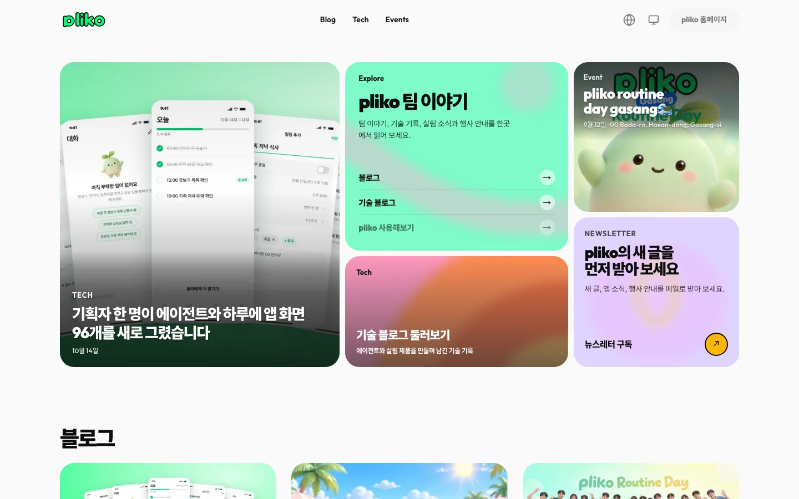
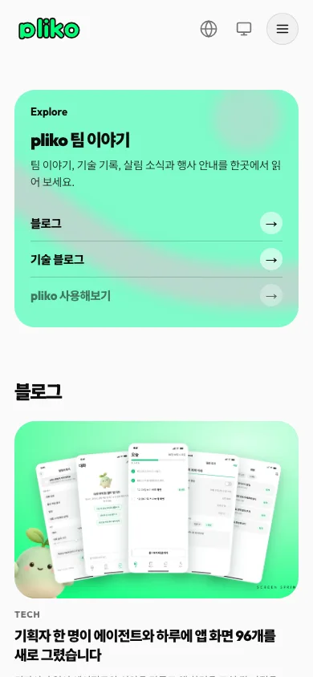

# pliko

가상 제품 "AI 살림 도우미"를 만드는 가상 브랜드 pliko의 제품 팀 블로그 샘플 프리셋이에요. 홈, 기술 블로그 목록, 글 4편, 없는 주소 화면을 한국어·영어, 시스템·라이트·다크로 살펴볼 수 있어요. 구독 창과 행사 신청 창은 화면 안에서 입력을 검사하는 데모이고, 외부 링크와 사이트 주소는 모두 비어 있는 예시예요. 프리미엄 팩으로 제공하며, 아래 안내에서 다운로드하고 복원할 수 있어요.

| 항목 | 내용 |
|---|---|
| 페이지 | <!-- v:preset.pliko.pages -->6<!-- /v -->개(홈, 기술 블로그 `/tech/`, 글 4편 `screen-sprint`·`working-with-agents`·`routine-day-recap`·`tool-search`)이고, 없는 주소 화면이 따로 있어요 |
| 디자인 참고 | [blog.vooy.com](https://blog.vooy.com/)의 구조·서체·색·모션을 직접 실측해 참고해요(디자인 카탈로그의 스타일이 아니에요). 브랜드·인물·행사·수치·연락처는 가상 예시이고, 시제품 영상도 가상 화면이에요 |
| 대표 색 | <!-- v:preset.pliko.design.color -->라이트그레이·잉크·네온그린<!-- /v -->, 강조색은 <!-- v:preset.pliko.design.hexCode -->`#00ff77`<!-- /v -->예요 |
| 서체 | Outfit과 Pretendard 가변을 자체 호스팅하고 OFL 이용 조건을 팩에 담았어요 |
| 생성 이미지 | <!-- v:preset.pliko.design.images -->16<!-- /v -->개를 gpt-image로 만들었어요. 나머지 화면 자산은 HTML·SVG로 그렸어요 |
| 설정 | 같은 주소에서 바꾸는 언어 메뉴(한국어·영어)와 아이콘 버튼 하나의 테마 메뉴(시스템·라이트·다크)를 제공해요 |
| 검사 상태 | 하위 경로로 내보낸 정적 사본에서 링크와 버튼을 <!-- v:preset.pliko.design.clicks -->70<!-- /v -->번 눌러 확인했어요. 원본 대조 관측 924개가 모두 통과했어요([검증 상태](#검증-상태)). 실결제·운영 DB·배포는 포함하지 않아요 |





## 프리셋 팩으로 만들어 보기

<!-- b:preset-pack name=pliko -->
작업 폴더 `~/projects`에서 연 에이전트에 이 프롬프트를 보내면 pliko 프리셋과 같은 서비스를 만들어요. [프리셋 팩](https://github.com/roadkwon-ai/pro-kit-premium-packs/releases/tag/pack-pliko)의 화면 구성, 디자인, 예시 데이터, 그림을 그대로 써서 AI 그림을 새로 그리지 않아요. `[ ]` 안의 이름을 바꿔 같은 구성의 서비스를 만들어요. 팩을 써도 AI가 만들기 때문에 100% 똑같지는 않을 수 있어요.

```prompt
https://github.com/roadkwon-ai/pro-kit 을 이 폴더에 받고, 그 안의 AGENTS.md대로 화면만 만들 프로젝트를 pro-kit 옆에 [pliko] 폴더로 만들어줘.
DB는 쓰지 않아. 없는 준비물은 설치해줘.
옆 폴더 pro-kit의 packs/pliko에 프리셋 팩을 받아줘.
그 팩대로 pliko 프리셋과 똑같은 서비스를 만들 거야. 이름은 [pliko].
팩의 README.md 순서대로 하고, 팩은 고치지 마. 이름을 바꿨으면 팩의 이름 대신 내가 정한 이름을 써.
디자인, 화면 구성, 그림은 팩에 있는 것을 써. 스타일 추천, 시안, 새 그림은 만들지 마.
모든 페이지의 기본 디자인은 팩의 스크린샷과 같게 만들어줘.
시스템·라이트·다크 모드 전환과 한국어·영어 전환을 모든 페이지의 기본 기능으로 넣어줘. 화면 문구는 같은 키를 가진 두 언어의 번역 사전에서 관리하고, 전환해도 현재 페이지와 입력을 유지해줘. 개발 화면과 HTML로 내보낸 결과에서 모든 페이지의 전환과 상태 유지를 실제로 확인해줘.
다 만들면 HTML 파일로 내보내줘.
```

> [!IMPORTANT]
> **프롬프트만 보내면 에이전트가 이 프리셋 팩을 자동으로 받아 설치해요. 따로 받지 않아도 돼요.**
>
> 직접 받으려면 [pliko-pack.zip](https://github.com/roadkwon-ai/pro-kit-premium-packs/releases/download/pack-pliko/pliko-pack.zip)(13.2MB, [릴리스](https://github.com/roadkwon-ai/pro-kit-premium-packs/releases/tag/pack-pliko))을 받고, 프롬프트 끝에 `프리셋 팩 zip은 [~/Downloads/pliko-pack.zip]에 받아 뒀어.` 한 줄을 더하세요. 에이전트가 그 zip이 최신 판인지 확인하고, 옛 판이면 새로 받아요.
<!-- /b -->

### 직접 받은 ZIP으로 자세히 복원하기

ZIP을 미리 받았다면 아래 절차로 파일을 검증하고 복원해요.

받아 둔 ZIP이 `tutorials/packs.json`에 등록된 판인지 확인하고, pro-kit 폴더의 터미널에서 아래 명령을 실행해요. 명령의 `[팩 ZIP 경로]` 자리에 그 파일의 경로를 넣어요.

```bash
node scripts/pack.mjs pliko --zip "[팩 ZIP 경로]"
```

이 명령은 등록된 SHA-256을 대조해 `packs/pliko/`에 풀어요. 파일이 없거나 해시가 다르면 다운로드한 파일과 등록 정보를 확인해요.

팩이 준비되면 작업 폴더에서 연 에이전트에 아래 프롬프트를 보내요. [처음부터 만들기](#이-컨셉으로-처음부터-만들기)의 프로젝트 생성 절차처럼 에이전트가 템플릿 초기 구성을 먼저 처리해요. 프로젝트 이름은 `pliko`로 둬요. 팩 소스가 `@pliko/*` 패키지 이름을 그대로 써서, 이름이 다르면 패키지 이름을 따로 맞춰야 해요.

```prompt
pro-kit의 AGENTS.md대로 pro-kit 옆 pliko 폴더에 새 화면만 프로젝트를 만들어줘.
검증해 풀어 둔 pro-kit/packs/pliko의 README와 manifest를 읽고 prokit-pack-use로 복원해줘. 이름은 [pliko].
apply-pack.mjs --check로 충돌을 확인한 뒤 실제 적용하고, 환경·하네스를 보존한 채 설치·타입·빌드·실행을 확인해줘.
DB는 쓰지 않아. 없는 준비물은 설치해줘.
팩은 고치지 말고 소스, 디자인, 그림, 폰트와 이용 조건을 재사용해줘. 스타일 추천이나 새 그림은 필요 없어.
뉴스레터 구독 창과 행사 신청 창은 입력 검사·화면 안 데모로 유지해줘. 실제 전송·저장은 하지 마.
한국어·영어와 시스템·라이트·다크 전환 후에도 입력 내용과 현재 위치를 유지해줘.
홈·기술 블로그·글 4편·없는 주소를 직접 열고, 새로고침과 쪽 왕복, 전체 스크롤의 모션과 이미지를 확인해서 manifest의 화면 기준과 비교해줘.
다 만들면 HTML 파일로 내보내줘.
```

팩에는 환경값, 환경 schema, 하네스, 제작 스킬이 들어 있지 않아요. 프로젝트의 로컬 설정은 건드리지 않고, 필요한 환경 선언은 실제 소스와 따로 대조해요. ZIP을 푸는 것과 프로젝트를 복원하는 것은 별개예요.

**이렇게 되면 성공**

- 홈, 기술 블로그, 글 4편, 없는 주소 화면을 직접 열 수 있고 새로고침·왕복 뒤에도 화면이 유지돼요.
- 언어 메뉴와 테마 메뉴로 바꿔도 현재 쪽과 입력 내용이 남고, Escape로 메뉴를 닫으면 열었던 버튼으로 초점이 돌아와요.
- 구독 창과 신청 창이 이메일 형식과 동의 선택을 검사하고, 정상 입력이면 성공 문구를 보여 줘요. 서버로 보내지는 않아요.
- 주소를 채우지 않은 링크는 흐린 비활성 표시와 "링크 미설정" 툴팁으로 보여요.

<details>
<summary>막히면</summary>

- **ZIP 검증이 멈춰요**: 해시가 등록된 판과 다르다는 뜻이에요. 위 다운로드 안내에서 현재 팩을 다시 받아 `tutorials/packs.json`과 비교해요.
- **복원이 충돌로 멈춰요**: 프로젝트 이름이 `pliko`인지 확인해요. 충돌이 있으면 사용자 파일을 보존하고 차이를 검토해요.
- **공유 버튼이 "다시 시도해 주세요"만 보여요**: 브라우저가 클립보드를 거부한 경우예요. 다른 복사 방법은 없어요.

</details>

프롬프트를 보냈다면 [알려 준 한 줄로 이어 가기](README.md#3-알려-준-한-줄로-이어-가기)에서 작업 폴더의 이어서 하기를 따라가요.

## 프리셋 팩으로 나만의 서비스 만들기

복원한 프로젝트에서 브랜드 이름·문구·글부터 바꿔요. 팩의 `CUSTOMIZE.md`는 바꿀 항목과 다시 확인할 동작을 안내해요.

```prompt
복원한 pliko를 [내 팀 이름]의 팀 블로그로 바꿔줘.
제품은 [내 제품]이고 소개할 글은 [글 주제들]이야.
팩의 CUSTOMIZE.md를 보고 바꾸는 부분만 수정해줘. 원본 팩은 고치지 마.
인물·행사·수치는 내가 확인해 준 내용만 쓰고, 가상 예시를 실제 소식처럼 쓰지 마.
한국어와 영어 문구를 함께 바꾸고 모바일 배치를 맞춰줘. 구독·신청은 화면 안 데모로 유지해줘.
나머지 서체 크기·간격·모션은 유지하고 완성 프리셋과 비교해줘.
```

새 그림이 필요하면 [이미지 그리기 안내](../reference/costs-and-keys.md#이미지-그리기)를 확인해요. 그림은 비율과 슬롯을 유지하고 같은 파일 이름으로 바꾸는 것이 가장 안전하고, 옆의 `*.webp.json`(출처·해시)도 함께 갱신해요. 브랜드 이름은 한 곳에만 있지 않아서 프로젝트 전체에서 `pliko`를 검색해 함께 바꿔요.

문구는 `apps/web/src/lib/messages/content/site.ts`(내비·푸터·홈·기술 블로그·행사·뉴스레터)와 `posts/meta.ts`(글 4편)에서 바꾸고 한국어와 영어를 함께 맞춰요. 제품 홈페이지, Product·Social, 정책, 행사 신청 같은 외부 주소는 `site.ts`의 비어 있는 칸에 `https://`로 시작하는 확인한 주소만 넣어요. 비워 두면 비활성으로 보여요. 사이트 주소(canonical, og:url, hreflang, sitemap)는 배포 주소를 정한 뒤에 채워요. 정확한 위치와 순서는 팩의 `CUSTOMIZE.md`에 있어요.

## 이 컨셉으로 처음부터 만들기

<!-- b:preset-scratch-intro -->
작업 폴더 `~/projects`에서 연 에이전트에 이 프롬프트를 그대로 보내면 **바로** 시작돼요. [가장 쉬운 방법](README.md#가장-쉬운-방법)의 프롬프트와 같고, `[ ]` 안만 이 프리셋의 폴더 이름과 컨셉이에요. 원하는 대로 바꿔도 돼요.
<!-- /b -->

<!-- b:screen-prompt folder=pliko concept="제품 팀의 이야기·기술 글·행사 소식을 읽고 뉴스레터 구독 내용을 복사하는 팀 블로그" -->
```prompt
https://github.com/roadkwon-ai/pro-kit 을 이 폴더에 받고, 그 안의 AGENTS.md대로 화면만 만들 프로젝트를 pro-kit 옆에 [pliko] 폴더로 만들어줘.
DB는 쓰지 않아. 없는 준비물은 설치해줘.
[제품 팀의 이야기·기술 글·행사 소식을 읽고 뉴스레터 구독 내용을 복사하는 팀 블로그]를 만들고 싶어.
필요한 화면을 모두 예시 데이터로 만들어줘. 로그인이나 저장 같은 기능은 빼고 화면만 만들어.
시스템·라이트·다크 모드 전환과 한국어·영어 전환을 모든 페이지의 기본 기능으로 넣어줘. 화면 문구는 같은 키를 가진 두 언어의 번역 사전에서 관리하고, 전환해도 현재 페이지와 입력을 유지해줘. 개발 화면과 HTML로 내보낸 결과에서 모든 페이지의 전환과 상태 유지를 실제로 확인해줘.
디자인 스타일은 서비스에 어울리는 걸로 추천해주고, 다 만들면 HTML 파일로 내보내줘.
```
<!-- /b -->

<!-- b:preset-scratch-note -->
**같은 컨셉이라도 이름, 스타일, 화면은 매번 다르게 나와요.** 프리셋에 가깝게 만들려면 [프리셋 팩으로 만들어 보기](#프리셋-팩으로-만들어-보기)를 쓰세요.
<!-- /b -->

<!-- b:preset-next-steps -->
에이전트를 아직 열지 않았으면 [1. 작업 폴더에서 에이전트 열기](README.md#1-작업-폴더에서-에이전트-열기)부터 하세요. 프롬프트를 보낸 다음에는 [3. 알려 준 한 줄로 이어 가기](README.md#3-알려-준-한-줄로-이어-가기)와 [4. 답하며 요청을 자세히 채우기](README.md#4-답하며-요청을-자세히-채우기)를 따라가면 돼요.
<!-- /b -->

<!-- edition:pro -->
## 실제 서비스로 만들 때

예시 팀 소개·글·행사·연락처를 확인된 본인 자료로 바꿔요. 글을 관리 화면(CMS)에서 올리거나 구독 메일을 보내려면 저장 방식, 발송 방법, 수신 동의와 개인정보 처리 범위를 정하고 `prokit-api`·`prokit-db` 등 프로젝트 스킬로 서버 기능을 연결해요. 구독 창의 입력 검사와 성공 문구가 있다는 이유로 발송이 연결된 것으로 판단하지 않아요.

```prompt
복원한 프로젝트에서 [필요한 실전 기능]을 연결해줘.
먼저 데이터·발송 방법·권한·개인정보 처리 범위를 확인하고 프로젝트 기술 스킬을 따라 구현해줘.
완성팩의 배치·서체·이미지·모션·설정 메뉴를 유지해줘.
로딩·빈 목록·오류·긴 글 상태와 원래 화면을 함께 검사해줘.
실행한 검사와 미확인 항목을 나눠 보고해줘.
```

복원 검사와 실전 기능 검사는 별개예요. 등록한 외부 주소의 이동은 실제 운영 환경에서도 확인해요. 기본값이 비어 있으면 활성 링크처럼 보이지 않아야 해요.
<!-- /edition -->

## 시간과 비용

프리셋 팩으로 다시 만들 때는 <!-- v:preset.pliko.pack.time.text -->한 번에 완성하면 약 1시간\~2시간(여러 번 고쳐 달라고 하면 약 3시간까지)<!-- /v -->이고, 토큰은 최소 약 <!-- v:preset.pliko.pack.tokens -->122.4만<!-- /v -->(캐시 포함 약 <!-- v:preset.pliko.pack.cached -->6118.8만<!-- /v -->)으로 예상해요. 처음부터 화면을 만들 때는 <!-- v:preset.pliko.scratch.time.text -->한 번에 완성하면 약 1시간 35분\~3시간 10분(여러 번 고쳐 달라고 하면 약 4시간 45분까지)<!-- /v -->과 최소 약 <!-- v:preset.pliko.scratch.tokens -->221만<!-- /v --> 토큰으로 예상해요.

<!-- b:preset-estimate-method report=2026-10-24-preset-measurements.json -->
시간은 공통 단계별 계획의 합이고, 토큰은 같은 정책의 기준 단위에서 환산한 예상값이에요. 검사 예상은 이 프리셋의 화면 범위를 기준으로 정했어요. [예상 계산 근거](https://github.com/roadkwon-ai/pro-kit/blob/main/docs/reports/2026-10-24-preset-measurements.json)를 확인해요.

실제 제작 기록이나 현재 제공자의 청구 요금을 뜻하지 않으며, API·DB·실결제 개발은 포함하지 않았어요. 고쳐 달라는 횟수와 사용하는 모델에 따라 늘어날 수 있어요. [시간과 비용 읽는 법](../reference/costs-and-keys.md#시간과-비용-읽는-법)을 참고해요.
<!-- /b -->

이 프리셋을 만든 실제 시간·토큰·비용은 여기에 싣지 않았어요. 위 값은 모두 정책 기반 예상이에요. 그림 호출은 구독에 포함되어 사용량 기록이 없어요.

디자인 평가는 닐슨의 열 가지 기준으로 <!-- v:preset.pliko.design.critique -->27<!-- /v -->점(40점 만점)이에요. 독립 평가 두 개가 매겼고, 접근성 점검은 20점 만점에 15점이에요. 평가는 마지막 수정본이 아니라 그 앞 판을 대상으로 했어요. 그 뒤에는 문구·색·인쇄 스타일만 바뀌어 다시 매기지 않았어요. 기준별 점수와 감점 이유는 프로킷 사이트의 디자인 평가에서 볼 수 있어요.

<!-- b:preset-estimate-stages name=pliko -->
<details>
<summary>단계별 예상</summary>

| 단계 | 프리셋 팩으로 | 처음부터(내 컨셉으로) |
|---|---|---|
| 준비: pro-kit 받기, 프로젝트 만들기 | 5분 · 10.2만 · 2달러 | 5분 · 10.2만 · 2달러 |
| 기획: 서비스 질문, 이름, 사이트맵 | 5분 · 10.2만 · 2달러 | 10분 · 20.4만 · 4달러 |
| 디자인: DESIGN.md | 5분 · 10.2만 · 2달러 | 8분 · 16.3만 · 3달러 |
| 화면 구성 | 해당 없음 · 0만 · 1달러 미만 | 10분 · 20.4만 · 4달러 |
| 그림 | 1분 · 2만 · 1달러 미만 | 8분 · 43.5만 · 8달러 |
| 첫 화면 | 10분 · 20.4만 · 4달러 | 15분 · 30.6만 · 6달러 |
| 나머지 페이지 | 20분 · 40.8만 · 7달러 | 25분 · 51만 · 9달러 |
| 검사와 디자인 리뷰 | 12분 · 24.5만 · 4달러 | 12분 · 24.5만 · 4달러 |
| HTML 내보내기 | 2분 · 4.1만 · 1달러 미만 | 2분 · 4.1만 · 1달러 미만 |
| 합계(배포 빼고) | 약 1시간\~2시간 (여러 번 고치면 약 3시간까지) · 약 122.4만(캐시 포함 약 6118.8만) · 약 22.25달러 | 약 1시간 35분\~3시간 10분 (여러 번 고치면 약 4시간 45분까지) · 약 221만(캐시 포함 약 9715.2만) · 약 40.17달러 |

</details>
<!-- /b -->

## 검증 상태

**제품과 팩.** 제품 최종 판의 실행 소스 261개 파일이 팩에 들어 있어요. 원본 대조는 관측 924개가 모두 통과했고 실패는 0이에요. 이 중 557개는 허용 차이로 통과했어요. 허용 차이는 글꼴 교체와 그에 따른 줄 수, 가상 문구로 바뀐 문단 길이, 테마·언어 설정 추가, 비워 둔 링크의 비활성 표시 같은 것이에요. 설정 검사는 12개 맥락(테마 메뉴, 언어 메뉴, Escape 초점 복귀, 번역, 새로고침 뒤 유지)에서 모두 통과했어요. 하위 경로(`/pro-kit/pliko`)로 내보낸 정적 사본에서는 6쪽에서 링크와 버튼을 70번 눌러 창 42번과 메뉴 12번을 열었고, 콘솔 오류와 막힌 링크가 0건이었어요.

**독립 검수.** 만든 쪽과 따로 도는 검수에서 6회차는 기능이 합격이고, 충실도와 접근성은 남은 낮음·참고 지적을 받아들인다는 조건을 붙인 합격이었어요. 문구를 바꾼 뒤 7회차는 바뀐 곳만 다시 검수했고, 피드(RSS·매니페스트)에 새 문구가 덜 옮겨진 점 등 5건을 지적받았어요. 8회차에서는 그 5건과 홈 영어 제목이 모두 해소된 것을 확인했고, 충실도·기능·접근성이 모두 합격이에요(지적 0건). 같은 짜임이던 문장 3개는 원본과의 유사도가 0.31\~0.47로 내려갔어요. 증거 검사(verify-evidence)도 남은 문제 0건이에요. 하위 경로(`/pro-kit/pliko`)로 내보낸 28개 조합에서 깨진 그림은 0건이고, 접두어 밖 요청은 공통 미리보기 수신기뿐이며, 콘솔 오류는 일부러 연 없는 주소의 404뿐이었어요. 글자 대비는 마지막 문구 수정 앞 판에서 쟀고, 그 뒤에는 문구만 바뀌었어요.

**팩 복원.** 팩 ZIP을 템플릿 새 사본에 복원해 적용·설치·타입 검사·빌드·정적 내보내기가 통과했어요. 정적 출력은 빌드 ID와 청크 파일 이름을 맞추면 제품 출력과 같았고, 다시 찍은 기준 화면 14장은 팩 기준 화면과 바이트까지 같았어요.

**알려진 한계.**

- 영어로 볼 때도 정적 HTML의 `head`는 한국어예요. 한 주소에서 언어를 바꾸는 구조라서 그래요.
- 없는 주소 화면은 원본처럼 영어로 고정돼요.
- 390px 홈에는 구독 입구가 없어요(원본 그대로).
- 1440px 홈에서 행사 카드 제목이 표지 로고와 겹쳐요(원본 배치).
- 모바일 상단 아이콘 버튼은 32\~40px예요(원본 크기).
- `llms.txt` 머리 문장과 짧은 라벨 몇 개는 원본과 비슷한 표현이에요(유사도 0.77\~0.83).
- 홈의 "Try pliko"는 주소를 채우기 전까지 비활성 링크예요.
- 공유 버튼은 클립보드를 거부당하면 "다시 시도해 주세요"만 보여 줘요.

복원한 프로젝트의 개발 서버 실행, 실결제·운영 DB·외부 배포·실기기·Safari는 이 안내에서 확인하지 않았어요.
