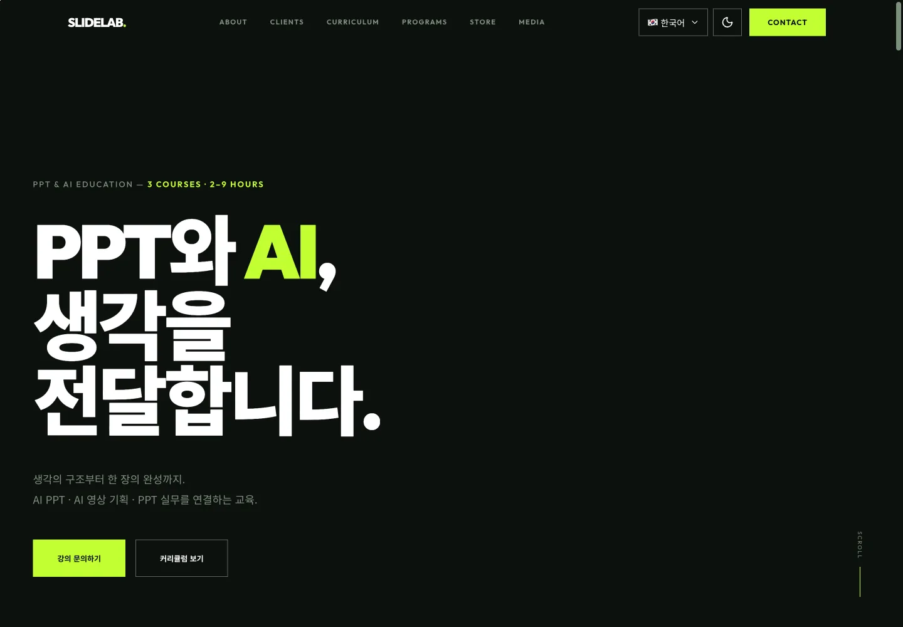

# 슬라이드랩

AI·PPT 교육을 소개하는 한 페이지 프리셋이에요. 과정과 교육 시간을 고르면 문의에 반영되고, 템플릿과 학습 노트를 같은 페이지에서 살펴볼 수 있어요. 문의는 입력 검사 뒤 예시 완료 상태를 보여 주며 실제로 전송하지 않아요.



[프리셋 사이트 열기](https://roadkwon-ai.github.io/pro-kit/slidelab/) · [프로킷 사이트에서 보기](https://prokit.highvalue.kr/work/slidelab/)

| 항목 | 내용 |
|---|---|
| 페이지 | <!-- v:preset.slidelab.pages -->1<!-- /v -->개, 소개·고객사 예시·현장·커리큘럼·후기·프로그램·템플릿·콘텐츠·문의까지 같은 페이지에서 이어져요 |
| 디자인 참고 | [pptpro.kr](https://pptpro.kr/)의 구조·서체·색상·스크롤 효과를 관측했어요. 인물·고객사·실적·사진은 복제하지 않았어요 |
| 대표 색 | <!-- v:preset.slidelab.design.color -->다크 라임<!-- /v -->, <!-- v:preset.slidelab.design.hexCode -->`#c8ff00`<!-- /v --> |
| 서체 | Outfit, Noto Sans KR. 자체 호스팅 파일과 OFL 이용 조건을 포함해요 |
| 생성 이미지 | <!-- v:preset.slidelab.design.images -->13<!-- /v -->개, 인물·강의·제품·학습 장면은 가상 예시예요 |
| 설정 | 시스템·라이트·다크와 한국어·영어 전환을 제공해요. 프로킷 미리보기에서는 기존 공통 설정으로 서체·팔레트를 비교해요 |
| 검사 | 현재 내보낸 화면에서 링크·버튼 <!-- v:preset.slidelab.design.clicks -->40<!-- /v -->번, 없는 페이지·콘솔 오류·반응 없는 버튼은 없었어요 |

## 프리셋 팩으로 만들어 보기

<!-- b:preset-pack name=slidelab -->
작업 폴더 `~/projects`에서 연 에이전트에 이 프롬프트를 보내면 슬라이드랩 프리셋과 같은 서비스를 만들어요. [프리셋 팩](https://github.com/roadkwon-ai/pro-kit-packs/releases/tag/pack-slidelab)의 화면 구성, 디자인, 예시 데이터, 그림을 그대로 써서 AI 그림을 새로 그리지 않아요. `[ ]` 안의 이름만 바꾸면 이름만 다른 서비스가 나와요. 팩을 써도 AI가 만들기 때문에 100% 똑같지는 않을 수 있어요.

```prompt
https://github.com/roadkwon-ai/pro-kit 을 이 폴더에 받고, 그 안의 AGENTS.md대로 화면만 만들 프로젝트를 pro-kit 옆에 [slidelab] 폴더로 만들어줘.
DB는 쓰지 않아. 없는 준비물은 설치해줘.
옆 폴더 pro-kit의 packs/slidelab에 프리셋 팩을 받아줘.
그 팩대로 슬라이드랩 프리셋과 똑같은 서비스를 만들 거야. 이름은 [슬라이드랩].
팩의 README.md 순서대로 하고, 팩은 고치지 마. 이름을 바꿨으면 팩의 이름 대신 내가 정한 이름을 써.
디자인, 화면 구성, 그림은 팩에 있는 것을 써. 스타일 추천, 시안, 새 그림은 만들지 마.
모든 페이지를 팩의 스크린샷과 같게 만들고, 다 만들면 HTML 파일로 내보내줘.
```

> [!IMPORTANT]
> **프롬프트만 보내면 에이전트가 이 프리셋 팩을 자동으로 받아 설치해요. 따로 받지 않아도 돼요.**
>
> 직접 받으려면 [slidelab-pack.zip](https://github.com/roadkwon-ai/pro-kit-packs/releases/download/pack-slidelab/slidelab-pack.zip)(34.9MB, [릴리스](https://github.com/roadkwon-ai/pro-kit-packs/releases/tag/pack-slidelab))을 받고, 프롬프트 끝에 `프리셋 팩 zip은 [~/Downloads/slidelab-pack.zip]에 받아 뒀어.` 한 줄을 더하세요. 에이전트가 그 zip이 최신 판인지 확인하고, 옛 판이면 새로 받아요.
<!-- /b -->

<!-- b:preset-next-steps -->
에이전트를 아직 열지 않았으면 [1. 작업 폴더에서 에이전트 열기](README.md#1-작업-폴더에서-에이전트-열기)부터 하세요. 프롬프트를 보낸 다음에는 [3. 알려 준 한 줄로 이어 가기](README.md#3-알려-준-한-줄로-이어-가기)와 [4. 답하며 요청을 자세히 채우기](README.md#4-답하며-요청을-자세히-채우기)를 따라가면 돼요.
<!-- /b -->

<details>
<summary>막히면</summary>

<!-- b:trouble-pack name=slidelab -->
- **프리셋 팩을 못 찾는대요**: `프리셋 팩은 옆 폴더 pro-kit의 packs/slidelab에 있어. 없으면 pro-kit 폴더에서 node scripts/pack.mjs slidelab 명령으로 받아줘`라고 보내세요. pro-kit 폴더가 2026-10-08 전에 받은 것이라 팩 받기가 멈추면 `그 폴더 이름을 pro-kit-old로 바꾸고 새로 받아줘`라고 보내세요.
<!-- /b -->

</details>

## 프리셋 팩으로 나만의 서비스 만들기

<!-- b:preset-remix name=slidelab folder=workshop title="우리 워크숍" changes="주제는 발표 교육, 대표 색은 짙은 파랑" topic="주제는 발표 교육" -->
슬라이드랩의 [프리셋 팩](https://github.com/roadkwon-ai/pro-kit-packs/releases/tag/pack-slidelab)을 바탕으로 이름, 색, 페이지, 주제를 바꿔 나만의 서비스를 만들어요. 화면 구성과 디자인이 정해져 있어서 처음부터 만들 때보다 빠르고, 맞지 않는 그림만 같은 화풍으로 다시 그려요.

```prompt
https://github.com/roadkwon-ai/pro-kit 을 이 폴더에 받고, 그 안의 AGENTS.md대로 화면만 만들 프로젝트를 pro-kit 옆에 [workshop] 폴더로 만들어줘.
DB는 쓰지 않아. 없는 준비물은 설치해줘.
옆 폴더 pro-kit의 packs/slidelab에 프리셋 팩을 받아줘.
그 팩을 바탕으로 나만의 서비스를 만들 거야. 이름은 [우리 워크숍].
바꿀 것: [주제는 발표 교육, 대표 색은 짙은 파랑]
팩의 README.md와 CUSTOMIZE.md를 보고, 바꾸는 것에 맞춰 다시 할 일만 해줘. 다시 그릴 그림은 팩의 prompts.json을 고쳐 같은 화풍으로 그려줘.
팩은 고치지 말고, 바꾸지 않는 것은 팩대로 해. 다 만들면 HTML 파일로 내보내줘.
```

`바꿀 것`에는 이렇게 적어요.
- 색이나 서체: `대표 색은 짙은 파랑, 제목 서체는 더 둥글게`
- 페이지: `[페이지 이름] 페이지는 빼줘` 또는 `[페이지 이름] 페이지를 더해줘`
- 주제: `주제는 발표 교육`

무엇을 바꾸면 무엇을 다시 하는지는 팩의 `CUSTOMIZE.md`에 있어요. **그림을 다시 그리려면 이미지를 그릴 수 있는 에이전트가 필요해요**([이미지 그리기](../reference/costs-and-keys.md#이미지-그리기)). 그릴 수 없으면 원래 그림을 그대로 써요.

팩 zip을 미리 받아 두었다면 [프리셋 팩으로 만들어 보기](#프리셋-팩으로-만들어-보기)처럼 이 프롬프트 끝에도 zip 경로 한 줄을 더하세요.
<!-- /b -->

## 이 컨셉으로 처음부터 만들기

<!-- b:preset-scratch-intro -->
작업 폴더 `~/projects`에서 연 에이전트에 이 프롬프트를 그대로 보내면 **바로** 시작돼요. [가장 쉬운 방법](README.md#가장-쉬운-방법)의 프롬프트와 같고, `[ ]` 안만 이 프리셋의 폴더 이름과 컨셉이에요. 원하는 대로 바꿔도 돼요.
<!-- /b -->

<!-- b:screen-prompt folder=slidelab concept="AI·PPT 교육 과정을 소개하고 과정과 교육 시간을 고른 뒤 예시 문의를 남기는 한 페이지 사이트" -->
```prompt
https://github.com/roadkwon-ai/pro-kit 을 이 폴더에 받고, 그 안의 AGENTS.md대로 화면만 만들 프로젝트를 pro-kit 옆에 [slidelab] 폴더로 만들어줘.
DB는 쓰지 않아. 없는 준비물은 설치해줘.
[AI·PPT 교육 과정을 소개하고 과정과 교육 시간을 고른 뒤 예시 문의를 남기는 한 페이지 사이트]를 만들고 싶어.
필요한 화면을 모두 예시 데이터로 만들어줘. 로그인이나 저장 같은 기능은 빼고 화면만 만들어.
디자인 스타일은 서비스에 어울리는 걸로 추천해주고, 다 만들면 HTML 파일로 내보내줘.
```
<!-- /b -->

<!-- b:preset-scratch-note -->
**같은 컨셉이라도 이름, 스타일, 화면은 매번 다르게 나와요.** 프리셋에 가깝게 만들려면 [프리셋 팩으로 만들어 보기](#프리셋-팩으로-만들어-보기)를 쓰세요.
<!-- /b -->

<!-- b:preset-next-steps -->
에이전트를 아직 열지 않았으면 [1. 작업 폴더에서 에이전트 열기](README.md#1-작업-폴더에서-에이전트-열기)부터 하세요. 프롬프트를 보낸 다음에는 [3. 알려 준 한 줄로 이어 가기](README.md#3-알려-준-한-줄로-이어-가기)와 [4. 답하며 요청을 자세히 채우기](README.md#4-답하며-요청을-자세히-채우기)를 따라가면 돼요.
<!-- /b -->

## 실제로 보완한 부분

넓은 화면의 중앙 정렬, 프로필과 다음 영역의 스크롤 겹침, 사진 누락과 세로 콘텐츠 잘림을 고쳤어요. 현재판에는 두 언어의 문구, 밝고 어두운 의미 색상, 입력을 유지하는 전환, 폰트 이용 조건을 추가했어요. 자세한 내용은 [제작 검증 기록](https://github.com/roadkwon-ai/pro-kit/blob/main/docs/reports/2026-10-10-slidelab-reference-fidelity/README.md)에 있어요.

## 실제 서비스로 만들 때

문의 전달 서비스와 개인정보 처리 방식을 정해야 해요. 이 프리셋의 고객사·후기·강사와 현장 이미지는 예시이므로 실제 정보로 교체하고, 사용할 권리를 확인해요. 로그인·결제·DB는 현재 프리셋에 포함하지 않았어요.

## 시간과 비용

최초 제작·수정의 <!-- v:preset.slidelab.observed.count -->3<!-- /v -->개 세션에서 <!-- v:preset.slidelab.observed.time -->1시간 59분<!-- /v -->을 관측했어요. <!-- v:preset.slidelab.observed.note -->대기·검사·증거 정리를 포함한 세션 관측값이에요. 초기 설치와 레퍼런스 재제작·게시 준비는 포함하지 않았어요.<!-- /v -->

전체 제작 시간·토큰·비용과 팩 재현 시간은 이 일부 기록으로 확정할 수 없어요. [관측 출처와 표시 기준](https://github.com/roadkwon-ai/pro-kit/blob/main/docs/reports/2026-10-11-preset-skills/README.md)을 확인해요. 다른 프리셋의 숫자나 주관 시각 점수를 환산해 채우지 않았어요. 검증한 빌드·내보내기 시간은 해당 작업의 관측값이며 전체 제작 시간 단축률을 뜻하지 않아요.
