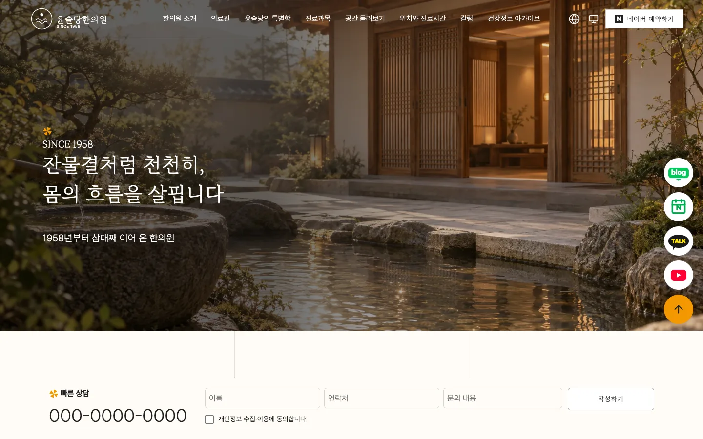
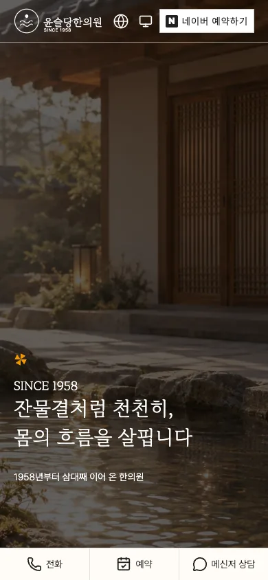

# 윤슬당한의원

3대째 이어 온 한의원의 이야기, 의료진, 진료과목, 공간, 위치와 진료시간을 보여 주는 한의원 소개 샘플 프리셋이에요. 첫 화면, 칼럼 목록과 글, 건강정보 아카이브를 살펴볼 수 있고, 첫 화면 위로 이용약관 창이 열려요. 가상 한의원 윤슬당한의원의 이름·의료진·연락처·사업자 정보는 모두 예시예요. 헤더의 `네이버 예약하기` 단추와 오른쪽 플로팅 단추(blog·N·TALK·재생 표지)는 네이버 예약·블로그, 카카오 채널, 유튜브의 첫 화면을 새 탭으로 여는 예시 주소이고 실제 병원 계정이 아니에요. 빠른 상담 양식은 전송하지 않는 데모예요. 프리미엄 팩으로 제공하며, 아래 안내에서 다운로드하고 복원할 수 있어요.

| 항목 | 내용 |
|---|---|
| 페이지 | 비교 기준 화면은 <!-- v:preset.yunseul.pages -->4<!-- /v -->쪽이에요. 첫 화면, 칼럼 목록, 칼럼 글, 건강정보 아카이브이고, 첫 화면 위에 이용약관 창(`/?mode=privacy`)이 열려요 |
| 디자인 참고 | [chdd1922.com](https://chdd1922.com/)의 구조·서체·색·배치를 직접 실측해 참고해요. 한의원·의료진·글·연락처·수치는 가상 예시이고, 원본의 문구는 쓰지 않았어요 |
| 대표 색 | <!-- v:preset.yunseul.design.color -->크림·잉크·오렌지<!-- /v -->, 강조색은 <!-- v:preset.yunseul.design.hexCode -->`#f39800`<!-- /v -->예요 |
| 서체 | MaruBuri와 Pretendard를 자체 호스팅하고, OFL 이용 조건을 담았어요 |
| 생성 이미지 | 사진 <!-- v:preset.yunseul.design.images -->39<!-- /v -->장이에요. 의료진·진료실·탕전실·칼럼·지도 그림을 생성했고, 첫 화면 배경 영상 1편은 이 수에 넣지 않았어요 |
| 설정 | 언어 메뉴(한국어·영어)와 테마 메뉴를 제공해요. 헤더 메뉴는 너비가 좁아지면 넘치는 항목을 더보기(`…`) 메뉴로 접어요. 플로팅 단추는 화면 너비 1200 이상에서 보여요 |
| 검사 상태 | 정적 사본의 4쪽을 열어 보이는 버튼을 <!-- v:preset.yunseul.design.clicks -->18<!-- /v -->번 눌렀어요. 없는 페이지, 콘솔 오류, 반응 없는 버튼은 모두 0이에요. 버튼만 누르는 검사라 링크 이동과 창은 따로 살폈어요([검증 상태](#검증-상태)). 실결제·운영 DB·배포는 포함하지 않아요 |





## 프리셋 팩으로 만들어 보기

<!-- b:preset-pack name=yunseul -->
작업 폴더 `~/projects`에서 연 에이전트에 이 프롬프트를 보내면 윤슬당한의원 프리셋과 같은 서비스를 만들어요. [프리셋 팩](https://github.com/roadkwon-ai/pro-kit-premium-packs/releases/tag/pack-yunseul)의 화면 구성, 디자인, 예시 데이터, 그림을 그대로 써서 AI 그림을 새로 그리지 않아요. `[ ]` 안의 이름을 바꿔 같은 구성의 서비스를 만들어요. 팩을 써도 AI가 만들기 때문에 100% 똑같지는 않을 수 있어요.

```prompt
https://github.com/roadkwon-ai/pro-kit 을 이 폴더에 받고, 그 안의 AGENTS.md대로 화면만 만들 프로젝트를 pro-kit 옆에 [yunseul] 폴더로 만들어줘.
DB는 쓰지 않아. 없는 준비물은 설치해줘.
옆 폴더 pro-kit의 packs/yunseul에 프리셋 팩을 받아줘.
그 팩대로 윤슬당한의원 프리셋과 똑같은 서비스를 만들 거야. 이름은 [윤슬당한의원].
팩의 README.md 순서대로 하고, 팩은 고치지 마. 이름을 바꿨으면 팩의 이름 대신 내가 정한 이름을 써.
디자인, 화면 구성, 그림은 팩에 있는 것을 써. 스타일 추천, 시안, 새 그림은 만들지 마.
모든 페이지의 기본 디자인은 팩의 스크린샷과 같게 만들어줘.
시스템·라이트·다크 모드 전환과 한국어·영어 전환을 모든 페이지의 기본 기능으로 넣어줘. 화면 문구는 같은 키를 가진 두 언어의 번역 사전에서 관리하고, 전환해도 현재 페이지와 입력을 유지해줘. 개발 화면과 HTML로 내보낸 결과에서 모든 페이지의 전환과 상태 유지를 실제로 확인해줘.
다 만들면 HTML 파일로 내보내줘.
```

> [!IMPORTANT]
> **프롬프트만 보내면 에이전트가 이 프리셋 팩을 자동으로 받아 설치해요. 따로 받지 않아도 돼요.**
>
> 직접 받으려면 [yunseul-pack.zip](https://github.com/roadkwon-ai/pro-kit-premium-packs/releases/download/pack-yunseul/yunseul-pack.zip)(18.8MB, [릴리스](https://github.com/roadkwon-ai/pro-kit-premium-packs/releases/tag/pack-yunseul))을 받고, 프롬프트 끝에 `프리셋 팩 zip은 [~/Downloads/yunseul-pack.zip]에 받아 뒀어.` 한 줄을 더하세요. 에이전트가 그 zip이 최신 판인지 확인하고, 옛 판이면 새로 받아요.
<!-- /b -->

### 직접 받은 ZIP으로 자세히 복원하기

ZIP을 미리 받았다면 아래 절차로 파일을 검증하고 복원해요.

받아 둔 ZIP이 `tutorials/packs.json`에 등록된 판과 같아야 해요. pro-kit 폴더의 터미널에서 아래 명령을 실행해요. `[팩 ZIP 경로]`에는 받아 둔 파일의 실제 경로를 넣어요.

```bash
node scripts/pack.mjs yunseul --zip "[팩 ZIP 경로]"
```

이 명령은 등록된 SHA-256을 대조해 `packs/yunseul/`에 풀어요. 파일이 없거나 해시가 다르면 다운로드한 파일과 등록 정보를 확인해요.

팩이 준비되면 작업 폴더에서 연 에이전트에 아래 프롬프트를 보내요. [처음부터 만들기](#이-컨셉으로-처음부터-만들기)의 프로젝트 생성 절차처럼 에이전트가 템플릿 초기 구성을 먼저 처리해요. 프로젝트 이름은 `yunseul`로 둬요. 팩 소스가 `@yunseul/*` 워크스페이스 이름을 그대로 쓰면 이름이 다를 때 복원이 충돌로 멈춰요.

```prompt
pro-kit의 AGENTS.md대로 pro-kit 옆 yunseul 폴더에 새 화면만 프로젝트를 만들어줘.
검증해 풀어 둔 pro-kit/packs/yunseul의 README와 manifest를 읽고 prokit-pack-use로 복원해줘. 이름은 [윤슬당한의원].
apply-pack.mjs --check로 충돌을 확인한 뒤 실제 적용하고, 환경·하네스를 보존한 채 설치·타입·빌드·실행을 확인해줘.
DB는 쓰지 않아. 없는 준비물은 설치해줘.
팩은 고치지 말고 소스, 디자인, 그림, 폰트와 이용 조건을 재사용해줘. 스타일 추천이나 새 그림은 필요 없어.
빠른 상담 양식은 입력 검사만 하는 데모로 유지해줘. 실제 전송·결제·DB 저장은 하지 마.
한국어·영어와 시스템·라이트·다크 전환 후에도 입력 내용과 현재 위치를 유지해줘.
첫 화면, 칼럼 목록과 글, 건강정보 아카이브, 이용약관 창(`/?mode=privacy`), 플로팅 단추, 헤더 더보기 메뉴를 확인하고 팩의 화면 기준과 비교해줘.
다 만들면 HTML 파일로 내보내줘.
```

이 팩에는 환경값, 환경 schema, 하네스, 제작 스킬이 들어 있지 않아요. 초기 구성에서 만든 로컬 설정은 건드리지 않고, 필요한 환경 선언은 소스와 따로 맞춰 봐요. ZIP을 푸는 일과 프로젝트를 복원하는 일은 별개예요.

**이렇게 되면 성공**

- 네 쪽(첫 화면, 칼럼 목록, 칼럼 글, 건강정보 아카이브)과 이용약관 창을 직접 열 수 있고 새로고침 뒤에도 화면이 유지돼요.
- 언어 메뉴와 테마 메뉴로 바꿔도 현재 쪽과 입력 내용이 남아요.
- 빠른 상담 양식이 필수 항목을 검사하고, 전송 없이 데모 확인 창을 보여 줘요.
- 헤더 예약 단추와 플로팅 단추는 서비스 첫 화면을 새 탭으로 열어요.

<details>
<summary>막히면</summary>

- **ZIP 검증에서 멈춰요**: 받은 ZIP이 `tutorials/packs.json`에 등록된 판인지 봐요. 판이 다르면 위 안내에서 현재 팩을 새로 받아요.
- **복원이 충돌로 멈춰요**: 프로젝트 이름이 `yunseul`인지 확인해요. 충돌이 있으면 사용자 파일을 보존하고 차이를 검토해요.
- **창이나 메뉴가 열리지 않아요**: 팩의 README.md 순서대로 설치·빌드가 끝났는지 확인하고, 브라우저 콘솔 오류를 에이전트에 그대로 전해요.

</details>

프롬프트를 보냈다면 [알려 준 한 줄로 이어 가기](README.md#3-알려-준-한-줄로-이어-가기)부터 작업 폴더에서 계속해요.

## 프리셋 팩으로 나만의 서비스 만들기

복원한 프로젝트에서 한의원 이름·소개·의료진부터 바꿔요. 팩의 `CUSTOMIZE.md`는 바꿀 항목과 다시 확인할 동작을 안내해요.

```prompt
복원한 윤슬당한의원을 [내 한의원 이름] 소개 사이트로 바꿔줘.
소개할 의료진은 [의료진 정보]이고 진료과목은 [진료과목들]이야.
팩의 CUSTOMIZE.md를 보고 바꾸는 부분만 수정해줘. 원본 팩은 고치지 마.
의료진·글·수치·연락처는 내가 확인해 준 내용만 쓰고, 가상 예시를 실제 정보처럼 쓰지 마. 완치, 치료 전후 사례, 환자 후기 같은 의료 광고 표현은 넣지 마.
한국어와 영어 문구를 함께 바꾸고 모바일 배치를 맞춰줘. 빠른 상담은 전송하지 않는 데모로 유지해줘.
나머지 서체 크기·간격·모션은 유지하고 완성 프리셋과 비교해줘.
```

새 그림이 필요하면 [이미지 그리기 안내](../reference/costs-and-keys.md#이미지-그리기)를 확인해요. 사진은 `public/media/`의 파일을 같은 이름과 비율로 바꾸고, 옆의 `*.webp.json`(출처·해시)이 있으면 함께 갱신해요. 예약·블로그·메신저·영상 주소는 `apps/web/src/components/site/links.ts`의 `links`에서 바꾸고, 쓰지 않는 서비스는 빈 문자열로 둬요.

가상 한의원 이름, 의료진 소개, 연락처, 사업자 정보와 이용약관은 확인된 본인 자료로 바꿔요. 이용약관은 화면용 샘플이라 실제 약관으로 교체해요.

## 이 컨셉으로 처음부터 만들기

<!-- b:preset-scratch-intro -->
작업 폴더 `~/projects`에서 연 에이전트에 이 프롬프트를 그대로 보내면 **바로** 시작돼요. [가장 쉬운 방법](README.md#가장-쉬운-방법)의 프롬프트와 같고, `[ ]` 안만 이 프리셋의 폴더 이름과 컨셉이에요. 원하는 대로 바꿔도 돼요.
<!-- /b -->

<!-- b:screen-prompt folder=yunseul concept="3대째 이어 온 한의원의 이야기와 의료진, 진료과목, 위치와 진료시간을 소개하고 칼럼을 싣는 한의원 소개 사이트" -->
```prompt
https://github.com/roadkwon-ai/pro-kit 을 이 폴더에 받고, 그 안의 AGENTS.md대로 화면만 만들 프로젝트를 pro-kit 옆에 [yunseul] 폴더로 만들어줘.
DB는 쓰지 않아. 없는 준비물은 설치해줘.
[3대째 이어 온 한의원의 이야기와 의료진, 진료과목, 위치와 진료시간을 소개하고 칼럼을 싣는 한의원 소개 사이트]를 만들고 싶어.
필요한 화면을 모두 예시 데이터로 만들어줘. 로그인이나 저장 같은 기능은 빼고 화면만 만들어.
시스템·라이트·다크 모드 전환과 한국어·영어 전환을 모든 페이지의 기본 기능으로 넣어줘. 화면 문구는 같은 키를 가진 두 언어의 번역 사전에서 관리하고, 전환해도 현재 페이지와 입력을 유지해줘. 개발 화면과 HTML로 내보낸 결과에서 모든 페이지의 전환과 상태 유지를 실제로 확인해줘.
디자인 스타일은 서비스에 어울리는 걸로 추천해주고, 다 만들면 HTML 파일로 내보내줘.
```
<!-- /b -->

<!-- b:preset-scratch-note -->
**같은 컨셉이라도 이름, 스타일, 화면은 매번 다르게 나와요.** 프리셋에 가깝게 만들려면 [프리셋 팩으로 만들어 보기](#프리셋-팩으로-만들어-보기)를 쓰세요.
<!-- /b -->

<!-- b:preset-next-steps -->
에이전트를 아직 열지 않았으면 [1. 작업 폴더에서 에이전트 열기](README.md#1-작업-폴더에서-에이전트-열기)부터 하세요. 프롬프트를 보낸 다음에는 [3. 알려 준 한 줄로 이어 가기](README.md#3-알려-준-한-줄로-이어-가기)와 [4. 답하며 요청을 자세히 채우기](README.md#4-답하며-요청을-자세히-채우기)를 따라가면 돼요.
<!-- /b -->

<!-- edition:pro -->
## 실제 서비스로 만들 때

예시 한의원 정보·의료진·글·약관을 확인된 본인 자료로 바꿔요. 예약과 상담을 실제로 받으려면 수신 방법과 개인정보 처리 범위를 정하고 `prokit-api`·`prokit-db` 등 프로젝트 스킬로 서버 기능을 연결해요. 빠른 상담 양식이 입력 검사와 확인 창을 보여 준다는 이유로 전송이 연결된 것으로 판단하지 않아요.

```prompt
복원한 프로젝트에서 [필요한 실전 기능]을 연결해줘.
먼저 데이터·수신 방법·권한·개인정보 처리 범위를 확인하고 프로젝트 기술 스킬을 따라 구현해줘.
완성팩의 배치·서체·이미지·모션·설정 메뉴를 유지해줘.
로딩·빈 목록·오류·긴 내용 상태와 원래 화면을 함께 검사해줘.
실행한 검사와 미확인 항목을 나눠 보고해줘.
```

복원 검사와 실전 기능 검사는 별개예요. 예약·블로그·메신저·영상 주소의 기본값은 각 서비스의 첫 화면(booking.naver.com, blog.naver.com, pf.kakao.com, www.youtube.com)이고 새 탭으로 열려요. 실제 병원 계정으로 바꾼 뒤에는 운영 환경에서 이동을 확인해요.
<!-- /edition -->

## 시간과 비용

프리셋 팩으로 다시 만들 때는 <!-- v:preset.yunseul.pack.time.text -->한 번에 완성하면 약 50분\~1시간 40분(여러 번 고쳐 달라고 하면 약 2시간 30분까지)<!-- /v -->이고, 토큰은 최소 약 <!-- v:preset.yunseul.pack.tokens -->102만<!-- /v -->(캐시 포함 약 <!-- v:preset.yunseul.pack.cached -->5099만<!-- /v -->)으로 예상해요. 처음부터 화면을 만들 때는 <!-- v:preset.yunseul.scratch.time.text -->한 번에 완성하면 약 1시간 35분\~3시간 10분(여러 번 고쳐 달라고 하면 약 4시간 45분까지)<!-- /v -->과 최소 약 <!-- v:preset.yunseul.scratch.tokens -->260.1만<!-- /v --> 토큰으로 예상해요.

<!-- b:preset-estimate-method report=2026-10-24-preset-measurements.json -->
시간은 공통 단계별 계획의 합이고, 토큰은 같은 정책의 기준 단위에서 환산한 예상값이에요. 검사 예상은 이 프리셋의 화면 범위를 기준으로 정했어요. [예상 계산 근거](https://github.com/roadkwon-ai/pro-kit/blob/main/docs/reports/2026-10-24-preset-measurements.json)를 확인해요.

실제 제작 기록이나 현재 제공자의 청구 요금을 뜻하지 않으며, API·DB·실결제 개발은 포함하지 않았어요. 고쳐 달라는 횟수와 사용하는 모델에 따라 늘어날 수 있어요. [시간과 비용 읽는 법](../reference/costs-and-keys.md#시간과-비용-읽는-법)을 참고해요.
<!-- /b -->

실제로 이 프리셋을 만든 시간·토큰·비용은 싣지 않았어요. 위 값은 전부 정책으로 계산한 예상이에요.

디자인 평가는 닐슨의 열 가지 기준으로 <!-- v:preset.yunseul.design.critique -->36<!-- /v -->점(40점 만점)이에요. 독립 전체 검수에서 29점이 나왔고, 지적을 고친 뒤 변경분 검수에서 다시 채점해 36점이 됐어요. 그 뒤 고친 헤더 메뉴 접기, 바깥 서비스 단추, 맺음 사진, 빠른 상담 여백은 다시 채점하지 않았어요. 연락처 형식 검사가 없는 것, 오류 상태가 예시 수준인 것, 영어 의료진 직함이 모바일에서 두 줄로 줄바꿈되는 것이 남은 감점이에요. 실기기와 히어로 영상 로딩 실패, 슬라이더 드래그는 평가하지 않았어요.

<!-- b:preset-estimate-stages name=yunseul -->
<details>
<summary>단계별 예상</summary>

| 단계 | 프리셋 팩으로 | 처음부터(내 컨셉으로) |
|---|---|---|
| 준비: pro-kit 받기, 프로젝트 만들기 | 5분 · 10.2만 · 2달러 | 5분 · 10.2만 · 2달러 |
| 기획: 서비스 질문, 이름, 사이트맵 | 5분 · 10.2만 · 2달러 | 10분 · 20.4만 · 4달러 |
| 디자인: DESIGN.md | 5분 · 10.2만 · 2달러 | 8분 · 16.3만 · 3달러 |
| 화면 구성 | 해당 없음 · 0만 · 1달러 미만 | 10분 · 20.4만 · 4달러 |
| 그림 | 1분 · 2만 · 1달러 미만 | 20분 · 107.1만 · 19달러 |
| 첫 화면 | 10분 · 20.4만 · 4달러 | 15분 · 30.6만 · 6달러 |
| 나머지 페이지 | 12분 · 24.5만 · 4달러 | 15분 · 30.6만 · 6달러 |
| 검사와 디자인 리뷰 | 10분 · 20.4만 · 4달러 | 10분 · 20.4만 · 4달러 |
| HTML 내보내기 | 2분 · 4.1만 · 1달러 미만 | 2분 · 4.1만 · 1달러 미만 |
| 합계(배포 빼고) | 약 50분\~1시간 40분 (여러 번 고치면 약 2시간 30분까지) · 약 102만(캐시 포함 약 5099만) · 약 18.54달러 | 약 1시간 35분\~3시간 10분 (여러 번 고치면 약 4시간 45분까지) · 약 260.1만(캐시 포함 약 9754.3만) · 약 47.28달러 |

</details>
<!-- /b -->

## 검증 상태

**독립 검수.** 원본과 제품을 독립 검수자가 비교하는 전체 검수(r1) 뒤에 변경분 검수를 다섯 번(r2\~r6) 했어요. r3·r5는 지적이 나와 고쳤고, 마지막 r6를 통과했어요. r3부터는 992\~1920 너비를 한국어·영어로 훑고, 맺음 사진은 창 높이 700\~2200에서 맨 아래까지 내린 위치로 다시 확인했어요. 알려진 작은 문제가 남아 있어요. 동의 누락 알림 창을 Esc로 닫으면 초점이 동의 체크박스로 돌아가요. 더보기 메뉴는 Tab으로는 닿지만 방향키로 항목에 가지 않아요. 아주 넓고 낮은 창(2560×700 등)에서 맨 아래까지 내리면 맺음 사진의 얼굴이 일부만 보여요. 원본도 같아요.

**링크와 버튼 검사.** 정적 사본에서 4쪽을 모두 200으로 열었고, 보이는 버튼 18개를 눌렀어요. 콘솔 오류와 반응 없는 버튼은 0건이고, 눌러서 열린 메뉴는 8건이에요. 이 검사는 버튼과 탭 같은 요소만 눌러서 링크 이동과 이용약관 창(`/?mode=privacy`)은 세지 않아요. 이용약관 창과 상담 확인 창은 독립 검수에서 직접 열어 확인했어요.

**확인하지 않은 것.** 하위 경로(`/pro-kit/yunseul/`) 내보내기의 전 쪽 검수, 영어 390 정적 내보내기의 첫 화면 밖 쪽, 실기기 터치와 iOS Safari, 실결제·운영 DB·외부 배포는 확인하지 않았어요.
